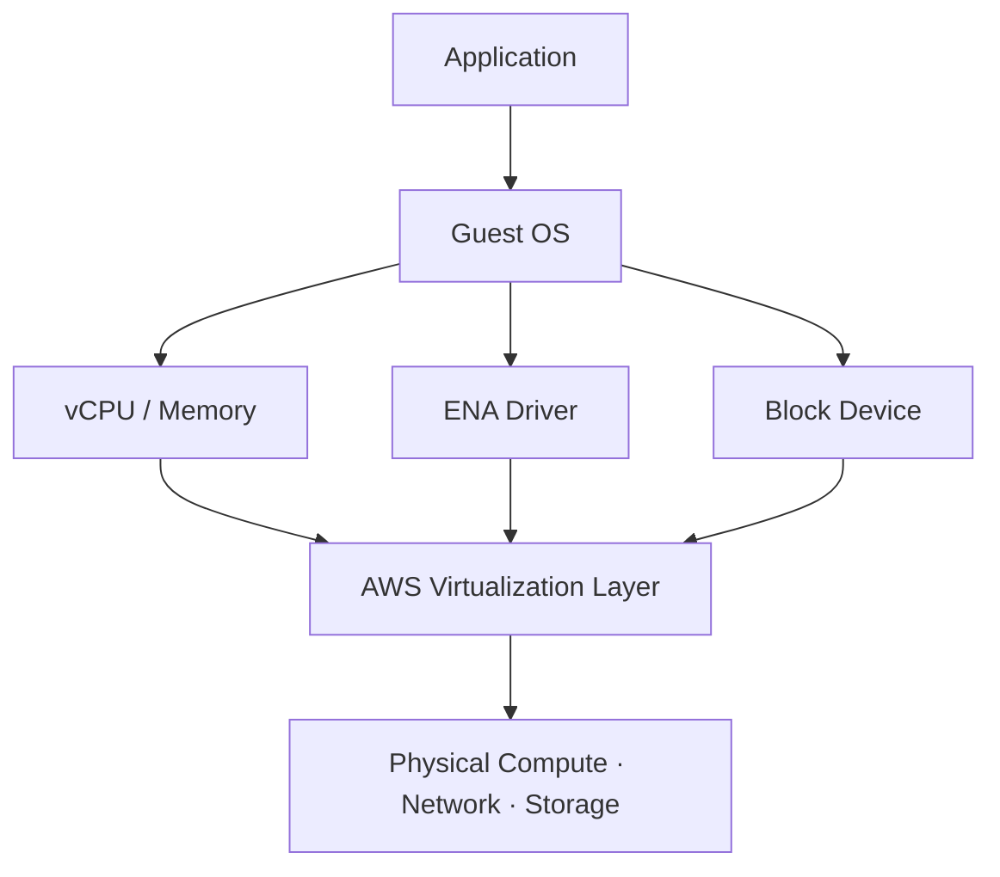
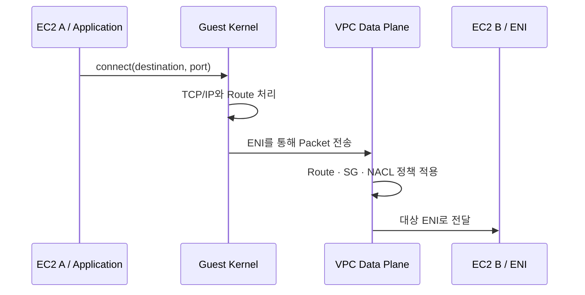

# EC2와 VPC

EC2는 AWS 데이터센터의 Compute 자원을 Instance라는 실행 환경으로 제공하고, VPC는 그 Instance와 다른 리소스를 연결하는 논리 네트워크를 제공합니다.

> 관련 노트: [Virtualization Foundations](virtualization-foundations.md) · [Access Network와 Physical Media](../computer-networks/access-networks-and-physical-media.md) · [S3 Object Storage](aws-s3-object-storage.md)

## EC2 Instance의 구성



Instance를 구성하는 주요 선택은 다음과 같습니다.

| 구성 | 역할 |
| --- | --- |
| AMI | OS와 초기 디스크 내용을 담은 Image |
| Instance Type | vCPU, Memory, Network와 I/O 성능 범위 |
| EBS | Instance와 독립적으로 관리 가능한 Network Block Storage |
| Instance Store | 물리 Host에 연결된 임시 Block Storage |
| ENI | Private IP, MAC, Security Group 등이 연결되는 가상 Network Interface |
| IAM Role | 애플리케이션이 AWS API를 호출할 때 사용할 Workload Identity |

Instance Store의 데이터는 Instance 수명주기와 Host 장애에 영향을 받으므로 영구 데이터는 EBS, S3, RDS 등 목적에 맞는 저장소에 둡니다.

## VPC의 논리 구조

```text
VPC 10.0.0.0/16
├─ Public Subnet  10.0.1.0/24
│  └─ Load Balancer 또는 Public Entry Point
├─ Private App Subnet 10.0.10.0/24
│  └─ EC2 Application
└─ Private DB Subnet  10.0.20.0/24
   └─ RDS
```

- **VPC**: Region 범위의 논리 네트워크
- **Subnet**: 하나의 Availability Zone에 속하는 IP 주소 범위
- **Route Table**: 목적지 주소에 사용할 다음 Target을 결정
- **Internet Gateway**: VPC와 인터넷 사이의 연결 지점
- **NAT Gateway**: Private Subnet의 Outbound 연결에 사용
- **VPC Endpoint**: 인터넷 경로 없이 지원되는 AWS 서비스에 접근

Subnet이 Public인지 Private인지는 이름이 아니라 Route와 리소스의 주소·연결 방식으로 결정됩니다.

## Packet 처리 흐름

EC2 A가 EC2 B의 Private IP로 연결한다고 가정합니다.



사용자는 물리 Switch나 Router를 직접 설정하지 않습니다. AWS가 운영하는 물리망 위에 VPC의 Route와 보안 정책이 논리적으로 구현됩니다.

## Security Group과 Network ACL

| 구분 | Security Group | Network ACL |
| --- | --- | --- |
| 적용 단위 | ENI에 연결 | Subnet에 연결 |
| 상태 추적 | Stateful | Stateless |
| 규칙 | Allow 규칙 | Allow와 Deny 규칙 |
| 응답 Traffic | 허용된 Flow의 응답을 상태로 처리 | 양방향 규칙을 각각 고려 |

Security Group에서는 Source를 고정 IP 대신 다른 Security Group으로 지정해 역할 중심의 연결을 만들 수 있습니다.

```text
sg-app: 443을 Load Balancer SG에서만 허용
sg-db : 5432를 sg-app에서만 허용
```

## Public IP의 의미

Instance의 Guest OS가 보는 주소는 보통 ENI의 Private IP입니다. Public IPv4가 연결되면 AWS 네트워크 경계에서 Public ↔ Private 주소 매핑을 제공합니다. Public IP가 있다고 해서 모든 Port가 자동으로 열리는 것은 아니며 Route, Security Group, NACL과 Guest 방화벽을 함께 통과해야 합니다.

## Availability Zone과 장애 경계

Region은 여러 Availability Zone으로 구성됩니다. Subnet은 한 AZ에 속하고 Instance도 특정 AZ에서 실행됩니다. 고가용성이 필요하면 단일 Instance의 크기만 늘리는 대신 여러 AZ에 자원을 분산하고, Load Balancer·Auto Scaling·관리형 Database의 장애 조치 기능을 함께 설계합니다.

## 보안 관점의 계층

```text
Cloud Control Plane  IAM · API · Resource Policy
Virtual Network      VPC · Route · SG · NACL
Guest OS             Patch · Account · Service · Host Firewall
Application          Authentication · Input Validation · Secrets
Data                 Encryption · Backup · Retention
```

AWS가 물리 장비와 가상화 계층을 운영해도 Guest OS, 애플리케이션, IAM과 데이터 설정에 대한 사용자의 책임은 남습니다.

## 참고 자료

- [Amazon EC2 User Guide](https://docs.aws.amazon.com/AWSEC2/latest/UserGuide/concepts.html)
- [Amazon VPC User Guide](https://docs.aws.amazon.com/vpc/latest/userguide/what-is-amazon-vpc.html)
- [AWS Shared Responsibility Model](https://aws.amazon.com/compliance/shared-responsibility-model/)
