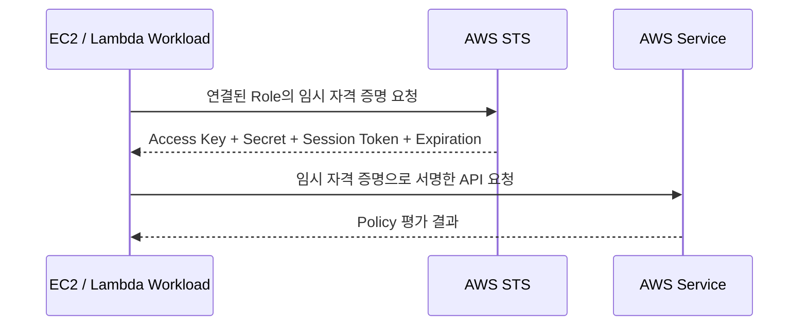

# IAM과 Temporary Credentials

AWS IAM은 누가 어떤 AWS 리소스에 어떤 조건으로 작업할 수 있는지를 결정합니다. 클라우드 보안에서는 Network 경계만큼 Identity와 Policy 경계가 중요합니다.

> 관련 노트: [Cloud Security Misconfigurations](cloud-security-misconfigurations.md) · [EC2와 VPC](aws-ec2-and-vpc.md)

## IAM의 기본 요소

| 요소 | 의미 |
| --- | --- |
| Principal | 요청을 보내는 User, Role, Service 또는 Federated Identity |
| Action | `s3:GetObject`처럼 수행하려는 작업 |
| Resource | 작업 대상 ARN |
| Condition | Source, Tag, MFA, 시간 등 추가 제약 |
| Policy | Effect, Action, Resource와 Condition을 표현한 문서 |

정책은 `Allow`가 있다고 끝나는 것이 아닙니다. 적용되는 여러 정책의 교집합·합집합과 명시적 `Deny`, 권한 경계, 조직 정책 등을 함께 평가합니다.

## User, Group과 Role

```text
IAM User
  사람이 직접 사용하는 장기 Identity가 필요할 때

IAM Group
  여러 User에 공통 Policy를 연결

IAM Role
  신뢰받는 Principal이 일정 시간 맡아서 사용하는 Identity
```

Workload에는 User의 장기 Access Key를 복사하기보다 Role을 연결합니다.



SDK와 CLI의 Credential Provider Chain은 실행 환경에서 제공되는 Role 자격 증명을 자동으로 사용할 수 있습니다. 애플리케이션 코드에 Key를 고정할 필요가 없습니다.

## AssumeRole의 두 조건

Role을 맡으려면 양쪽이 모두 허용해야 합니다.

```text
호출자 Policy
  "이 Role에 sts:AssumeRole을 호출할 수 있다"

Role Trust Policy
  "이 Principal이 나를 맡는 것을 신뢰한다"
```

Role을 맡은 뒤 할 수 있는 작업은 Role에 연결된 Permission Policy가 결정합니다. Trust Policy와 Permission Policy는 목적이 다릅니다.

## Identity Policy와 Resource Policy

```text
Identity Policy
  Principal 쪽에서 "무엇을 할 수 있는가" 정의

Resource Policy
  S3 Bucket, SQS Queue, KMS Key 등이 "누구를 허용하는가" 정의
```

Cross-account 접근에서는 Principal, Resource Policy, Trust와 조직 경계를 함께 봐야 합니다. 특히 KMS Key Policy는 암호화된 Data에 대한 실질적인 접근 가능성을 바꿀 수 있습니다.

## EC2 Instance Profile과 IMDS

EC2 Role은 Instance Profile을 통해 Instance에 연결되고, Workload는 Instance Metadata Service에서 짧은 수명의 자격 증명을 얻을 수 있습니다.

```text
EC2 Application
   ↓ SDK Credential Provider
IMDSv2
   ↓
Instance Role Temporary Credentials
   ↓
AWS API
```

보안 원칙:

- IMDSv2를 요구하고 Hop Limit을 환경에 맞게 제한합니다.
- Instance Role에는 애플리케이션에 필요한 최소 권한만 줍니다.
- SSRF를 막기 위해 URL 입력과 Outbound 요청을 검증합니다.
- Container 환경에서는 같은 Host의 다른 Workload가 자격 증명 경로에 접근하지 못하도록 격리합니다.

## Lambda Execution Role

Lambda Service가 함수를 실행할 수 있도록 Trust를 설정하고, 함수 코드가 사용할 AWS API 권한을 Execution Role에 연결합니다.

```text
Lambda Service --AssumeRole--> Execution Role
Function Code --temporary credentials--> S3 / SQS / RDS API
```

함수를 만들 수 있는 권한과 강한 Role을 함수에 넘길 수 있는 `iam:PassRole` 권한이 함께 있으면 권한 상승 경로가 될 수 있습니다. `PassRole`의 대상 Role과 전달 가능한 Service를 제한해야 합니다.

## Cognito에서 구분할 Identity

- **User Pool**은 애플리케이션 사용자를 가입·인증하고 Token을 발급합니다.
- **Identity Pool**은 인증된 사용자나 허용된 Guest를 AWS 임시 자격 증명과 연결할 수 있습니다.

애플리케이션의 `admin` 같은 Claim을 Client가 임의로 바꿀 수 없게 하고, Token 검증과 AWS Role Mapping을 Server-side 정책으로 강제해야 합니다.

## Credential 수명주기

| 방식 | 권장 사용 |
| --- | --- |
| 장기 Access Key | 불가피한 경우에만 발급하고 사용처·회전·폐기 관리 |
| STS Temporary Credentials | 사람의 Federation과 Workload Role에 우선 사용 |
| Secrets Manager | DB Password나 외부 API Secret의 저장·회전 |
| Parameter Store | 설정과 요구사항에 맞는 Secure Parameter 관리 |

Access Key, Session Token, Pre-signed URL은 모두 권한을 전달할 수 있는 값입니다. Source Code, Screenshot, Shell History, CI Log와 공개 문서에 남기지 않습니다.

## 최소 권한 검토 순서

1. 누가 이 Principal을 사용할 수 있는가?
2. 직접 연결된 Policy뿐 아니라 Group, Role과 Resource Policy는 무엇인가?
3. 다른 Role을 맡거나 새 자격 증명을 만들 수 있는가?
4. Policy, Tag, Version, Permission Boundary를 바꿀 수 있는가?
5. Data 접근 권한과 암호화 Key 권한이 함께 있는가?
6. CloudTrail과 관련 서비스 Log로 행위를 추적할 수 있는가?

## 참고 자료

- [AWS IAM User Guide](https://docs.aws.amazon.com/IAM/latest/UserGuide/introduction.html)
- [AWS STS Temporary Security Credentials](https://docs.aws.amazon.com/IAM/latest/UserGuide/id_credentials_temp.html)
- [EC2 Instance Metadata Service](https://docs.aws.amazon.com/AWSEC2/latest/UserGuide/configuring-instance-metadata-service.html)
