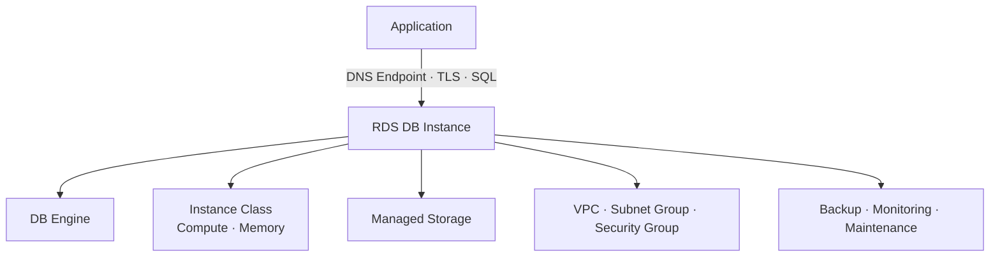
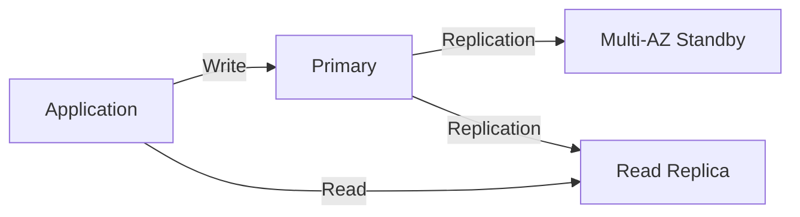

# RDS Managed Database

Amazon RDS는 관계형 Database Engine을 실행하는 데 필요한 Provisioning, Backup, Patch, Monitoring과 장애 조치의 상당 부분을 AWS가 관리하는 서비스입니다.

> 관련 노트: [EC2와 VPC](aws-ec2-and-vpc.md) · [SQS Message Queue](aws-sqs-message-queues.md) · [IAM과 Temporary Credentials](aws-identity-and-temporary-credentials.md)

## EC2에 직접 설치하는 경우와 비교

| 영역 | EC2 + Database | RDS |
| --- | --- | --- |
| OS 설치·Patch | 사용자 | AWS 관리 |
| DB Engine 설치 | 사용자 | AWS 관리 |
| Backup·장애 조치 구성 | 사용자가 직접 설계 | 관리 기능 제공 |
| Root OS 접근 | 가능 | 제공하지 않음 |
| Schema·Index·Query | 사용자 | 사용자 |
| DB User와 Data | 사용자 | 사용자 |

RDS는 Database 논리 설계와 애플리케이션의 올바른 Query까지 대신해주지는 않습니다. 관리 부담을 줄이는 대신 OS 수준의 자유도도 줄어듭니다.

## DB Instance의 구성



| 구성 | 의미 |
| --- | --- |
| DB Engine | PostgreSQL, MySQL 등 실제 SQL Engine |
| DB Instance Class | Compute와 Memory 크기 |
| Storage | Data, Index와 Transaction Log 저장 |
| Endpoint | 애플리케이션이 연결할 DNS 이름과 Port |
| DB Subnet Group | 배치 가능한 여러 AZ의 Subnet 집합 |
| Parameter Group | Engine 설정 값 |
| Security Group | DB Port에 도달할 수 있는 Source 제한 |

애플리케이션은 변경될 수 있는 IP 대신 Endpoint를 사용합니다.

## 일반적인 Network 구성

```text
Internet
   ↓
Load Balancer
   ↓
Private Application Subnet
   └─ EC2 / ECS / Lambda ENI
          ↓ DB Port
Private DB Subnet
   └─ RDS
```

RDS를 Public으로 만들기보다 Application 계층만 DB Security Group에 접근하도록 제한하는 구성이 일반적입니다.

```text
sg-db inbound:
  PostgreSQL 5432 from sg-app
```

## Multi-AZ와 Read Replica

두 기능은 목적이 다릅니다.

| 기능 | 주목적 | 일반적인 복제·사용 방식 |
| --- | --- | --- |
| Multi-AZ | 고가용성과 자동 장애 조치 | Standby를 유지하고 Endpoint를 Failover |
| Read Replica | 읽기 확장과 일부 재해 복구 패턴 | 별도 Endpoint로 읽기 Traffic 처리 |



RDS의 배포 유형과 Engine마다 복제 방식과 읽기 가능 여부가 다릅니다. 특히 일반적인 Single-Standby Multi-AZ DB Instance의 Standby와 읽기 가능한 Multi-AZ DB Cluster의 Reader를 같은 것으로 보면 안 됩니다.

## Backup, Snapshot과 복구

- **Automated Backup**은 보존 기간 안에서 Point-in-Time Recovery에 필요한 Snapshot과 Log를 관리합니다.
- **Manual Snapshot**은 사용자가 삭제할 때까지 특정 시점의 상태를 보관할 수 있습니다.
- 복구는 기존 Instance를 과거 상태로 덮어쓰기보다 새 DB Instance를 만드는 방식으로 이해해야 합니다.

Backup이 설정되어 있다는 사실만으로 복구가 보장되지는 않습니다. 복구 시간 목표와 데이터 손실 허용 범위에 맞춰 실제 Restore 절차를 검증해야 합니다.

## IAM 권한과 DB 권한

```text
AWS IAM
  rds:CreateDBInstance · rds:ModifyDBInstance · Snapshot 관리
  → RDS 리소스의 Control Plane 권한

Database Account
  SELECT · INSERT · UPDATE · Schema 권한
  → DB Data Plane 권한
```

두 권한은 기본적으로 별개입니다. IAM Database Authentication을 지원하는 구성에서는 짧은 수명의 Token으로 DB 인증을 연결할 수 있지만, Network 접근과 DB User 권한은 여전히 필요합니다.

## 애플리케이션 연결 관리

Serverless나 Auto Scaling 환경은 짧은 시간에 많은 DB Connection을 만들 수 있습니다. Connection Pool을 사용하고, 요구사항에 따라 RDS Proxy 같은 관리형 Proxy를 고려합니다.

```text
Many Application Workers
          ↓
Connection Pool / RDS Proxy
          ↓
RDS Connections
```

## 보안 체크리스트

- Public 접근을 끄고 Private Subnet과 제한된 Security Group을 사용합니다.
- DB Password를 Source Code나 환경 변수에 평문으로 고정하지 않습니다.
- Secrets Manager와 Rotation 또는 IAM DB Authentication을 검토합니다.
- 저장 데이터 암호화와 TLS 연결을 사용합니다.
- 자동 Backup, Snapshot 접근 권한과 삭제 방지 정책을 확인합니다.
- IAM의 RDS 관리 권한과 DB 내부 권한을 최소화합니다.
- Audit·Engine Log를 중앙 Log 저장소로 보내고 보존 정책을 설정합니다.

## 참고 자료

- [Amazon RDS User Guide](https://docs.aws.amazon.com/AmazonRDS/latest/UserGuide/Welcome.html)
- [RDS in a VPC](https://docs.aws.amazon.com/AmazonRDS/latest/UserGuide/USER_VPC.WorkingWithRDSInstanceinaVPC.html)
- [RDS High Availability](https://docs.aws.amazon.com/AmazonRDS/latest/UserGuide/Concepts.MultiAZ.html)
