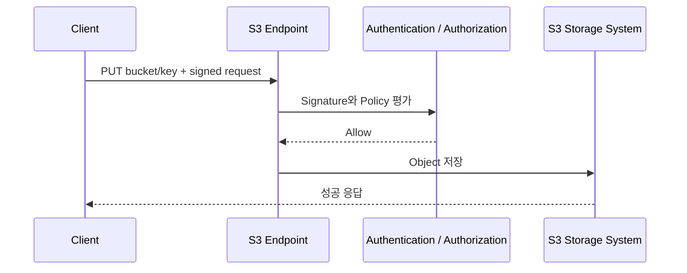

# S3 Object Storage

Amazon S3는 파일 시스템이나 가상 디스크가 아니라 HTTP API로 Object를 저장하고 조회하는 관리형 Object Storage입니다.

> 관련 노트: [EC2와 VPC](aws-ec2-and-vpc.md) · [Control Plane과 Data Plane](control-data-management-planes.md)

## Bucket, Object와 Key

```text
Bucket: study-example
├─ Key: notes/os/process.md
├─ Key: notes/network/tcp.md
└─ Key: images/diagram.png
```

- **Bucket**은 Object를 담고 정책, Region, Versioning과 Lifecycle 같은 설정을 적용하는 경계입니다.
- **Object**는 Data와 Metadata로 구성됩니다.
- **Key**는 Bucket 안에서 Object를 식별하는 문자열입니다.
- `/`가 포함된 Key를 Console이 폴더처럼 보여주지만 S3의 기본 Data Model은 평평한 Key Space입니다.

Bucket은 디스크나 Partition이 아니며, 사용자는 내부 물리 장치나 파일 시스템을 직접 관리하지 않습니다.

## Block Storage와 Object Storage

| 구분 | EBS | S3 |
| --- | --- | --- |
| 모델 | Block Device | Object API |
| 접근 | OS가 Volume을 Mount하고 File System 구성 | HTTP API로 Bucket·Key 지정 |
| 수정 단위 | Block 단위 읽기·쓰기 | Object 전체를 새 버전으로 저장 |
| 대표 용도 | OS Disk, Database Volume | Backup, Log, Static Asset, Data Lake |
| 연결 대상 | 특정 AZ의 Compute에 연결 | Regional Service Endpoint로 접근 |

Database가 낮은 지연시간으로 임의 Block을 반복 수정하는 작업과, 대규모 Object를 Key로 저장하는 작업은 요구사항이 다릅니다.

## 요청 처리의 논리적 흐름

내부 저장 방식은 AWS의 구현 세부사항이므로 공개된 API와 보장만을 기준으로 이해하는 편이 안전합니다.



1. Client가 Bucket, Key와 작업을 지정합니다.
2. SigV4 서명 또는 허용된 익명 요청을 확인합니다.
3. IAM Policy, Bucket Policy, Access Point Policy와 차단 설정을 평가합니다.
4. S3가 Object를 저장·복제하고 API 결과를 반환합니다.

S3는 성공한 `PUT`과 `DELETE` 이후의 읽기와 목록 작업에 Strong Consistency를 제공합니다. 내구성, 가용성, 복제 범위는 선택한 Storage Class와 기능에 따라 구분해서 봐야 합니다.

## Control Plane과 Data Plane

```text
Control Plane
  Bucket 생성 · Policy · Versioning · Lifecycle · Replication 설정

Data Plane
  PutObject · GetObject · HeadObject · DeleteObject
```

Bucket 설정 권한과 Object Data 접근 권한을 분리하면 운영 자동화가 모든 Data를 읽을 필요 없이 설정만 관리하도록 만들 수 있습니다.

## 접근 제어

S3 접근 여부는 하나의 Policy만으로 결정되지 않습니다.

```text
Principal의 Identity Policy
        +
Bucket / Access Point Resource Policy
        +
Public Access Block과 명시적 Deny
        +
KMS Key Policy(SSE-KMS 사용 시)
        =
최종 Authorization 결과
```

보안 기본 원칙은 다음과 같습니다.

- Public Access Block을 기본값으로 유지합니다.
- Bucket이나 Object를 공개해야 한다면 목적과 범위를 명시적으로 제한합니다.
- 애플리케이션에는 필요한 Prefix와 작업만 허용합니다.
- 장기 Access Key 대신 EC2·Lambda Role의 임시 자격 증명을 사용합니다.
- SSE-S3 또는 SSE-KMS와 전송 구간 TLS를 사용합니다.
- Versioning과 필요한 경우 Object Lock을 사용해 삭제·변조 복구 가능성을 높입니다.
- Data Event Logging은 비용과 조사 요구사항을 고려해 중요한 Bucket에 적용합니다.

## VPC와 S3

S3는 사용자의 Subnet 안에 배치되는 서비스가 아닙니다. VPC의 Workload는 Public Service Endpoint 또는 S3용 Gateway Endpoint 같은 Private 경로로 API를 호출할 수 있습니다.

```text
Private EC2 → S3 Gateway Endpoint → S3
```

Endpoint Policy는 경로에서 허용할 Bucket과 작업을 추가로 제한할 수 있지만 IAM과 Bucket Policy를 대체하지는 않습니다.

## 대표 사용 패턴

```text
Web Application → Upload URL 발급 → Client가 S3에 직접 Upload
Application Log → S3 → 분석·보관
Static Asset → S3 → CDN
Database Backup → S3 Lifecycle → 저비용 Storage Class
```

Pre-signed URL은 자격 증명을 전달하지 않고 제한된 시간 동안 특정 Object 작업을 허용할 때 사용합니다. URL 자체가 권한을 나타내므로 Log, 채팅과 공개 저장소에 남기지 않아야 합니다.

## 참고 자료

- [Amazon S3 User Guide](https://docs.aws.amazon.com/AmazonS3/latest/userguide/Welcome.html)
- [S3 Security Best Practices](https://docs.aws.amazon.com/AmazonS3/latest/userguide/security-best-practices.html)
- [VPC Gateway Endpoints](https://docs.aws.amazon.com/vpc/latest/privatelink/gateway-endpoints.html)
