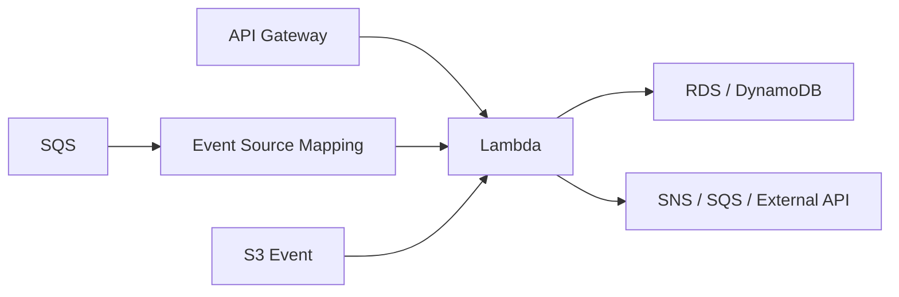
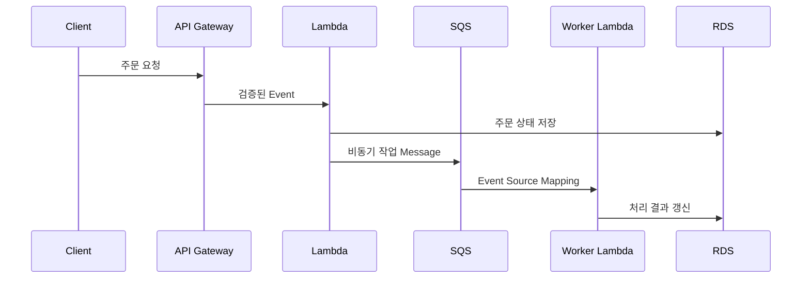

# Serverless와 Managed Platform

AWS의 관리형 서비스는 Server 관리 범위를 줄여주지만, Event 연결, IAM, Network와 Data 검증에 대한 책임까지 없애지는 않습니다.

> 관련 노트: [SQS Message Queue](aws-sqs-message-queues.md) · [RDS Managed Database](aws-rds-managed-databases.md) · [IAM과 Temporary Credentials](aws-identity-and-temporary-credentials.md)

## Lambda

Lambda는 Event에 따라 Function Code를 실행하는 관리형 Compute 서비스입니다.

```text
Lambda Function
├─ Runtime
├─ Handler
├─ Code Package / Container Image
├─ Memory · Timeout · Concurrency
├─ Execution Role
├─ Environment Configuration
└─ Event Source / Trigger
```



Lambda가 VPC 자원에 접근해야 할 때 VPC 연결을 구성할 수 있습니다. 모든 Lambda가 기본적으로 사용자의 VPC 안에서 실행되는 것은 아닙니다. VPC 연결을 추가하면 Subnet, Security Group, Endpoint·NAT와 Connection 설계를 함께 고려해야 합니다.

### Lambda 보안 원칙

- Function마다 목적에 맞는 Execution Role을 사용합니다.
- 환경 변수에 장기 Access Key나 평문 Password를 저장하지 않습니다.
- 외부 입력, Event Body와 Database Query를 검증하고 Parameterized Query를 사용합니다.
- Dependency와 배포 Package를 검사하고 Version·Alias로 변경을 통제합니다.
- Timeout, Reserved Concurrency와 Downstream 한도를 맞춥니다.
- Application Log에 Token, Header와 개인정보를 출력하지 않습니다.

## Elastic Beanstalk

Elastic Beanstalk는 Application Version을 배포하면 EC2, Load Balancer, Auto Scaling과 Monitoring 구성을 오케스트레이션하는 관리형 Platform입니다.

```text
Application
  └─ Application Version
       └─ Environment
            ├─ EC2 Instances
            ├─ Load Balancer
            ├─ Auto Scaling
            └─ Environment Configuration
```

관리형 Platform이라고 해서 하위 자원이 사라지는 것은 아닙니다. Service Role, EC2 Instance Profile, Security Group, Environment Variable과 배포 Artifact를 각각 보호해야 합니다.

Environment Variable은 설정 전달에는 편리하지만 Secret Vault와 같지 않습니다. 민감한 값은 Secrets Manager 등에서 Runtime에 가져오고, 읽을 수 있는 Role을 최소화합니다.

## SNS와 SQS

둘 다 Message를 다루지만 전달 모델이 다릅니다.

| 구분 | SNS | SQS |
| --- | --- | --- |
| 모델 | Publish / Subscribe | Queue |
| 목적 | 한 Message를 여러 Subscriber에 Fan-out | Consumer가 작업을 가져가 처리 |
| 보관 | 구독 Endpoint로 전달 중심 | 소비될 때까지 Queue에 보관 |
| 대표 연결 | Email, HTTP, Lambda, SQS | Lambda, EC2·Container Worker |

```text
Producer → SNS Topic ─┬→ SQS Queue A → Worker A
                      ├→ SQS Queue B → Worker B
                      └→ Lambda
```

Secret이나 Access Key를 Notification Message로 보내면 구독자, 재시도 경로와 Log에 복제될 수 있습니다. Message에는 식별자만 넣고 권한 있는 Consumer가 보안 저장소에서 필요한 값을 읽도록 설계합니다.

## API Gateway

API Gateway는 HTTP 요청을 인증·제한·변환해 Lambda나 다른 Backend로 전달하는 관리형 API Front Door입니다.

```text
Client
  ↓ TLS · Authentication · Throttling
API Gateway
  ↓ Integration
Lambda / HTTP Backend / AWS Service
```

API Key는 일반적으로 사용량 추적과 Quota 적용에 쓰이며 사용자 인증을 대신하지 않습니다. IAM, JWT Authorizer, Cognito User Pool 등 요구사항에 맞는 인증·인가를 별도로 구성해야 합니다.

## 서비스 조합 예시



동기 요청 경로는 짧게 유지하고 오래 걸리는 작업은 Queue로 넘길 수 있습니다. 이때 Message 중복, DB Transaction, 실패 재처리와 사용자에게 보여줄 상태 모델을 함께 설계해야 합니다.

## 참고 자료

- [AWS Lambda Developer Guide](https://docs.aws.amazon.com/lambda/latest/dg/welcome.html)
- [AWS Elastic Beanstalk Concepts](https://docs.aws.amazon.com/elasticbeanstalk/latest/dg/concepts.html)
- [Amazon SNS Developer Guide](https://docs.aws.amazon.com/sns/latest/dg/welcome.html)
- [Amazon API Gateway Developer Guide](https://docs.aws.amazon.com/apigateway/latest/developerguide/welcome.html)
