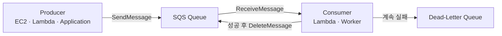
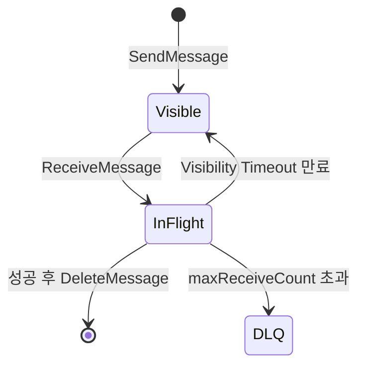

# SQS Message Queue

Amazon SQS는 Producer와 Consumer 사이에 Message를 보관해 두 구성요소의 실행 시점과 처리 속도를 분리하는 관리형 Queue 서비스입니다.

> 관련 노트: [RDS Managed Database](aws-rds-managed-databases.md) · [Serverless와 Managed Platform](aws-serverless-and-managed-services.md)

## 왜 Queue를 사용하는가

직접 호출 구조에서는 Consumer의 장애와 지연이 Producer까지 전파됩니다.

```text
Without Queue
Web → Worker → 처리 완료를 기다림

With Queue
Web → SQS에 작업 기록
             ↓
         Worker가 가능한 속도로 처리
```

Queue는 Traffic Spike를 흡수하지만 무한한 해결책은 아닙니다. 오래 쌓이는 Message 수, 가장 오래된 Message의 나이, Consumer 오류율을 함께 Monitoring해야 합니다.

## Producer, Queue와 Consumer



- **Producer**는 작업을 Message로 만듭니다.
- **Queue**는 처리 전 Message를 보관합니다.
- **Consumer**는 Message를 받고 실제 작업을 수행합니다.

## Message Lifecycle과 Visibility Timeout

`ReceiveMessage`는 Message를 즉시 삭제하지 않습니다. 정해진 Visibility Timeout 동안 다른 Consumer에게 보이지 않게 만들 뿐입니다.



Consumer가 처리 중 죽으면 Timeout 이후 다른 Consumer가 다시 처리할 수 있습니다. 처리 시간이 Timeout보다 길다면 중복 처리가 늘 수 있고, 너무 길면 실패 복구가 늦어집니다.

Message를 삭제할 때는 Message ID가 아니라 해당 수신 결과의 `ReceiptHandle`을 사용합니다.

## At-least-once와 Idempotency

Standard Queue에서는 같은 Message가 두 번 이상 전달될 수 있다고 가정해야 합니다. Consumer는 동일한 작업을 반복해도 최종 결과가 달라지지 않도록 설계합니다.

```text
Message: order_id=4123, operation=charge

Consumer:
1. idempotency key가 이미 처리됐는지 확인
2. 처리되지 않았다면 Transaction 수행
3. 처리 결과와 key를 원자적으로 기록
```

단순히 처리 전에 `완료` 표시를 남기면 실제 작업 실패 시 유실될 수 있고, 처리 후 따로 표시하면 그 사이의 장애로 중복될 수 있습니다. Database의 Unique Constraint와 Transaction, 서비스의 Idempotency 기능을 함께 사용합니다.

## Standard와 FIFO Queue

| 구분 | Standard | FIFO |
| --- | --- | --- |
| 전달 | At-least-once | 중복 제거 기능 제공 |
| 순서 | Best-effort | 같은 Message Group 안에서 순서 보장 |
| 확장 | 매우 높은 처리량에 적합 | Group 단위 순서와 병렬성을 조정 |

FIFO에서도 전체 Queue를 하나의 Group으로 만들면 직렬 처리 병목이 생깁니다. 독립적으로 순서를 지킬 수 있는 단위를 `MessageGroupId`로 나눕니다.

## Dead-Letter Queue

계속 실패하는 Message를 Main Queue에 무한히 돌리면 정상 작업을 방해합니다. Redrive Policy의 `maxReceiveCount`를 넘은 Message를 DLQ로 격리해 원인을 조사합니다.

DLQ는 단순 폐기함이 아닙니다.

- Alarm으로 유입을 감지합니다.
- 실패한 Payload에 개인정보나 Secret이 없는지 보호합니다.
- 원인을 수정한 뒤 검증된 절차로 Redrive합니다.
- Main Queue와 DLQ의 보존 기간을 의도에 맞게 설정합니다.

## Lambda와 SQS

Lambda Event Source Mapping이 SQS를 Polling하고 Message Batch로 함수를 호출합니다.

```text
SQS Queue
   ↓ Event Source Mapping이 Polling
Lambda Invocation
   ↓
성공: Message 삭제
실패: 재처리 또는 부분 Batch 실패 처리
```

Function은 중복 실행에 안전해야 하며, Batch 크기, Visibility Timeout, 동시성과 DLQ를 함께 설계해야 합니다.

## IAM, Queue Policy와 암호화

```text
Producer Role: sqs:SendMessage
Consumer Role: sqs:ReceiveMessage, sqs:DeleteMessage
Operator Role: Queue 설정 관리
```

SQS는 Identity Policy와 Queue Resource Policy를 사용합니다. SSE-KMS를 선택하면 SQS 권한과 함께 KMS Key Policy·권한도 고려해야 합니다.

Message Body에 Password, Access Key 또는 불필요한 개인정보를 넣지 않습니다. Queue 암호화는 권한 있는 Consumer의 조회까지 막아주지 않으므로 Payload 자체의 최소화가 먼저입니다.

## VPC에서 접근

SQS는 사용자 Subnet 안의 Server가 아닙니다. VPC Workload는 Regional Endpoint를 호출하며, Interface VPC Endpoint를 사용하면 NAT나 Internet Gateway를 거치지 않는 Private 경로를 만들 수 있습니다.

## 참고 자료

- [Amazon SQS Developer Guide](https://docs.aws.amazon.com/AWSSimpleQueueService/latest/SQSDeveloperGuide/welcome.html)
- [SQS Visibility Timeout](https://docs.aws.amazon.com/AWSSimpleQueueService/latest/SQSDeveloperGuide/sqs-visibility-timeout.html)
- [Using Lambda with SQS](https://docs.aws.amazon.com/lambda/latest/dg/with-sqs.html)
