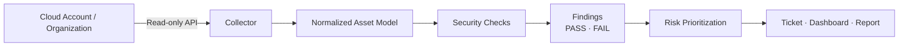

# Cloud Security Assessment

Cloud Security Posture Management(CSPM)은 클라우드 관리 API에서 자산과 설정을 수집하고, 보안 기준에 따라 자동으로 점검해 수정 우선순위를 만드는 활동입니다.

> 관련 노트: [Cloud Security Misconfigurations](cloud-security-misconfigurations.md) · [Control Plane과 Data Plane](control-data-management-planes.md)

## 자동 점검의 흐름



대표 점검 대상은 다음과 같습니다.

- Public Storage와 Database
- 과도한 IAM 권한과 오래된 Access Key
- MFA, Federation과 Root Account 보호
- Encryption과 Key 관리
- Audit Log와 Monitoring 누락
- Backup, Versioning과 고가용성 설정
- Security Group과 Network 경계

Prowler 같은 Open Source 도구는 여러 Cloud Provider의 설정을 수집하고 Check, Metadata와 Compliance Mapping으로 결과를 구성합니다.

## Configuration Assessment와 Penetration Test

| 구분 | Configuration Assessment | Penetration Test |
| --- | --- | --- |
| 입력 | 관리 API의 설정·자산 Metadata | 실행 중인 System과 Application |
| 방법 | 정책·기준과 현재 상태 비교 | 취약점을 실제 경로로 검증 |
| 대표 결과 | Public 설정, 암호화 누락, 과도한 권한 | Exploit 가능성, 영향과 재현 경로 |
| 주의점 | Runtime 취약점과 Business Logic을 놓칠 수 있음 | 허용 범위와 안전 통제가 필요 |

둘은 대체 관계가 아닙니다. 설정 점검은 넓은 범위를 반복해서 확인하고, 침투 테스트와 Code Review는 더 깊은 경로를 검증합니다.

## Check의 최소 구조

```text
Service Client
  Cloud API에서 필요한 Data 수집
        ↓
Check Logic
  안전 조건과 현재 상태 비교
        ↓
Metadata
  제목 · 위험 · 근거 · 수정 방법 · 기준 매핑
        ↓
Test
  정상 · 취약 · 권한 부족 · API 오류 검증
```

수집과 판정을 분리하면 같은 API 결과를 여러 Check가 재사용할 수 있고, 판정 Logic을 작은 단위로 Test하기 쉽습니다.

## 좋은 Finding의 조건

`Bucket이 위험하다`는 설명만으로는 수정하기 어렵습니다. Finding에는 최소한 다음 내용이 필요합니다.

1. 어떤 Account·Region·Resource에서 발견됐는가?
2. 실제 현재 설정과 기대하는 안전 조건은 무엇인가?
3. Confidentiality, Integrity, Availability 중 무엇에 영향을 주는가?
4. 다른 권한·노출과 연결될 때 공격 경로가 되는가?
5. 수정하면 Service에 어떤 영향이 생기는가?
6. 다시 발생하지 않게 어떤 예방 통제를 둘 것인가?

## 우선순위

Severity만으로 순서를 정하면 실제 중요한 문제를 놓칠 수 있습니다.

```text
Priority
= Technical Severity
+ Internet Exposure
+ Data Sensitivity
+ Exploit Path
+ Identity Privilege
+ Business Criticality
- Existing Compensating Controls
```

예를 들어 같은 Public Security Group이라도 사용하지 않는 Test Instance와 Production Database의 위험은 다릅니다.

## Compliance Mapping의 한계

CIS, ISO 27001, PCI DSS 같은 기준에 Check를 연결하면 보고와 Gap 분석에 도움이 됩니다. 그러나 자동 Check가 통과했다고 전체 통제가 충족되는 것은 아닙니다.

- 기술 설정 외에 절차, 교육, 계약과 증적이 필요할 수 있습니다.
- 일시적인 Snapshot만으로 지속적인 운영 상태를 보장할 수 없습니다.
- Service마다 Shared Responsibility 범위가 다릅니다.
- 예외에는 만료일, Owner, 보완 통제와 재검토가 필요합니다.

## 운영에 연결하기

```text
Detect → Triage → Assign → Remediate → Verify → Prevent
```

- 동일한 Root Cause의 Finding을 묶습니다.
- Resource Owner와 수정 기한을 지정합니다.
- 자동 수정은 영향과 Rollback을 검증한 항목부터 적용합니다.
- IaC Policy와 CI 검사로 같은 설정의 재생성을 막습니다.
- Finding 수보다 평균 수정 시간과 재발률을 함께 봅니다.

## 안전한 Scanner 권한

Scanner 자체도 공격 표면입니다.

- 가능한 한 Read-only Role과 짧은 Session을 사용합니다.
- Organization 전체 Role의 Trust와 External ID를 제한합니다.
- Finding에 Secret 원문을 저장하지 않습니다.
- Scan Log, Report와 Export 파일의 접근·보존 기간을 통제합니다.
- Scanner가 사용하는 Container, Dependency와 CI 자격 증명을 보호합니다.

## 참고 자료

- [Prowler Documentation](https://docs.prowler.com/)
- [CIS Benchmarks](https://www.cisecurity.org/cis-benchmarks)
- [AWS Well-Architected Security Pillar](https://docs.aws.amazon.com/wellarchitected/latest/security-pillar/welcome.html)
