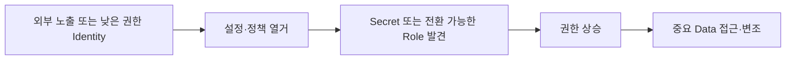

# Cloud Security Misconfigurations

클라우드 공격 경로는 하나의 치명적인 취약점보다, 작은 설정 오류와 과도한 권한이 연결될 때 만들어지는 경우가 많습니다.

> 관련 노트: [IAM과 Temporary Credentials](aws-identity-and-temporary-credentials.md) · [S3 Object Storage](aws-s3-object-storage.md) · [Cloud Security Assessment](cloud-security-assessment.md)

## 공격 경로로 보는 이유



각 단계만 보면 영향이 작아 보일 수 있습니다. 위험 평가는 `현재 권한 → 다음 Identity → 최종 Data` 연결을 기준으로 해야 합니다.

## 1. User Data와 Metadata

EC2 User Data는 초기 Package 설치와 설정 자동화에 유용하지만 Secret 저장소가 아닙니다. 권한 있는 API 사용자나 Instance 내부 주체가 내용을 볼 수 있고, Image·Template·Log에도 남을 수 있습니다.

```text
취약한 연결
User Data의 Password
  → Instance 로그인
  → IMDS의 Instance Role 자격 증명
  → 과도한 AWS API 권한
```

대응:

- User Data에는 Secret 대신 Secret의 식별자와 초기화 Logic만 둡니다.
- IMDSv2를 요구하고 SSRF와 Container 간 접근을 제한합니다.
- Instance Role을 최소 권한으로 설정합니다.
- 불필요한 SSH·RDP Public 접근을 닫습니다.

## 2. 환경 변수와 배포 설정의 Secret

Lambda와 Elastic Beanstalk 환경 변수는 설정 전달 수단입니다. 이를 읽을 수 있는 관리 API 권한이나 배포 Artifact 접근 권한이 있으면 값이 노출될 수 있습니다.

대응:

- Secrets Manager 같은 전용 저장소와 짧은 수명의 자격 증명을 사용합니다.
- 설정 조회 권한과 Secret 조회 권한을 분리합니다.
- Log와 오류 응답에 환경 변수 전체를 출력하지 않습니다.
- 유출을 가정한 Rotation 절차를 준비합니다.

## 3. IAM 권한 상승 조합

직접 `AdministratorAccess`가 없어도 다음과 같은 권한 조합은 강한 Identity를 만들 수 있습니다.

| 위험한 능력 | 연결될 수 있는 결과 |
| --- | --- |
| 다른 User의 Access Key 생성·변경 | 해당 User로 Identity 전환 |
| Policy Version 변경·기본 Version 설정 | 이전의 강한 권한 복원 |
| Role 전달 + Compute 생성·수정 | 강한 Role을 Workload로 사용 |
| User·Role Tag 변경 + Tag 조건 Policy | 조건을 만족시켜 추가 권한 획득 |
| Trust Policy 수정 | 공격자가 Role을 맡도록 변경 |

`iam:PassRole`은 Role 자체를 맡는 권한이 아니라 AWS Service에 Role을 전달하는 권한입니다. 하지만 Lambda·EC2 같은 실행 기능과 결합되면 그 Role의 권한으로 Code를 실행하는 경로가 될 수 있습니다.

대응:

- 단일 Action이 아니라 권한 조합을 분석합니다.
- `Resource`, `Condition`, Tag 수정 권한과 전달 가능한 Service를 제한합니다.
- Access Analyzer, CloudTrail과 Policy 변경 Alarm을 사용합니다.
- 관리 작업에는 승인·분리된 Role과 짧은 Session을 사용합니다.

## 4. S3 Public Write와 공급망 변조

Public Read는 Data 노출을 만들고 Public Write는 Web Asset, Script와 배포 Artifact 변조로 이어질 수 있습니다.

```text
Public Writable Bucket
   ↓ JavaScript 또는 Package 교체
정상 Website가 변조된 Resource Load
   ↓
사용자 Browser에서 악성 Code 실행
```

대응:

- Public Access Block과 명시적 최소 권한을 기본으로 둡니다.
- 정적 Asset 배포 주체를 제한하고 Versioning을 켭니다.
- CDN Origin Access 제어, CSP와 Subresource Integrity를 요구사항에 맞게 사용합니다.
- Object 변경과 Bucket Policy 변경을 Monitoring합니다.

## 5. Message와 Notification에 Secret 포함

SNS, SQS와 Event Payload는 여러 구독자, Retry, DLQ와 Log로 복제될 수 있습니다. API Key나 AWS 자격 증명을 Message Body로 전달하면 노출 범위가 예상보다 넓어집니다.

대응:

- Message에는 작업 ID와 최소 Metadata만 넣습니다.
- Consumer가 자신의 Role로 Secret Store에서 값을 조회하게 합니다.
- Queue·Topic Policy와 KMS Key Policy를 함께 검토합니다.
- DLQ의 접근 권한과 보존 기간도 Main Queue처럼 관리합니다.

## 6. Cognito와 Application Authorization

Client UI가 `admin` 기능을 숨기는 것만으로는 권한을 통제할 수 없습니다. User Pool Token의 Signature, Issuer, Audience와 만료를 검증하고, Identity Pool Role Mapping과 Backend 권한 검사를 Server-side에서 수행해야 합니다.

```text
UI 제한 ≠ Authorization
Token Claim 검증 + Backend Policy + AWS Role Mapping = 실제 경계
```

## 7. Lambda 입력 검증과 Execution Role

Lambda도 일반 Application Code입니다. SQL Injection, Command Injection, 취약한 Dependency가 그대로 발생할 수 있고, 성공하면 Execution Role 권한으로 AWS API가 호출될 수 있습니다.

대응:

- Parameterized Query와 허용 목록 기반 입력 검증을 사용합니다.
- Function별 Role을 분리하고 Wildcard 권한을 피합니다.
- Read-only Function에 Policy·Secret 변경 권한을 주지 않습니다.
- Code 서명·배포 Pipeline·Dependency 검사를 적용합니다.

## 공개 Write-up 전 점검

실습 환경이 종료됐더라도 다음 값은 공개 전에 제거하거나 재발급해야 합니다.

- Access Key ID, Secret Access Key, Session Token
- Account ID, User·Role ARN, Resource ID
- Public IP, Endpoint, Bucket 이름과 Pre-signed URL
- Email, Username, Password와 MFA Seed
- Terminal History, Profile 파일과 Screenshot 속 값
- Flag와 시나리오 정답을 공개할 수 있는지에 대한 프로젝트 규칙

가장 안전한 방법은 원본을 비공개로 보존하고, 공개 문서는 새 파일에 개념과 방어 원칙만 다시 작성해 깨끗한 Git 이력으로 배포하는 것입니다.

## 참고 자료

- [AWS IAM Security Best Practices](https://docs.aws.amazon.com/IAM/latest/UserGuide/best-practices.html)
- [AWS Security Reference Architecture](https://docs.aws.amazon.com/prescriptive-guidance/latest/security-reference-architecture/welcome.html)
- [OWASP Serverless Top 10](https://owasp.org/www-project-serverless-top-10/)
