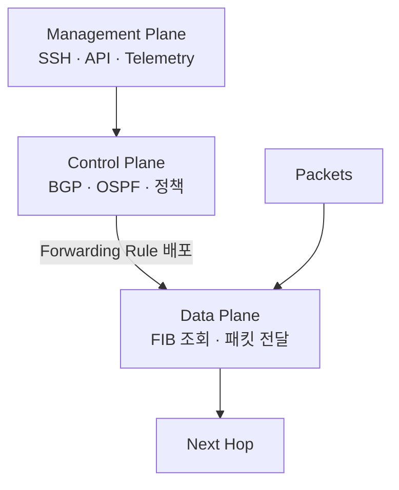

# Control Plane, Data Plane과 Management Plane

Plane은 시스템의 위아래 계층이 아니라 **시스템이 수행하는 일을 역할별로 구분하는 관점**입니다.

> 관련 노트: [EC2와 VPC](aws-ec2-and-vpc.md) · [Protocol Layering과 Network Security](../computer-networks/protocol-layering-and-security.md)

## 세 Plane의 역할

| 구분 | 핵심 질문 | 대표 작업 |
| --- | --- | --- |
| Control Plane | 무엇을 어떻게 처리할 것인가? | 정책 계산, 리소스 생성, 설정 배포 |
| Data Plane | 실제 요청과 데이터를 어떻게 처리하는가? | 패킷 전달, 객체 읽기·쓰기, 워크로드 실행 |
| Management Plane | 운영자가 어떻게 설정하고 관찰하는가? | Console, CLI, 관리 API, Monitoring |

Management Plane을 Control Plane에 포함해 설명하는 시스템도 있습니다. 용어 경계보다 **설정 변경과 실제 데이터 처리의 분리**가 핵심입니다.

## Layer와 Plane의 차이

```text
Layer: 시스템의 위아래 구조
Application → OS → Hypervisor → Hardware

Plane: 같은 시스템 안의 역할
Management → Control → Data
```

라우터 한 대 안에도 세 Plane이 동시에 존재할 수 있으므로 Plane이 반드시 서로 다른 장비를 뜻하지는 않습니다.

## Network 예시



- Control Plane은 토폴로지와 정책을 바탕으로 경로를 선택합니다.
- Data Plane은 만들어진 전달 테이블을 매 패킷에 빠르게 적용합니다.
- SDN은 제어 기능을 논리적으로 중앙화하고 여러 장치의 Data Plane을 프로그램할 수 있게 합니다.

## AWS 서비스 예시

| 서비스 | Control Plane | Data Plane |
| --- | --- | --- |
| EC2 | Instance 생성·종료, ENI·Security Group 연결 | 실행 중인 연산, 패킷과 디스크 I/O |
| VPC | Subnet·Route·Security Group 규칙 변경 | 실제 패킷에 라우팅·필터링 적용 |
| S3 | Bucket 생성, Versioning·Policy 설정 | Object `PUT`, `GET`, `DELETE` |
| RDS | DB Instance, Backup, Replica 설정 | SQL과 Transaction 처리 |
| SQS | Queue, Policy, DLQ 설정 | Message 전송·수신·삭제 |

`Create`나 `Delete`라는 동사만으로 구분할 수는 없습니다. `DeleteBucket`은 서비스 구조를 없애므로 Control Plane이고, `DeleteObject`는 S3가 본래 다루는 사용자 데이터를 처리하므로 Data Plane입니다.

## 왜 분리하는가

### 성능

Control Plane은 복잡한 결정을 상대적으로 낮은 빈도로 수행합니다. Data Plane은 이미 계산된 규칙을 매우 많은 요청에 반복 적용하므로 단순하고 빠른 경로가 중요합니다.

### 복원력

Control Plane의 일부 기능에 장애가 나더라도 기존 Data Plane이 계속 동작하도록 설계하면 장애 범위를 줄일 수 있습니다. 예를 들어 새 리소스 생성은 실패해도 이미 실행 중인 워크로드의 요청 처리는 계속될 수 있습니다. 단, 실제 보장은 서비스와 장애 유형에 따라 다릅니다.

### 보안

```text
Control Plane 침해
  IAM 탈취 → 정책 변경 → 리소스·네트워크 구성 조작

Data Plane 침해
  애플리케이션 취약점 → 실제 데이터 조회·변조 → 서비스 중단
```

둘은 권한, 로그와 대응 방법이 다릅니다. CloudTrail 같은 관리 이벤트뿐 아니라 애플리케이션·데이터 접근 로그도 함께 봐야 전체 공격 경로를 확인할 수 있습니다.

## 구분하는 질문

1. 리소스의 구조·정책·상태를 정의하거나 바꾸는가? → **Control Plane**
2. 이미 정의된 규칙으로 실제 요청·패킷·데이터를 처리하는가? → **Data Plane**
3. 사람이 시스템을 설정하고 관찰하는 접점인가? → **Management Plane**

## 참고 자료

- [AWS: Control planes and data planes](https://docs.aws.amazon.com/whitepapers/latest/aws-fault-isolation-boundaries/control-planes-and-data-planes.html)
- [Open Networking Foundation: Software-Defined Networking](https://opennetworking.org/sdn-definition/)
