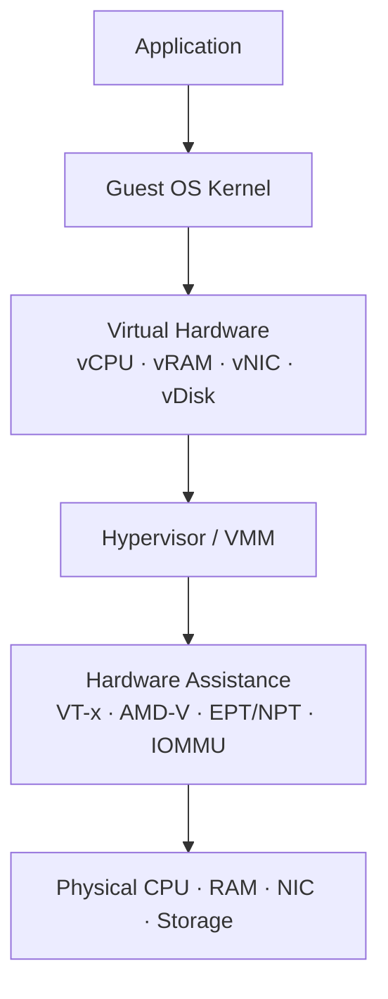
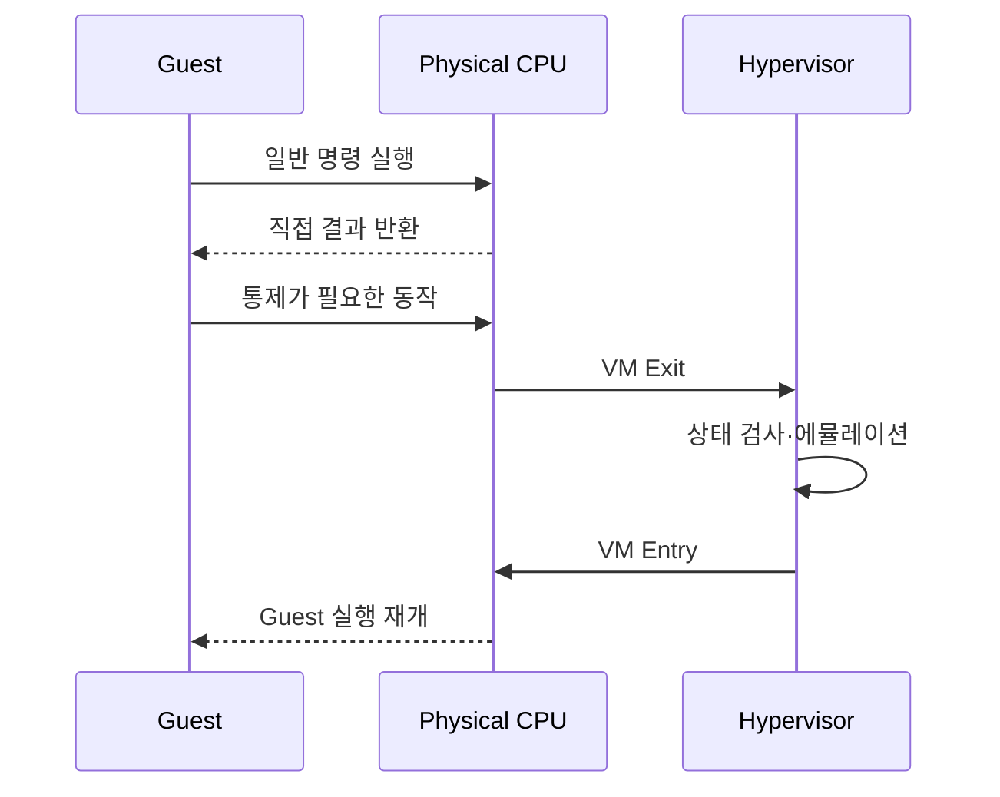

# Virtualization Foundations

가상화는 하나의 물리 자원을 여러 독립된 실행 환경에 나누어 제공하면서, 각 환경에는 자신만의 하드웨어가 있는 것처럼 보이게 만드는 기술입니다.

> 관련 노트: [EC2와 VPC](aws-ec2-and-vpc.md) · [Memory Management](../operating-systems/memory-management.md) · [Context Switching](../operating-systems/context-switching.md)

## 전체 계층



Guest OS는 CPU, 메모리, 디스크와 NIC를 직접 소유한다고 생각합니다. Hypervisor는 실제 자원을 스케줄링하고 주소를 매핑하며 VM 사이를 격리합니다.

## vCPU와 CPU Virtualization

vCPU는 물리 코어 자체가 아니라 Guest가 사용할 수 있는 **가상 프로세서 인터페이스와 실행 상태**입니다. Hypervisor는 여러 vCPU를 물리 CPU에 스케줄링합니다.

```text
시간 t1: Physical Core 0 → VM A / vCPU 0
시간 t2: Physical Core 0 → VM B / vCPU 0
시간 t3: Physical Core 0 → VM A / vCPU 1
```

Guest OS도 자신의 vCPU 위에서 Process를 다시 스케줄링하므로 두 단계의 스케줄링이 생깁니다.

```text
Physical CPU
  └─ Hypervisor가 VM의 vCPU를 스케줄링
       └─ Guest OS가 Process·Thread를 스케줄링
```

현대 x86 CPU는 Intel VT-x나 AMD-V 같은 가상화 확장을 제공합니다. Guest의 일반 명령은 가능한 한 CPU에서 직접 실행하고, Hypervisor가 개입해야 하는 사건에서 VM Exit이 발생합니다.



## Memory Virtualization

Guest는 자신이 관리하는 주소를 실제 물리 주소라고 생각하지만, Host 관점에서는 한 단계가 더 필요합니다.

```text
Guest Virtual Address
        ↓ Guest Page Table
Guest Physical Address
        ↓ EPT(Intel) / NPT(AMD)
Host Physical Address
        ↓
Real RAM
```

두 번째 매핑은 주소 변환 성능뿐 아니라 VM 격리에도 중요합니다. VM A의 매핑에 VM B의 메모리가 없으면 A는 정상적인 주소 변환만으로 B의 메모리에 접근할 수 없습니다.

## I/O Virtualization

| 방식 | 동작 | 장단점 |
| --- | --- | --- |
| Device Emulation | Hypervisor가 실제 장치의 동작을 소프트웨어로 흉내 냄 | 호환성이 좋지만 오버헤드가 큼 |
| Paravirtualized I/O | Guest가 `virtio` 같은 가상화 전용 장치를 사용 | 불필요한 에뮬레이션을 줄임 |
| PCI Passthrough | 물리 장치를 특정 VM에 직접 연결 | 성능이 높지만 공유와 이동성이 제한됨 |
| SR-IOV | 하나의 물리 장치를 여러 Virtual Function으로 분할 | 공유하면서 데이터 경로를 단축 |

Passthrough나 SR-IOV에서 장치의 DMA가 임의의 Host 메모리에 접근하지 못하도록 IOMMU가 Device → Memory 매핑을 제한합니다.

## Network Virtualization

```text
VM A eth0 ─ vNIC ─┐
                  ├─ Virtual Switch / SDN Data Plane ─ Physical NIC
VM B eth0 ─ vNIC ─┘
```

한 서버의 vSwitch를 데이터센터 규모로 확장하고, 라우팅과 필터링 규칙을 소프트웨어로 제어하면 VPC 같은 논리 네트워크를 구성할 수 있습니다.

## VM과 Container

| 구분 | VM | Container |
| --- | --- | --- |
| 격리 경계 | 가상 하드웨어와 별도 Guest Kernel | 하나의 Host Kernel을 공유 |
| 핵심 기술 | Hypervisor, CPU·Memory Virtualization | Namespace, cgroup, capability, seccomp |
| 이미지 | OS까지 포함해 상대적으로 큼 | 애플리케이션과 사용자 공간 중심 |
| 시작 시간 | 일반적으로 더 김 | 일반적으로 더 짧음 |
| 커널 선택 | Guest마다 다를 수 있음 | Host Kernel에 종속 |

Container도 강한 격리를 제공할 수 있지만 VM과 경계가 같지는 않습니다. 위협 모델에 따라 VM, Container 또는 둘을 함께 사용합니다.

## 핵심 정리

가상화의 본질은 다음 세 가지입니다.

1. **Mapping** — 가상 CPU·주소·장치를 실제 자원에 연결
2. **Scheduling** — 공유 자원의 사용 순서를 결정
3. **Isolation** — 한 VM의 오류와 접근이 다른 VM으로 넘어가지 않게 제한

AWS EC2를 생성한다는 것은 이 기반 위에 vCPU, 메모리, 네트워크 인터페이스, 스토리지와 Guest Image를 조합해 하나의 실행 환경을 만드는 일입니다.
