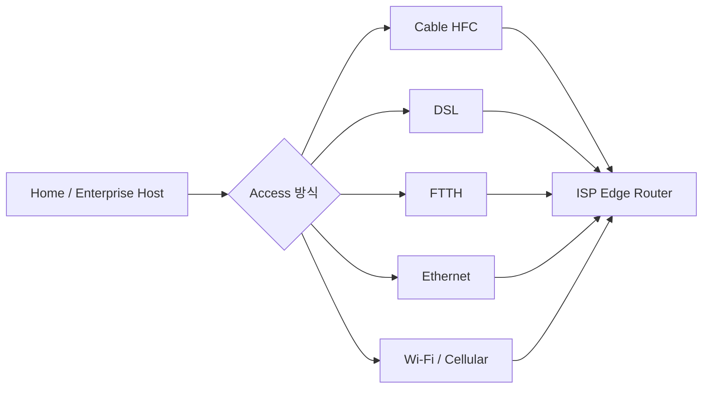
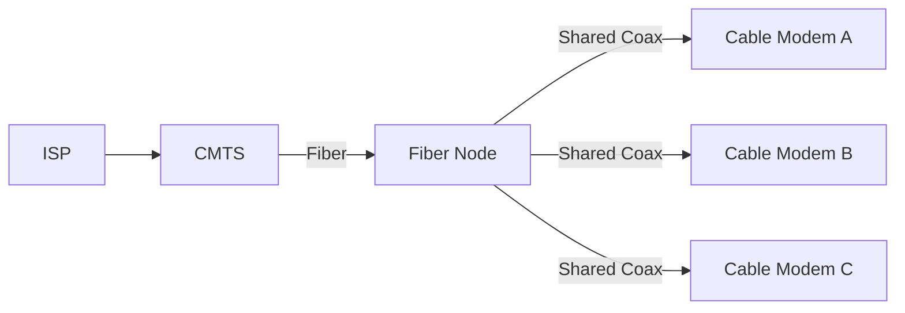
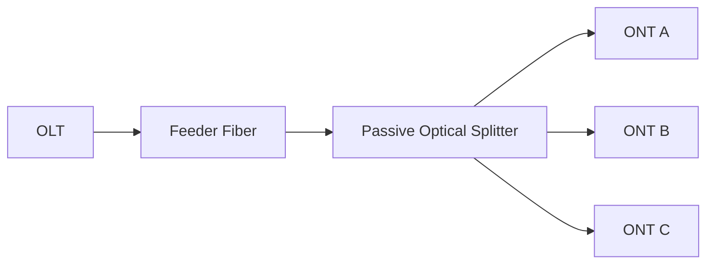

# Access Network와 Physical Media

<details>
<summary><strong>목차</strong></summary>

- [Access Network 비교](#access-network-비교)
- [Cable Internet과 HFC](#cable-internet과-hfc)
- [DSL](#dsl)
- [FTTH](#ftth)
- [Home과 Enterprise Network](#home과-enterprise-network)
- [Physical Media](#physical-media)
- [핵심 정리](#핵심-정리)

</details>

End System이 Edge Router에 연결되는 방식과 Bit를 전달하는 물리 매체를 정리합니다.

> 관련 노트: [Internet과 Network Architecture](internet-and-network-architecture.md) · [Wireless와 Mobile Networks](wireless-and-mobile-networks.md)

## Access Network 비교



| 방식 | 가입자 구간 | 공유 특성 | 집선 장비 |
| --- | --- | --- | --- |
| Cable HFC | Coaxial + Fiber | 이웃 가입자와 일부 구간 공유 | CMTS |
| DSL | 기존 Telephone Copper Pair | 가입자 Local Loop는 전용 | DSLAM |
| FTTH PON | Optical Fiber + Passive Splitter | Splitter 뒤 Fiber 용량 공유 | OLT / ONT |
| Ethernet | Twisted Pair 또는 Fiber | Switch Port 기준 Full-Duplex | Ethernet Switch |
| Wi-Fi | Radio | 같은 Channel을 Station이 공유 | Access Point |
| Cellular | Radio | 기지국의 Radio Resource 공유 | Base Station |

## Cable Internet과 HFC

HFC(Hybrid Fiber Coax)는 ISP 쪽의 Fiber와 가입자 근처의 Coaxial Cable을 결합합니다.



- TV Channel과 Internet Data는 서로 다른 Frequency Band를 사용할 수 있습니다.
- 같은 Coaxial Segment의 가입자들이 용량을 공유하므로 사용량에 따라 체감 속도가 달라질 수 있습니다.
- CMTS는 Cable Modem들의 Upstream·Downstream 전송을 관리하고 ISP Network에 연결합니다.

## DSL

DSL은 기존 Telephone Line의 Copper Pair를 이용합니다.

```text
Home -- dedicated local loop --> Central Office DSLAM --> ISP Network
  └-- splitter: voice frequency와 data frequency 분리
```

- 가입자 집에서 Central Office까지의 Local Loop는 다른 집과 직접 공유하지 않습니다.
- DSLAM에서 여러 가입자 회선을 집선합니다.
- Copper Line의 길이와 품질이 전송률에 큰 영향을 줍니다.
- Downstream과 Upstream 속도가 다른 ADSL 같은 방식이 널리 사용되었습니다.

## FTTH

FTTH(Fiber To The Home)는 가입자 구간까지 Optical Fiber를 연결합니다.

### AON과 PON

| 구분 | AON | PON |
| --- | --- | --- |
| 중간 장비 | 전원이 필요한 Active Switch | 전원이 필요 없는 Passive Splitter |
| 가입자 분기 | Active 장비가 Frame 전달 | Optical Signal을 물리적으로 분기 |
| 운영 특성 | 제어가 유연하지만 전원·관리 필요 | 외부 전원 부담이 적고 다수 가입자 수용 |



- OLT(Optical Line Terminal)는 ISP 측 장비입니다.
- ONT/ONU는 가입자 측에서 Optical Signal과 Ethernet Signal을 변환합니다.
- PON에서는 여러 가입자가 Feeder Fiber 용량을 공유하므로 전송 순서와 대역폭 할당이 필요합니다.

## Home과 Enterprise Network

### Home Network

가정용 Router 한 대가 여러 기능을 함께 제공하는 경우가 많습니다.

- ISP와 연결하는 WAN Interface
- 여러 Device를 연결하는 Ethernet Switch
- Wireless Access Point
- Private Address와 Public Address를 변환하는 NAT
- IP Address를 할당하는 DHCP Server
- 기본적인 Firewall

### Enterprise Network

- 다수의 Ethernet Switch가 같은 조직 내부의 Device를 연결합니다.
- Router는 다른 IP Network 또는 Internet으로 Traffic을 전달합니다.
- Wireless LAN Controller, 여러 AP, VLAN, Firewall 등을 함께 사용할 수 있습니다.

## Physical Media

| Media | Signal | 장점 | 주의점 |
| --- | --- | --- | --- |
| Twisted Pair | Electrical | 저렴하고 Ethernet에 널리 사용 | 거리와 전자기 간섭 영향 |
| Coaxial Cable | Electrical | 차폐와 Broadband 전송에 유리 | 가입자 구간 공유 가능 |
| Optical Fiber | Light | 높은 전송률, 장거리, EMI에 강함 | 광 송수신 장비와 시공 필요 |
| Radio | Electromagnetic Wave | 이동성과 배선 없는 접속 | 간섭, 장애물, 공유 매체 |
| Satellite | Radio | 넓은 Coverage | 궤도에 따른 Delay와 관리 복잡성 |

### Transmission Delay

길이가 `L` bit인 Packet을 전송률 `R` bps인 Link에 밀어 넣는 시간은 다음과 같습니다.

```text
d_trans = L / R

예: 8,000 bit / 1,000,000 bps = 0.008 s = 8 ms
```

이는 신호가 Link를 따라 이동하는 Propagation Delay와 다른 값입니다.

## 핵심 정리

- Access Network는 Host와 첫 Router 사이의 구간입니다.
- Cable과 PON은 일부 구간을 공유하며, DSL Local Loop는 가입자별로 분리됩니다.
- Fiber는 높은 전송률과 장거리에 유리하고, Radio는 이동성을 제공하지만 간섭과 공유 문제가 있습니다.
- `L/R`은 Packet을 Link에 올리는 시간이지 목적지까지 이동하는 전체 시간이 아닙니다.
