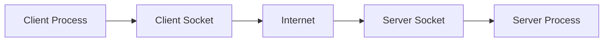
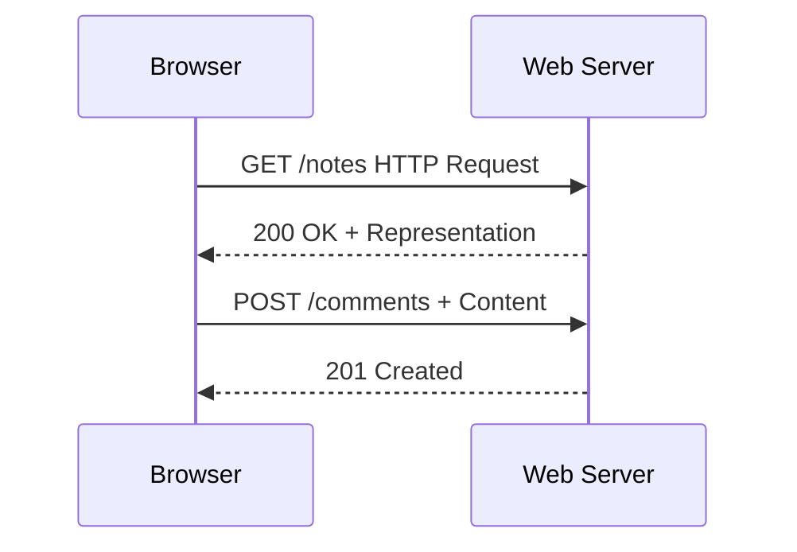
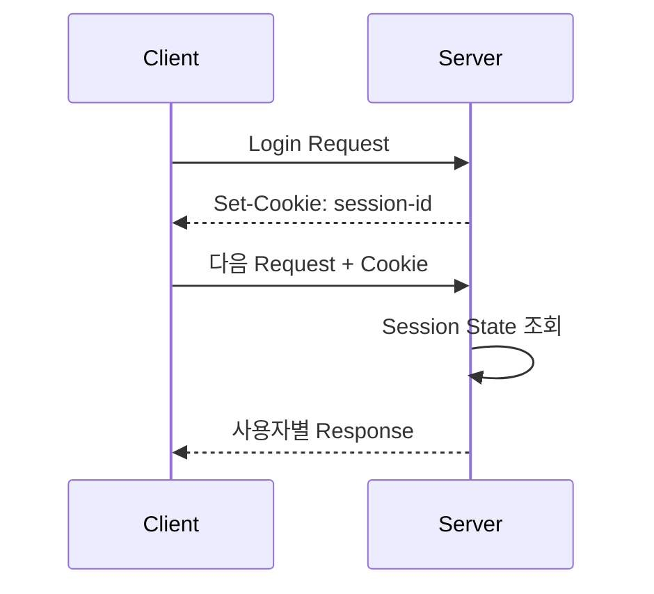
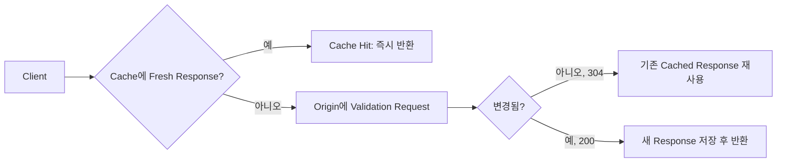

# Application Architecture와 HTTP

<details>
<summary><strong>목차</strong></summary>

- [Network Application은 Edge에서 실행된다](#network-application은-edge에서-실행된다)
- [Client-Server와 P2P](#client-server와-p2p)
- [Application-Layer Protocol이 정의하는 것](#application-layer-protocol이-정의하는-것)
- [HTTP](#http)
- [Stateless와 Connection은 다른 개념](#stateless와-connection은-다른-개념)
- [Cookie와 Session](#cookie와-session)
- [Web Cache와 Conditional Request](#web-cache와-conditional-request)
- [HTTP/1.1, HTTP/2, HTTP/3](#http11-http2-http3)
- [핵심 정리](#핵심-정리)

</details>

Network Application의 구조, Process Addressing, HTTP의 요청·응답과 상태 관리, Web Cache를 정리합니다.

> 관련 노트: [DNS와 E-mail](dns-and-email.md) · [Socket Programming](socket-programming.md) · [P2P, Streaming과 CDN](p2p-streaming-and-cdn.md)

## Network Application은 Edge에서 실행된다

- Application Process는 End System에서 실행됩니다.
- Core Router에 Application Code를 배포하지 않아도 Internet Service를 만들 수 있습니다.
- Process는 Socket을 통해 Transport Layer에 Message를 전달합니다.
- 원격 Process는 `IP Address + Port Number`로 식별합니다.



## Client-Server와 P2P

| 구분 | Client-Server | P2P |
| --- | --- | --- |
| 중심 역할 | 항상 접근 가능한 Server | Peer들이 Service 요청과 제공을 모두 수행 |
| Address | Server는 안정적인 Address 필요 | Peer Address와 접속 상태가 자주 바뀔 수 있음 |
| 확장 | Server·Network Capacity 증설 필요 | Peer 증가와 함께 Upload Capacity도 증가 가능 |
| 관리 | 중앙 관리가 비교적 쉬움 | Churn과 분산 상태 관리가 복잡함 |
| 예시 | Web, E-mail, Cloud API | BitTorrent |

## Application-Layer Protocol이 정의하는 것

- 교환하는 Message의 종류
- Message의 Syntax와 Field 구조
- 각 Field의 Semantics
- Message 송수신과 Event 발생 시 따라야 하는 Rule

Application이 Transport에 요구하는 속성은 Data Integrity, Throughput, Timing, Security 등에 따라 달라집니다. File Transfer는 정확성이 중요하고, Real-Time Media는 일정 수준의 Loss를 감수하더라도 낮은 Delay를 우선할 수 있습니다.

## HTTP

HTTP는 Resource를 Request하고 Response를 받는 Stateless Application-Layer Protocol입니다. HTTP의 공통 Semantics는 [RFC 9110](https://www.rfc-editor.org/rfc/rfc9110.html)에 정의되어 있습니다.



### Request

```http
GET /notes HTTP/1.1
Host: example.com
Accept: text/html
```

| Method | 기본 의미 | 멱등성 |
| --- | --- | --- |
| GET | Resource의 Representation 조회 | Yes |
| HEAD | Content 없이 Response Metadata 조회 | Yes |
| POST | Resource가 정한 방식으로 Content 처리 | No guarantee |
| PUT | 지정 URI의 상태 생성 또는 대체 | Yes |
| DELETE | 지정 Resource 제거 요청 | Yes |

멱등성은 같은 Request를 여러 번 수행했을 때 의도된 Server 상태 효과가 한 번 수행한 것과 같은지를 뜻합니다. Response가 항상 같다는 의미는 아닙니다.

### Response Status

| 범위 | 의미 | 예시 |
| --- | --- | --- |
| 1xx | Informational | 100 Continue |
| 2xx | Success | 200 OK, 201 Created |
| 3xx | Redirection | 301 Moved Permanently, 304 Not Modified |
| 4xx | Client Error | 400 Bad Request, 404 Not Found |
| 5xx | Server Error | 500 Internal Server Error, 503 Service Unavailable |

## Stateless와 Connection은 다른 개념

- Stateless는 각 Request의 의미를 이전 Request의 Application State에 의존하지 않고 해석할 수 있다는 뜻입니다.
- Non-Persistent와 Persistent는 Transport Connection을 Request마다 새로 만드는지 재사용하는지에 관한 개념입니다.
- HTTP/1.1은 Persistent Connection을 기본적으로 사용할 수 있지만 HTTP Semantics는 Stateless입니다.

## Cookie와 Session



- Cookie는 Browser가 저장하고 이후 Request에 포함하는 작은 Data입니다.
- Server는 Cookie 값 자체 또는 Cookie가 가리키는 Server-Side Session으로 사용자를 구분할 수 있습니다.
- `Secure`, `HttpOnly`, `SameSite` 같은 속성은 노출과 오용 위험을 줄이는 데 중요합니다.
- 민감 정보를 검증 없이 Cookie 값만 믿어서는 안 됩니다.

## Web Cache와 Conditional Request

Cache는 Origin Server 대신 저장된 Response를 제공해 Response Time과 Access Link Traffic을 줄입니다.



- `Cache-Control`은 Freshness와 저장 가능 여부를 제어합니다.
- `ETag`와 `If-None-Match`, 또는 `Last-Modified`와 `If-Modified-Since`로 변경 여부를 확인할 수 있습니다.
- `304 Not Modified`에는 전체 Representation을 다시 보낼 필요가 없습니다.

## HTTP/1.1, HTTP/2, HTTP/3

| Version | 전송 구조 | 주요 개선 | 남는 문제 |
| --- | --- | --- | --- |
| HTTP/1.1 | TCP 위 Text Message | Persistent Connection | 한 Connection의 Request 처리 순서와 HOL 문제 |
| HTTP/2 | TCP 위 Binary Frame과 Stream Multiplexing | 여러 Stream을 한 Connection에서 Interleave | TCP Packet Loss가 Connection의 여러 Stream을 지연 |
| HTTP/3 | QUIC 위 HTTP | QUIC Stream별 Loss Recovery, 빠른 Connection Setup | UDP 차단 환경과 구현 복잡성 |

HTTP/2는 Application-Layer Stream을 Multiplexing하지만 하나의 TCP Byte Stream을 공유합니다. HTTP/3는 QUIC의 독립적인 Stream을 이용해 한 Stream의 Loss가 다른 Stream의 전달까지 막는 현상을 줄입니다.

## 핵심 정리

- Network Application은 Edge Host의 Process로 실행되고 Socket을 통해 통신합니다.
- HTTP는 Stateless Request/Response Protocol이며 Connection 재사용 여부와 Stateless 여부는 별개입니다.
- Cookie와 Session은 Stateless HTTP 위에 사용자 상태를 구성합니다.
- Cache는 Freshness와 Validation을 이용해 Traffic과 Delay를 줄입니다.
- HTTP/2와 HTTP/3는 같은 HTTP Semantics를 다른 Wire Format과 Transport 위에서 전달합니다.
