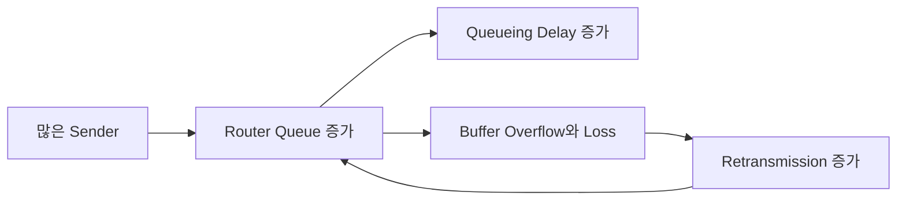
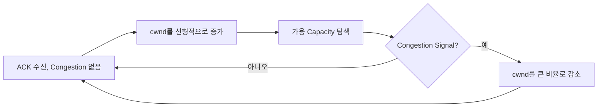
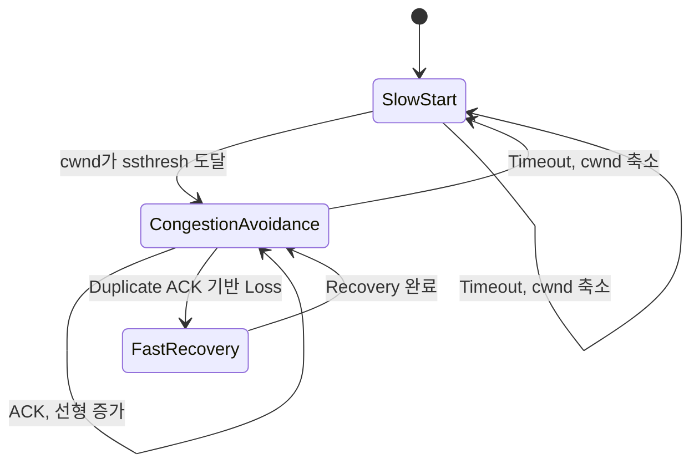
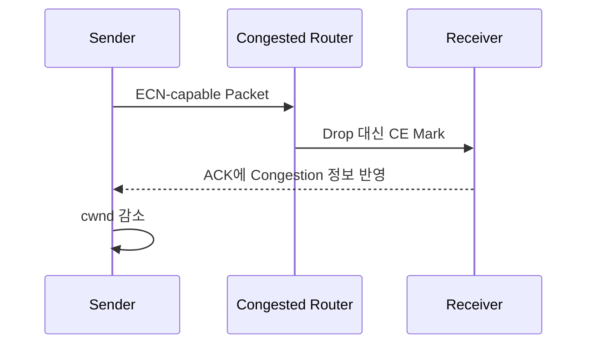

# Congestion Control

<details>
<summary><strong>목차</strong></summary>

- [Flow Control과 Congestion Control](#flow-control과-congestion-control)
- [Congestion의 원인과 비용](#congestion의-원인과-비용)
- [Congestion Control 접근 방법](#congestion-control-접근-방법)
- [AIMD](#aimd)
- [Slow Start와 Congestion Avoidance](#slow-start와-congestion-avoidance)
- [CUBIC](#cubic)
- [Delay-Based Control과 ECN](#delay-based-control과-ecn)
- [TCP Fairness](#tcp-fairness)
- [QUIC과 HTTP/3](#quic과-http3)
- [핵심 정리](#핵심-정리)

</details>

Network Congestion의 원인과 비용, TCP의 AIMD·Slow Start, CUBIC, ECN, Fairness와 QUIC을 정리합니다.

> 관련 노트: [Network Performance](network-performance.md) · [TCP](tcp.md)

## Flow Control과 Congestion Control

| 구분 | 보호 대상 | Feedback | 대표 변수 |
| --- | --- | --- | --- |
| Flow Control | Receiver Buffer | Receiver가 광고한 여유 | `rwnd` |
| Congestion Control | Network와 Bottleneck Queue | Loss, RTT, ECN 등 | `cwnd` |

Sender의 전송 가능량은 대략 다음처럼 제한됩니다.

```text
in-flight data <= min(rwnd, cwnd)
```

## Congestion의 원인과 비용

Arrival Rate가 Bottleneck Link의 처리 능력에 가까워지거나 초과하면 Queue가 길어집니다.



- Queueing Delay 증가
- Buffer Overflow에 따른 Packet Loss
- 불필요한 재전송으로 Link Capacity 낭비
- Multi-Hop 경로에서 이미 소비한 Upstream Resource 낭비
- Timeout과 반복 Loss로 Goodput 감소

단순히 Buffer를 크게 만들면 Loss를 늦출 수 있지만 과도한 Queueing Delay가 생길 수 있습니다.

## Congestion Control 접근 방법

### End-to-End

Network가 명시적인 정보를 주지 않아도 Endpoint가 Loss와 RTT 변화로 Congestion을 추정합니다. 전통적인 TCP Loss-Based Control이 대표적입니다.

### Network-Assisted

Router가 ECN Mark, Explicit Rate 같은 Signal을 Endpoint에 제공합니다. Endpoint와 Network의 지원이 모두 필요합니다.

## AIMD

AIMD(Additive Increase, Multiplicative Decrease)는 Capacity를 탐색하되 Congestion Signal이 오면 빠르게 양보합니다.



- Additive Increase: Congestion Avoidance에서 대략 RTT당 1 MSS 증가
- Multiplicative Decrease: Loss 발생 시 Window를 보통 큰 비율로 감소
- 여러 Flow가 같은 Bottleneck을 공유할 때 효율성과 공정성에 접근하도록 설계되었습니다.

## Slow Start와 Congestion Avoidance

Connection 시작 시 Network Capacity를 모르므로 작은 Window에서 출발합니다.

```text
cwnd (MSS)
1 → 2 → 4 → 8 → 16      Slow Start: RTT마다 대략 두 배
16 → 17 → 18 → 19 ...   Congestion Avoidance: 선형 증가
```

`ssthresh`는 Slow Start와 Congestion Avoidance를 전환하는 기준입니다.



### Timeout과 Duplicate ACK

- Timeout은 ACK가 오지 않는 더 강한 Congestion Signal로 취급해 Window를 크게 줄이고 Slow Start로 돌아갑니다.
- Triple Duplicate ACK는 일부 Data가 계속 도착한다는 신호이므로 Fast Retransmit을 수행할 수 있습니다.
- TCP Reno는 Fast Recovery를 사용하고, 전통적인 Tahoe는 Loss 후 Slow Start로 돌아갑니다.
- 실제 최신 TCP 구현은 SACK, Proportional Rate Reduction 등 더 많은 Mechanism을 사용할 수 있습니다.

TCP의 전통적인 네 알고리즘은 [RFC 5681](https://www.rfc-editor.org/rfc/rfc5681.html)에 정리되어 있습니다.

## CUBIC

CUBIC은 시간과 이전 최대 Window `Wmax`를 이용하는 Cubic Function으로 Window를 조정합니다.

- `Wmax`에서 멀 때 빠르게 증가해 대역폭을 탐색합니다.
- 이전 `Wmax` 근처에서는 천천히 증가해 안정적으로 Capacity를 확인합니다.
- 큰 Bandwidth-Delay Product를 가진 Network에서 Reno식 선형 증가보다 빠르게 Capacity를 활용할 수 있습니다.

## Delay-Based Control과 ECN

### Delay-Based

최소 RTT와 현재 RTT의 차이를 이용해 Queue가 쌓이는 시점을 Loss 전에 감지하려고 합니다. Queue를 짧게 유지할 수 있지만 Loss-Based Flow와 경쟁할 때 불리해질 수 있습니다.

### ECN



ECN(Explicit Congestion Notification)은 Router가 Packet을 버리기 전에 Congestion을 표시할 수 있게 합니다. Endpoint와 Router가 ECN을 지원하고 협상해야 합니다.

## TCP Fairness

같은 RTT와 비슷한 조건의 여러 TCP Flow가 같은 Bottleneck에서 AIMD를 사용하면 Capacity를 비교적 공평하게 나누는 방향으로 수렴합니다.

그러나 다음 요소는 공정성을 바꿉니다.

- RTT가 짧은 Flow가 ACK Cycle을 더 자주 수행
- Application이 여러 Parallel TCP Connection 사용
- UDP Application이 Rate를 제한하지 않음
- 서로 다른 Congestion Control Algorithm 사용
- Wireless Loss를 Congestion Loss로 오인

## QUIC과 HTTP/3

QUIC은 [RFC 9000](https://www.rfc-editor.org/rfc/rfc9000.html)에 정의된 UDP 기반 Secure Transport입니다.

- TLS 1.3을 Protocol에 통합
- Connection 안에 독립적인 여러 Stream 제공
- Connection ID로 Address 변경과 Migration 지원
- User Space 구현으로 Protocol 발전과 배포가 비교적 빠름
- Congestion Control과 Loss Recovery를 구현해야 하며 UDP라고 해서 Congestion 대응을 생략하지 않음

HTTP/3는 QUIC Stream을 사용해 한 Stream의 Loss가 다른 Stream의 Delivery까지 막는 TCP 수준의 Head-of-Line Blocking을 줄입니다.

## 핵심 정리

- Congestion Control은 Receiver가 아니라 Network의 Queue와 Capacity를 보호합니다.
- TCP는 `cwnd`를 증가시켜 Capacity를 탐색하고 Congestion Signal에서 감소시킵니다.
- Slow Start는 빠른 탐색, Congestion Avoidance는 안정적인 선형 탐색을 담당합니다.
- CUBIC, Delay-Based Control, ECN은 Loss-Based AIMD의 한계를 다른 방식으로 보완합니다.
- QUIC도 Network와 공존하기 위한 Congestion Control이 필요합니다.
