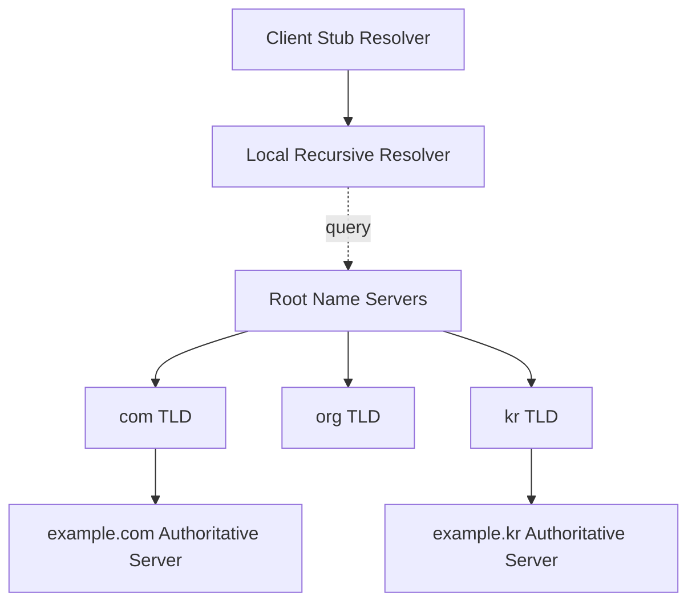
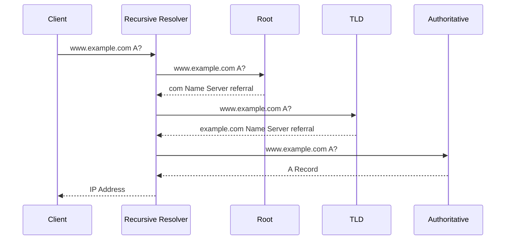
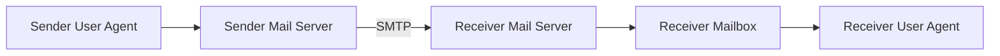
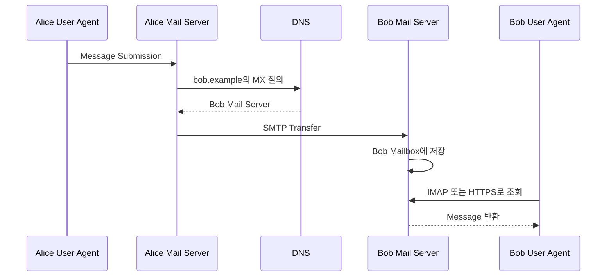

# DNS와 E-mail

<strong>목차</strong>

- [DNS가 제공하는 것](#dns가-제공하는-것)
- [DNS Hierarchy](#dns-hierarchy)
- [Name Resolution](#name-resolution)
- [Resource Record](#resource-record)
- [DNS Message와 보안](#dns-message와-보안)
- [E-mail 구성 요소](#e-mail-구성-요소)
- [Mail 전송 과정](#mail-전송-과정)
- [핵심 정리](#핵심-정리)

계층적 Name Resolution을 제공하는 DNS와 E-mail의 전송·조회 구조를 정리합니다.

> 관련 노트: [Application Architecture와 HTTP](application-architecture-and-http.md) · [P2P, Streaming과 CDN](p2p-streaming-and-cdn.md)

## DNS가 제공하는 것

DNS(Domain Name System)는 사람이 사용하는 Domain Name을 IP Address 같은 Resource Record로 연결하는 분산 Database입니다.

- Hostname을 IPv4·IPv6 Address로 변환
- Mail Server와 Name Server 정보 제공
- Alias Name을 Canonical Name으로 연결
- 여러 Server Address를 반환해 부하 분산 지원

## DNS Hierarchy

| 구성 요소 | 역할 |
| --- | --- |
| Stub Resolver | OS·Application에서 Recursive Resolver에 질의 |
| Recursive Resolver | Client 대신 여러 DNS Server에 질의하고 Cache 사용 |
| Root Server | 적절한 TLD Server 정보 제공 |
| TLD Server | Domain의 Authoritative Server 정보 제공 |
| Authoritative Server | 해당 Zone의 최종 Resource Record 제공 |

## Name Resolution

일반적인 Client는 Local Resolver에 Recursive Query를 보내고, Resolver가 계층을 따라 Iterative Query를 수행합니다.

- Recursive Query는 질의를 받은 Server가 최종 결과 또는 Error를 돌려줄 책임을 가집니다.
- Iterative Query는 현재 Server가 아는 최선의 Answer 또는 다음에 물어볼 Server를 반환합니다.
- 실제 동작은 Cache, Anycast, DNSSEC, Resolver Policy에 따라 단축되거나 달라질 수 있습니다.

## Resource Record

기본 형태는 `(Name, Value, Type, TTL)`입니다.

| Type | Name | Value |
| --- | --- | --- |
| A | Hostname | IPv4 Address |
| AAAA | Hostname | IPv6 Address |
| NS | Zone | Authoritative Name Server |
| CNAME | Alias | Canonical Name |
| MX | Domain | Mail Exchanger와 Priority |

TTL은 Resolver가 Record를 Cache할 수 있는 시간을 나타냅니다. 긴 TTL은 질의량을 줄이지만 변경 반영이 느리고, 짧은 TTL은 변경에 빠르게 반응하지만 DNS Traffic을 늘릴 수 있습니다.

## DNS Message와 보안

DNS Query와 Response는 같은 기본 Header 구조를 사용하며 Identification, Flag, Question, Answer, Authority, Additional Section을 포함합니다.

- 전통적인 DNS는 주로 UDP 53을 사용하며, 필요에 따라 TCP도 사용합니다.
- DNSSEC는 Digital Signature로 DNS Data의 출처 인증과 무결성 검증을 지원합니다.
- DNSSEC는 질의 내용의 기밀성을 제공하지 않습니다.
- Cache Poisoning을 줄이려면 Transaction 식별, Source Port 무작위화, DNSSEC 검증 등이 중요합니다.

## E-mail 구성 요소

| 구성 요소 | 역할 |
| --- | --- |
| User Agent | Mail 작성, 전송 요청, 조회와 표시 |
| Mail Server | Mailbox 저장, Message Queue와 SMTP 처리 |
| SMTP | Client-to-Server Submission과 Server-to-Server Transfer |
| IMAP / Web API | Receiver가 Mail을 조회·동기화 |

## Mail 전송 과정

### SMTP와 HTTP 비교

- SMTP는 Mail을 목적지 Server로 밀어 넣는 Push 중심 Protocol입니다.
- HTTP는 Client가 Resource를 요청해 가져오는 Pull 형태가 일반적입니다.
- Web Mail에서는 Browser와 Mail Service 사이에 HTTPS를 사용하고, Mail Server 사이에는 SMTP를 사용할 수 있습니다.
- Attachment와 비 ASCII Content는 MIME 형식으로 표현할 수 있습니다.

## 핵심 정리

- DNS는 중앙 Server 하나가 아니라 Root, TLD, Authoritative Server로 분산된 계층 구조입니다.
- Recursive Resolver의 Cache가 대부분의 반복 질의를 줄입니다.
- Resource Record의 Type과 TTL을 함께 이해해야 합니다.
- E-mail은 SMTP 전송과 Mailbox 조회 Protocol을 분리해 사용합니다.
