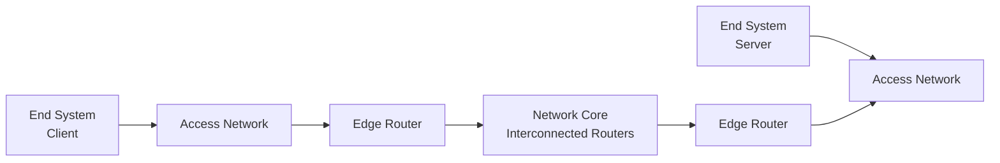
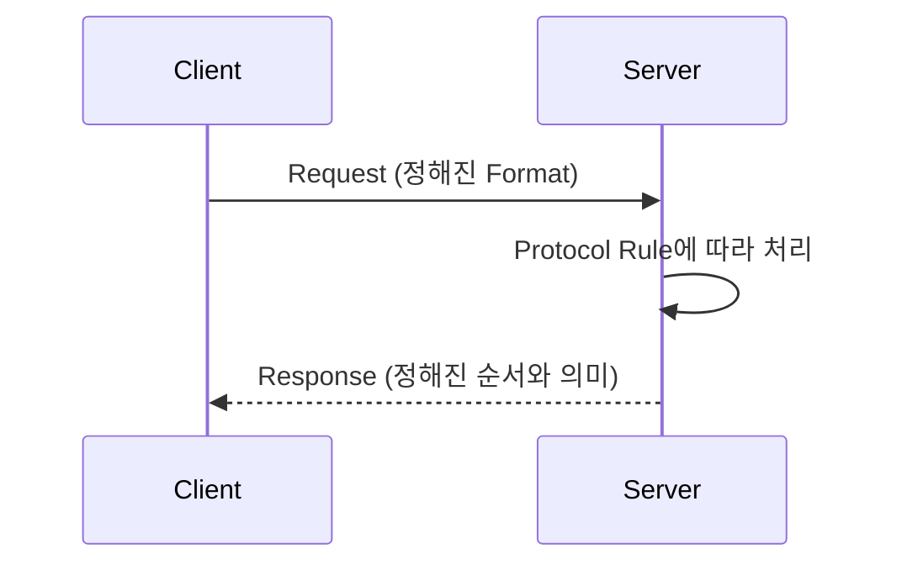
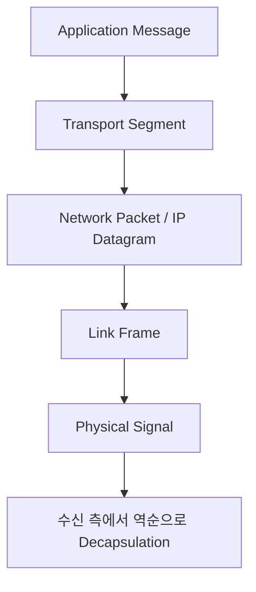
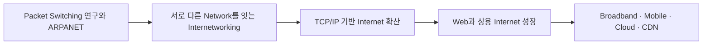

# Internet과 Network Architecture

<strong>목차</strong>

- [Internet의 전체 구조](#internet의-전체-구조)
- [Edge, Access, Core](#edge-access-core)
- [Protocol](#protocol)
- [Internet의 두 가지 관점](#internet의-두-가지-관점)
- [Network Application이 데이터를 보내는 과정](#network-application이-데이터를-보내는-과정)
- [Internet의 발전 흐름](#internet의-발전-흐름)
- [핵심 정리](#핵심-정리)

Internet을 구성 요소 관점과 서비스 관점에서 살펴보고, Edge·Access·Core의 관계를 정리합니다.

> 관련 노트: [Access Network와 Physical Media](access-networks-and-physical-media.md) · [Packet Switching과 Internet Structure](packet-switching-and-internet-structure.md)

## Internet의 전체 구조

Internet은 하나의 거대한 단일 Network가 아니라 독립적으로 운영되는 여러 Network가 상호 연결된 **Network of Networks**입니다.

| 구성 요소 | 역할 | 예시 |
| --- | --- | --- |
| End System 또는 Host | Network Application 실행 | PC, Smartphone, Server, IoT Device |
| Communication Link | Bit를 물리적으로 전달 | Fiber, Copper, Radio, Satellite |
| Packet Switch | Packet을 다음 Link로 전달 | Router, Ethernet Switch |
| Access Network | Host를 첫 Router에 연결 | FTTH, Cable, Wi-Fi, Cellular |
| Network Core | 여러 Network 사이에서 Packet 전달 | ISP Backbone, Interconnected Routers |

## Edge, Access, Core

### Network Edge

- Application을 실행하는 End System이 위치합니다.
- Client뿐 아니라 Data Center의 Server도 End System이므로 Edge에 속합니다.
- 실제 통신 주체는 Host 안에서 실행되는 Process입니다.

### Access Network

- End System을 Internet의 첫 번째 Router인 Edge Router까지 연결합니다.
- 가정, 기업, 학교, 이동통신망에 따라 다른 접속 기술을 사용합니다.
- 공유 매체인지, 전용 회선인지, 제공 가능한 전송률이 얼마인지가 중요한 비교 기준입니다.

### Network Core

- 상호 연결된 Router들이 Packet을 Source Network에서 Destination Network로 전달합니다.
- 각 Router는 Packet Header와 Forwarding Table을 이용해 출력 Link를 선택합니다.
- 경로 전체를 계산하는 Routing과 개별 Packet을 넘기는 Forwarding은 구분해야 합니다.

## Protocol

Protocol은 Network Entity 사이의 통신 규칙입니다. 단순한 Message Format뿐 아니라 다음 사항을 함께 정의합니다.

- 송수신하는 Message의 Format과 의미
- Message를 교환하는 순서
- Message 수신 또는 Timeout 같은 Event에 대한 Action

서로 다른 제조사와 운영체제가 통신하려면 같은 Protocol을 구현해야 합니다. Internet Protocol은 주로 IETF에서 논의되며, 결과는 RFC 문서로 공개됩니다.

## Internet의 두 가지 관점

### Nuts and Bolts 관점

Internet을 Host, Link, Router, ISP, Protocol 같은 실제 구성 요소의 집합으로 봅니다.

### Service 관점

Internet을 분산 Application에 통신 서비스를 제공하는 Infrastructure로 봅니다.

- Application은 Socket API를 통해 Transport Service를 사용합니다.
- Application 개발자는 Core Router를 직접 제어하지 않습니다.
- 하위 Layer가 Addressing, Routing, Framing 같은 세부 작업을 담당합니다.

## Network Application이 데이터를 보내는 과정

각 Layer는 자신이 담당하는 Header를 붙이며, 수신 측은 Header를 해석하고 제거하면서 Application Message를 복원합니다.

## Internet의 발전 흐름

- 초기 연구 Network는 Packet Switching의 가능성을 검증했습니다.
- 서로 다른 Network를 공통 Protocol로 연결하는 Internetworking 개념이 발전했습니다.
- TCP/IP가 Host와 Network 사이의 공통 Interface 역할을 하면서 Network of Networks가 확장됐습니다.
- Web은 Internet 위에서 정보를 연결하고 배포하는 대중적인 Application이 되었습니다.
- 이후 Broadband, Wi-Fi, Cellular, Cloud, Content Provider Network가 규모와 사용 방식을 크게 바꿨습니다.

## 핵심 정리

- Internet은 여러 Network가 Protocol을 통해 연결된 구조입니다.
- Edge는 Application이 실행되는 곳이고, Access Network는 Edge를 Core에 연결합니다.
- Core는 Router들의 집합으로 Packet을 목적지 Network까지 전달합니다.
- Protocol은 Format, Order, Action을 함께 정의합니다.
- Application은 Socket Interface를 사용하고 복잡한 전송 과정은 하위 Layer에 맡깁니다.
