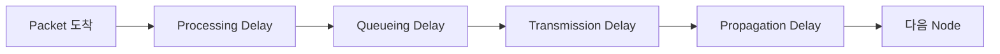
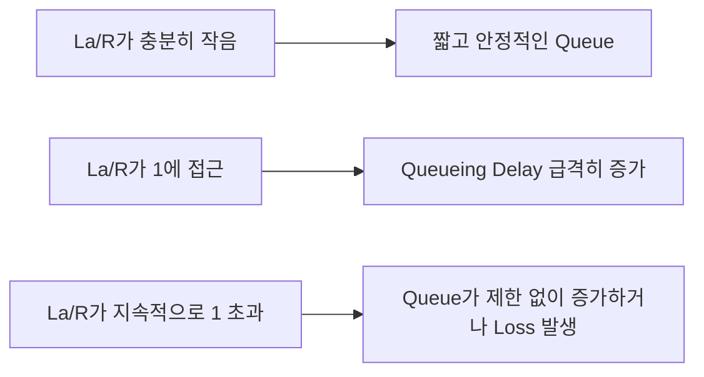
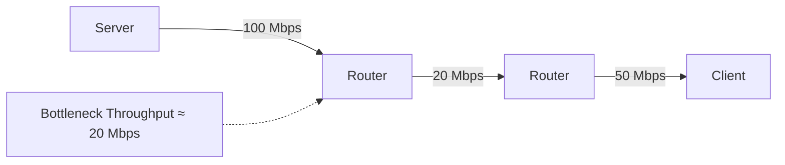
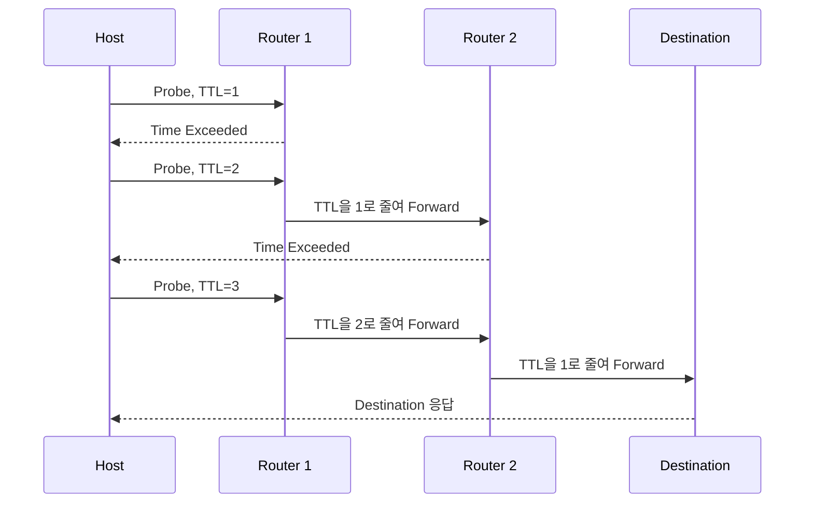

# Network Performance

<details>
<summary><strong>목차</strong></summary>

- [Nodal Delay](#nodal-delay)
- [Traffic Intensity와 Queueing](#traffic-intensity와-queueing)
- [Packet Loss](#packet-loss)
- [Throughput과 Bandwidth](#throughput과-bandwidth)
- [Traceroute](#traceroute)
- [핵심 정리](#핵심-정리)

</details>

Packet Delay의 구성 요소, Traffic Intensity, Loss, Throughput과 Bottleneck을 정리합니다.

> 관련 노트: [Packet Switching과 Internet Structure](packet-switching-and-internet-structure.md) · [Congestion Control](congestion-control.md)

## Nodal Delay

Router 하나를 통과할 때의 Delay는 네 부분으로 나눌 수 있습니다.



```text
d_nodal = d_proc + d_queue + d_trans + d_prop
```

| Delay | 의미 | 주요 결정 요인 |
| --- | --- | --- |
| Processing | Header 검사, 오류 확인, 출력 Port 결정 | Router 처리 성능 |
| Queueing | 출력 Queue에서 전송 순서를 기다림 | Traffic 양, Scheduling, Buffer |
| Transmission | Packet의 모든 Bit를 Link에 밀어 넣음 | Packet 길이 `L`, 전송률 `R` |
| Propagation | Signal이 물리적 Link를 이동 | 거리 `d`, 전파 속도 `s` |

### Transmission과 Propagation

```text
d_trans = L / R
d_prop  = d / s
```

- Transmission Delay는 Packet 크기와 Link Rate에 좌우됩니다.
- Propagation Delay는 Link 길이와 매체에서의 신호 속도에 좌우됩니다.
- Link Rate가 빨라져도 물리적 거리가 같다면 Propagation Delay 자체는 줄지 않습니다.

## Traffic Intensity와 Queueing

평균 Packet 도착률을 `a` packets/s, Packet 길이를 `L` bits, Link Rate를 `R` bps라 하면 다음 비율로 부하를 볼 수 있습니다.

```text
Traffic intensity = La / R
```



실제 Traffic은 순간적으로 몰리므로 평균이 1보다 작더라도 Queueing Delay와 Loss가 발생할 수 있습니다.

## Packet Loss

- Router Buffer는 유한합니다.
- Queue가 가득 찼을 때 도착한 Packet은 Drop될 수 있습니다.
- Wireless Error, Hardware Fault, Policy에 의한 Filtering도 Loss 원인이 될 수 있습니다.
- TCP는 Loss를 감지하면 재전송하지만, 재전송은 추가 Traffic과 Delay를 만듭니다.

## Throughput과 Bandwidth

Bandwidth 또는 Link Capacity는 Link가 제공할 수 있는 최대 전송률입니다. Throughput은 실제 End-to-End로 전달되는 Data Rate입니다.



여러 Flow가 같은 Bottleneck Link를 공유하면 각 Flow가 얻는 Throughput은 경쟁 Traffic과 Protocol 동작에 따라 달라집니다.

## Traceroute

Traceroute는 TTL/Hop Limit을 점차 증가시킨 Probe를 보내 경로상의 Router와 왕복 시간을 관찰합니다.



### 해석할 때 주의할 점

- 표시된 시간은 각 Hop 사이의 단방향 시간이 아니라 Source에서 해당 Hop까지의 RTT입니다.
- Router가 Probe에 낮은 우선순위로 응답하거나 응답하지 않을 수 있습니다.
- Load Balancing 때문에 Probe마다 다른 경로가 나타날 수 있습니다.
- 중간 Hop의 응답 지연이 실제 Data Forwarding 지연과 정확히 같지는 않습니다.

## 핵심 정리

- End-to-End Delay는 경로상의 Processing, Queueing, Transmission, Propagation Delay가 누적된 값입니다.
- `L/R`과 `d/s`를 혼동하지 않아야 합니다.
- Traffic Intensity가 1에 가까워지면 Queueing Delay와 Loss 위험이 급격히 증가합니다.
- End-to-End Throughput은 보통 가장 느린 Bottleneck과 공유 경쟁에 제한됩니다.
