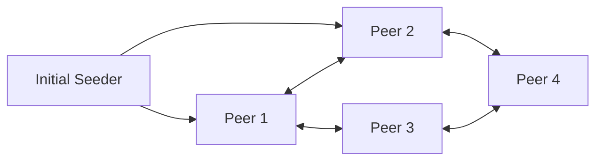
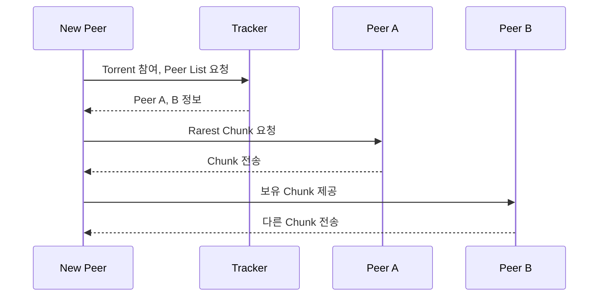
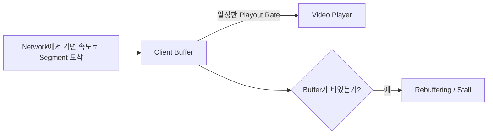
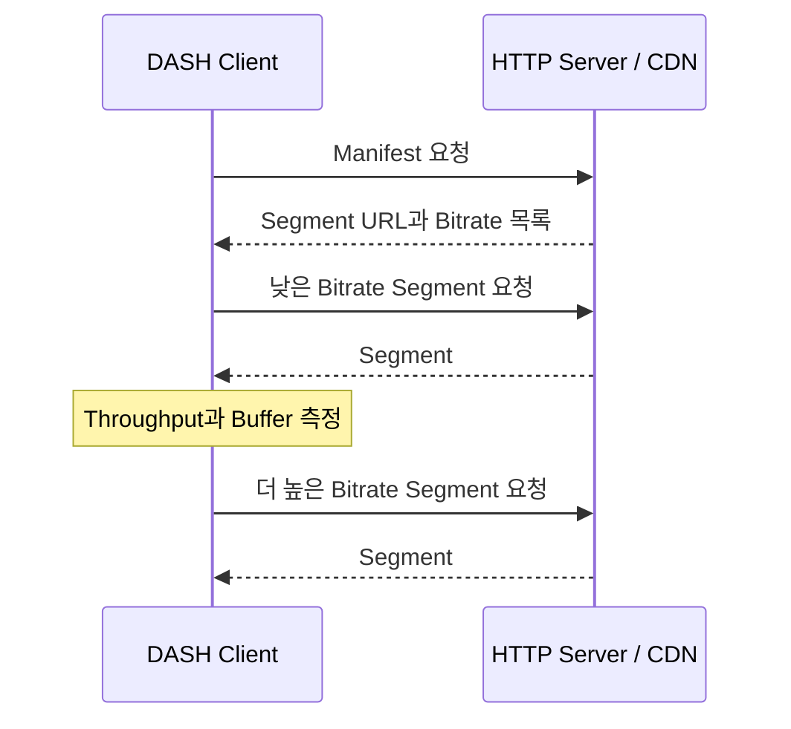
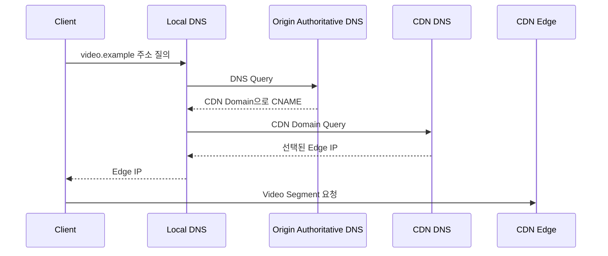

# P2P, Streaming과 CDN

<details>
<summary><strong>목차</strong></summary>

- [Client-Server와 P2P Distribution](#client-server와-p2p-distribution)
- [BitTorrent의 핵심](#bittorrent의-핵심)
- [Video Encoding과 Bit Rate](#video-encoding과-bit-rate)
- [Jitter와 Playout Buffer](#jitter와-playout-buffer)
- [DASH](#dash)
- [CDN](#cdn)
- [핵심 정리](#핵심-정리)

</details>

P2P File Distribution, Video Streaming의 Buffering과 DASH, CDN의 배치·요청 흐름을 정리합니다.

> 관련 노트: [Application Architecture와 HTTP](application-architecture-and-http.md) · [DNS와 E-mail](dns-and-email.md)

## Client-Server와 P2P Distribution

크기 `F`인 File을 `N`명의 Peer에게 배포한다고 가정합니다.

### Client-Server

Server가 `N`개의 Copy를 모두 Upload해야 하므로 최소 배포 시간은 다음 두 제약을 받습니다.

```text
D_cs >= max(NF / u_s, F / d_min)

u_s   : Server Upload Rate
d_min : 가장 느린 Client Download Rate
```

### P2P

Peer도 받은 Chunk를 다른 Peer에게 Upload하므로 전체 Upload Capacity가 함께 증가합니다.

```text
D_p2p >= max(
  F / u_s,
  F / d_min,
  NF / (u_s + Σu_i)
)
```



P2P는 Peer가 늘어날 때 Demand뿐 아니라 Upload Capacity도 함께 늘 수 있어 Self-Scalability를 가집니다. 다만 Peer가 계속 참가·이탈하는 Churn을 처리해야 합니다.

## BitTorrent의 핵심

- File을 Chunk로 나눠 Peer끼리 교환합니다.
- Tracker 또는 분산된 Discovery Mechanism으로 참여 Peer를 찾습니다.
- Rarest First는 복제 수가 적은 Chunk를 먼저 받아 Content 가용성을 높입니다.
- Tit-for-Tat 계열 전략은 자신에게 Data를 제공하는 Peer를 우선해 무임승차를 줄입니다.



## Video Encoding과 Bit Rate

- Spatial Coding은 한 Frame 안의 중복을 줄입니다.
- Temporal Coding은 연속 Frame 사이의 중복을 줄입니다.
- CBR(Constant Bit Rate)은 시간당 Bit Rate가 비교적 일정합니다.
- VBR(Variable Bit Rate)은 장면 복잡도에 따라 Bit Rate가 달라집니다.

압축률을 높이면 Network 사용량은 줄지만 화질 저하 또는 Encoding 비용이 커질 수 있습니다.

## Jitter와 Playout Buffer

Network Delay가 시간마다 달라지는 현상을 Jitter라고 합니다. Client는 일정량의 Video를 미리 받아 Buffer에 저장한 뒤 재생합니다.



- 큰 Buffer는 변동을 잘 흡수하지만 재생 시작 Delay가 증가합니다.
- Download Rate가 장기간 Playback Rate보다 낮으면 결국 Rebuffering이 발생합니다.

## DASH

DASH는 Video를 시간 구간별 Segment와 여러 Bitrate Version으로 준비하고, Client가 Network 상태에 맞춰 선택하는 Adaptive Streaming 방식입니다.



- Server는 같은 Content의 여러 Representation과 Manifest를 제공합니다.
- Client는 추정 Throughput, Buffer, Device 상태 등을 이용해 다음 Segment 품질을 선택합니다.
- 품질을 너무 공격적으로 높이면 Buffer가 고갈될 수 있고, 지나치게 낮추면 화질을 낭비합니다.

## CDN

CDN(Content Distribution Network)은 Content를 사용자와 가까운 Edge Server에 복제해 Delay와 Origin 부하를 줄입니다.

### 배치 방식

| 방식 | 핵심 | 장점 | 비용 |
| --- | --- | --- | --- |
| Enter Deep | Access Network 가까이에 많은 Cluster 배치 | 사용자와 가까워 낮은 Delay | 운영 지점이 많아짐 |
| Bring Home | 주요 IXP·PoP에 큰 Cluster 배치 | 관리와 규모의 경제 | 일부 사용자는 더 먼 경로 사용 |

### DNS를 이용한 CDN 선택



CDN은 Client 위치, Resolver 위치, Server 부하, Network 상태, Content 보유 여부 등을 고려해 Edge를 선택할 수 있습니다.

## 핵심 정리

- P2P는 Peer의 Upload Capacity를 활용해 File Distribution을 확장합니다.
- Streaming은 Jitter를 Buffer로 흡수하며, Buffer가 비면 재생이 멈춥니다.
- DASH에서는 Client가 Segment마다 Bitrate를 선택합니다.
- CDN은 Content를 분산 배치하고 DNS 또는 Request Routing으로 적절한 Edge를 선택합니다.
