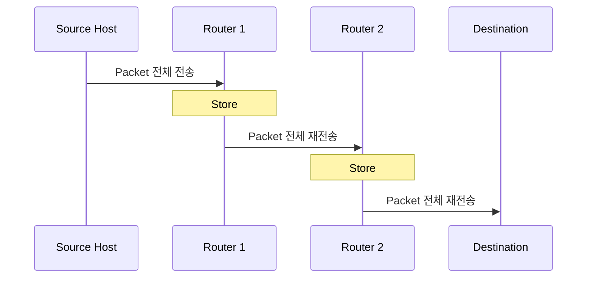
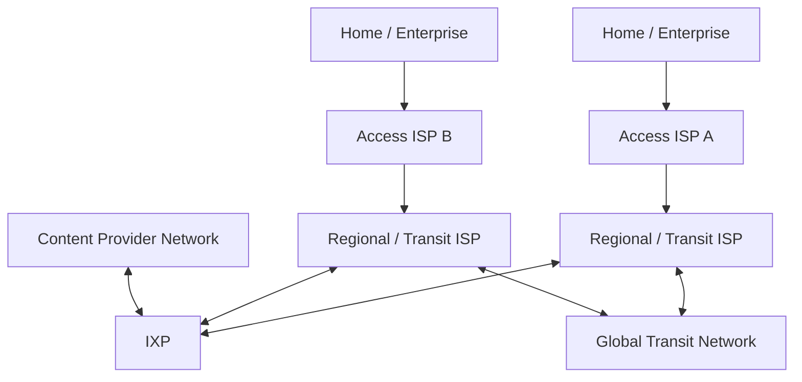

# Packet Switching과 Internet Structure

<details>
<summary><strong>목차</strong></summary>

- [Packet Switching](#packet-switching)
- [Forwarding과 Routing](#forwarding과-routing)
- [Queueing과 Packet Loss](#queueing과-packet-loss)
- [Circuit Switching](#circuit-switching)
- [Internet: Network of Networks](#internet-network-of-networks)
- [핵심 정리](#핵심-정리)

</details>

Network Core의 Packet 전달 방식과 Circuit Switching, ISP·IXP·Peering 구조를 정리합니다.

> 관련 노트: [Network Performance](network-performance.md) · [Protocol Layering과 Network Security](protocol-layering-and-security.md)

## Packet Switching

Packet Switching에서는 Application Message를 작은 Packet으로 나누고, 각 Packet을 Link 단위로 전달합니다.



### Store-and-Forward

- Router는 일반적으로 Packet 전체를 받은 뒤 다음 Link로 전송합니다.
- 길이가 `L` bit이고 모든 Link의 전송률이 `R` bps라면 Link 하나의 Transmission Delay는 `L/R`입니다.
- Queueing과 Propagation을 제외하고 `N`개의 Link를 지나는 Packet 하나의 Delay는 대략 `N × L/R`입니다.
- 여러 Packet은 서로 다른 Link에서 동시에 전송될 수 있으므로 Pipeline 효과가 생깁니다.

## Forwarding과 Routing

| 구분 | 질문 | 범위 | 결과 |
| --- | --- | --- | --- |
| Forwarding | 이 Packet을 어느 출력 Port로 보낼까? | 개별 Router 내부 | Forwarding Table 조회 후 전달 |
| Routing | Source에서 Destination까지 어떤 경로를 사용할까? | Network 전체 | 경로 계산 및 Table 구성 |


## Queueing과 Packet Loss

- 여러 입력에서 같은 출력 Link로 Packet이 몰리면 Output Queue에 대기합니다.
- Arrival Rate가 Link가 처리할 수 있는 Rate보다 높으면 Queue가 길어집니다.
- Buffer가 가득 찬 상태에서 새 Packet이 오면 Drop되어 Packet Loss가 발생합니다.
- Packet Switching은 Resource를 통계적으로 공유하므로 Bursty Traffic에 효율적이지만 Delay와 Loss가 변동할 수 있습니다.

## Circuit Switching

Circuit Switching은 통신 전에 End-to-End Resource를 예약합니다.

| 항목 | Packet Switching | Circuit Switching |
| --- | --- | --- |
| Resource | 필요할 때 공유 | Connection 동안 예약 |
| Setup | 보통 별도 Circuit Setup 없음 | 통신 전 Circuit 설정 |
| Bursty Data | 효율적 | Idle 시간에도 Resource 점유 |
| 성능 | Queueing Delay와 Loss 가능 | 예약된 용량을 예측 가능하게 사용 |
| 대표 사례 | Internet | 전통적 Telephone Network |

### FDM과 TDM

```text
FDM: | User A Frequency | User B Frequency | User C Frequency |

TDM: | A | B | C | A | B | C | ...  (Time Slot 반복)
```

- FDM은 Link의 Frequency Band를 나눕니다.
- TDM은 시간을 Slot으로 나눠 사용자를 배정합니다.
- 두 방식 모두 한정된 Link Capacity를 논리적인 Circuit으로 분할할 수 있습니다.

## Internet: Network of Networks

모든 Access Network를 서로 직접 연결하면 연결 수와 운영 비용이 폭발합니다. Internet은 ISP 계층, Peering, IXP를 이용해 확장합니다.



### ISP, IXP, Peering

- ISP는 가입자나 다른 Network에 Internet Connectivity를 제공합니다.
- Transit은 한 Network가 비용을 받고 다른 Network의 Traffic을 더 넓은 Internet으로 전달하는 관계입니다.
- Peering은 두 Network가 직접 Traffic을 교환하는 관계입니다.
- IXP(Internet Exchange Point)는 여러 Network가 물리적으로 연결되어 Traffic을 교환할 수 있는 시설입니다.
- 대형 Content Provider는 자체 Backbone과 Data Center Network를 운영하고 ISP 또는 IXP와 직접 연결할 수 있습니다.

## 핵심 정리

- Packet Switching은 Packet 단위로 Link를 공유하고 Store-and-Forward로 전달합니다.
- Forwarding은 Router 내부의 Data Plane 동작이고, Routing은 경로를 계산하는 Control Plane 동작입니다.
- Circuit Switching은 Resource를 미리 예약하므로 예측 가능하지만 Bursty Traffic에는 비효율적일 수 있습니다.
- ISP, Transit, Peering, IXP가 독립된 Network들을 확장 가능하게 연결합니다.
