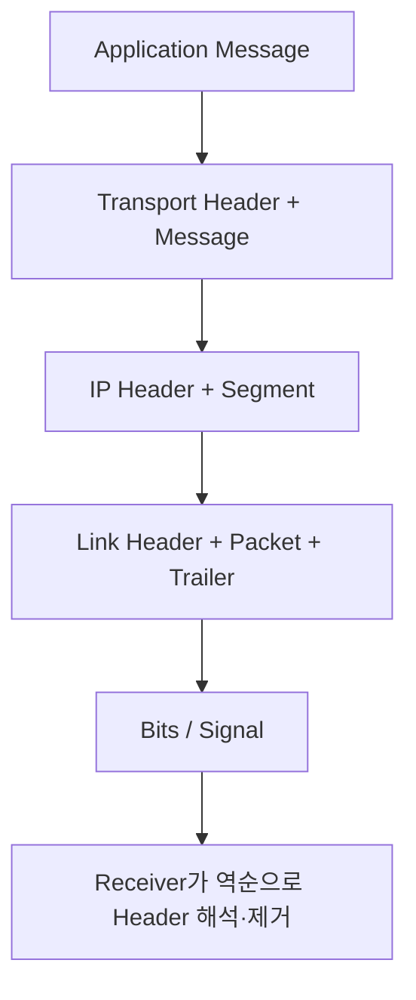
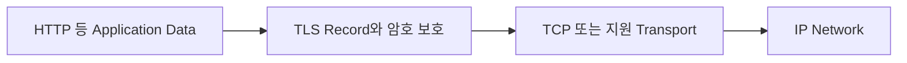
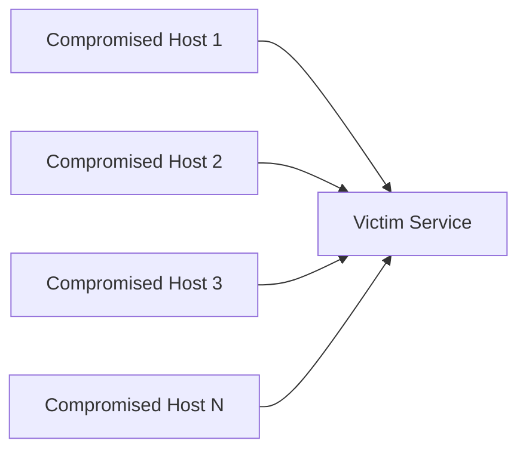

# Protocol Layering과 Network Security

<strong>목차</strong>

- [Layering이 필요한 이유](#layering이-필요한-이유)
- [TCP/IP 5-Layer Model](#tcpip-5-layer-model)
- [Encapsulation과 Decapsulation](#encapsulation과-decapsulation)
- [보안이 기본 가정이 아니었던 Internet](#보안이-기본-가정이-아니었던-internet)
- [TLS의 위치와 역할](#tls의-위치와-역할)
- [Sniffing과 Wireshark](#sniffing과-wireshark)
- [IP Spoofing과 DDoS](#ip-spoofing과-ddos)
- [핵심 정리](#핵심-정리)

TCP/IP 5계층의 역할과 Encapsulation, 기본적인 Network 위협과 보호 수단을 정리합니다.

> 관련 노트: [Internet과 Network Architecture](internet-and-network-architecture.md) · [Application Architecture와 HTTP](application-architecture-and-http.md)

## Layering이 필요한 이유

- 복잡한 통신 기능을 책임별로 분리합니다.
- 각 Layer는 위 Layer에 Service를 제공하고 아래 Layer의 Service를 사용합니다.
- Interface가 유지되면 한 Layer의 구현을 바꿔도 다른 Layer에 미치는 영향을 줄일 수 있습니다.
- 표준화와 독립적인 구현·검증이 쉬워집니다.

단, Header와 처리 단계가 늘어나는 Overhead가 있고 Layer 경계를 넘어선 최적화가 어려울 수 있습니다.

## TCP/IP 5-Layer Model

| Layer | 주요 역할 | 대표 Protocol / 기술 | Data Unit |
| --- | --- | --- | --- |
| Application | Application 사이의 Message와 의미 | HTTP, DNS, SMTP | Message |
| Transport | Process-to-Process 전송 | TCP, UDP, QUIC | Segment / Datagram |
| Network | Host-to-Host Addressing과 Routing | IP, ICMP | Packet / Datagram |
| Link | 한 Link의 Frame 전달과 Media Access | Ethernet, Wi-Fi | Frame |
| Physical | Bit를 Signal로 전달 | Copper, Fiber, Radio | Bit |

## Encapsulation과 Decapsulation

- Switch는 일반적인 Ethernet Forwarding에서 주로 Link-Layer Header를 봅니다.
- Router는 Link Frame을 제거한 뒤 Network-Layer Header를 보고 다음 Link를 선택하고 새 Frame을 만듭니다.
- End Host는 Transport Header의 Port를 이용해 올바른 Process로 Data를 전달합니다.
- Firewall, NAT, Tunnel, Load Balancer 같은 장비는 기본 계층 모델보다 더 많은 Header를 검사하거나 변경할 수 있습니다.

## 보안이 기본 가정이 아니었던 Internet

초기 Internet은 신뢰할 수 있는 연구 Network 사이의 연결에서 출발했습니다. 현대 Network에서는 Confidentiality, Integrity, Authentication, Availability를 별도로 확보해야 합니다.

| 위협 | 핵심 동작 | 대표 대응 |
| --- | --- | --- |
| Packet Sniffing | 전달 중인 Traffic 관찰 | TLS, WPA2/3, 안전한 Tunnel |
| Spoofing | Source Address나 Identity 위조 | Authentication, Ingress Filtering |
| Tampering | Message 변조 | MAC, Digital Signature, TLS |
| DoS / DDoS | Resource를 소진해 Service 방해 | Rate Limit, Filtering, Capacity, 분산 방어 |
| Malware | Host에서 악성 동작 수행 | Patch, Least Privilege, Endpoint Protection |

## TLS의 위치와 역할

TLS는 Application이 주고받는 Data에 다음 속성을 제공합니다.

- Server 또는 Peer Authentication
- Data Confidentiality
- Message Integrity

TLS가 사용되어도 Endpoint 자체의 Malware, 잘못된 Authorization, Traffic Volume을 이용한 DoS까지 자동으로 해결되는 것은 아닙니다.

## Sniffing과 Wireshark

- Packet Capture는 장애 분석과 Protocol 학습에 유용하지만 권한 없는 Traffic 수집은 개인정보와 인증 정보를 노출할 수 있습니다.
- Switched Ethernet에서는 일반 Port가 모든 Unicast Frame을 받는 것은 아닙니다.
- Wi-Fi Frame을 폭넓게 수집하려면 Interface와 Driver가 Monitor Mode를 지원해야 할 수 있습니다.
- 암호화된 Traffic에서는 Header Metadata는 보일 수 있어도 Application Payload는 보호됩니다.

## IP Spoofing과 DDoS

### IP Spoofing

Source IP Address를 위조해 다른 Host가 보낸 Packet처럼 보이게 합니다. 단순 위조만으로 TCP Connection을 완전히 가로채기는 어렵지만, 반사·증폭 공격이나 신뢰 기반 정책 우회에 악용될 수 있습니다.

### DDoS

여러 Source가 동시에 Traffic을 보내면 Source 하나만 차단하기 어렵습니다. Network Edge의 Filtering, Anycast/CDN, Rate Limit, Upstream 협력이 함께 필요할 수 있습니다.

## 핵심 정리

- Layering은 통신 기능을 책임별로 분리하고 표준 Interface로 연결합니다.
- Encapsulation은 각 Layer의 Control Information을 Header로 추가하는 과정입니다.
- Internet 연결 자체는 Confidentiality나 Authentication을 보장하지 않습니다.
- TLS는 도청·변조·위조를 줄이지만 Endpoint 보안과 Availability 대책은 별도로 필요합니다.
