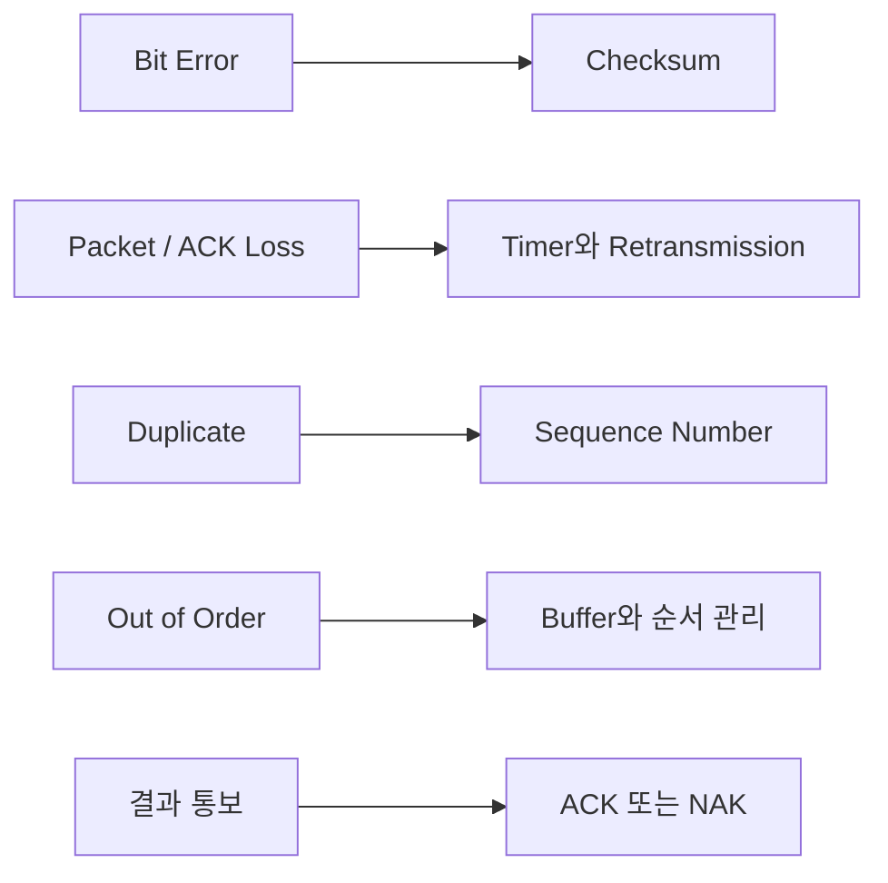
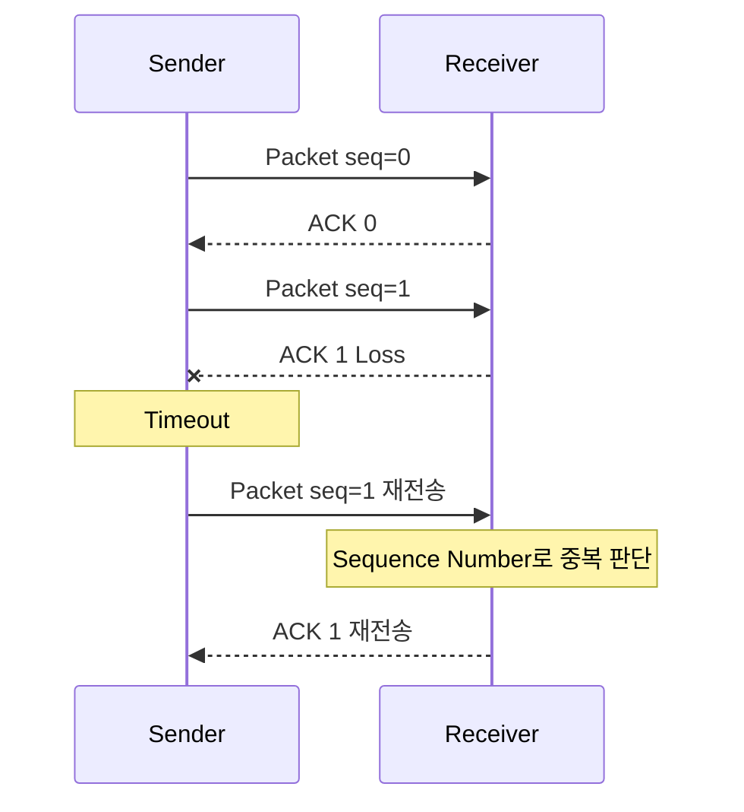
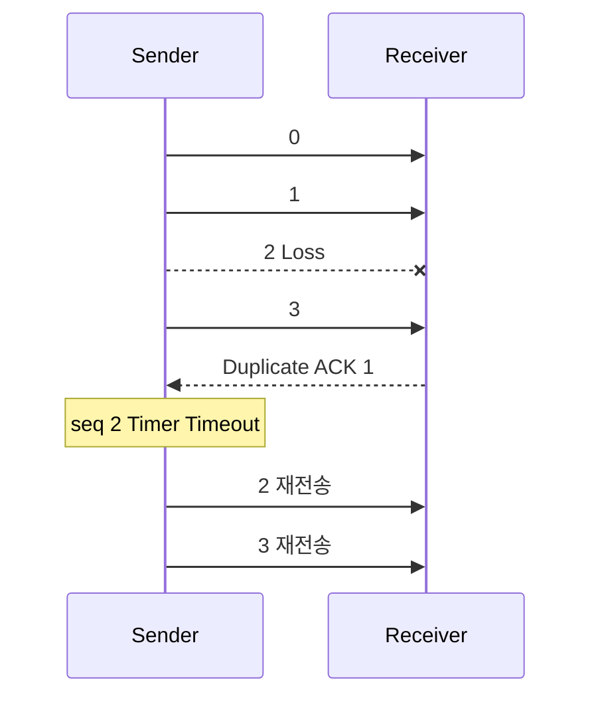

# Reliable Data Transfer

<details>
<summary><strong>목차</strong></summary>

- [신뢰성을 위해 필요한 요소](#신뢰성을-위해-필요한-요소)
- [rdt Protocol의 발전](#rdt-protocol의-발전)
- [Stop-and-Wait](#stop-and-wait)
- [Timeout의 Trade-off](#timeout의-trade-off)
- [Stop-and-Wait의 성능](#stop-and-wait의-성능)
- [Pipelining과 Sliding Window](#pipelining과-sliding-window)
- [Go-Back-N](#go-back-n)
- [Selective Repeat](#selective-repeat)
- [핵심 정리](#핵심-정리)

</details>

오류와 손실이 있는 Channel 위에서 신뢰성을 만드는 과정과 Pipelined Protocol을 정리합니다.

> 관련 노트: [Transport Layer와 UDP](transport-layer-and-udp.md) · [TCP](tcp.md)

## 신뢰성을 위해 필요한 요소



Sender는 Receiver의 상태를 직접 볼 수 없으므로 Feedback과 Timeout을 이용해 전송 결과를 추론합니다.

## rdt Protocol의 발전

| Protocol | Channel 가정 | 추가 Mechanism | 남은 문제 |
| --- | --- | --- | --- |
| rdt 1.0 | Error와 Loss 없음 | Data 전달만 수행 | 현실적 Channel을 처리하지 못함 |
| rdt 2.0 | Bit Error 가능 | Checksum, ACK/NAK, 재전송 | ACK/NAK 손상 시 중복 발생 가능 |
| rdt 2.1 | Data와 Feedback 손상 가능 | Sequence Number, 중복 제거 | State가 복잡해짐 |
| rdt 2.2 | rdt 2.1과 같음 | NAK 없이 ACK와 Duplicate ACK 사용 | Loss는 처리하지 못함 |
| rdt 3.0 | Packet과 ACK Loss 가능 | Timer, Timeout Retransmission | Stop-and-Wait 성능 한계 |

## Stop-and-Wait

Sender는 Packet 하나를 전송하고 결과를 확인하기 전에는 다음 Packet을 보내지 않습니다.



### Sequence Number 0과 1

Stop-and-Wait에서는 이전 Packet과 현재 Packet만 구별하면 되므로 Alternating Bit인 0과 1을 번갈아 사용할 수 있습니다.

- Receiver가 기대한 Sequence Number를 받으면 Data를 한 번만 전달하고 ACK를 보냅니다.
- 이미 처리한 Sequence Number가 다시 오면 Application에 재전달하지 않고 이전 ACK를 다시 보냅니다.
- ACK가 손실되어 Sender가 재전송해도 중복 실행을 막을 수 있습니다.

## Timeout의 Trade-off

- Timeout이 너무 짧으면 ACK가 오는 중인데 불필요한 재전송이 발생합니다.
- Timeout이 너무 길면 실제 Loss 복구가 늦어집니다.
- Sender는 재전송에 필요한 Packet Copy와 Timer State를 보관해야 합니다.
- ACK가 어느 전송에 대한 것인지 구분하려면 Sequence Number가 필요합니다.

## Stop-and-Wait의 성능

Packet 전송 시간을 `L/R`, 왕복 시간을 `RTT`라 하면 단순화한 Sender Utilization은 다음과 같습니다.

```text
U_sender = (L/R) / (RTT + L/R)
```

고속 Link와 긴 RTT에서는 Packet을 보내는 시간보다 ACK를 기다리는 시간이 훨씬 길 수 있습니다.

```text
Sender:   [Packet 1] ---------------- wait ---------------- [Packet 2]
Link:                 대부분의 시간 동안 전송하지 못함
```

## Pipelining과 Sliding Window

Pipelining은 ACK를 기다리는 동안 여러 Packet을 연속으로 전송합니다. Sender Window는 ACK 없이 전송할 수 있는 Sequence Number 범위를 나타냅니다.

```text
Sequence: 0 1 2 3 4 5 6 7 8 9
          [ACKed] [ Sent, unACKed ] [ Sendable ] [Not allowed]
                    <------ Sender Window ------>
```

ACK를 받으면 Window의 왼쪽 경계가 앞으로 이동합니다.

## Go-Back-N

- Sender는 최대 `N`개의 미확인 Packet을 전송합니다.
- Receiver는 보통 기대한 다음 Packet만 순서대로 받아들이고 Out-of-Order Packet은 버립니다.
- Cumulative ACK는 해당 번호까지 연속 수신했다는 뜻입니다.
- 가장 오래된 미확인 Packet의 Timer가 만료되면 그 Packet과 이후 미확인 Packet을 다시 보냅니다.



## Selective Repeat

- Receiver가 Window 안의 Out-of-Order Packet을 Buffer에 저장합니다.
- 각 Packet을 개별 ACK합니다.
- Sender는 Timeout되거나 손실된 Packet만 선택적으로 재전송합니다.
- 효율은 높지만 Packet별 Timer와 Receiver Buffer 관리가 복잡합니다.

| 항목 | Go-Back-N | Selective Repeat |
| --- | --- | --- |
| ACK | Cumulative | 개별 Packet ACK |
| Out-of-Order | 보통 폐기 | Buffer에 저장 |
| 재전송 | 손실 지점 이후 여러 Packet | 손실 Packet 중심 |
| 구현 | 단순 | 복잡 |
| Loss가 많을 때 | 불필요한 재전송 증가 | 대역폭 효율이 높음 |

### Sequence Number 공간

Selective Repeat에서 Sequence Number를 순환 재사용할 때 새 Packet과 오래 지연된 Packet을 혼동하면 안 됩니다. Window 크기가 `N`이면 Sequence Number 공간은 일반적으로 최소 `2N` 이상이어야 합니다.

## 핵심 정리

- Checksum, ACK, Sequence Number, Timer와 Retransmission을 조합해 신뢰성을 만듭니다.
- Sequence Number는 재전송된 Duplicate를 새 Data와 구분합니다.
- Stop-and-Wait은 단순하지만 RTT가 큰 고속 Link를 충분히 활용하지 못합니다.
- Go-Back-N은 단순하고 Selective Repeat은 Loss 상황에서 효율적이지만 State가 더 많습니다.
