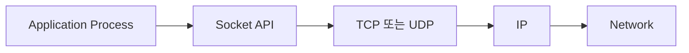
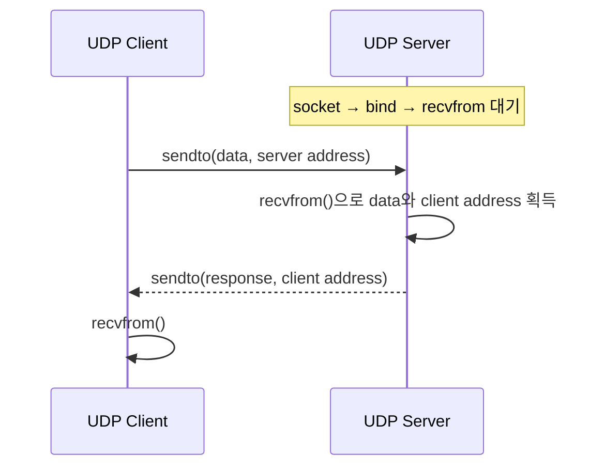
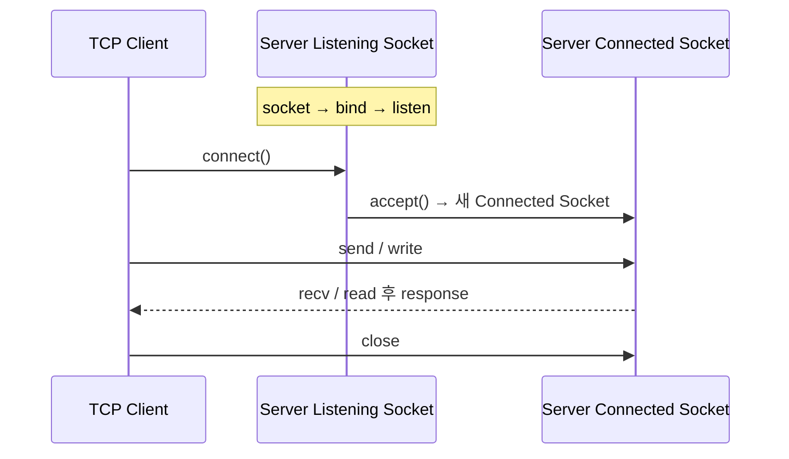

# Socket Programming

<details>
<summary><strong>목차</strong></summary>

- [Socket](#socket)
- [Address와 Port](#address와-port)
- [UDP Socket](#udp-socket)
- [TCP Socket](#tcp-socket)
- [UDP와 TCP API 비교](#udp와-tcp-api-비교)
- [구현할 때 자주 놓치는 점](#구현할-때-자주-놓치는-점)
- [핵심 정리](#핵심-정리)

</details>

Application이 UDP와 TCP Socket API를 사용해 통신하는 과정을 정리합니다.

> 관련 노트: [Application Architecture와 HTTP](application-architecture-and-http.md) · [Transport Layer와 UDP](transport-layer-and-udp.md) · [TCP](tcp.md)

## Socket

Socket은 Application Process와 Transport Layer 사이의 Interface입니다.



Application은 Socket에 Data와 상대 Address를 전달합니다. OS는 Transport Header 생성, IP Routing, Link 전송 같은 작업을 처리합니다.

## Address와 Port

- IP Address는 Host 또는 Network Interface를 식별합니다.
- Port Number는 Host 안의 Transport Endpoint를 식별합니다.
- Server는 Client가 찾을 수 있는 알려진 Port에 `bind()`합니다.
- Client는 보통 OS가 선택한 Ephemeral Port를 사용합니다.
- 실제 Connection은 Protocol과 Local/Remote Address·Port 조합으로 구분됩니다.

## UDP Socket

UDP는 Connection Setup 없이 Datagram을 주고받습니다.



### Server 흐름

```text
socket(AF_INET, SOCK_DGRAM)
bind(server_address)
loop:
    data, client_address = recvfrom()
    sendto(response, client_address)
```

### Client 흐름

```text
socket(AF_INET, SOCK_DGRAM)
sendto(data, server_address)
response = recvfrom()
close()
```

UDP는 Datagram 경계를 보존하지만 Delivery, 순서, 중복 제거를 보장하지 않습니다. Application이 필요하면 Timeout과 재전송을 직접 설계해야 합니다.

## TCP Socket

TCP Server는 연결 요청을 받는 Listening Socket과 Client별로 Data를 주고받는 Connected Socket을 구분합니다.



### Server 흐름

```text
listen_socket = socket(AF_INET, SOCK_STREAM)
bind(server_address)
listen()
loop:
    connection, client_address = accept()
    data = connection.recv()
    connection.sendall(response)
    connection.close()
```

### Client 흐름

```text
socket(AF_INET, SOCK_STREAM)
connect(server_address)
sendall(data)
response = recv()
close()
```

## UDP와 TCP API 비교

| 항목 | UDP | TCP |
| --- | --- | --- |
| Setup | 없음 | `connect()`와 `accept()` |
| Server Socket | 보통 하나로 여러 Client 처리 | Listening Socket + Connection별 Socket |
| 상대 Address | `sendto()`마다 지정 가능 | Connection 설정 뒤 Socket에 결합 |
| Data 경계 | Datagram 경계 보존 | Byte Stream, Message 경계 없음 |
| Delivery | 보장하지 않음 | Reliable, In-Order Byte Stream |

## 구현할 때 자주 놓치는 점

### TCP는 Message Protocol이 아니다

한 번의 `send()`가 수신 측의 한 번의 `recv()`와 일치하지 않습니다. Application은 Length Prefix, Delimiter, 고정 길이 Header 같은 Framing을 정의해야 합니다.

```text
Sender: send("HELLO") + send("WORLD")
Receiver가 읽을 수 있는 예:
  "HELLOWORLD"
  "HEL" + "LOWORLD"
  "HELLO" + "WORLD"
```

### Partial I/O와 종료

- `send()`는 일부 Byte만 처리할 수 있으므로 언어가 제공하는 `sendall()` 또는 반복 처리가 필요합니다.
- `recv()`가 빈 결과를 반환하면 Peer가 정상적으로 Stream을 닫았다는 뜻일 수 있습니다.
- Blocking Socket은 응답이 없으면 계속 기다릴 수 있으므로 실제 Service에서는 Timeout을 고려합니다.
- Network Byte Order와 Character Encoding을 명시해야 합니다.

### Local Test

- `127.0.0.1`과 `::1`은 Loopback Address로 같은 Host 안에서 Client와 Server를 시험할 때 사용합니다.
- Loopback 성공만으로 Firewall, NAT, DNS, 실제 Network Delay까지 검증되는 것은 아닙니다.

## 핵심 정리

- Socket은 Process가 Transport Service를 사용하는 API입니다.
- UDP Server는 Datagram마다 Client Address를 확인하고, TCP Server는 `accept()`로 Client별 Connected Socket을 만듭니다.
- TCP는 Byte Stream이므로 Application-Level Message Framing이 필요합니다.
- Timeout, Partial I/O, Encoding과 Resource 정리를 실제 구현에서 함께 처리해야 합니다.
