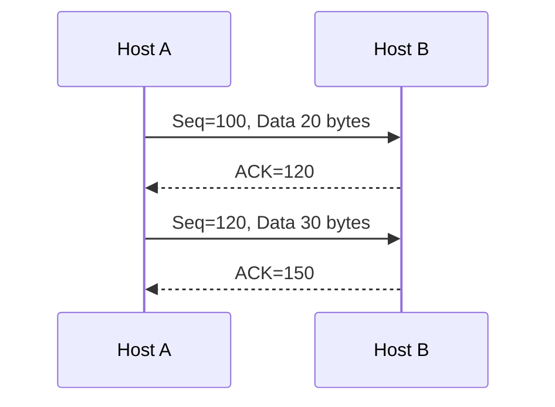
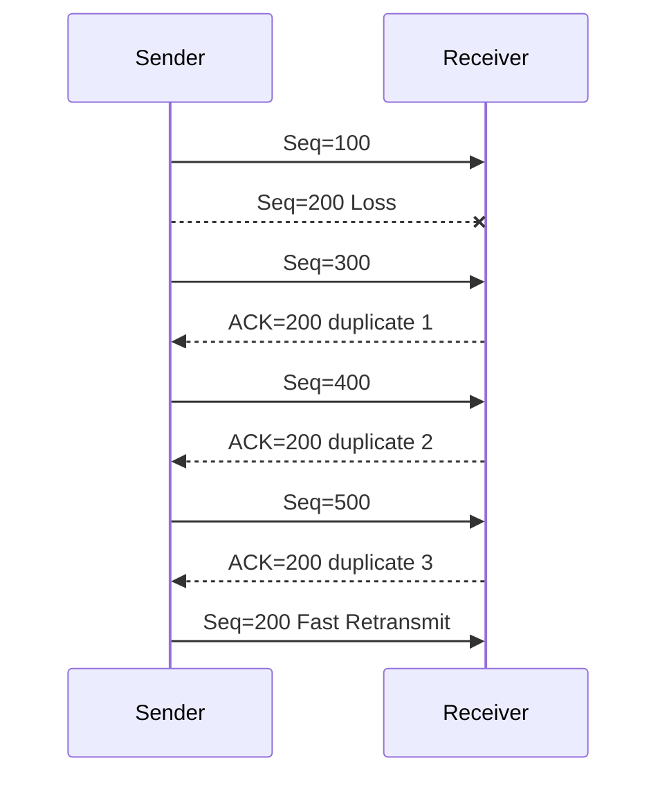
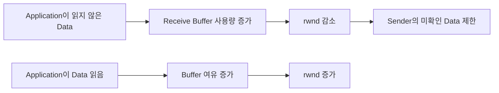
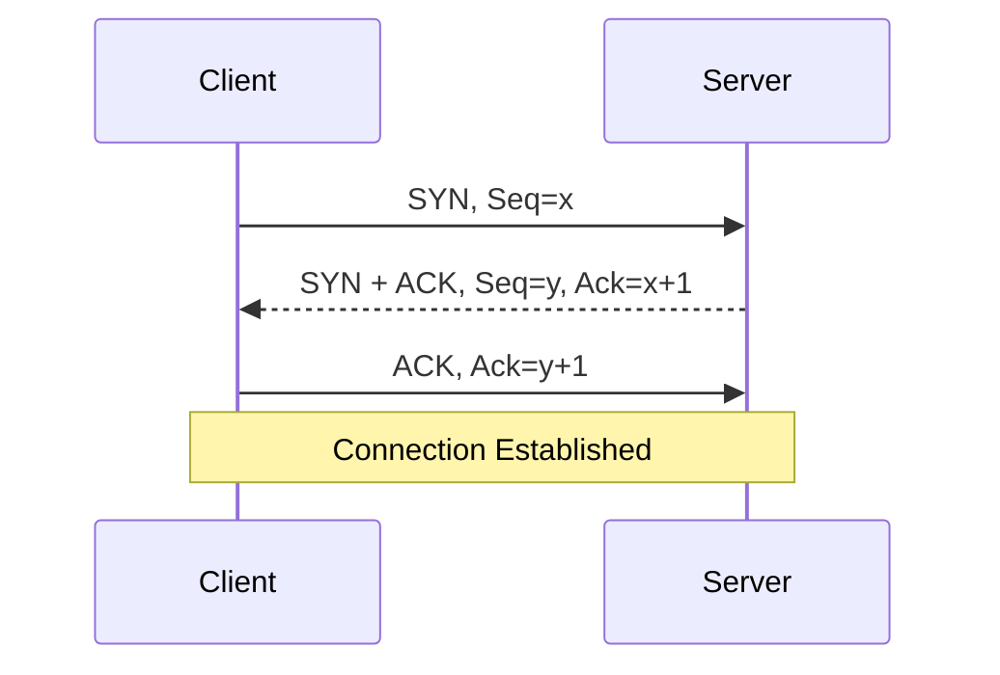
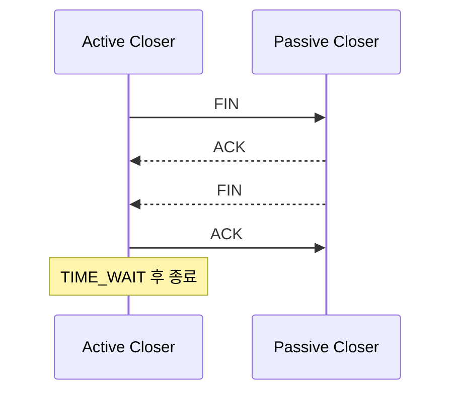

# TCP

<details>
<summary><strong>목차</strong></summary>

- [TCP의 주요 특징](#tcp의-주요-특징)
- [Byte Stream과 Segment](#byte-stream과-segment)
- [TCP Header의 핵심 Field](#tcp-header의-핵심-field)
- [Sequence Number와 Cumulative ACK](#sequence-number와-cumulative-ack)
- [RTT와 Retransmission Timeout](#rtt와-retransmission-timeout)
- [TCP Retransmission](#tcp-retransmission)
- [Flow Control](#flow-control)
- [Three-Way Handshake](#three-way-handshake)
- [Connection 종료](#connection-종료)
- [핵심 정리](#핵심-정리)

</details>

TCP의 Byte Stream, Segment 구조, Sequence·ACK, RTT, Flow Control과 Connection Management를 정리합니다.

> 관련 노트: [Reliable Data Transfer](reliable-data-transfer.md) · [Congestion Control](congestion-control.md) · [Socket Programming](socket-programming.md)

## TCP의 주요 특징

- 두 Endpoint 사이의 Point-to-Point Connection
- Reliable, In-Order Byte Stream
- Full-Duplex Data Transfer
- Cumulative ACK와 Pipelining
- Receiver를 보호하는 Flow Control
- Network를 보호하는 Congestion Control
- Data 전송 전 Connection Setup

TCP의 현재 기본 명세는 [RFC 9293](https://www.rfc-editor.org/rfc/rfc9293.html)입니다.

## Byte Stream과 Segment

TCP는 Application의 Message 경계를 보존하지 않고 연속된 Byte Stream을 제공합니다.

```text
Application write:  "HELLO"  +  "WORLD"
TCP Byte Stream:     H E L L O W O R L D
Segment 예시:       [H E L] [L O W O] [R L D]
```

Sender의 Segment 분할과 Receiver의 `read()` 단위는 Application의 `write()` 호출 단위와 다를 수 있습니다.

### MSS

MSS(Maximum Segment Size)는 TCP Segment 하나에 넣을 수 있는 최대 Payload 크기입니다.

```text
Ethernet MTU 1500 - IPv4 Header 20 - TCP Header 20 = MSS 1460 bytes
```

이는 Option이 없는 일반적인 예시이며 IPv6, TCP Option, Tunnel 사용 시 값이 달라질 수 있습니다.

## TCP Header의 핵심 Field

| Field | 역할 |
| --- | --- |
| Source / Destination Port | 양쪽 Process 식별 |
| Sequence Number | Segment Data의 첫 Byte 번호 |
| Acknowledgment Number | 다음에 받기를 기대하는 Byte 번호 |
| Data Offset | TCP Header 길이 |
| Flags | SYN, ACK, FIN, RST 등 Control 정보 |
| Window | Receiver가 추가로 받을 수 있는 Byte 수 |
| Checksum | Header·Data 오류 탐지 |
| Options | MSS, Window Scale, SACK, Timestamp 등 |

## Sequence Number와 Cumulative ACK

Sequence Number는 Packet 개수가 아니라 Byte 위치를 기준으로 증가합니다.



`ACK=150`은 149번 Byte까지 연속으로 받았고 다음에는 150번 Byte를 기대한다는 뜻입니다.

### Piggybacking

Full-Duplex Connection에서 반대 방향 Data를 보낼 때 ACK 정보를 같은 Segment Header에 함께 넣을 수 있습니다. 별도 ACK-only Segment를 줄일 수 있지만 너무 오래 기다리면 Sender의 전송을 지연하므로 Delayed ACK에는 제한이 필요합니다.

## RTT와 Retransmission Timeout

RTT는 시간에 따라 변하므로 최근 Sample을 그대로 사용하지 않고 EWMA로 평활화합니다.

```text
EstimatedRTT = (1 - α) × EstimatedRTT + α × SampleRTT
DevRTT       = (1 - β) × DevRTT + β × |SampleRTT - EstimatedRTT|
Timeout      = EstimatedRTT + 4 × DevRTT

대표 값: α = 0.125, β = 0.25
```

- Timeout이 너무 짧으면 불필요한 재전송이 늘어납니다.
- 너무 길면 실제 Loss 복구가 늦어집니다.
- 재전송된 Segment의 RTT Sample은 어느 전송의 ACK인지 모호할 수 있어 측정에 주의합니다.

## TCP Retransmission

### Timeout

가장 오래된 미확인 Data의 Timer가 만료되면 재전송합니다.

### Fast Retransmit

같은 ACK가 반복되면 중간 Segment가 빠졌지만 뒤의 Segment는 도착하고 있다고 추정할 수 있습니다. 전통적인 TCP는 Triple Duplicate ACK를 Loss Signal로 사용해 Timeout 전에 빠진 Segment를 재전송합니다.



SACK Option을 사용하면 Receiver가 받은 비연속 구간을 알려 Sender가 더 정확히 재전송할 수 있습니다.

## Flow Control

Flow Control은 빠른 Sender가 느린 Receiver의 Buffer를 넘치게 하지 않도록 합니다.



Receiver는 ACK의 Window Field로 `rwnd`를 광고합니다. Sender가 실제로 전송할 수 있는 양은 Flow Control의 `rwnd`와 Congestion Control의 `cwnd` 중 더 작은 값에 제한됩니다.

## Three-Way Handshake



Handshake는 양쪽이 통신 가능한지 확인하고 초기 Sequence Number와 Option을 교환합니다. 단순 2-Way Handshake는 지연된 옛 Connection Request와 새 Connection을 구분하기 어렵습니다.

## Connection 종료

TCP는 양방향 Stream을 각각 닫으므로 일반적인 정상 종료에는 FIN과 ACK 교환이 양방향으로 필요합니다.



TIME_WAIT는 지연된 Segment가 새 Connection에 섞이는 것을 막고 마지막 ACK 재전송 가능성을 남깁니다. RST는 정상적인 Half-Close 절차와 다른 즉시 초기화 신호입니다.

## 핵심 정리

- TCP는 Message가 아니라 Reliable Byte Stream을 제공합니다.
- Sequence Number와 ACK Number는 Byte 위치를 나타냅니다.
- Timeout과 Duplicate ACK로 Loss를 감지하고 재전송합니다.
- Flow Control은 Receiver Buffer를 보호하며 Congestion Control과 목적이 다릅니다.
- Three-Way Handshake로 초기 상태를 맞추고 FIN 교환으로 양방향 Stream을 종료합니다.
