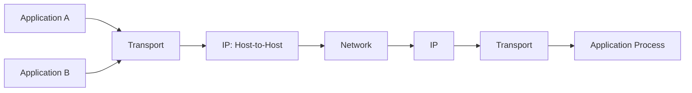
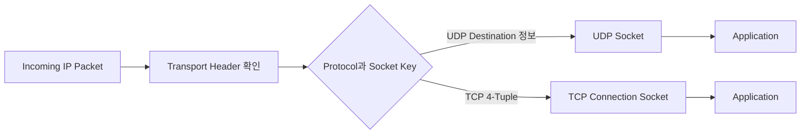
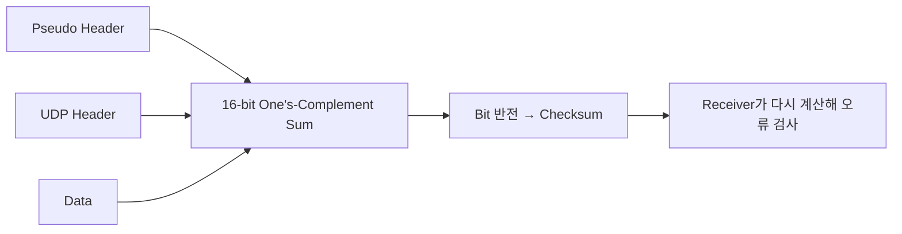

# Transport Layer와 UDP

<details>
<summary><strong>목차</strong></summary>

- [Transport Layer의 역할](#transport-layer의-역할)
- [TCP와 UDP 비교](#tcp와-udp-비교)
- [Multiplexing과 Demultiplexing](#multiplexing과-demultiplexing)
- [UDP](#udp)
- [UDP Checksum](#udp-checksum)
- [UDP가 적합한 경우](#udp가-적합한-경우)
- [핵심 정리](#핵심-정리)

</details>

Process-to-Process 통신, Multiplexing·Demultiplexing, UDP Header와 Checksum을 정리합니다.

> 관련 노트: [Socket Programming](socket-programming.md) · [Reliable Data Transfer](reliable-data-transfer.md) · [TCP](tcp.md)

## Transport Layer의 역할

Network Layer가 Host-to-Host 전달을 담당한다면 Transport Layer는 서로 다른 Host에서 실행되는 Process 사이의 논리적 통신을 제공합니다.



- Sender는 Application Message에 Transport Header를 붙여 Segment 또는 Datagram을 만듭니다.
- Receiver는 Port와 Connection 정보를 이용해 올바른 Process에 Payload를 전달합니다.
- Internet의 대표 Transport Protocol은 TCP와 UDP이고, QUIC은 UDP 위에서 Transport 기능과 보안을 구현합니다.

## TCP와 UDP 비교

| 기능 | TCP | UDP |
| --- | --- | --- |
| Connection Setup | 있음 | 없음 |
| Delivery와 순서 | Reliable, In-Order Byte Stream | 보장하지 않음 |
| Flow Control | 있음 | 없음 |
| Congestion Control | 있음 | Protocol 자체에는 없음 |
| Data 경계 | Byte Stream | Datagram 경계 보존 |
| Header | 상대적으로 큼 | 고정 8 Byte |

UDP가 항상 빠르다는 뜻은 아닙니다. Setup과 Protocol 기능이 적어 Overhead가 작지만 Reliability, Congestion 대응, Security가 필요하면 Application 또는 상위 Protocol이 구현해야 합니다.

## Multiplexing과 Demultiplexing

### Multiplexing

Sender에서 여러 Socket의 Data를 모아 Transport Header를 붙이고 Network Layer로 내립니다.

### Demultiplexing

Receiver에서 Header 정보를 보고 적절한 Socket으로 Payload를 전달합니다.



| Protocol | 개념적으로 사용하는 식별 정보 |
| --- | --- |
| UDP | Local IP, Destination Port 중심; Source Address도 Application에 전달 가능 |
| TCP | Source IP, Source Port, Destination IP, Destination Port의 4-Tuple |

같은 Server Port를 사용하더라도 TCP는 4-Tuple이 다르면 여러 Connection을 구분할 수 있습니다.

## UDP

UDP(User Datagram Protocol)는 IP 위에 Port 기반 Multiplexing, Length, Checksum을 추가한 최소한의 Datagram Service입니다. 기본 규격은 [RFC 768](https://www.rfc-editor.org/rfc/rfc768.html)입니다.

### UDP Header

```text
  0               15 16              31
 +------------------+------------------+
 |   Source Port    | Destination Port |
 +------------------+------------------+
 |      Length      |     Checksum     |
 +------------------+------------------+
 |                Data ...             |
 +-------------------------------------+
```

| Field | 의미 |
| --- | --- |
| Source Port | 송신 Process의 Port; 응답 대상 식별에 사용 가능 |
| Destination Port | 수신 Process의 Port |
| Length | UDP Header와 Data 전체 길이 |
| Checksum | Header와 Data의 Bit Error 탐지 |

## UDP Checksum

Sender는 UDP Header와 Data뿐 아니라 IP Source·Destination, Protocol, UDP Length를 포함한 Pseudo Header를 이용해 One's-Complement Sum을 계산합니다.



- Pseudo Header는 잘못된 IP Endpoint로 전달된 Datagram을 탐지하는 데 도움을 줍니다.
- Checksum은 Error Detection 수단이지 Error Correction이나 Retransmission 기능이 아닙니다.
- 모든 가능한 Error Pattern을 검출하는 강한 암호학적 Integrity Mechanism도 아닙니다.

## UDP가 적합한 경우

- Application이 자체 Reliability와 Congestion Control을 구현하는 경우
- 일부 Loss를 허용하고 낮은 Delay를 우선하는 Real-Time Media
- 짧은 Request/Response를 사용하는 DNS 같은 Protocol
- Multicast 또는 Broadcast가 필요한 경우
- QUIC처럼 UDP를 기반으로 새로운 Transport 기능을 구현하는 경우

UDP 사용은 Network에 과도한 Traffic을 보내도 된다는 뜻이 아닙니다. Application은 Rate Control, Congestion 대응, Message Size, Timeout과 보안을 고려해야 합니다.

## 핵심 정리

- Transport Layer는 Port와 Connection 정보로 Process-to-Process 전달을 제공합니다.
- Multiplexing은 여러 Application Data를 내려보내는 과정이고 Demultiplexing은 올바른 Socket으로 나누는 과정입니다.
- UDP는 8-Byte Header로 최소 기능만 제공하며 Delivery와 순서를 보장하지 않습니다.
- UDP Checksum은 오류를 탐지하지만 손실 복구와 보안까지 제공하지는 않습니다.
