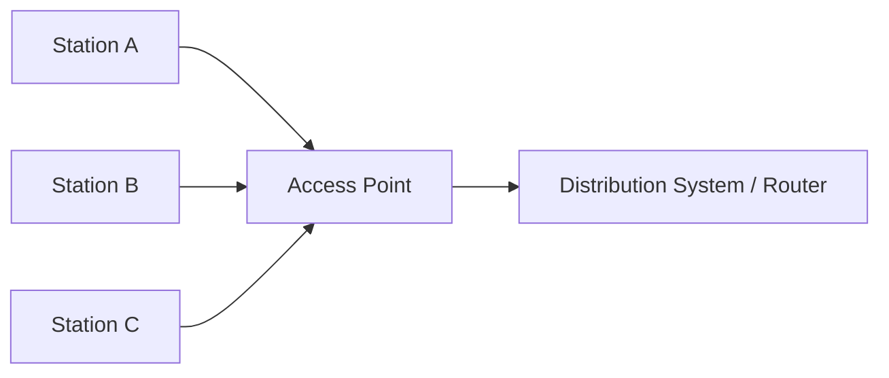
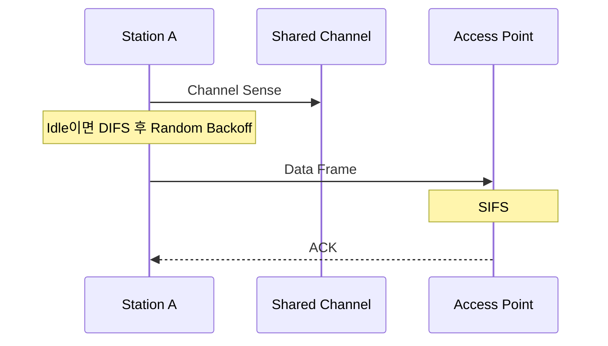
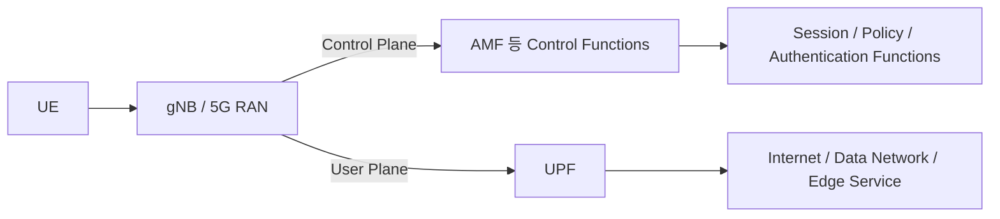

# Wireless와 Mobile Networks

<details>
<summary><strong>목차</strong></summary>

- [Wireless Channel의 특징](#wireless-channel의-특징)
- [Wi-Fi와 IEEE 802.11](#wi-fi와-ieee-80211)
- [CSMA/CA](#csmaca)
- [Wi-Fi 세대와 핵심 기술](#wi-fi-세대와-핵심-기술)
- [OFDM, OFDMA, MIMO](#ofdm-ofdma-mimo)
- [Wi-Fi와 Cellular의 차이](#wi-fi와-cellular의-차이)
- [5G System Architecture](#5g-system-architecture)
- [NSA와 SA](#nsa와-sa)
- [Network Slicing과 5G Service](#network-slicing과-5g-service)
- [NTN, ISAC과 6G 연구](#ntn-isac과-6g-연구)
- [핵심 정리](#핵심-정리)

</details>

Wi-Fi의 공유 매체 제어와 5G System Architecture, MIMO·OFDMA·Network Slicing을 정리합니다.

> 관련 노트: [Access Network와 Physical Media](access-networks-and-physical-media.md) · [Protocol Layering과 Network Security](protocol-layering-and-security.md)

## Wireless Channel의 특징

- Radio Signal은 공간으로 퍼지며 같은 Channel을 여러 Station이 공유할 수 있습니다.
- 거리, 장애물, 반사, 간섭, 이동에 따라 Signal Quality가 변합니다.
- Sender가 모든 Receiver의 상태를 직접 알기 어렵고 Hidden Terminal이 존재할 수 있습니다.
- 유선 Full-Duplex Ethernet과 달리 일반적인 Wi-Fi Channel에서는 송신과 수신을 동시에 수행하기 어렵습니다.

## Wi-Fi와 IEEE 802.11

Wi-Fi는 IEEE 802.11 계열 WLAN 기술을 기반으로 합니다. 표준 현황은 [IEEE 802.11 Working Group](https://www.ieee802.org/11/)에서 확인할 수 있습니다.



Infrastructure Mode에서는 Station이 AP를 통해 같은 LAN과 외부 Network에 연결됩니다. 모든 Station이 같은 무선 자원을 동시에 독점할 수 없으므로 Media Access Control이 필요합니다.

## CSMA/CA

Wi-Fi는 Collision을 전송 중 직접 감지하기 어려워 Collision Avoidance를 사용합니다.



### 기본 흐름

1. Channel이 Busy이면 전송하지 않고 기다립니다.
2. Idle 구간을 확인한 뒤 Random Backoff Counter를 줄입니다.
3. Counter가 0이 되면 Frame을 전송합니다.
4. ACK를 받지 못하면 Collision 또는 Loss로 보고 Contention Window를 키워 재시도합니다.

### Hidden Terminal과 RTS/CTS

```text
Station A ----> AP <---- Station B
Station A와 B는 서로의 Signal을 듣지 못하지만 AP에서는 충돌할 수 있음
```

RTS/CTS는 짧은 Control Frame으로 Channel 사용 시간을 예약해 긴 Data Frame의 Collision 비용을 줄일 수 있습니다. Control Overhead가 있으므로 항상 사용하는 것은 아닙니다.

## Wi-Fi 세대와 핵심 기술

| Wi-Fi 세대 | IEEE 계열 | 대표 Band | 핵심 변화 |
| --- | --- | --- | --- |
| Wi-Fi 4 | 802.11n | 2.4 / 5 GHz | MIMO, Channel Bonding |
| Wi-Fi 5 | 802.11ac | 5 GHz | Wider Channel, Downlink MU-MIMO |
| Wi-Fi 6 / 6E | 802.11ax | 2.4 / 5 / 6 GHz | OFDMA, 개선된 MU-MIMO, 효율 향상 |
| Wi-Fi 7 | 802.11be | 2.4 / 5 / 6 GHz | Multi-Link Operation, 더 넓은 Channel, 고차 변조 |

실제 속도는 Channel 폭, Spatial Stream, 신호 품질, 규제, Client Capability와 경쟁 Station 수에 따라 달라집니다. 표준의 최대 PHY Rate가 Application Throughput과 같지는 않습니다.

## OFDM, OFDMA, MIMO

### OFDM과 OFDMA

```text
OFDM 한 전송 구간:  [ subcarrier 1 | 2 | 3 | 4 | 5 | 6 ] → 한 사용자 중심
OFDMA:              [ A | A | B | B | C | C ] → Resource Unit을 사용자별 할당
```

- OFDM은 Channel을 서로 직교하는 여러 Subcarrier로 나눕니다.
- OFDMA는 시간·주파수 Resource Unit을 여러 사용자에게 나눠 작은 Packet이 많은 환경의 효율을 높입니다.

### MIMO와 Beamforming

- MIMO는 여러 Antenna와 Spatial Stream을 이용해 Throughput 또는 Reliability를 높입니다.
- MU-MIMO는 여러 사용자를 같은 시간 자원에서 지원할 수 있습니다.
- Beamforming은 Antenna 신호의 위상·크기를 조절해 특정 방향의 Signal을 강화합니다.
- 실제 이득은 Channel 상태와 Antenna 구성에 따라 달라집니다.

## Wi-Fi와 Cellular의 차이

| 항목 | Wi-Fi | 5G Cellular |
| --- | --- | --- |
| 운영 | 개인·조직이 AP 설치 가능 | 이동통신 사업자가 RAN과 Core 운영 |
| Spectrum | 주로 비면허 Band | 면허 Band 중심, 일부 공유 Band 가능 |
| Access Control | 경쟁 기반 CSMA/CA 중심 | Base Station의 중앙 Scheduling 중심 |
| Mobility | AP 사이 Roaming | 넓은 Coverage와 이동성 관리 |
| Architecture | WLAN과 IP Network | RAN + 5G Core + Service Network |

## 5G System Architecture

5G System은 User Equipment, Radio Access Network, 5G Core와 Data Network로 구성됩니다. 세부 구조는 [3GPP TS 23.501](https://portal.3gpp.org/desktopmodules/Specifications/SpecificationDetails.aspx?specificationId=3144)에 정의됩니다.



- Control Plane은 Registration, Authentication, Mobility, Session Control 등을 처리합니다.
- User Plane은 실제 Application Packet을 전달합니다.
- CP와 UP를 분리하면 Service 요구에 따라 Function을 배치하고 확장하기 쉽습니다.

## NSA와 SA

| 구분 | NSA | SA |
| --- | --- | --- |
| 의미 | LTE 기반 요소와 NR을 함께 사용 | NR과 5G Core를 중심으로 독립 구성 |
| 도입 | 기존 LTE Infrastructure를 활용해 단계적 배포 | 5G Core 기능을 본격 활용 |
| 기능 | 구성 Option에 따라 제약 | Slicing, Service-Based Core 등 5G 기능 활용에 유리 |

NSA와 SA는 단순히 Radio 속도만의 차이가 아니라 Core와 Control 구조의 차이입니다.

## Network Slicing과 5G Service

Network Slicing은 같은 Physical Infrastructure 위에 서로 다른 Service 요구를 위한 논리적 Network를 구성하는 개념입니다.

| Service 방향 | 요구 특성 | 예시 |
| --- | --- | --- |
| eMBB | 높은 Data Rate와 Capacity | 고화질 Video, Broadband |
| URLLC | 매우 낮은 Latency와 높은 Reliability | 산업 제어 계열 |
| mMTC | 매우 많은 저전력 Device 연결 | 대규모 Sensor |

이는 목표 범주이며 실제 Service 보장은 Radio, Core, Transport, Edge, Application 전체 설계에 달려 있습니다.

## NTN, ISAC과 6G 연구

- NTN(Non-Terrestrial Network)은 Satellite·고고도 Platform 등을 이동통신망과 결합합니다.
- ISAC(Integrated Sensing and Communication)은 통신 Signal과 Spectrum을 Sensing에도 활용하려는 방향입니다.
- AI/ML은 Radio 최적화, Network 운영, 예측 등에 연구·적용되고 있습니다.
- 6G는 아직 연구와 표준화가 진행 중인 영역이므로 확정된 상용 규격처럼 단정하면 안 됩니다.

2026년 3GPP는 Release 20에서 6G Radio, Architecture, ISAC, NTN, AI/ML 관련 Study를 진행하고 있습니다. 최신 상태는 [3GPP RAN Working Group Report](https://www.3gpp.org/news-events/3gpp-news/ran113-reports)처럼 시점이 명시된 공식 자료로 확인해야 합니다.

## 핵심 정리

- Wi-Fi는 공유 무선 Channel에서 CSMA/CA와 Random Backoff로 전송을 조정합니다.
- OFDMA는 주파수 자원을 여러 사용자에게 나누고 MIMO는 공간 차원을 활용합니다.
- 5G는 RAN뿐 아니라 Control·User Plane이 분리된 Core Architecture를 포함합니다.
- Wi-Fi는 경쟁 기반 Local Access, Cellular는 사업자 Scheduling과 Mobility 관리가 중심입니다.
- 6G·ISAC 같은 주제는 진행 중인 Study와 확정된 표준을 구분해야 합니다.
