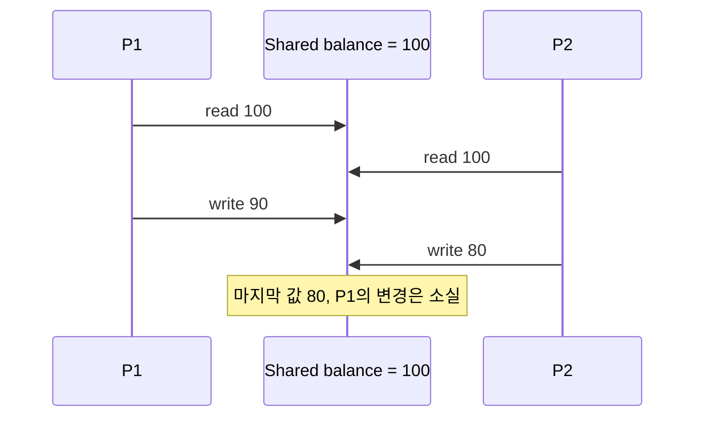

# Concurrency와 Mutual Exclusion

<details>
<summary><strong>목차</strong></summary>

- [Multiple Processes](#section-1)
- [Race Condition](#section-2)
- [Mutual Exclusion : Software Approaches](#section-3)
- [SW Solution 1](#section-4)
- [SW Solution 2](#section-5)
- [SW Solution 3](#section-6)
- [SW Solution 4](#section-7)
- [Dekker’s 알고리즘](#section-8)
- [Peterson’s 알고리즘](#section-9)
- [복습 질문](#section-10)
- [질문1](#section-11)
- [질문2](#section-12)
- [Dekker와 Peterson 연습 문제](#section-13)
  - [첫 번째 문제 - Dekker](#section-14)
  - [두 번째 문제 - Dekker](#section-15)
  - [세 번째 문제 - Dekker](#section-16)
  - [네 번째 문제 - Peterson](#section-17)
  - [다섯 번째 문제 - Peterson](#section-18)
  - [여섯 번째 문제 - Peterson](#section-19)
- [질문4](#section-20)
- [질문5](#section-21)
- [Concurrency 고려 상황](#section-22)
  - [Process Interation](#section-23)
  - [Control Problems](#section-24)
- [Requirements for Mutual Exclusion](#section-25)
- [Approaches for Mutual Exclusion](#section-26)
  - [Software Approaches](#section-27)
  - [An Approach using the Special-Purpose Machine Instruction](#section-28)
  - [An Approach using Support within the OS or a Programming Language](#section-29)
- [Compare & Swap Instruction](#section-30)
- [Exchange Instruction](#section-31)
- [위 HW Instruction을 이용해 Critical Section을 구현하는 방법](#section-32)
- [HW Mutual Exclusion](#section-33)

</details>


Race Condition과 Critical Section, Software 및 Hardware 상호배제 기법을 정리합니다.

> 관련 노트: [Semaphore, Monitor와 동기화 문제](synchronization-primitives.md) · [Deadlock](deadlocks.md)

- 용어 설명
    - Concurrency
        - 동시성
        - Concurrency Control → OS의 중요한 역할중 하나
    - Mutual Exclusion
        - 상호 배제성
    - Synchronization
        - 동기화

<a id="section-1"></a>
## Multiple Processes

- 현대 OS가 여러 프로세스들을 관리하는데 있어 주요한 기법
    - Multi-Programming
        - 시스템 안에 메모리 안에서 여러 Process가 동시에 들어가서 번갈아, 또는 동시에 실행을 하는 것을 말한다.
        - 단일 CPU던 멀티 CPU던 결국 그 이상의 Process가 메모리에 대기 중일테니 위 행동은 동일함
    - Multi-Processing
        - 여기는 진짜 여러 개의 CPU가 있는 상황이다.
        - n개의 CPU가 있어 n개의 프로그램이 동시에 실행되는 상황을 말한다.
    - Distributed Processing
        - 2장에서 배웠던 Distriobuted OS 같은 것이다.
        - 각각 가지고 있는 각각의 시스템들이, 가지고 있는 OS 위에다가 한 레이어를 더 깔아서 전체 시스템을 하나의 시스템처럼 사용을 하도록 하는 것
        - 여기서도 각각의 시스템에서 프로세스들이 실행이 되니까 동시에 실행이 되는 것
        - 현 OS는 기본적으로 Multi-Programming, Multi-Processing, Distributed Processing 등이 전부 가능하다.
            - 때문에 한 번에 한 프로그램만 실행하는 것이 아닌, 여러 프로그램들이 동시에 실행되어야 한다.
            - 이 상황을 Concurrency 라고 한다.
- Concurrency의 주요 이슈
    - interleaving과 overlapping의 발생을 관리해야함
        - interleaving : a 실행, b 실행, c 실행, 다시 a, b, c 처럼 순서 설정
        - overlapping : abc가 동시에 실행되는 상황
    - 간접적으로 통신/interaction을 하는 경우 관리를 할 때가 문제임
        - 예를 들어 Shared Memory Segment의 데이터를 읽고 쓰고 할 때, 그 데이터가 다른 사람들도 읽고 쓸 수 있는 데이터 일 때
        - 만약 OS가 Concurrency Control을 제대로 수행하지 못한다면,
        - OS 자체가 먹통이 될 수 있음
    - 왜냐? OS 자체가 process나 thread의 집합이기 때문에
- 예시


이게 단순히 x가 아니라, 은행 계좌이체 상황이라고 한다면, 은행 P1에서 내 통장의 정보를 읽어 100만원을 추가하고 있음.

근데 추가한 작업을 다시 수정하기 전에, 은행 P2에서 수정되지 않은 내 통장의 정보를 읽어 200만원을 추가하고 있음.

그럼 내 통장에는 x + 300이 되어야 하지만, 결과적으로는 x +100 또는 x +200이 통장에 찍혀있으며, 100 또는 200만원의 돈이 공중분해가 되어버림.

위 같은 상황을 Race Condition이라고 표현함.

<a id="section-2"></a>
## Race Condition



- Race Conditon이 발생하는 경우
    - 여러 프로세스나 쓰레드가 데이터를 읽고 쓸 때
    - 데이터의 최종 결과가 프로세스의 실행과 연관이 되어있을 때
- Output은 race의 마지막에 누가 도착했는지에 따라 달림
    - 당연하지만, 생기면 안되는 상황임. 위에 돈 공중분해된 거 보셈 ㅇㅇ
- 이 Race Condition이 발생하지 않도록 코드를 작성해야하며,
- 가장 쉬운 해결 방법은 read, 연산, write 모두 한 단위로 묶어서 동시에 실행되지 않게 하는 것이다.
    - 이러한 조치를 상호 배제, Mutual Exclusion이라고 한다.

<a id="section-3"></a>
## Mutual Exclusion : Software Approaches

- Mutual Exclusion, 상호배제성을 구현
    - 이를 위해 Critical Section을 구성
- Critical Section (임계구역)
    - 프로그램의 일부 코드로,
    - 한 번에 하나의 프로세스만 접근할 수 있도록 설정한 공간이다.
- Critical Section의 코드는 다른 프로그램의 Critical Section 코드와 동시에 interleaving이나 overlapping 을 하지 못하도록 설계되어 있다.
    - 한 프로세스가 Critical Section의 코드를 실행하기 시작했으면, 다른 프로세스는 기다려야 한다.
- Critical Section Code의 Mutual Exclusive한 실행을 위한 방법 3가지
    - OS가 코드를 잘 작성해서 이 Critical Section이 동시에 실행되지 않게 하는 것(Software 적 해결법)
    - Hardware Instruction의 도움을 받아 동시에 실행되지 않도록 하게 하는 것
    - Semaphore를 사용해 동시에 실행되지 않도록 하게 하는 것
- 아래에는 먼저 SW 해결책을 제시하고, 가정은 Process가 2개라는 가정

<a id="section-4"></a>
## SW Solution 1


- Critical Section을 실행하려는 프로세스가 2개라는 가정
- 공유 변수 turn을 이용한 접근 제한
    - 여기서 공유 변수 turn은 CS의 실행의 여부를 결정하는 변수
    - turn = 0인 경우 P0가 접근해 Critical Section의 코드를 실행할 수 있다.
        - 이 때 P1은 Critical Section에 접근할 수 없다.
        - P0가 Critical Section을 실행하고 turn의 값을 1로 바꾼다.
    - turn = 1인 경우 P1가 접근해 임계구역의 코드를 실행할 수 있음.
        - 이 때 P0은 임계구역에 접근할 수 없다.
        - P1은 Critical Section을 실행하고 turn의 값을 0으로 바꾼다.
    - 장단점
        - Mutual Exclusion이 보장된다.
        - 하지만 Busy Waiting (Spin Waiting) 문제가 발생함
            - 프로세스가 번갈아가면서 실행되어야 함.
                - turn = 0이고 P1이 접근해야한다고 할 때, P0이 접근하기 전까지는 P1은 무한대기를 해야함.
                - 예를 들어 P0이 10분마다, P1이 한 시간마다 실행이 된다면
                    - 결국 P0도 한 시간마다 실행하게 됨.
        - 만약 한 프로세스가 fail이 나면, 다른 프로세스는 영원히 blocked됨

<a id="section-5"></a>
## SW Solution 2


- Mutual Exclusion을 구현할 때 생각해야할 상황 3가지
    - 상대편이 Critical Section을 실행하고 있을 때
        - Sol.1에서는 공유변수 turn 1개로 관리되므로 다른 쪽은 진입하지 못함.
    - 둘이 동시에 Critical Section에 진입하려고 할 때
        - 더 빠른 사람 한 명만 진입하여 실행할 수 있어야 함.
    - 아무도 실행을 하지 않고 있고, 내가 진입하려고 할 때
        - 앞선 Sol.1에서 해결하지 못함.
- 공유변수 flag 2개를 사용(Process가 2개)
    - flag[0], 0번 플래그는 P0, 0번 프로세스가 CS에 진입할 의사가 있다는 것을 나타내는 플래그
    - flag[1], 1번 플래그는 P1, 1번 프로세스가 CS에 진입할 의사가 있다는 것을 나타내는 플래그
    - 임계구역에 진입할 생각이 없다고 할 때, flag를 0, false로 설정
    - 진입할 생각이 있으면 flag를 1, true로 설정
- 알고리즘 실행
    - 처음에는 flag가 둘 다 0으로 셋팅
    - CS에 진입을 하고 싶으면, 상대의 flag를 확인함.
    - 상대편의 flag가 true일 경우, 내가 양보를 함.
        - 계속 1번 코드 또는 5번 코드 while문을 돌게 됨.
    - 상대편의 flag가 false일 경우, 내가 내 flag를 true로 바꿈
        - 이러면 나는 CS에 진입할 의사가 있고, CS에 진입했다는 의미가 됨.
    - CS 내의 코드를 실행하고, 작업이 다 끝나면 자신의 flag를 다시 false로 바꿈
        - CS에서의 일이 다 끝났으니 나왔다는 의미
    - 위의 ‘나’의 표현은 프로세스를 뜻하며,
        - P0의 경우에는 자신의 0번 플래그를 조작하는 것이고,
        - P1의 경우에는 자신의 1번 플래그를 조작하는 것이다.
- Mutual Exclusion이 지켜지지 않음
    - 상대편 flag를 보고 0인 것을 확인, while문을 빠져나옴
    - time-out 등 어떠한 이유로 본인의 flag를 true로 바꾸기 전에 CPU를 빼앗김
    - 상대편 프로세스도 CPU를 할당 받고, CS로 진입하기 위해 내 flag를 확인함
    - 내 flag는 true로 바꾸기 전에 switching을 당했으므로 false로 확인됨.
    - 상대편 프로세스도 CS로 진입
    - 두 프로세스가 당당하게 CS에 진입, 실행을 하게됨.

<a id="section-6"></a>
## SW Solution 3


- 똑같이 flag를 2개 사용하고 Sol.2에서 1번과 2번 코드, 5번과 6번 코드의 위치를 바꿈.
- Sol.3에서는 상대편 flag를 보기 전에 자신의 flag를 1로 바꾸어 Critical Section에 진입할 의사가 있다고 표시
    - 이를 통해 Sol.2에서 실패한 Mutual Exclusion을 보장함.
- DeadLock 문제 발생
    - DeadLock이란?
        - 어떤 프로세스가 한 문장(while 같은)에 갇혀있고, 탈출을 위해서는 다른 프로세스의 변수가 바껴야 하는데, 그 다른 프로세스도 동일한 상황에 있어서 서로 영원히 그 멈춰있는 문장에서 나아가지 못하는 경우
        - deadlock에 걸릴 경우에는 탈출 방법이 0%이다.
    - 1번과 2번 코드 사이에 cpu만 빼앗기지 않는다면 deadlock은 발생하지 않는다.
    - 1번과 2번 코드 사이에 빼앗겨서 P1이 실행, 5번 코드가 실행되면은 둘 다 flag가 true인 상황이 되어, 영원히 while에 갇혀있게 됨.

<a id="section-7"></a>
## SW Solution 4


- 위 Sol.3의 DeadLock 문제를 해결하기 위해 ‘양보’ 를 진행함.
    - 만약 상대가 이미 Critical Section에 들어갔거나 서로 진입하려고 할 때,
    - 자신의 flag를 false로 바꾸고 일정시간동안 대기를 진행함.
    - 그리고 반복문을 돌다가 상대의 flag가 false가 되면, 임계구역에 진입
- P0과 P1이 동시에 진입하는 경우
    - 두 Process가 각각 1번과 8번 코드를 진행함.
    - 둘 다 서로 플래그를 보면서 true임을 확인
    - 둘 다 양보를 하고 delay를 진행함.
    - 만약 기다리는 시간이 상대와 다르다면,
        - 먼저 대기 시간이 짧은 쪽이 상대의 false를 보고 Critical Section에 진입하게 됨.
    - 만약 기다리는 시간이 상대와 같다면,
        - 계속 서로는 true → false → true → false가 반복되면서 무한정 반복하게 됨
        - 즉, LiveLock이 발생하게 됨.
            - 이 livelock의 경우에는 한 문장만 어긋나도 발생하지 않을 문제이므로, deadlock 발생 비율보다는 현저히 낮다.
            - 또한 delay 시간을 조절해서 비율을 낮추거나 없앨 수도 있다.
- Sol.4의 LiveLock 상황


<a id="section-8"></a>
## Dekker’s 알고리즘


- 위 Sol.4의 문제는 두 프로세스가 동시에 양보하는 것이 문제이다.
    - 확률은 현저히 낮지만, 동시에 계속 양보를 하게되면, 서로 while을 반복하며 Livelock 상태에 걸리게 된다.
- 이를 위해서 flag[2]와 turn을 사용한다.
    - 여기서 turn은 Sol.1처럼 들어갈 사람을 위한 변수가 아닌 양보할 사람을 고르는 변수다.
- 알고리즘 진행 및 Mutual Exclusion 고려상황 3가지
    - P0가 critical section에 진입하기 위해서 자신의 flag를 true로 만듦
    - 만약 상대편(P1) flag가 false라면, 그냥 스근하게 Critical Section에 진입하면 됨. (고려 상황 1)
    - 만약 상대편(P1) flag가 true라면, turn 값을 보는 것임 (고려 상황 2)
        - 만약 turn이 1이라면, 우선 순위가 P1에게 있다는 뜻이고, P0가 flag를 false로 바꾸고 대기함.
        - 경쟁중이거나 critical section을 실행 중인 P1은 Critical Section을 실행하고 마지막에서 turn을 0으로 바꾸고 자신의 flag도 false로 만듬.
        - 그럼 대기중이던 P0은 turn이 0이 되었음을 확인, 임계구역으로 진입하게 됨.
- 동시에 진입한다면, (고려 상황 3)
    - 둘다 동시에 flag를 true로 바꾸고 서로의 flag값이 true임을 확인하게 됨.
    - 하지만 turn을 확인할 때, 3번과 13번에서 갈리게 됨.
    - turn이 1이라면, P0는 2번 3번 코드를 진행할 것이고, P1은 14번, 15번, 16번 코드를 진행하게 될 것이다.
    - 그리고 P0쪽에서 P1의 flag가 false가 되었음을 확인하다면, 임계구역에 진입하게 됨.

<a id="section-9"></a>
## Peterson’s 알고리즘

```text
shared boolean flag[2] = {false, false}
shared integer turn

enter(i):
    j = 1 - i
    flag[i] = true
    turn = j
    while flag[j] and turn == j:
        wait

    critical_section()
    flag[i] = false
```

- Dekker는 Critical Section에 진입하고 작업을 한 후에 turn을 양보하지만,
- Peterson에서는 Critical Section에 진입하기 전에  turn 값을 바꿔 먼저 양보를 한다.
    - 이를 통해 코드가 간결해지는 장점이 있다.
- 고려 상황 3가지
    - 상대편이 Critical Section을 실행하고 있을 때
        - P0는 자신의 flag를 true로, turn도 1로 만듬
        - 3번 코드를 수행하며 상태편 flag가 1, true 이므로 while문을 반복하게 됨
        - 즉, P0는 상대 P1이 CS 내의 코드를 전부 수행하고 CS를 나오면서 자신의 flag, flag[1]을 false로 바꾸기 전까지는 3번 while문에서 대기하게 됨.
    - 둘이 동시에 Critical Section에 진입하려고 할 때
        - P0는 1번 코드, P1은 7번 코드를 동시에 실행하게 됨.
        - P0는 2번 코드에서 turn을 1로, P1은 8번 코드에서 turn을 0으로 바꾸게 됨.
            - 여기서 turn은 공유변수이므로, ‘한’ 개의 변수임
            - 따라서 turn은 0 또는 1이 됨.
        - 이제 3번과 9번 코드에서 turn의 향방에 따라 한쪽은 대기하고, 한쪽은 실행하게 됨.
    - 아무도 실행을 하지 않고 있고, 내가 진입하려고 할 때
        - 상대편의 flag가 false이기 때문에, 진입하려는 쪽은 언제든지 진입할 수 있음.
- Peterson의 알고리즘은 자신의 이름을 적고 자신이 확인해서 Critical Section에 진입하는 것이 아닌, 상대편의 이름을 적으면서 확인을 하게되기 때문에 동시성 문제가 생기지 않음
- Peterson 알고리즘의 특징
    - 교대 진입 불필요
    - Mutual Exclusion 지켜짐
    - Deadlock 발생 가능성 없음
    - Livelock 발생 가능성 없음

<a id="section-10"></a>
## 복습 질문

<a id="section-11"></a>
## 질문1

질문이라기 보다는 중간고자 문제 예고인데,

위의 Sol.2 같은 코드를 주고, 왜 Mutual Exclusion이 지켜지냐 지켜지지 않냐를 물어보고, 안지켜진다면 어떤 순서로 작업을 했을 때 상호 배제성이 지켜지지 않냐고 물어볼 것임.

<a id="section-12"></a>
## 질문2


Dekker의 알고리즘에서 P0나 P1이 CS에 진입, 그리고 10번 작업들까지 진행함.

근데 여기서, 한 프로세스가 cpu를 계속 차지한다고 할 때, 계속 반복하면서 여러번 Critical Section에 진입할 수 있는지

상대방이 Critical Section에 진입할 의사가 있을 때의 경우를 말하는 것

- 특정 프로세스가 CPU를 계속 점유한다고 해도, 연속으로 진입할 수 없다.
- Dekker의 코드를 단계적으로 따라가면 답이 나온다.
    - P0가 CPU를 독점하고 있는 상황에서 P1이 진입의사가 있는 경우 (flag[1] = true)
    1. P0가 Critical Section의 접근, 코드 7번부터 작업을 진행함.
    2. P0가 Critical Section 작업을 끝내면서 CS를 탈출하기 전 양보를 진행하며 turn = 1로 바꿈
    3. P0가 다시 Critical Section에 진입하기 위해 코드 1번을 수행하며 flag[0] = true로 바꿈
    4. P0가 상대방의 flag를 확인하는데, P1은 진입의사가 있으므로 flag[1] = true
    5. 상대방 P1이 진입의사가 있으므로, turn을 확인하는데 turn == 1 조건이 true임.
    6. 그대로 6번 코드로 진입하며 turn이 0이 될 때까지, turn == 1일 동안에는 계속 반복하게 됨. (강제 반복대기)
- 결론적으로는, 한 프로세스가 CPU를 계속 차지한다고 해도, CS를 한 번 빠져나오면서 turn을 넘겨주기 때문에, 상대 프로세스가 진입의사가 있다면 계속 CPU를 차지하고 있는 프로세스는 스스로 flag를 내리고 무한 대기 상태에 빠진다.
- 이 알고리즘은 한 프로세스가 자원을 독점하며 다른 프로세스가 영원히 실행되지 못하는 Starvation(기아 현상)이 발생하지 않는다.

<a id="section-13"></a>
## Dekker와 Peterson 연습 문제

Dekker와 Peterson 알고리즘 관련 중간고사 대비 문제 알려주심

같은 형태의 질문을 Dekker와 Peterson에 각각 적용한 형식임.

- Dekker 알고리즘


<a id="section-14"></a>
### 첫 번째 문제 - Dekker

- P0도 P1도 Critical Section에 진입의사가 없는 상황에서
- 이제 둘이 동시에 CS에 진입하려고할 때,
- 턴 값에 따라 누가 CS에 진입하고 누구는 ‘어떤’ while문에서 대기하는지

#### 1번 문제 대답

- turn = 1이라고 가정했을 때,
- 서로의 flag가 true인 것을 보고 P0와 P1 모두 각 2번 while, 12번 while문 내로 진입
- P0는 turn == 1이 참이므로 if 내부로 진입하여 자신의 flag[0]를 내리고 5번 while문에서 turn == 1이 거짓이 될 때까지 대기하게 된다.
- P1은 일반적으로는 12번에서 turn == 0은 False이므로 if 내부 코드를 건너뛰고 다시 12번 while의 조건문을 확인하고 CS로 이동하게된다.
    - 다만, 만약 아직 P0측에서 4번 코드를 실행하기 전에 P1이 계속 동작을 한다면,
    - 여전히 flag[0] = True이므로 P0는 12번 while문에서 계속 반복을 진행하게 된다.
- turn = 0일 때는 이 반대가 된다.

<a id="section-15"></a>
### 두 번째 문제 - Dekker

- 이미 P0가 CS 내 코드를 진행하고 있는 상황
- P1이 CS를 진입하려고 while에 대기하려고 할 때, turn 값에 따라 대기하는 while문 지점이 어디인지

#### 2번 문제 대답

- turn이 0일 때(아직 7번 CS 코드를 실행 중이고, 8번 코드를 실행하지 않았을 때)
    - P1은 11번 코드를 실행시켜 자신의 flag[1]을 True로 바꾸고
    - 12번 코드에서 상대 flag[0]를 확인해 아직 true이므로 while 내부로 진입한다.
    - 13번 코드 if 조건문을 확인하며 지금은 turn == 0이 참이므로 if 내부로 진입한다.
    - 14번 코드를 실행하며 자신의 flag[1]를 내리고
    - 15번 코드 while 문에서 turn이 1이 될 때까지 대기하게 된다.
- turn이 1일 때(8번 코드까지 실행되었으나, 아직 9번 코드가 실행되지 않았음. 또는 P0가 이미 CS를 한 번 실행하고 turn을 1로 넘겼지만, P1의 flag가 false여서 다시 한 번 진입을 한 상태일 때)
    - P1은 11번 코드를 실행시켜 자신의 flag[1]을 True로 바꾸고
    - 12번 코드에서 상대 flag[0]를 확인해 true임을 확인, while 내부로 진입한다.
    - 13번 코드 if 조건문에서 turn = 0이므로 조건문이 거짓이되고, if문 내부로 진입하지 않는다.
    - 다시 12번 코드로 돌아가 조건문을 확인하며 flag[0]이 False가 될 때까지 12번 while에서 대기한다.

<a id="section-16"></a>
### 세 번째 문제 - Dekker

- P0가 CS 내의 7번 코드를 실행한 다음에, 다시 1번부터 시작해서 CS 7번 코드로 진입하는 것이 가능한지
- 이때 P1 또한 CS에 진입하기 위해 11~16코드 어딘가에서 대기하고 있는 상황

#### 3번 문제 대답

- 위의 질문2를 참조할 것. 문제에서 요구하는 것이 정확히 동일함.
- 결론만 얘기하면 “연속해서 진입할 수 없다” 가 정답
- 왜? turn값이 앞서 CS에서 나오기 직전에 turn을 1로 바꿔두고 나왔으므로 P0는 코드 5번에 while문에서 대기하게 됨.
    - 물론 시험에서는 몇 번 몇 번 코드와 flag값, turn값을 얘기하면서 잘 조합해서 작성해야함.

- Peterson 알고리즘


<a id="section-17"></a>
### 네 번째 문제 - Peterson

- 이미 P0가 CS 내 코드를 진행하고 있는 상황
- P1이 CS를 진입하려고 while에 대기하려고 할 때, turn 값에 따라 대기하는 while문 지점이 어디인지

#### 4번 문제 대답

<a id="section-18"></a>
### 다섯 번째 문제 - Peterson

- 이미 P0가 CS 내 코드를 진행하고 있는 상황
- P1이 CS를 진입하려고 while에 대기하려고 할 때, turn 값에 따라 대기하는 while문 지점이 어디인지

#### 5번 문제 대답

<a id="section-19"></a>
### 여섯 번째 문제 - Peterson

- P0가 CS 내의 4번 코드를 실행한 다음에, 다시 1번부터 시작해서 CS 4번 코드로 진입하는 것이 가능한지
- 이때 P1 또한 CS에 진입하기 위해 9번 코드에서 대기하고 있는 상황

#### 6번 문제 대답

<a id="section-20"></a>
## 질문4


Dekker 알고리즘에서

- P0가 5번 코드에서 대기하다가 turn이 0이 되어 5번 while을 빠져나오고
- 6번 코드에서 자신의 flag를 true로 바꾼 뒤 2번 코드로 돌아갔을 때,
- 분명 상대방 P1이 CS를 끝내고 turn을 넘겨주었음에서 P1의 flag[1]이 여전히 true로 보이는 경우가
- 두 가지의 상황에서 위 경우가 나온다. 이 두가지 상황은 무엇일까

- 상황 1 : P1이 너무 빠르고, 연속적으로 진입을 시도할 때
    - P1이 17번 CS 코드를 마치고, 18번 코드에서 turn을 0으로 넘겨주고, 19번 flag[1] = false로 만드는 등 순서대로 실행을 함
    - P1이 turn을 0으로 바꾸고, 코드 5번 while문에서 대기하던 P0가 6번 코드를 실행하고 2번 코드로 돌아가 flag[1]의 값을 확인하려고 함.
    - 여기서 P0가 flag[1]를 확인하기 전, P1이 남은 코드들(20번)을 처리하고 루프를 돌아 다시 11번 코드를 처리하여 flag[1] = true를 만들었음.
    - 그럼 P0가 flag[1]을 확인할 때는 true로 확인이 됨.
        - 이 경우, P0는 3번 코드를 검사하지만, turn = 0이 유지되고 있으므로 if문을 건너뛰고 2-3번만 반복하다가 P1이 14번 - 15번 코드 부분에 걸려 P0는 CS에 진입할 수 있게 됨.
    - 좀 더 정확히는, P1가 turn을 넘겨주고 P0가 대기문을 탈출한 뒤,
    - P1이 남은 코드를 다 수행하고 다시 CS에 진입하기 위해 다시 돌아와 11번 코드를 수행해 flag[1]을 true로 올리고, turn = 0이므로 if문 내부로 진입해 14번 코드에서 flag[1]을 false로 내리기 전,
    - 즉 P0의 2번 코드가 P1의 11번 수행, 14번 수행 직전 상황에 실행되면 위의 여전히 true인 경우가 나온다.
- 상황 2 : P0가 너무 느릴 때
    - P1이 17번 CS 코드를 마치고 18번 코드에서 turn = 0으로 바꾸었는데
    - 이 턴을 바꾸자마자 19번 코드를 실행하지 못하고 time out 등의 인터럽트에 의해 CPU를 P0에게 빼앗긴 경우
    - turn = 0으로 바뀌었지만, flag[1]은 여전히 true인 상황
    - 여기서 P0가 2번 코드를 수행하며 flag[1]의 값을 확인했지만, 앞에서 19번 코드를 수행하지 못했기 때문에 여전히 flag[1] = true인 경우이다.
        - 마찬가지로 P0는 2-3번 반복하다가 스케쥴러가 P1에게 CPU를 할당해주면 P1이 19번 코드를 실행, flag[1] = false로 바뀐다. 그리고 바뀐 flag를 보고 P0는 CS로 진입

<a id="section-21"></a>
## 질문5

Sol.4 코드의 상호 배제 성립 이유 적기


- CS에 진입하려할 때는 1번 또는 8번 코드, 또는 while문 내부의 5번 12번 코드를 통해서 자신의 flag를 반드시 올린다.
- 그 상태에서 2번 또는 9번 while 조건문을 통해 상대의 flag가 false 인 것을 확인해야만 루프를 탈출하여 CS에 진입할 수 있다.
- 즉, CS 진입 직전의 상태는 항상 내 flag = true, 상대 flag = false로 확정되므로, 두 프로세스가 동시에 CS에 진입하는 일은 논리적을 발생할 수 없다.

---

<a id="section-22"></a>
## Concurrency 고려 상황

<a id="section-23"></a>
### Process Interation

- Competition among Processes for Resources
    - 어떤 자원을 가지려고 경쟁하는 상황
    - 쉽게 Ready Queue에 있는 프로세스들은 전부 CPU를 차지하기 위해 경쟁하는 것
    - 근데 두 Process가 하나의 CPU를 쓰는 것도 안되고 한 Process가 두 개의 CPU를 써서도 안됨.
    - 이런 것들을 제어하는 것
- Cooperation among Processes by Sharing
    - Process 입장에서는 파일의 데이터나 Shared memory Segment 데이터를 공유할 때 내가 다른 사람과 같이 Co-op 하고 있다고 인식을 못할 때가 많음.
    - 그래서 5주차 내용처럼 Critical Section을 사용한 것
- Cooperation among Processes by Communication
    - 프로세스 간 직접적으로 통신하는 경우
    - A에서 B로 메세지를 보내면, A는 메세지를 보내고 B는 메세지를 받는 Co-op을 하게 됨.
    - 이 경우 중요한 것은, 메세지를 보냈으면 다음에 메세지를 받아야 한다는 것
    - 이 보내고 받는 순서가 굉장히 중요함.

<a id="section-24"></a>
### Control Problems

- Mutual Exclusion
    - Critical Section
        - Data를 Share하는 과정에서 발생하는 문제를 해결하기 위해 사용
    - Data Coherence
        - 시스템에서 Memory Mapping이라는 것을 함.
            - 메모리 매핑은, 파일에 있는 데이터를 프로세스가 자신의 메모리 주소로 가져와서 마치 본인의 메모리에 있는 것 마냥 사용하는 것
        - 근데 매핑된 파일이 공유 파일이면, 다른 프로세스도 매핑해갈 수 있음.
        - 어느 한 사람이 data에 접근해있는 동안, 다른 사람이 접근해서는 안됨.
- Deadlock
    - 프로세스가 진행되다가 멈춰섰는데, 이를 해결하기 위해서는 다른 프로세스의 도움이 필요한 상황이고
    - 이 필요한 다른 프로세스도 지금 멈춰있는 프로세스의 도움이 필요한 상태로 멈춰 있는 경우
- Starvation
    - 프로세스가 Ready Queue에 존재하지만, 우선순위로 인해 스케줄러가 해당 프로세스에게 CPU를 할당하지 않는 경우
    - 둘이 있다고 하면, 하나에만 CPU를 할당하고 다른 한 쪽에는 CPU를 할당해주지 않음.
    - 위 상황을 Starvation이 발생했다고 하고
    - Process 1이 Starvation에 빠져있다고도 표현할 수 있음.

<a id="section-25"></a>
## Requirements for Mutual Exclusion

- Mutual Exclusion, 상호 배제성이 무조건 지켜져야 함.
    - 오직 한 Process만이 Resource를 위한 Critical Section에 진입할 수 있음
- 다른 프로세스들이 CS에 진입할 의사가 없는데, 진입을 원하는 프로세스가 진입하는데 방해받지 말아야 함.
- Deadlock과 Starvation이 없어야 함.
- Process의 속도나 갯수에 대한 가정을 해서는 안됨.
    - 어떤 경우에도 적용할 수 있어야 함.
    - 5주차에서 한 경우는 2개의 process에 대한 경우였음.
    - Process n개에 대한 코드도 존재는 함.
- 한 Process는 Critical Section 내에 계속 있을 수 없음.

<a id="section-26"></a>
## Approaches for Mutual Exclusion

| 접근 방법 | 대기 방식 | 장점 | 주의점 |
| --- | --- | --- | --- |
| Software 알고리즘 | Busy waiting | 별도 HW 명령 불필요 | 구현이 복잡하고 프로세스 수 확장이 어려움 |
| Atomic HW 명령 | Busy waiting | 짧고 일반적인 lock 구현 가능 | CPU 시간을 소모하고 starvation 가능 |
| Semaphore | Blocking queue | CPU 낭비를 줄이고 순서를 제어 | wait/signal 순서를 틀리면 deadlock 가능 |
| Monitor | 언어/런타임이 lock 관리 | 구조화된 상호배제와 condition variable | 언어와 런타임 지원 필요 |

<a id="section-27"></a>
### Software Approaches

- Dekker’s Algorithm
- Peterson’s Algorithm

<a id="section-28"></a>
### An Approach using the Special-Purpose Machine Instruction

- Compare_and_swap_instruction
- Exchange instruction

<a id="section-29"></a>
### An Approach using Support within the OS or a Programming Language

- Semaphore
- Monitor

<a id="section-30"></a>
## Compare & Swap Instruction

```text
atomic compare_and_swap(address, expected, replacement):
    old = *address
    if old == expected:
        *address = replacement
    return old
```

- 3개의 Operand를 사용하는 하드웨어 기계어 명령어

int* word : 주소
int testval : 비교용 변수
int newval : 새로운 변수

int oldval : word가 가리키는 곳의 데이터를 저장하기 위한 변수

- 동작 순서
    - 메모리 주소(word가 가지고 있는 주소값)에 있는 기존 값을 읽어 oldval에 저장
    - oldval 값과 testval 값을 비교
    - 두 값이 같으면 word가 가리키고 있는 곳의 데이터를 newval로 덮어씀
    - 두 값이 다르면 값을 바꾸지 않고 그대로 둠
    - 명령어가 끝나면서 oldval을 최종 결과로 반환

- 위 instruction은 atomic instruction임.
    - 한 Fetch-Execution 사이클동안에 실행되는 것이므로, interrupt를 고려하지 않아도 됨.
- 위에는 편의를 위해 코드로 작성한 것이지, Hardware Instruction이다.
    - 그래서 이 코드 중에간 다른 코드를 끼워 넣거나 임의로 수정을 하거나 할 수가 없음.
    - 위 atomic instruction과 같은 얘기
- 이 명령을 실행하는 동안, 다른 instruction이 해당 메모리 위치로 접근하는 것이 제한됨.
    - 즉, 한 CPU가 word가 가진 memory 주소로 접근해 있는 동안, 다른 CPU는 해당 메모리 공간에 절대로 접근할 수가 없음.
        - 왜? 해당 공간을 Block시켜 두기 때문에
    - 완벽하게 한 번에 한 명씩만 실행됨을 보장함.

<a id="section-31"></a>
## Exchange Instruction

```text
atomic exchange(register, memory):
    temp = *register
    *register = *memory
    *memory = temp
```

- 2개의 피연산자를 받아 동작하는 하드웨어 기계어 명령어이다.

int* register : 레지스터 주소(keyi 값이 들어옴)
int* memory : 메모리 주소 (공유변수의 값이 들어옴)

int temp : memory와 register의 데이터값을 바꾸기 위한 매개변수

- 동작순서
    - 사실 동작순서라고 할 것도 없는게, 진짜로 memory와 register가 가지고 있는 주소의 데이터값만 바꾸는 동작만을 수행한다.
    - 진짜는 아래 CS 구현에서 발휘된다.

- Exchange Instruction 또한 atomic instruction이다.
    - Hardware Instruction이며, 코드를 임의로 수정할 수 없다.

<a id="section-32"></a>
## 위 HW Instruction을 이용해 Critical Section을 구현하는 방법


int bolt는 다른 프로세스들이 접근할 수 있는 공유변수 / 전역변수

일단 bolt의 초기값은 0으로 설정

parbegin은 프로세스 1 부터 N까지 동시에 실행시킨다는 뜻

- Compare and Swap Instruction
    - C&S Instruction을 사용하기 위해서는 딱 한 줄만 실행하면 됨.
        - 그래서 간단하게 프로그램을 작성할 수 있음.
    - while문 안에서 C&S Instruction 명령을 실행시키면 됨.
        - while(compare_and_swap(&bolt, 0, 1) == 1)
            - 첫 번째 인자 int* word로 전역변수 bolt의 주소를
            - 두 번째 인자 int testval로 0을
            - 세 번째 인자 int newval로 1을
        - 저 while내 조건문을 수행할 때 기준 bolt 내에 있는 값이 이미 1이라면, while 반복문을 수행한다.
    - bolt의 주소를 확인하고, bolt 내의 값이 0인지 1인지 확인을 함.
        - bolt 값이 0이라면, bolt의 값을 1 (newval)로 바꾸고 리턴을 0 (oldval)으로 줌.
        - bolt 값이 1이라면, 리턴 값이 1이므로 while문을 돌게 됨.
    - bolt 값이 0이라면 while문 빠져나오고 CS의 코드를 실행할 수 있게 됨.
    - 처음 진입 성공한 프로세스를 제외하고, 나머지 프로세스들은 처음 프로세스가 진입하면서 bolt을 1로 바꾸었기 때문에, 해당 프로세스가 CS를 수행하고 bolt = 0으로 만들기 전까지는 전부 대기하여야 함.
    - 그래서 Process가 2개든 3개든 n개든 상관이 없음.
- Exchange Instruction
    - 위의 Compare과는 다르게, 각각의 프로세스가 key라는 지역변수를 가지고 있음.
    - 초기 key값은 1로 세팅
    - do-while문을 활용해서 key가 1 일 동안에는 계속 exchange instruction을 실행한다.
        - do exchange(&keyi, &bolt)
        while (keyi ≠ 0);
    - bolt가 0이라면 exchange를 통해 keyi = 0, bolt = 1이 되어 do-while문을 탈출해 CS 내 코드를 실행하게 될 것이고,
    - bolt가 1이라면 계속 keyi = 1, bolt = 1만 교환하고 있으니 계속 do-while을 반복할 것이다.
    - CS 코드 실행 후  bolt = 0으로 바꿔두기에 다음 들어올 프로세스가 해당 값을 exchange, CS에 진입할 것이다.

<a id="section-33"></a>
## HW Mutual Exclusion

- Advantages
    - n개의 프로세스를 다룰 수 있음
    - 간단함
    - multiple Critical Section을 지원할 수 있음
- Disadvantages
    - Busy-Waiting으로 인해 할당받은 CPU 시간을 잡아먹음
        - 멀티 CPU 환경이면 좀 괜찮은데,
        - 단일 CPU 환경에서는 거의 무조건적으로 Busy-Waiting이 발생하게 됨.
            - 왜냐? 상대 프로세스가 동작을 하면서 내가 기다리는 것인데, 상대가 CS에 있는 채로 CPU를 나에게 주면, 나는 하염없이 기다려야 함.
    - Starvation 가능성
        - 내가 CS를 진입하려고 시도하는데, 결국 진입을 하지 못하는 것
        - 즉, 1 2 3 4 5번 프로세스가 있다할 때, 운이 나쁜, 우선순위에서 밀린 프로세스가 5번이라하면, 5번은 영원히 CS에 진입하지 못할 수도 있음.
    - Deadlock 가능성
        - CS가 하나인 경우에는 발생하지 않음.
