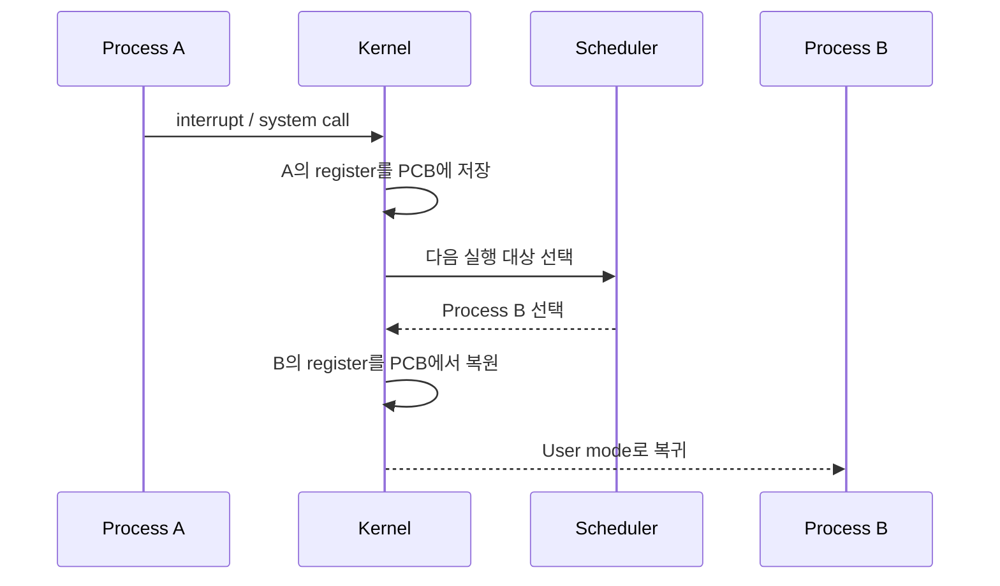

# Context Switching

<strong>목차</strong>

- [Context Switching](#section-1)
- [Process Switching](#section-2)
  - [Mode Switching vs Process Switching](#section-3)
- [추가 질문](#section-4)

Context Switch, Process Switch와 Mode Switch의 차이 및 전환 과정을 정리합니다.

> 관련 노트: [Interrupt와 I/O](interrupts-and-io.md) · [Process와 Process State](processes.md)

## Context Switching

- 앞의 1주차 내용과 연관됨. 특히 1주차 2번 질문
- CPU가 A 프로그램 → B 프로그램으로 바꿔 실행하는 것을 Context Switching이라고 함.
    - 정확히는 A프로그램 실행 중 interrupt 또는 system call 발생 → A 프로그램의 Register 저장 → 발생한 interrupt에 따른 해당 ISR 시작 주소를 PC에 삽입 후 실행(Mode Switching) → 처리 후 Control Stack에 저장되어 있는 B 프로그램의 레지스터를 다시 복구(restore)하여 B 프로그램을 실행(Mode Switching)
    - 위 과정 자체가 하나의 Context Switching이다.
    - 여기서 메인은 저장되어 있는 B 프로그램의 레지스터 ‘복구’를 하여 실행한다는 것이다.
- Context Switching에 해당되는 경우
    - 타임아웃 등에 의한 강제 교체
        - A 프로그램 실행 중 timer interrupt 발생하여 interrupt 처리 후 대기 중이던 B 프로그램으로 전환하여 실행
        - A → B로 바꾸는 다른 interrupt도 포함이다.
    - 프로세스 정상 종료 후 다른 프로세스 실행
        - A 프로그램이 종료되어 대기 중이던 B 프로그램을 실행하는 경우
        - 위에 정확히 설명하는 부분에서 “interrupt 또는 system call 발생”이라 했는데, 이 프로그램 종료 또한 system call인 exit()을 불러 진행하는 것이다.
    - 유저 프로그램 요청에 의한 대기
        - A 프로그램이 sleep()이나 pause(), scanf() 등 스스로 CPU를 내려놓고 대기 상태에 빠지면서 B 프로그램을 실행하는 경우
    - 완전히 새로운 프로세스의 최초 시작
        - A 프로그램이 어떠한 이유로 중단이 되고 B 프로그램이 ‘새로 시작’되는 경우
        - 새로 시작되는 경우… 지금 정확히는 위의 ‘프로그램’ 들은 ‘프로세스’를 뜻하는 것이다. 실행 중인 프로그램이라는 것이다.
        - 따라서 Context Switching이 진행될 때, 실행 예정인 Process의 PCB를 읽고 그 정보들을 바탕으로 CPU 레지스터값들을 복원하는데, 여기서 위의 다시 시작하는 Process들과의 차이점은, 초기화된 PCB와 Control Stack을 준다는 것이다.
            - 여기서 초기화된 PCB와 Control Stack은 일종의 ‘가짜 과거’로 준비된다고 생각하면 된다.
        - 그래서 CPU 입장에서는 지금 Context Switch가 진행되면서 새로 시작하는 놈이든 다시 재개하는 놈이든 둘 다 그냥 PCB를 읽는 것이기 때문에 동일하게 취급한다.
            - 재개되는 프로세스라면 PCB를 읽고 Control Stack에서 과거의 레지스터를 복구하는 것이고, 새로 시작하는 친구라면 초기 상태의 레지스터를 복구하게 된다.
                - PC는 해당 프로그램의 첫 진입점 주소를 넣어두고
                - SP에는 해당 프로그램을 위해 만든 텅 빈 유저 스택 주소를 넣어둘 것이고
                - 범용 레지스터는 0으로 초기화
- Context Switching이 아닌 경우
    - User Program에서 OS의 ISR 진입하는 것 그 자체
        - interrupt나 system call에 의해 PC가 ISR의 시작 주소로 바뀌는 그 찰나의 순간
        - Context Switching을 위한 필수 단계일 수는 있으나, 이 진입 자체는 단순한 권한 상승, Mode Switching(User Mode → Kernel Mode)이다.
        - ISR을 실행하는데 새로운 프로세스로 교체하는 것이 아닌, A 프로세스가 할당받은 메모리 공간 내에서 일어나는 작업이기에 Context Switching이 아니다.
    - interrupt 처리 후 원래 프로세스로 복귀
        - I/O 작업 완료 인터럽트 등이 발생해 OS가 상황을 잠깐 확인, Scheduler를 부르지 않고 하던 일 마저하러 기존 실행 중이던 프로세스로 돌아가는 경우
        - CPU 실행의 주도권이 다른 프로세스로 넘어가지 않았으며, 단순히 해당 프로세스의 Control Stack에 레지스터값들이 피신해있다가 다시 복귀하는 Mode Switch Return 일 뿐이다.

---

## Process Switching

- Running 중인 Process가 인터럽트에 걸리고, OS는 다른 Process를 CPU에 할당함

- 언제 발생하는가
    - Interrupt
        - Clock/Timer Interrupt (→ Ready State)
            - 시간에 의해 실행을 중단해야 함
        - I/O Interrupt (→Running /→ Ready State)
            - 내 잘못에 의한 것이 아니지만,
            - A → ISR → A 이렇게 계속 실행시키기도 하고
            - 그냥 B 프로세스를 실행시키기도 함
        - Memory Fault (→Blocked State)
            - Page Fault → 내가 실행해야하는 코드가 메모리에 없을 때
            - Segmentation Fault → 내 권한 밖의 공간에 접근했을 때 (Trap에 해당)
            - Bus Error → 포인터가 가리킨 곳에 데이터가 없을 때 (Trap에 해당)
    - Trap (→ Exit State / → Running State)
        - Trap은 보통 프로세스 본인의 잘못에 의해 발생한 것들임
        - 대부분은 프로그램을 중단시키면 Exit으로 보내버리지만,
        - 정말 예외적으로, Overflow가 발생했는데 그냥 진행하는 등의 경우가 있다.
    - Supervisor Call (→ Blocked State / → Running State)
        - Message Receive 요청을 받았을 때,

---

### Mode Switching vs Process Switching

- Mode Switching
    - User mode (A) → Kernel Mode → User Mode (A)
- Process Switching
    - User mode (A) → Kernel Mode → User Mode (B)

| 구분 | 실행 주체 변화 | 주소 공간 변화 | 대표 사례 |
| --- | --- | --- | --- |
| Mode Switch | A → Kernel → A | 없음 | system call 처리 후 같은 Process로 복귀 |
| Thread Switch | Thread A → Thread B | 같은 Process라면 없음 | 같은 Process 안의 Thread 교체 |
| Process Switch | Process A → Process B | 있음 | timeout 후 다른 Process dispatch |

---

## 추가 질문

Context Switch 또는 Process Switch는 A → OS Service Routine → B 일련의 과정 자체를,

Mode Switch는 권한 상승과 권한 하강 자체를 Mode Switch로 보면되는지 → 맞음

그래서 A → OS SR → A의 경우에는 Mode Switch만 일어났다라고 표현? → 맞음

프로그램 종료 후 다른 프로세스 작업을 진행하는 것은 앞선 프로세스에서 cpu 레지스터를 저장하는 행위가 없는 것인데, process switch로 봐도 되는지 → 레지스터 저장이 아닌, 프로세스가 바뀌었다는 점에 집중해야함. Process Switch가 맞음

jmp 명령어 실행 관련해서 표현의 정도가 5-stage pipeline 기반으로 설명해도 되는지, 아니면 id stage와 ex stage를 합쳐서 execution stage로 서술하면 되는지.

또한 jmp의 분기예측까지 고려하여야 하는지 → 중간고사 질문은 못말해주지롱

강의에서는 MAR ← PC로 표현되어 있지만,

MMU의 개입을 고려하여 PC에는 논리적 주소만을 넣는 것이 맞는지 → 7장에서 다룸
