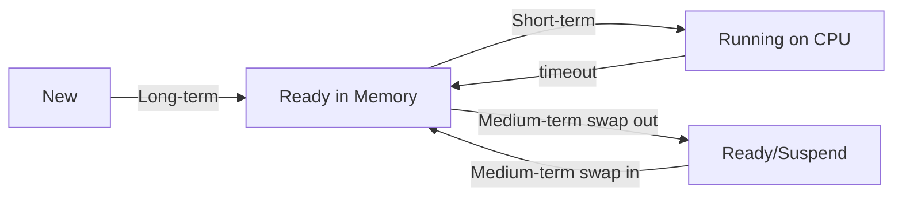
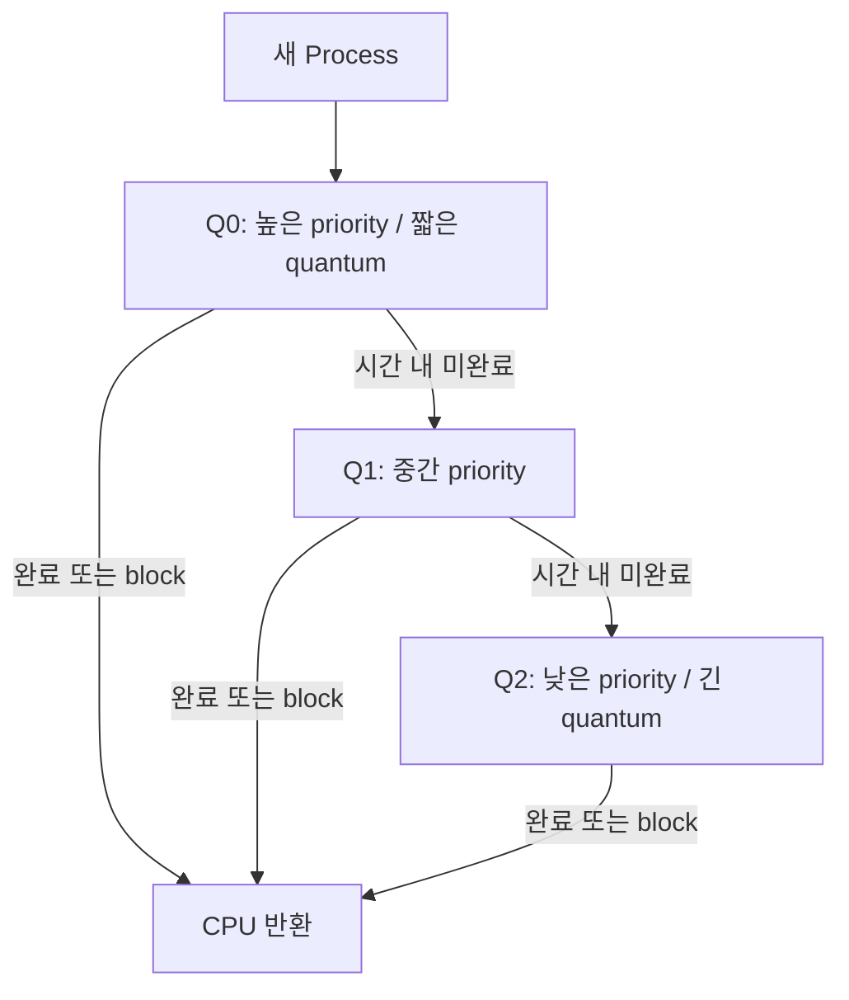

# CPU Scheduling

<details>
<summary><strong>목차</strong></summary>

- [UniProcessor Scheduling](#section-1)
- [Aim of Scheduling](#section-2)
- [Types of Scheduling](#section-3)
  - [Long-Term Scheduling](#section-4)
  - [Medium-Term Scheduling](#section-5)
  - [Short-Term Scheduling](#section-6)
- [Schduling Criteria : 사용자 관점과 시스템 관점](#section-7)
- [Priority와 Starvation](#section-8)
- [Scheduling Algorithm](#section-9)
  - [Alg 1 : First-Come-First-Served(FCFS)](#section-10)
  - [Alg 2 : Round-Robin(RR)](#section-11)
  - [Alg 3 : Shortest Process Next(SPN)](#section-12)
- [Round-Robin 계산 주의점](#section-13)
- [SPN의 burst time 예측](#section-14)
  - [Alg 4 : Shortest Remaining Time(SRT)](#section-15)
  - [Alg 5 : Highest Response Ratio Next(HRRN)](#section-16)
- [Multilevel Feedback Queue](#section-17)
  - [Multilevel Feedback Queue의 기본원리](#section-18)
  - [Time Quantum이 Queue마다 같이 경우와 다른 경우](#section-19)
  - [Multilevel Feedback Queue 예제 흐름](#section-20)
  - [Multilevel Feedback Queue에서 특히 조심할 점](#section-21)
  - [Multilevel Feedback Queue의 의미](#section-22)
- [Fair-Share Scheduling](#section-23)
- [Traditional UNIX Scheduling](#section-24)
  - [Traditional UNIX는 어떻게 Queue를 쓰는가](#section-25)
  - [같은 Priority Queue 안에서는 Round-Robin](#section-26)
  - [Traditional UNIX의 priority 계산 요소](#section-27)
  - [Traditional UNIX Scheduling의 기준은 Response Time이 아니라 Fairness](#section-28)
- [복습 질문](#section-29)

</details>


FCFS, Round-Robin, SPN, SRT, HRRN과 Multilevel Feedback Queue를 정리합니다.

> 관련 노트: [Multiprocessor Scheduling](multiprocessor-scheduling.md) · [Real-Time 및 운영체제별 Scheduling](real-time-and-system-scheduling.md)

<a id="section-1"></a>
## UniProcessor Scheduling

- Scheduling이란
    - Ready Queue에 있는 process들 중 누구에게 CPU를 할당할 것인가를 결정하는 문제
    - CPU입장에서 보면 총 Serive Time의 합은 같기 때문에 전체 작업 시간은 같다고 생각할 수 있다.
    - 하지만 process 하나하나의 입장에서 보면 순서는 매우 중요하다.
        - 어떤 프로세스는 빨리 끝나고, 어떤 프로세스는 오래 기달릴 수 있다.
        - 그래서 실행 순서에 따라 성능이 크게 달라진다.

<a id="section-2"></a>
## Aim of Scheduling

scheduling 성능을 말하려면 먼저 “무엇이 좋은 성능인가”를 정해야 한다.

- Response Time
    - Response Time, 즉 반응시간은 사용자가 입력을 주고 엔터를 친 순간부터 시스템이 결과를 화면에 보여줄 때까지 걸리는 시간이다.
    - 내가 뭔가 입력을 주면 얘가 결과값을 나한테 딱 보여줄 때까지의 시간이다.
- Throughput
    - Throughput은 단위 시간당 CPU가 몇 개의 작업을  완료했는지를 나타내는 척도다.
    - 숫자로 표시할 수 있다.
    - 예를 들어 1시간에 process 10개를 끝냈으면 throughput은 10 jobs/hour 같은 식으로 볼 수 있다.
- Processor Efficiency
    - Processor Efficiency는 CPU가 의미 있는 작업을 얼마나 했는지를  말한다.
    - Time Sharing에서 timeout interval을 너무 작게 잡으면 Context Switching 시간이 너무 많아진다.
    - 만약 Time Quantum과 Context Switching 시간이 비슷해지면,
        - 전체 실행 시간의 절반을 Context Switching에 쓰고
        - 실제 User Program 실행에는 절반 밖에 못 쓸 수 있다.
        - 그러면 Processor Efficiency는 50% 이하가 된다.
    - 즉 Processor Efficiency는 CPU가 실제 의미 있는 Program 실행에 사용된 비율이다.
- Fairness
    - Fairness는 중요하지만 숫자로 표현하기 어렵다.
    - 어떤 System은 모든 Process에게 같은 기회를 주지만,
        - 어떤 System은  Priority가 높은 Process에게 더 많은 기회를 준다.
    - 최악의 경우 어떤 Process는 CPU를 잡을 기회가 0%가 되어 Ready Q에 계속있는데도 실행을 못할 수 있다.
        - 이것을 Starvation이라고 한다.
    - Response Time, Throughput, Processor Efficiency 모두 수치로 보이는 성능 척도지만,
        - Fairness는 수치로 표현하기 어렵다.
        - 하지만 Starvation 가능성 때문에 매우 중요하다.

<a id="section-3"></a>
## Types of Scheduling




<a id="section-4"></a>
### Long-Term Scheduling

- Long-term Scheduling은 Process가 새로 만들어졌을 때 수행된다.
- new state = PCB가 만들어진 상태다.
    - 여기서 Process가 새로 만들어졌는데 memory에 올릴 수 있으면 Ready State가 된다.
    - 그런데 memory에 올릴 수 없는 상황이면 처음부터 Ready/Suspend 상태에서 시작할 수 있다.
- 즉 Long-term Scheduling은 새 Process를 Memory 에 올려 Ready 상태로 만들지, 아니면 Suspend 상태로 둘지 결정하는 것이다.

<a id="section-5"></a>
### Medium-Term Scheduling

- Medium-term Scheduling은 Swapping과 관련된다.
- 예를 들어
    - Ready Q가 비고, process들이 다 blocked 상태로 갔다고 하자.
    - 그러면 blocked process들을 disk의 swapping area로 내려보내고,
        - disk에 있던 ready suspend process를 memory로 불러올 수 있다.
    - 그런데 ready suspend process가 많으면 그중 누구를 memory로 올릴지 결정해야 한다.
    - 이것이 medium-term scheduling이다.
- 즉 medium-term scheduling은 process를 memory와 disk 사이에서 올리고 내리는 시점을 결정하는 scheduling이다.

<a id="section-6"></a>
### Short-Term Scheduling

- Short-term Scheduling은 Ready Q에 있는 Process 중 누구에게 CPU를 줄지 결정하는 것이다.
- 일반적으로  scheduling이라고 하는 것은 이 short-term scheduling을 말하는 것이고, 이 9장 또한 short-term scheduling을 다룬다.

<a id="section-7"></a>
## Schduling Criteria : 사용자 관점과 시스템 관점

- User 입장 성능
    - Response Time
    → 요청 제출부터 output이 나올 때까지의 시간
    - Turnaround Time
    →  process가 제출되어 완료될 때까지의 전체 시간
- System 입장 성능
    - Processor의 효율적인 사용(Processor Utilization과 Processor Efficiency)
    - Throughput
    → 단위시간 당 처리한 process의 수
- 성능 지표(Quantitative Performance)
    - Response Time
    - Throughput
    - Turnaround Time
    - Processor Efficiency
- 비성능 지표(Qualitative Performance)
    - Fairness (공정성)
    - Predictability (예측 가능성)

<a id="section-8"></a>
## Priority와 Starvation

- 높은 우선순위의 프로세스가 항상 먼저 선택된다.
- Priority별로 다단계의 멀티큐 사용
- 우선순위가 낮은 Process에 대해 Starvation을 방치해서는 안됨
    - 시간에 따라서 우선순위를 좀 높여주거나 한다.

<a id="section-9"></a>
## Scheduling Algorithm

- Scheduling Alg을 비교할 때,
    - Response Time을 기준으로 비교한다.
    - 다만 Fairness와 Starvation 가능성도 같이 고려한다.

| Algorithm | 선점 | 선택 기준 | 핵심 trade-off |
| --- | --- | --- | --- |
| FCFS | 비선점 | 도착 순서 | 단순하지만 긴 작업 뒤의 짧은 작업이 오래 대기 |
| Round-Robin | 선점 | Ready Queue 순환 | 응답성이 좋지만 quantum이 작으면 switch 비용 증가 |
| SPN | 비선점 | 예상 실행 시간이 가장 짧은 작업 | 평균 대기시간이 짧지만 긴 작업이 굶을 수 있음 |
| SRT | 선점 | 남은 시간이 가장 짧은 작업 | 새 짧은 작업에 빠르게 반응하지만 예측·switch 비용 증가 |
| HRRN | 비선점 | `(대기시간 + 실행시간) / 실행시간` | 오래 기다린 작업의 우선순위를 높여 starvation 완화 |

```text
모든 Process가 시각 0에 도착: A=5, B=2, C=1

FCFS       | A A A A A | B B | C |
SPN        | C | B B | A A A A A |
RR (q=2)   | A A | B B | C | A A | A |
```

- Arrival Time은
    - Process가 CPU를 실행하려고 Ready Q에 들어온 시점이다.

<a id="section-10"></a>
### Alg 1 : First-Come-First-Served(FCFS)


- 큐에 먼저 도착한 프로세스가 먼저 실행된다.
- Non-Preemption
    - 일단 실행이 시작되면 끝까지 실행이 된다.
    - CPU를 잡고 실행을 시작하면 service time이 끝날 때까지 중간에 CPU를 빼앗기지 않는다.
- Batched MultiProgramming System에서 사용하던 방식
    - Response Time이 너무 길다.
    - response time은 waiting time + service time으로 구성된다.


- 각 작업별 waiting time + service time을 더한 값이고, 평균은 43/5가 된다.
- Response Time이 나빠지는 것이 중요한데, 이는 “사용자 입장”에서 고려된다는 것이다.
    - 만약 10시간의 service time을 가지는 process가 11~12시간 만에 끝나면 사용자는 그렇게 오래 기다렸다고 느끼지는 않을 것이다.
    - 하지만 1시간이면 끝날 것을 5-6시간 걸리면 너무 오래 기다린다고 느낄 것이다.
    - 따라서 response time 관점에서는 짧은 process가 오래 기다리는 것이 특히 문제다.

<a id="section-11"></a>
### Alg 2 : Round-Robin(RR)


- Time-Sharing 시스템에서 사용하는 기법이다.
    - Time Slicing 기법이다.
    - Round Robin = Time-Sharing = Time Slicing
- 여기서 중요한 것은 Time Quantom이다. (위에서는 1초 설정)
- Preemption이다.
    - Time-out에 의해 CPU를 빼앗기게 된다.
- Q에 마지막으로 들어온 시간을 기준으로 우선순위가 형성된다.


- 2시에 B가 먼저 앞에 있는 것을 볼 수 있는데,
    - 원래 OS가 처리하므로 미세한 시간 차이가 있고 동시에 들어온다는 것이 불가능하지만,
    - 일단 지금은 동시에 들어왔을 때 외부에서 들어온 프로세스가 더 앞에 배치된다는 가정이 되어있다.


- 평균 Response Time에서 RR이 높은 것을 볼 수 있다.
    - 지금은 q = 1이라서 이렇게 되어있는 것이고, FCFS보다 더 빨리지는 q의 값이 있다.
    - q를 잘못작성하면 FCFS보다 Response Time이 높아질 수 있다.
    - 개개인으로 생각하면은, 누구에게는 Waiting Time이 늘어날 수 있고
        - 누구에게는 Waiting Time이 줄어들 수 있다.
    - 실행시간이 길다고 예상되는 것은 더 길어지고
        - 실행시간이 짧은 프로세스의 Waiting Time이 짧아진다. (중요)

<a id="section-12"></a>
### Alg 3 : Shortest Process Next(SPN)


- FCFS와 RR이 만족스럽지 않기 때문에 response time을 확 줄이기 위한 방법이다.
    - 실행 시간이 짧은 process를 먼저 실행하는 방식이다.
- Non-Preemptive Policy
    - 실행 시간이 짧은 process를 우선 선택하지만,
    - 일단 어떤 process가 CPU를 잡고 실행을 시작하면 중간에 더 짧은 process가 도착해도 현재 process를 중단시키지 않는다.
- 위 SPN 예제 설명
    - 0시에는 A밖에 없으므로 A 실행
    - A가 끝난 3시에는 B가 Ready Q에 있으므로 B 실행
    - B가 실행되는 동안 C,D,E가 도착했지만 SPN은 non-preemptive이므로 B를 계속 실행
    - B가 끝난 뒤에는 C(4), D(5), E(2) 중 service time이 가장 짧은 E를 먼저 실행
    - 그다음 C, 그다음 D를 실행


- 문제점 1 : 예상 실행시간이 가장 짧은 것 ‘같은’ 프로세스가 선택되는 방식이다.
    - shortest “expected” processing time
    - 정확히 예측이 안될 수도 있다.
    - 더 긴 실행시간의 프로세스의 예측 가능성이 줄어든다.
    - 만약 예상 시간보다 더 길게 실행된다면, OS가 그냥 중단시켜버린다.
- 문제점 2 : Starvation 가능성이 존재한다.

그래도 평균 Response Time이 짧기 때문에 사용해 볼 만은 하다.

그래서 잘 생각해야할 것은 예상실행 시간을 계산하는 것이다.

#### Calculating Program ‘Burst’

- SPN의 첫번째 문제, 즉 실행 시간 예측 문제를 해결하기 위해 burst time을 사용한다.
    - 실제 process는 CPU를 한 번 잡고 끝까지 실행되는 것이 아니다.
    - 보통 CPU를 사용하다가 I/O 작업을 하러가고, 다시 Ready Q에 돌아와 CPU를 사용하고, 또 I/O로 가는 식을 반복한다.
- 그래서 여기서 말하는 service time은 process 전체 실행 시간이 아니라
    - I/O 작업을 하러가기 전까지 CPU를 연속해서 사용하는 시간이다.
    - 이 CPU 사용 구간들을 burst time이라고 한다.
- 즉 process는 다음과 같이 움직인다.
    - CPU burst → I/O → CPU burst → I/O → …
- 처음 CPU burst는 과거 정보가 없으므로 예측이 어렵지만, 두번째, 세번째 이후에는 이전 burst time들을 이용해서 다음 burst time을 예측할 수 있다.

#### Burst 예측 방식 1 : Arithmetic Mean 산술 평균 방식


- 산술 평균에 의해 예측을 진행하는 방식이다.
- 구성
    - Ti : i번째 실제 burst time
    - Si : i번째 burst에 대한 예측값
- n + 1번째 burst time을 예측할 때, 1번째부터 n번째까지 실제 burst time의 평균을 사용한다.
    - S(n+1) = (T1 + T2 + T3 + … + Tn) / n
- 지금까지 실행 시간들의 평균을 내서, 다음에도 그 정도 실행할 것이라고 예측하는 방식이다.
- 하지만 산술 평균은 최근 변화에 둔감하다.
    - 실제 burst time이 점점 늘어나거나 줄어드는 상황에서는 평균값이 천천히 따라가므로 예측이 늦게 반영된다.

#### Burst 예측 방식 2 : Exponential Averaging 지수 평균 방식


- 두 번째 예측 방법은 지수 평균 방식이다.
- n+1번째 예측값을 바로 직전 실제 실행 시간과 직전 예측값을 섞어서 계산한다.
    - S(n+1) = a*Tn + (1-a)Sn
    - 여기서 a는 0과 1 사이의 값이다.
    - 만약 a = 0.5이면 직전 실제값과 직전 예측값을 반반 반영한다.
        - 만약 실제 실행 시간에 더 큰 비중을 두고 싶으면 a = 0.8처럼 크게 잡을 수 있다.
- 핵심은 exponential averaging이 최근 값에 더 큰 가중치를 준다는 점이다.
    - Sn 안에는 그 이전 예측값들이 누적되어 있고, 과거 값들은 (1-a)가 반복해서 곱해지므로 오래된 값일수록 영량이 작아진다.
    - 반대로 최근 실제 burst time은 더 크게 반영된다.
- 아래는 위의 설명을 그래프로 보여준다.


이후 내용은 13주차로 넘어감.

---

<a id="section-13"></a>
## Round-Robin 계산 주의점

Round-Robin은 `A B C D E` 식으로 단순 반복하면 안 된다. 매 시점 ready queue의 실제 순서를 그려야 한다. 같은 시간에 새 process 도착과 timeout이 겹치면, 교수님 예제에서는 **새로 도착한 process가 timeout된 process보다 앞에 선다**고 가정했다.

<a id="section-14"></a>
## SPN의 burst time 예측

SPN은 service time을 알아야 하지만 실제로는 실행 전에는 알 수 없다. 따라서 이전 CPU burst time을 이용해 다음 burst time을 예측한다.

산술 평균:

```
S(n+1) = (T1 + T2 + ... + Tn) / n
```

Exponential averaging:

```
S(n+1) = αTn + (1-α)Sn
```

Exponential averaging은 최근 실제 burst time을 더 크게 반영하므로 변화하는 실행 시간을 더 잘 따라간다.

---

<a id="section-15"></a>
### Alg 4 : Shortest Remaining Time(SRT)


- SPN의 preemptive 버전이 SRT인 느낌이다.
    - SPN은 한 번 실행을 시작아면 중간에 더 짧은 process가 도착해도 끊지 않는다.
    - 반면 SRT는 새 process가 도착할 때마다 현재 실행 중인 process의 남은 실행 시간과 새로 도착한 process service time을 비교한다.
    - 새 process의 시간이 더 짧으면 현재 process를 중단시키고 새 process를 실행한다.
- 여기서 핵심은
    - “남아있는 실행시간”을 비교한다는 것이다.
    - 사실상 Shortest Remaining Time인 이유


- SRT가 가장 빠른 반응시간을 가진다.
    - 즉 SRT의 response time이 optimal이다.
    - SRT보다 response time이 더 짧은 scheduling 기법은 만들 수가 없다.
    - 즉 response time 최소화만 기준으로 보면 SRT가 가장 좋은 방법이다.
- 하지만 SPN과 동일한 문제를 가진다.
    - 그래서 실제 system이 모두 SRT를 사용하지는 않는다.
    - 첫째로, 실행 시간을 계속 예측해주어야 하고
    - 둘째로, 긴 process의 starvation 가능성이 있다는 것이다.

<a id="section-16"></a>
### Alg 5 : Highest Response Ratio Next(HRRN)

- SRT처럼 response time을 줄이면서도 starvation을 완화하기 위해 나온 방식이다.
- non-preemptive 기법이다.


- HRRN은 다음 ratio를 계산한다
    - Response Ratio = (waiting time + expected service time) / expected service time
    - = 1 + waiting time / expected service time
    - 위 식의 의미는
        - Waiting Time이 길수록 ratio가 커진다.
        - Service Time이 짧을 수록 waiting/service 값이 커지므로 ratio가 커진다.
        - 따라서 HRRN은 오래 기다린 process와 실행시간이 짧은 process 모두에게 높은 우선순위를 줄 수 있다.
    - 이것이 SRT/SPN의 starvation 문제를 줄이는 핵심이다.
        - 짧은 process는 원래 높은 priority를 얻기 쉽지만,
        - 긴 process도 오래 기다리면 waiting time이 커져 ratio가 점점 올라간다.
        - 따라서 긴 process가 영원히 밀릴 가능성이 줄어든다.
- 위의 HRRN 예제 순서
    - 처음에는 A가 실행되고, 그다음 B가 실행되는 흐름은 FCFS/SPN과 비슷하다.
    - B가 끝난 시점에는 C,D,E가 ready Q에 있다.
        - 이때 각 process의 response ratio를 계산한다.
            - C : 1 + 5/4 = 2.25
            - D : 1 + 3/5 = 1.6
            - E : 1 + 1/2 = 1.5
        - 여기서 C의 ratio가 가장 높으므로 C를 먼저 실행한다.
    - C가 4시간 실행되어 끝난 뒤에는 D와 E 중 하나를 선택해야 한다.
        - 여기서 자주 실수하는 지점은
        - C 실행 전에 계산한 D = 1.6, E = 1.5 값을 그대로 쓰면 안된다는 것이다.
        - C가 실행되는 동안 D와 E 모두 4시간을 더 기다렸으므로 다시 계산해야 한다.
        - 다시 계산하면
            - D : 1 + 7/5 = 2.4
            - E : 1 + 5/2 = 3.5
        - E의 ratio가 더 켜져서 E를 먼저 실행한다.
    - 그리고 마지막으로 D를 실행한다.


<a id="section-17"></a>
## Multilevel Feedback Queue

- 앞에서 배운 SPN이나 SRT가 response time을 줄이는데 좋지만, 문제 2가지가 있다.
    - 실행 시간이 짧은 process를 먼저 실행하려면 실행시간을 예측해야한다는 것
        - Exponential averaging 등으로 어느 정도 예측할 수는 있지만,
        - 정확하지도 않고 계산도 반복적으로 해야 햐서 overhead가 있다.
    - 실행 시간이 긴 process가 계속 밀려 starvation 될 수 있다는 것
- 그래서 발상을 바꿔서 나온 것이,
    - 실행 시간이 짧은 process를 직접 찾아서 우선순위를 높이는 것이 아니라
    - 실행 시간이 긴 process의 우선순위를 낮추자라는 것이다.
- 실행 시간이 긴 process의 우선순위를 낮추면, 결과적으로 실행 시간이 짧은 process의 우선순위가 높아진다.
    - 이때 실행 시간을 미리 예측할 필요가 없다는 것이 핵심이다.

<a id="section-18"></a>
### Multilevel Feedback Queue의 기본원리



- Multilevel Feedback Queue는 여러 개의 ready Q를 둔다.
- 예를 들어 0번, 1번, 2번 Q가 있다고 하면
    - Q0 : 가장 높은 priority
    - Q1 : 그다음 priority
    - Q2 : 가장 낮은 priority
- Scheduler는 항상 가장 높은 priority queue부터 본다.
    - Q0에 process가 있으면 Q0에서 실행
    - Q0가 비어있으면 Q1에서 실행
    - Q0, Q1이 모두 비면 Q2에서 실행
- 즉 i번째 queue의 process가 실행되려면, 그보다 높은 priority queue들이 전부 비어있어야 한다.
- 처음 들어온 process는 보통 Q0에서 시작한다.
    - Q0에서 CPU를 받았는데 time quantum 안에 끝내지 못하면 Q1으로 내려간다.
    - Q1에서도 시간 내에 끝나지 못하면 Q2로 내려간다.
- 그러면 자연스럽게
    - 짧은 process
        - 높은 queue에서 빨리 끝남.
        - 아래 Q로 내려가지 않음
    - 긴 process
        - time quantum 안에 못 끝남.
        - 점점 아래 Q로 내려감.
        - 낮은 priority를 갖게 됨.
- 따라서 Multilevel Feedback Queue는 실행 시간을 직접 예측하지 않고도,
    - 실제로 오래 실행된 process를 낮은 priority로 보내는 방식으로 짧은 process를 우대한다.

<a id="section-19"></a>
### Time Quantum이 Queue마다 같이 경우와 다른 경우


- 위에는 다른 설정의 q가 있는 2가지 경우이다.
    - 하나는 모든 queue의 time quantum이 같은 경우이고
    - 하나는 queue 번호에 따라 time quantum이 달라지는 경우다.
- 모든 queue의 time quantum이 1인 경우(q = 1)
    - Q0에서 나오든, Q1에서 나오든, Q2에서 나오든 time quantum이 모두 1이다.
    - 그러면 process가 어느 queue에 있든 CPU 한 번 잡으면 1시간, 또는 1단위만 실행하고 timeout이 된다.
- time quantum이 2^i인 경우(q = 2^i)
    - 이 경우는 queue 번호 i에 따라 time quantum을 다르게 주는 방식이다.
        - Q0 : 2^0 = 1
        - Q1 : 2^1 = 2
        - Q2 : 2^2 = 4
    - 보면은 Q0가 가장 priority가 높은데 time quantum은 가장 짧고,
    - Q2가 가장 priority가 낮은데 time quantum은 가장 길다.
- 이는 starvation 가능성을 줄이기 위해 설정된 것이다.
    - 낮은 queue에 있는 process는 CPU를 얻을 확률이 작다.
    - Q0와 Q1이 모두 비어야 Q2가 실행되니까, 겨우 CPU를 잡았을 때 time quantum을 길게 줘서 최대한 많이 실행하게 하는 것이다.
    - 그래도 starvation 가능성이 완전히 없어지는 것은 아니지만, 조금 줄일 수 있다.
- 정리하면
    - 낮은 queue일수록 priority는 낮다.
    - 하지만 한 번 CPU를 얻으면 time quantum을 길게 줄 수 있다.
    - 이유는 낮은 queue process의 starvation 가능성을 줄이기 위해서다.
- 0번 큐에있는 프로세스를 먼저 실행한다.
- 숫자가 작을수록 높은 우선순위를 가진다.

<a id="section-20"></a>
### Multilevel Feedback Queue 예제 흐름


- 3개의 queue, 즉 Q0/Q1/Q2를 가정하고 예제를 설명한다.
- 이때 time quantum은 queue 번호에 따라 달라지는 방식이다.
    - Q0 quantum = 1
    - Q1 quantum = 2
    - Q2 quantum = 4
- 예제 process는 다음과 같다.
    - A : arrival 0, service 3
    - B : arrival 2, service 6
    - C : arrival 4, service 4
    - D : arrival 6, service 5
    - E : arrival 8, service 2


- 0시 : A 실행
    - 0시에는 A밖에 없으므로 A가 Q0에서 실행된다.
    - Q0의 quantum은 1이므로 원래 1시에 timeout이 발생한다.
        - 그러나 1시에 다른 process가 도착하지 않았다.
        - 여기서 중요한 점은,
            - 1시에 timeout이 발생했다고 해서 OS가 굳이 A를 Q1으로 내려보냈다가 다시 선택하지 않는다.
            - 그렇게 하면 불필요한 switching이 생긴다.
            - Ready Q를 확인해보니 아무도 없으면, 그냥 A를 계속 실행한다.
    - 즉 A는 0~2까지 계속 실행된다.
- 2시 : B 도착, A는 Q1으로 내려감
    - 2시에 B가 Q0로 도착한다.
        - 이때 A는 2시간 실행했지만 아직 1시간 남아 있다.
    - 이제 다른 process가 생겼으므로 A는 Q1으로 내려가고, Q0의 B가 실행된다.
    - B는 Q0에서 나왔으므로 1시간 실행하고 3시에 timeout된다.
    - B는 아직 끝나지 않았으므로 Q1으로 내려간다.
- 3시 : A 실행
    - 3시에는 Q0가 비어 있고 Q1에 A와 B가 있다.
    - Q1의 앞에 있는 A가 실행된다.
    - A는 Q1에서 나왔으므로 원래 2시간까지 실행할 수 있지만, A는 1시간만 남았기 때문에 3~4에 끝난다.
    - A가 끝난 이유는 timeout이 아니라, service time이 끝났거나 block/exit한 것이므로 CPU를 놓는 것이다.


- 4시 : C 도착
    - 4시에 C가 Q0로 도착한다.
    - Q1에는 B가 있지만, 항상 높은 Q가 우선이므로 C가 먼저 실행된다.
    - C는 Q0에서 나왔으므로 1시간 실행하고 5시에 Q1으로 내려간다.
- 5시 : B 실행
    - 5시에 Q0가 비어있고 Q1에는 B와 C가 있다.
    - B가 앞에 있으므로 B가 실행된다.
        - B는 Q1에서 나왔으므로 quantum이 2다.
        - 그래서 5~7까지 실행한다.
    - 아직 끝나지 않았으므로 B는 Q2로 내려간다.
- 6시에 D 도착, 7시 D 실행
    - D는 6시에 Q0로 도착해 있었고, B가 7시에 timeout되면 Q0의 D가 실행된다.
    - D는 Q0에서 나왔으므로 1시간 실행하고 8시에 Q1으로 내려간다.


- 8시에 E 도착
    - 8시에 E가 Q0로 도착한다.
        - Q1에는 C와 D가 있고, Q2에는 B가 있다.
    - Q0가 가장 높으므로 E가 먼저 실행된다.
    - E는 Q0에서 나왔으므로 8~9까지 1시간 실행하고, 아직 남았으므로 Q1으로 내려간다.
- 9시 : C 실행
    - 9시에는 Q0가 비어있고, Q1에는 C,D,E가 있으며, Q2에는 B가 있다.
    - Q1의 C가 실행된다.
        - C는 Q1에서 나왔으므로 2시간 실행할 수 있고, 9~11까지 실행한다.
    - 아직 C는 더 실행해야 하므로 Q2로 내려간다.
- 11시 : D 실행
    - Q0가 비어있으므로 C 다음 순서인 D가 이어서 실행된다.
        - D도 Q1에서 나왔으므로 2시간 실행할 수 있고, 11~13까지 실행한다.
    - 아직 D도 더 실행해야 하므로 Q2로 내려간다.
- 13시 : E 실행
    - Q0는 비어있고, D 다음 순서인 E가 이어서 실행된다.
        - E는 Q1에서 나와서 2시간을 실행할 수 있지만, 앞선 A처럼 1시간 실행후 작업을 마쳐서 service time 종료 또는 block/exit되었다.
    - 따라서 E는 13~14 동안 실행하고 마친다.
- 14시 : B 실행
    - 이제 Q0, Q1 모두 비었고, Q2의 첫순위인 B가 먼저 실행된다.
        - B는 Q2에서 나왔으므로 4시간 실행할 수 있다.
        - 하지만 B도 service time이 3시간만 남았기 때문에, 3시간 실행 후 종료한다.
    - B는 14~17 동안 실행하고 마친다.
- 17시 : C 실행
    - Q2에서 B 다음 순서인 C가 실행된다.
        - C도 service time이 1시간 남았다.
    - 따라서 C도 4시간을 사용할 수 있지만 17~18 동안만 실행하고 마친다.
- 18시 : D 실행
    - Q2의 마지막 남은 D도 실행된다.
        - D의 service time은 2시간 남았다.
    - D도 18~20 동안 실행을 마치고 종료된다.
- 20시를 기점으로 모든 프로세스가 종료되었다.

<a id="section-21"></a>
### Multilevel Feedback Queue에서 특히 조심할 점

- Timeout이 발생했다고 무조건 아래 Q로 내려보내는 것이 아니다.
    - 1시에 A가 timeout되었지만, 다른 process가 없었기 때문에 OS는 굳이 A를 Q1으로 내려보내지 않았다.
    - Q1으로 내려보낸다는 것은 switching을 한다는 뜻인데, 아무도 없는데 굳이 switching을 할 이유가 없다.
    - 그래서 A는 2시에 B가 도착할 때까지 계속 시행된다.
- Process가 끝난 것은 timeout과 다르다.
    - A가 Q1에서 3~4에 실행된 뒤 CPU를 놓은 것은 Q1의 quantum 2를 다 써서가 아니다.
    - A는 남은 service time이 1밖에 없었기 때문에 끝난 것이다.
    - 즉 block, exit, serive completion 때문에 CPU를 놓은 경우지, timeout으로 아래 queue로 내려간 것이 아니다.
- 항상 가장 높은 priority queue를 먼저 본다.
    - Q1에 process가 여러 개 있어도, Q0에 새 process가 도착하면 Q0의 process가 먼저 실행된다.
    - 따라서 도착 시점과 timeout 시점을 같이 보면서 queue 사태를 계속 업데이트해야 한다.

<a id="section-22"></a>
### Multilevel Feedback Queue의 의미

- Multilevel Feedback Queue는 실제 시스템에서 많이 사용된다.
- FCFS, RR, SPN, SRT, HRRN 같은 기본 알고리즘을 그대로 쓰기보다는,
    - Multilevel Feedback Queue를 시스템마다 변형해서 사용하는 경우가 많다.
- 차이를 정리하면
    - SPN/SRT
        - 실행시간이 짧은 process를 먼저 실행하려고 한다.
        - 문제는 실행시간 예측이 필요하다.
    - Multilevel Feedback Queue
        - 실행시간이 긴 process를 직접 찾아내는 대신,
        - 실제로 오래 실행되어 timeout을 반복한 process를 아래 queue로 내린다.
        - 실행시간을 예측하지 않고도 짧은 process를 우대하는 효과를 낸다.
- 즉 Multilevel Feedback Queue는 실행시간 예측 없이 SPN/SRT와 비슷한 방향을 구현하는 실제적인 방식이다.

<a id="section-23"></a>
## Fair-Share Scheduling

- 애플리케이션이 항상 하나의 process나 thread로만 구성되는 것은 아니다.
    - 큰 application은 여러 process나 여러 thread로 구성될 수 있다.
- 문제는 scheduling을 process/thread 단위로만 하면,
    - 어떤 사용자가 application을 여러 thread로 잘게 나우어 더 많은 ready queue entry를 만들 수 있다는 점이다.
- 예를 들어
    - 한 application이 thread 1개만 만들면 ready queue에 1개가 줄을 서지만,
    - thread 10개를 만들면 ready queue에 10개가 줄을 선다.
    - 그러면 단순 process/thread 단위 scheduler에서는 CPU time을 10배 더 많이 받을 수 있다.
    - 이게 매우 불공정하다는 것이다.
- 그래서 Fair-Share Scheduling은 Process나 Thread 하나를 기준으로 Scheduling 하지 말고,
    - Application 단위로 CPU Time을 나누자는 방식이다.


- 예를 들어
    - Application 1 : Process A 하나
    - Application 2 : Process B, C 두 개
- 일반 Round-Robin이면
    - A, B ,C가 각각 같은 기회를 얻어 App 2가 더 많은 CPU를 얻을 수 있다.
- 하지만 Fair-Share Scheduling에서는
    - 먼저 App 단위로
        - App1 → App2 → App1 → App2
    - 이렇게 시간을 나누고
    - App에게 주어진 시간 안에서 다시 B와 C가
        - B → C → B → C
    - 식으로 나누어 쓰게 한다.
- 이렇게 하면 App 2가 process/thread를 여러 개 만들었다고 해서 App1보다 더 많은 CPU time을 가져가지 못한다.
- 정리하면
    - 일반 Scheduling
        - Process/Thread 단위로 CPU를 나눔
        → thread를 많이 만들면 더 많은 CPU time을 얻을 수 있다.
    - Fair-Share Scheduling
        - App 단위로 CPU time을 먼저 나눔
        → 그 App 내부에서 process/thread들이 나눠 쓴다.
        → 더 공평함

<a id="section-24"></a>
## Traditional UNIX Scheduling

- Multilevel Feedback Queue를 사용한다.
    - 하지만 위에서 설명한 MLFQ는 아니다.
- 이전에 CPU를 얼마나 사용했냐에 따라서 우선순위를 다시 설정한다.

<a id="section-25"></a>
### Traditional UNIX는 어떻게 Queue를 쓰는가

- 기본 원칙
    - 우선순위가 같은 process들은 같은 queue에 들어간다.
    - 같은 queue 안에서는 Round-Robin으로 실행한다.
    - 우선순위가 더 높은 queue가 있으면 그 queue부터 실행한다.
- 하지만 일반 MLFQ처럼 “timeout되면 바로 아래 queue로 내려가는 방식”은 아니다.
    - 멀티 레벨도 맞고 피드백도 맞지만 방법이 다르다.
- Traditional UNIX에서는 1초마다 모든 process의 priority를 다시 계산한다.
    - 그리고 계산된 pr에 따라 process들을 다시 queue에 배치한다.
    - 즉 process가 아래로 내려가거나 위로 올라가는 것은 timeout 하나 때문이 아니라, 1초마다 다시 계산된 priority 때문이다.

<a id="section-26"></a>
### 같은 Priority Queue 안에서는 Round-Robin

- 예를 들어 Q0에 A와 B가 있으면,
    - A와 B가 RR으로 번갈아 실행된다.
    - 단, A와 B만 번갈아 실행한다.
- 이들이 실행되다가 block되거나 종료되어 Q0가 비면 그다음 priority queue로 내려간다.
    - 만약 Q1에 process가 하나뿐이면 RR 대상이 없으므로 혼자 계속 실행된다.
- 정리하면
    - 높은 priority queue부터 실행
    - 같은 priority queue 안에서는 round-robin
    - 1초마다 priority 재계산
    - 재계산 결과에 따라 queue 재배치

<a id="section-27"></a>
### Traditional UNIX의 priority 계산 요소


- Traditional UNIX의 pr는 크게 세 가지 값으로 결정된다.
    - Priority = base + CPU/2 + nice
    - 숫자가 작을수록 우선순위가 높다.
- Base 값
    - Base는 process가 무슨 일을 하는지에 따라 주어지는 기본 prioriry 다.
    - 우선순위가 높은 것부터 나열하면 다음과 같은 순서를 가진다.
        - swapping 관련 system process
        - block I/O 관련 process
        - file 작업 process
        - character I/O process
        - user process
    - 여기서 중요한 점은 priority 숫자가 작을수록 우선순위가 높다는 것이다.
    - 그리고 base 값들은 서로 꽤 멀리 떨어져 있게 설정한다.
    - 그래야 user process가 CPU 값이나 nice 값이 아무리 좋아도 swapping이나 file 작업 같은 system process와 같은 priority를 갖지 못한다.
- Nice 값
    - Nice 값은 사용자가 조정할 수 있는 값이다.
        - 사용자는 nice system call을 이용해 child process의 priority를 조절할 수 있다.
    - 하지만 pr를 높이는 것은 안되고 낮출 수는 있다.
        - 즉 사용자는 자기 process의 우선순위를 더 좋게 만드는 것이 아니라
        - 일부 child process의 우선순위를 낮춰 다른 child process가 상대적으로 더 잘 실행되게 할 수 있다.
- CPU 값
    - CPU 값은 최근에 CPU를 얼마나 많이 사용했는지를 나타낸다.
    - 아래의 식을 풀어서 설명하면
        - 현재 CPU 값은 직전 time interval에서 사용한 CPU utilization의 1/2, 그 전의 interval의 1/4, 그 전전 interval의 1/8… 식으로 반영된다.
    - 즉 최근 CPU 사용량일수록 크게 반영되고, 오래된 CPU 사용량일수록 영향이 작아진다.
        - 이건 exponential averaging과 비슷한 구조로 보면된다.


- 정리하면
    - 최근에 CPU를 많이 쓴 process
        - CPU 값이 큼
        - Priority 숫자가 커짐
        - 우선순위가 낮아짐
    - 최근에 CPU를 못 쓴 process
        - CPU 값이 작아짐
        - priority 숫자가 작아짐
        - 우선순위가 높아짐
- 위가 Traditional UNIX scheduling의 핵심으로,
    - 최근에 CPU를 많이 사용한 process는 우선수위가 낮아지고
    - 오랫동안 CPU를 사용하지 못한 process는 CPU 값이 거의 0에 가까워져 우선순위가 높아진다.

<a id="section-28"></a>
### Traditional UNIX Scheduling의 기준은 Response Time이 아니라 Fairness

- 앞의 FCFS/RR/SPN/SRT/HRRN은 response time을 기준으로 비교하지만
    - Traditional UNIX는 response time을 기준으로 하는 것이 아니다.
- Traditional UNIX의 priority 계산식에는 실행 시간이 짧은지 긴지 같은 정보가 들어 있지 않다.
    - 즉 SRT/SPN처럼 response time을 최소화하려는 구조가 아니다.
- 대신 중요한 것은 fairness다.
    - CPU를 최근에 많이 쓴 process는 priority가 낮아지고,
    - CPU를 오래 못 쓴 process는 priority가 높아진다.
    - 그러면 결국 CPU time을 비교적 공평하게 나눠주게 된다.
- 이 때문에 Traditional UNIX Scheduling은 starvation 가능성이 0%다.
    - CPU를 계속 못 쓰면 priority가 점점 올라가 결국 실행될 수 밖에 없기 때문이다.
- 정리하면
    - Traditional UNIX Scheduling의 목표
        - response time 최소화가 아니라 fairness
    - 장점
        - starvation 가능성이 사실상 없음
        - 매우 공정함
    - 단점
        - SPN/SRT처럼 짧은 process를 먼저 실행하는 방식보다 정량적 성능은 좋지 않을 수 있음.

<a id="section-29"></a>
## 복습 질문
