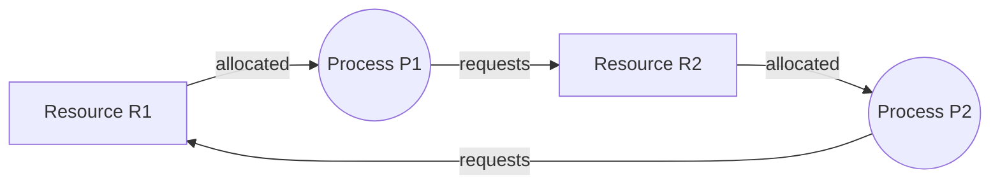
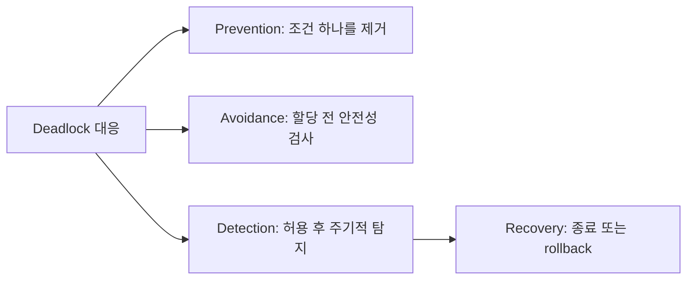
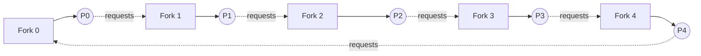

# Deadlock

<details>
<summary><strong>목차</strong></summary>

- [Deadlock](#section-1)
  - [예시 코드](#section-2)
  - [Deadlock 발생의 4가지 조건](#section-3)
- [자원 할당 그래프 (Resource Allocation Graph)](#section-4)
  - [자원 할당 그래프에서의 Cycle = Deadlock?](#section-5)
- [Deadlock 해결법 3가지](#section-6)
- [Deadlock Prevention 기법](#section-7)
  - [Mutual Exlusion](#section-8)
  - [Hold and Wait](#section-9)
  - [No Preemption](#section-10)
  - [Circular Wait](#section-11)
- [Deadlock Avoidance 기법](#section-12)
  - [Process Initiation Denial](#section-13)
  - [Resource Allocation Denial](#section-14)
  - [Banker’s Alg에서 쓰이는 자료구조(기말 출제 높음)](#section-15)
  - [Safe/Unsafe State 판단 방법](#section-16)
  - [Banker’s Algorithm의 Logic](#section-17)
  - [Deadlock Avoidance의 제한 조건](#section-18)
- [Deadlock Detection 기법](#section-19)
  - [Deadlock Detection의 장점](#section-20)
  - [일반적인 Detection 알고리즘 자료구조](#section-21)
  - [Detection 알고리즘](#section-22)
- [Deadlock이 발견되었을 때의 (시스템) 복구 방법](#section-23)
  - [Recovery 방법 4가지](#section-24)
- [Dining Philosophers Problem](#section-25)
  - [Dining Philosophers의 상황](#section-26)
- [Sol.1 Using Semaphore (Deadlock 발생)](#section-27)
- [Real Sol.1 : room semaphore](#section-28)
- [Real Sol.2 : Monitor](#section-29)
- [복습 질문](#section-30)
- [시험 답안 작성 요령](#section-31)
- [Banker](#section-32)
- [Detection](#section-33)
  - [유형 1: Matrix를 주고 Detection Algorithm으로 deadlock process 찾기](#section-34)
  - [유형 2: Resource Allocation Graph를 그려서 deadlock 찾기](#section-35)
- [Dining Philosophers Problem](#section-36)
  - [Circular Wait Prevention 방식으로 Dining Philosophers 해결 코드 작성](#section-37)

</details>


Deadlock의 발생 조건, Prevention, Avoidance, Detection과 복구 방법을 정리합니다.

> 관련 노트: [Semaphore, Monitor와 동기화 문제](synchronization-primitives.md)

<a id="section-1"></a>
## Deadlock

다른 blocked된 프로세스가 트리거해줘야만 풀리는 blocked된 프로세스가 있을 때, 그 두 프로세스의 집합을 deadlock 상황이라고 한다.

1. 프로세스 하나만으로는 데드락이 아니다.
    1. 혼자 멈춘 프로그램은 deadlock이라고 하기 어렵고,
    2. 기본적으로 set of processes, 둘 이상의 프로세스 집합에서 발생한다.
2. 둘 이상의 프로세스가 block 상태여야 한다.
    1. 하지만 둘이 block되었다고 무조건 데드락은 아니다.
    2. 만약 제3의 프로세스가 semSignal() 같은 것을 해줄 수 있다면, block에서 탈출가능하므로 데드락이 아니다.
3. block을 해제할 수 있는 연산을 deadlock에 빠진 프로세스들끼리만 해야하는 상황이다.
    1. 2개 이상의 프로세스가 block
    2. block에서 빠져나오는 명령을 deadlock에 빠진 프로세스들끼리 주고받아야 한다.
- 추가로, deadlock은 코드만 보고 무조건 발생이라고 하면 안되고, 실행흐름에 따라 발생할 수도 있고 안할 수도 있다.

<a id="section-2"></a>
### 예시 코드


예를 들어 A가 semWait(s1)과 semWait(s2)를 전부 통과한 뒤 B가 실행되면은 deadlock이 발생하지 않는다.

근데 A가 semWait(s1)을 실행하고 아래 s2를 실행 못한채 B가 실행되어 semWait(s2)를 하게 되면, deadlock이 발생한다.

<a id="section-3"></a>
### Deadlock 발생의 4가지 조건

아래 4가지 조건이 ‘동시에’ 만족될 때 deadlock이 발생한다.

- Mutual Exclusion
    - 한 리소스에는 한번에 한 프로세스만 사용해야함.
    - 예를 들어 semaphore s1, s2의 초기값이 1이면 한 번에 하나만 통과할 수 있지만, 초기값이 2 이상이라서 A와 B가 동시에 통과할 수 있다면 deadlock이 발생하지 않을 수 있다.
    - 즉, 자원이 공유가능하면 deadlock 조건이 약해지고, 자원이 독점적으로 사용되어야 하면 deadlock 가능성이 생긴다.
- Hold-and-Wait
    - 프로세스가 이미 어떤 자원을 hold, 즉 할당받아 가진 상태에서, 다른 자원을 요청하다가 기다리는 조건이다.
        - Hold : 자원을 이미 할당받은 상태
        - Wait : 다른 자원을 요청했지만 OS가 block시킨 상태
    - 위의 예시에서는 A는 s1을 hold하고 s2를 wait한다.
        - B는 s2를 hold하고 s1을 wait한다.
        - 둘 다 하나 이상 hold + 하나 이상 wait 상태라서 deadlock 조건이 성립한다.
    - 반대로 어떤 프로세스가 모든 자원을 다 hold하고 있거나, 아무 자원도 hold하지 않고 wait만 하고 있다면, hold-and-wait 조건이 성립하지 않는다.
- No Pre-emption
    - 프로세스가 가지고 있는 자원을 강제로 제거할 수 없는 조건이다.
    - CPU는 preemption이 가능한 대표적인 자원
        - CPU를 쓰다가 time-out되면 CPU를 빼앗기고, 레지스터 상태를 저장해두면 나중에 이어서 실행할 수 있다.
        - 하지만 어떤 자원은 중간에 강제로 빼앗기면 그 지점부터 이어서 할 수 없고, 처음부터 다시 해야 한다.
            - 이런 자원이 no preemption 조건을 만든다.
- Circular Wait
    - 프로세스와 자원 사이에 닫힌 순환 고리가 생기는 조건이다.
    - 이 조건을 이해하기 위해서는 아래 자원 할당 그래프를 참조할 것

<a id="section-4"></a>
## 자원 할당 그래프 (Resource Allocation Graph)



- 동그라미는 프로세스
- 네모는 자원
- 화살표는 방향에 따라 요청 또는 할당을 뜻함.
    - 프로세스 → 자원 : 요청(Request)
    - 프로세스 ← 자원 : 할당(Held by / Allocation)
- 어떤 자원이든 그 자원 타입의 자원이 하나이상 있을 수도 있다.
    - 따라서 네모 박스는 자원 타입을,
    - 네모 안 검은색 원이 자원을 나타낸다.
- 그래서 위의 자원이 요청하는 Request 화살표는,
    - 특정 자원이 아닌, 그 타입의 자원 아무거나 달라고 요청하는 것이다.
    - 요청이 들어오면, 특정 자원 instance에서 프로세스로 할당된다.

<a id="section-5"></a>
### 자원 할당 그래프에서의 Cycle = Deadlock?


- 각 자원 타입에 instance가 하나뿐이고 P1과 P2가 서로 상대가 가진 자원을 요청하면 cycle은 Deadlock을 뜻한다.
- 자원 타입에 instance가 여러 개라면 cycle만으로 Deadlock을 확정할 수 없다.
    - 예를 들어 Ra instance가 3개라면 남은 instance를 할당해 cycle이 풀릴 수 있다.
    - 자원과 요청하는 시점과 자원을 할당받는 시점은 요청 직후 바로 이어지거나 하지는 않는다.
        - 왜냐하면 OS 맘대로 할당하기 때문에(정확히는 상황에 맞게)
        - 그래서 요청 시점과 실제 할당 시점 사이에는 시간이 있을 수 있다는 것을 알아둬야 한다.
- 프로세스 수가 늘어나도, 기다림 관계가 닫힌 cycle을 만들고 남은 instance가 없다면 같은 원리로 Deadlock이 된다.


<a id="section-6"></a>
## Deadlock 해결법 3가지



- Deadlock Prevention
    - Deadlock Prevention은 Deadlock이 발생하지 않도록 하기 위해서 자원을 할당하는 어떤 규칙을 만든다.
        - 그리고 그 규칙에 따라서 자원을 할당한다.
        - 먼저 규칙을 만들고 규칙에 따라서 자원을 할당하기 때문에 궁극적으로 Deadlock이 발생하지는 않는다.
    - Deadlock 발생 방지를 위해 자원을 미리 정한 규칙에 맞게 할당한다.
- Deadlock Avoidance
    - 규칙은 없지만, 자원을 할당하기 전에 이것이 Deadlock이 발생하는지 검증을 하고 문제가 없다고 하면은 할당해 준다.
- Deadlock Detection
    - Prevent와 Avoid는 시간이 오래걸리는 작업이다.
    - 그래서 Detect에서는 그냥 Deadlock이 발생하라고 내비두고, 이것이 전체시스템으로 번지기 전에 잡아내서 Deadlock이 발생한 것들만 없애버린다.
    - 그래서 주기적으로 검사해서 발견하면 처리하는 방식이다.

<a id="section-7"></a>
## Deadlock Prevention 기법

- Deadlock 발생조건 4가지 중 하나를 깨는 방식
    - Deadlock의 네 조건이 모두 동시에 만족되어야 deadlock이므로, 하나라도 불가능하게 만들면 deadlock은 발생하지 않는다.

<a id="section-8"></a>
### Mutual Exlusion

- 이론적으로 Mutex 조건을 없애면 deadlock을 막을 수 있지만,
    - 현실적으로는 거의 불가능
- 왜냐하면 Mutex는 프로그램의 정확성을 위해 필요한 경우가 많이 때문
    - Race Condition을 방지하기 위해 Mutex를 설정했는데, 이걸 없애면 프로그램이 올바르게 동작하지 않을 수 있다.

<a id="section-9"></a>
### Hold and Wait

- 한 프로세스가 모든 자원을 Hold한 채로 대기하거나 모든 자원을 Wait한 채로 대기한다.
    - 프로세스가 실행 시작 전에 필요한 모든 자원을 한꺼번에 요청하고
        - 전부 줄 수 있으면 전부 할당하고 실행한다.
        - 전부 줄 수 없으면 아무것도 주지 않고 기다리게 한다.
        - 그럼 hold하면서 wait하는 상황이 사라진다! Profit!
    - 하지만 이 경우 당장 사용하지 않는 자원을 Hold하면서, 자원의 낭비가 심해진다.
    - 컴파일을 통해 언제 어떤 자원이 필요한지는 알 수 있어서, 불가능한 방법은 아니다. 자원 낭비가 심할 뿐.

<a id="section-10"></a>
### No Preemption

- 프로세스가 자원을 요청했는데 할당할 수 없다면, 그 프로세스가 가진 모든 자원을 뺏고 다시 시작하게 만드는 것이다.
    - 일단 hold 상태가 깨지므로 deadlock 가능성을 줄일 수 있다.
- 현실적으로는 매우 비효율적이다.
    - 프로세스가 실행하다가 다시 처음으로 돌아가고, 또 자원을 못 박아 다시 처음으로 돌아가면 언제 끝날지 알 수 없게 됨.
    - 사실상 사용할 수 없는 방식

<a id="section-11"></a>
### Circular Wait

- 순차적으로 자원을 할당하는 방식이며, 그나마 사용할 수 있는 방법이다.
- 방법
    - 모든 자원 타입에 번호를 붙인다
    - 프로세스는 항상 번호가 작은 자원부터 큰 자원 순서로만 요청한다.
        - 예를 들어 실제 사용 순서가 3번 → 7번 → 5번이어도, 요청은 3번 → 5번 → 7번 순서로 한다.
    - 이렇게 하면 자원 요청 방향이 항상 번호가 증가하는 방향으로만 가므로 cycle이 생길 수 없다.
- 증명
    - P1이 Ra를 hold하고 Rb를 Request한다면, 자원 요청 순서상 번호(Ra) < 번호(Rb) 여야 한다.
        - Prevention이 적용되어 있다면, 작은 번호부터 할당하는데, 지금 이미 Ra가 할당되어 있으므로 Ra가 Rb보다 번호가 작아야 한다.
    - P2가 Rb를 hold하고 Ra를 Request한다면, 번호(Rb) < 번호(Ra) 여야 한다.
        - 여기도 위와 동일하다.
    - 그런데 cycle이 성립하려면 동시에 Ra < Rb이고 Rb < Ra여야 한다.
        - 지금 위 상황이 cycle 상황인데, 이 cycle이 성립하려면 위 조건 또한 성립해야 한다.
    - 하나의 숫자가 동시에 더 작고 더 클 수는 없으므로 모순이 된다.
    - 따라서 cycle은 존재할 수 없다.

<a id="section-12"></a>
## Deadlock Avoidance 기법

Avoidance는 자원을 실제 필요한 시점에 요청하게 하되, OS가 바로 주지 않고 줘도 안전하지 검사한 후 할당하는 방식이다.

- 중요한 전제는
    - 각 프로세스가 앞으로 어떤 자원을 최대 몇 개까지 요청할지 OS가 미리 알고 있어야 한다.
        - 이 정보는 컴파일 단계에서 알 수 있지만, 실제 입력에 따하 프로그램이 모든 코드를 실행하지 않을 수 있으므로 “최대치”는 실제 필요한 양보다 과장될 수 있다.
- Avoidance에는 2가지 방법이 있음
    - Process Initiation Denial
    - Resource Allocation Denial

<a id="section-13"></a>
### Process Initiation Denial

- 어떤 프로세스의 실행을 시작시킬지 말지 결정하는 방법
    - 어떤 새 프로세스가 시작하여고 할 때, 현재 실행 중인 모든 프로세스의 maximum claim과 새 프로세스의 maximum claim을 더 한다.
    - 그 합이 시스템 전체 자원보다 크면 실행을 시작시키지 않고 block한다.
- 아래는 예시(여기서는 Claim Matrix랑 Resource Vector만 사용)


- Claim Matrix : 각 프로세스가 각 타입의 자원들을 실행하는 동안 최대 이만큼씩 사용할 겁니다라고 미리 알려주는 것
    - 지금 보면은 P1은 R1-3개, R2-2개, R3-2개를 최대 저렇게 사용할 수 있다는 것
- Resource Vector : 이 시스템이 갖고 있는 리소스의 개수
    - 이 시스템은 R1 타입 자원을 9개, R2 타입 3개, R3 타입 6개를 가지고 있는 것
- 프로세스들이 순차적으로 1,2,3,4번 순서로 도착했다고 가정
    - 먼저 P1이 도착해서 (3,2,2)를 달라고 요청
        - (R1,R2,R3) 벡터 표기법
    - Resource Vector (9,3,6) 보다 전부 다 작으므로 P1은 실행시킨다.
    - P2 도착, (6,1,3)을 요청
    - P1 + P2는 (9,3,5)라서 가능, P2 실행
    - P3 도착, (3,1,4) 요청
    - P3까지 더하면 R1이 12가 되어 시스템의 R1 9개를 넘으므로 P3는 시작할 수 없게 됨.
- 단점은 너무 보수적이라는 것
    - 실제로는 R1을 쓰고 반납한 뒤 R2를 쓰는 식일 수도 있는데, 이 방식은 그런 시간적 차이를 고려하지 못하고 무조건 Maximum Claim만 고려해서 비효율이 발생하게 된다.

<a id="section-14"></a>
### Resource Allocation Denial

- 일단 모든 프로세스를 그냥 실행시키고, 실행 중 자원 요청이 올 때마다 자원을 할당할지 말지를 OS가 결정하는 방법
- 유명해서 Banker’s Algorithm이라고 이름이 있다.
    - 어떠한 자원을 내가 줘도 이 시스템은 안전한지를 따지는 것
    - 일단 시스템 안에 있는 자원의 갯수가 고정이 되어 있다고 가정
    - 그리고 시스템의 상태를 정의하는데, 각각의 프로세스한테 자원들이 몇 개씩 할당되어 있는지를 가지고 이제 시스템의 상태를 말한다.
        - 이 상태는 Safe한 상태일 수도 있고 UnSafe한 상태일 수도 있다.

#### Safe/UnSafe 상태

- Safe 상태 : 현재 상태에서 어떤 순서로든 잘 진행하면 모든 프로세스를 Deadlock없이 종료시킬 수 있는 순서가 하나 이상 존재하는 상태
    - Safe State는 지금 당장 deadlock이 없다는 뜻이 아니라, 앞으로 적절한 순서로 자원을 배분하면 모든 프로세스가 종료 가능하다는 것
- Unsafe 상태 : Safe하지 않은 상태로, 어떤 식으로 진행해도 모든 프로세스를 deadlock없이 종료시킬 수 있는 안전한 순서를 찾을 수 없는 상태
    - Unsafe State도 지금 당장 deadlock이 있다는 뜻이 아닌, 앞으로 deadlock에 빠질 위험이 있는 상태라고 이해하면 된다.
- 절대 현재 deadlock이 있다/없다를 얘기하는 것이 아니다.

<a id="section-15"></a>
### Banker’s Alg에서 쓰이는 자료구조(기말 출제 높음)


- Claim Matrix C
    - 각 프로세스가 실행 전체 동안 각 자원 타입을 최대 몇 개까지 요청할 수 있는지 나타내는 행렬
    - P1 행이 (3,2,2) 이면, P1은 R1을 최대 3개, R2를 최대 2개, R3를 최대 2개까지 요청할 수 있다는 뜻이다.
- Allocation Matrix A
    - 현재 각 프로세스에세 실제로 할당된 자원의 개수를 나타내는 행렬
    - 추가로, 프로세스가 종료하면 반납하는 자원은 Claim Matrix 값이 아니라 Allocation Matrix 값이다.
        - Claim은 최대 이만큼 쓸 수 있다는 선언일 뿐이고,
        - 실제로 가지고 있는 건 Allocation이다.
        - 즉, 실수하지 말아라~
- C - A
    - 앞으로 각 프로세스가 최대 추가로 요청할 수 있는 자원의 수
        - = 앞으로 더 필요할 수 있는 최대 자원량
    - 어떤 프로세스의 C - A 값이 현재 Available Vector보다 작거나 같으면, 그 프로세스는 필요한 자원을 모두 받을 수 있으므로 종료 가능하다고 가정할 수 있다.
- Resource Vector R
    - 시스템 전체가 가지고 있는 각 자원 타입의 총 개수
    - 예를 들어 (9,3,6)이면 R1 9개, R2 3개, R3 6개를 보유한다는 뜻이다.
- Available Vector V
    - 현재 남아 있는 자원 수
    - Avail Vector = Resource Vec - 각 자원 타입별 Allocation 합

<a id="section-16"></a>
### Safe/Unsafe State 판단 방법


- Safe 상태 : 어떤한 순서로 순차적으로 종료가능한 상태
- Unsafe 상태 : 어떤 순서로도 종료가 안됨.
- 종료 가능한 프로세스
    - C - A에서 각각의 자원들이 지금 Avail Vector V의 자원 개수보다 작거나 같으면 종료 가능한 것

#### Safe한 경우 종료순서

- P1 입장에서 판단
    - C - A가 (2,2,2)이고, V는 (0,1,1)이므로 종료를 못할 수도 있음
- P3, P4도
    - C - A 계산하면 R1 타입의 자원이 1개, 4개가 필요한데, 남은 R1은 0개인 상황이므로 종료를 못할 수도 있다.
- P2는 C - A가 (0,0,1)이므로 V의 (0,1,1)보다 작거나 같기에 종료가 가능하다.
    - 그래서 가장 처음에 종료하는 프로세스는 P2가 된다.
- P2가 무사히 종료되었다 가정, P2에 해당하는 모든 항목은 0으로 리셋
    - 또한 자원 반납을 하였으므로 Allocation 했던 (6,1,2)를 반납
    - Available Vector V는 (6, 2, 3)이 된다.
    - 이제 손쉽게 남은 프로세스들을 종료시킬 수 있게 된다.
- 근데 이후 종료되는 순서는?
    - 단순히 Matrix와 Vector로만 생각하면은 1, 3, 4번 모두 나올 수 있다.
    - 하지만 Deadlock Avoidance는 코드이므로, 1번이라고 적어야 한다.
        - 왜? 남은 걸 검사할 때 for문을 쓰니까, i = 0 부터 시작할 것이고, 당연히 가장 빠른 순서의 프로세스가 걸리게 된다.
- 그래서 프로세스의 종료 순서는?
    - 2 1 3 4 순서로 종료된다.
    - V(0,1,1) → V(6,2,3) → V(7,2,3) → V(9,3,4) → V(9,3,6)

#### Unsafe한 경우를 판단하는 것


- 기존 예제 상태는 Safe한 상태다.
- 이 상태에서 P1이 R1 타입 1개와 R3 타입 자원 1개를 요청한다고 가정한다.
    - 이제 OS가 해야하는 것은, 자원을 할당해줘도 안전하냐를 따지는 것이다.
    - 여기서 계산은, 일단 자원을 할당했다고 가정하고 Safe/Unsafe를 계산하는 것이다.
- 계산 절차
    - 프로세스가 자원을 요청한다
    - OS는 일단 자원을 줬다고 가정한다.
    - Available Vector V에서 요청량을 뺀다
    - Allocation Matrix A에 요청량을 더한다.
    - 그 결과 C - A도 바뀐다.
    - 이 “할당 후 상태”가 Safe인지 검사한다.
    - Safe이면 실제로 할당한다.
    - Unsafe이면 요청 프로세스를 block시키고, 상태를 원래대로 되돌린다.
- P1의 `(1,0,1)` 요청을 가상으로 할당하면, `C - A`와 Available Vector를 비교했을 때 종료 가능한 프로세스가 없어진다.
    - 따라서 unsafe 상태가 되므로, 이 요청은 승인해서는 안된다.

<a id="section-17"></a>
### Banker’s Algorithm의 Logic

```text
work = available
remaining = all_processes

repeat:
    find process p in remaining where need[p] <= work
    if no such process exists:
        break
    work = work + allocation[p]
    remove p from remaining

safe = remaining is empty
```

#### (a) 코드는

- resource[m] = Resource Vector R
- available[m] = Available Vector V
- claim[n][m] = Claim Matrix C
- alloc[n][m] = Allocation Matrix A
- n은 프로세스의 수, m은 자원 타입의 수

#### (b) 코드에서는

- 여기서 *(와일드카드, 별)은 0,1,2,3번 자원 하나하나를 다 따져본다는 뜻이다.
- i는 프로세스 번호다.
    - 예를 들어 1번 프로세스라고 한다면, 1번 프로세스가 자원을 요청하는 것이다하면,
    - 1번 프로세스의 0~3번 자원의 값이 Allocation Matrix 값에다가 Request한 자원값으로 더해지는 것이다.
    - 그리고 Claim Matrix 값보다 더 크면, 이 프로세스는 OS에게 거짓말을 했다는 것이 된다.
        - 그래서 block을 시키던 아예 exit 시키던 하는 것
        - 애초에 오류임. 그래서 Error처리
- 요청량이 Claim을 초과하는지 검사
`Allocation[i][*] + Request[*] > Claim[i][*]`  이면 Error로 처리
    - 왜냐하면 프로세스가 처음에 OS에게 “나는 이만큼만 요청할거야” 라고 해놓고, 실제로는 그보다 더 요청한 상황이기 때문이다.
    - 이 경우 단순히 기다리는 것이 아닌 “오류”인 상황이며, 프로그램을 종료시켜야 할 수도 있다.
    - OS가 safe하다고 판단한 근거 자테가 Claim Matrix였는데, 그 Claim이 거짓이면 기존 판단도 무너질 수 있기 때문
- 요청량이 Available보다 큰지 검사
`Request[*] > Available[*]`이면 현재 줄 수 있는 자원이 없으므로 해당 프로세스를 block한다.
    - 이건 safe/unsafe를 따지기 전에 먼저 진행해야 한다.
    - 없는 자원은 줄 수 없으니까
    - 프로세스는 block되어 대기하게 된다.
- 자원이 충분하면, 일단 줬다고 가정
    - 자원이 충분하면 다음처럼 상태를 임시로 바꾼다.


    - 그 다음 이 임시 상태가 safe인지 검사한다. (if 내의 safe() 함수)


- safe이면 실제 할당, unsafe이면 rollback
    - 임시 상태가 safe이면 요청을 승인한다.
    - unsafe이면 프로세스를 block하고, 임시로 바꿨던 상태를 원래 상태로 되돌린다.

#### (c)코드이자, Safety 판별 알고리즘


- 알고리즘 작동순서
    - rest 라는 프로세스 집합을 만들고, 처음에는 모든 프로세스를 넣는다.
    - current_available에 현재 Available Vector 값을 복사
    - rest 안에서 C - A ≤ current_available인 프로세스를 찾는다.
    - 찾으면 그 프로세스가 종료했다고 가정
    - 종료한 프로세스의 allocation을 current_available에 더한다.
    - 그 프로세스를 rest에서 제거한다.
    - 더 이상 찾을 수 없을 때까지 반복한다.
    - 마지막에 rest가 비어있으면 safe state다.
    - rest가 남아 있으면 unsafe state다.
- 시험 포인트
    - 여러 프로세스가 동시에 종료 가능하면, 인텍스가 작은 순서대로 선택한다는 것. 위에서 얘기했던 것.

<a id="section-18"></a>
### Deadlock Avoidance의 제한 조건

- 각 프로세스는 시작 전에 최대 자원 요구량을 알려야 한다.
    - 이론적으로 컴파일 시 알 수 있지만, 실제 실행은 입력에 따라 달라지므로 최대치는 실제 필요량보다 훨씬 클 수 있다.
- 자원의 개수가 고정되어 있어야 한다.
    - Banker’s Alg.은 fixed number of resources를 가정한다.
    - 그런데 실제 시스템에서는 semaphore나 process처럼 생성/삭제되는 자원도 많다.
    - 이런 경우 적용하기 어려워진다.
- 알고리즘 비용이 크다
    - 별표(*) 하나가 모든 자원을 검사한다는 뜻이고, 실제로는 2중/3중 반복이 들어가므로 Order가 크다.
    - 그래서 자원 요청이 있을 때마다 이 검사를 수행하면, 매우 비효율적일 수도 있다.

그래서 현실적으로 Prevention/Avoidance가 너무 보수적이고 비용이 커서, 차라리 Deadlock Detection을 쓰자는 흐름으로 넘어가게 된다.

<a id="section-19"></a>
## Deadlock Detection 기법

- Deadlock 방지 자체는 너무 자원을 많이 소모하고 제한이 심함
    - Deadlock Prevention은 자원을 실제로 당장 쓰지 않아도 미리 hold하게 되는 경우가 많기에 자원낭비가 심함
    - Deadlock Avoidance, 특히 Banker’s Algorithm은 Claim Matrix 자체가 “최대 요구량”이기 때문에, 최악의 기준으로 Safe/Unsafe를 판단하게 됨
        - 따라서 실제로는 괜찮은 상태에서 unsafe로 판단될 수 있음.
    - 그리고 Banker’s Algorithm 자체가 느리다는 점
        - 프로세스를 하나씩 검사해야 하고, 각 프로세스를 검사할 때 자원 종류 하나하나 비교해야 하므로 사실 삼중 반복문에 가까운 알고리즘이다.
- 그래서 Detection에서는 리소스 요청을 가능하다면 바로 허가해준다.
    - 대신에 deadlock을 주기적으로 체크한다.

<a id="section-20"></a>
### Deadlock Detection의 장점

- 자원 낭비가 적다.
    - Prevention처럼 미리 모든 자원을 hold하지 않아도 되고, Avoidance처험 최대 필요량을 미리 알려줄 필요고 없다.
    - 그냥 실제로 자원이 필요하면 요청하고, 줄 수 있으면 준다.
    - 그래서 자원을 더 효율적으로 사용할 수 있다.
- 검사 주기를 조절할 수 있다.
    - Avoidance는 자원 요청이 들어올 때마다 검사해야 하지만, Detection은 OS가 정한 주기마다 검사하면 된다.
    - 물론 너무 자주 검사하면 overhead가 크고, 너무 늦게 검사하면 deadlock이 시스템 전체로 퍼질 수 있다.
        - 그래서 적절한 주기를 잡는 것이 중요

<a id="section-21"></a>
### 일반적인 Detection 알고리즘 자료구조


- allocation matrix A
    - 각각의 프로세스한테 어떠한 자원이 몇 개씩 할당이 되어 있는지
    - 아까 Avoidance에서 사용한 것
- available vecter (위에 잘못 적혀있음.)
    - 지금 몇 개의 자원이 각각 남았는지
    - 아까 Avoidance에서 사용한 것 2
- request matrix Q를 사용함
    - 자원 요청이 받아들여지지 않았을 경우 이 matrix에 작성한다.
    - 각 프로세스가 현재 요청했지만, 아직 할당받지 못한 자원의 개수
        - 실제로 자원 요청을 할 때 업데이트가 되는 매트릭스
- deadlock이 아닌 모든 프로세스에 대해 mark
    - 프로세스를 확인하며 deadlock이 아닌 것이 확정되면 마킹한다.
    - 모두 마킹이 된다면 deadlock이 없는 시스템 상태라는 것
    - 마킹이 안된 프로세스가 있다면, deadlock이 존재하는 상태라는 것
- Avoidance와의 차이
    - Avoidance에서는 Claim Matric C와 C - A 가 중요했지만
    - Detection에서는 Request Matrix Q가 중요하다.
    - Avoidance는 “앞으로 최대 얼마까지 더 요청할 수 있는가?”를 보고 safe 여부를 따지는 것이고,
    - Detection은 “지금 실제로 무엇을 기다리고 있는가?”를 보고 deadlock 여부를 따진다.

<a id="section-22"></a>
### Detection 알고리즘


- 처음에는 모든 프로세스를 아직 deadlock인지 아닌지 모름 상태로 둔다.
- Allocation matrix A에서 전부 0인 row(열)에 있는 각 process를  mark한다.
    - 왜냐하면 아무 자원도 hold하지 않는 프로세스가 있다면, Hold-and-Wait 중 Hold가 없기에 deadlock에 걸린 프로세스가 아니라고 판단가능하다.
- Temporary Vector W를 만들어서 여기에 Available Vector 값을 복사한다.
    - 이 임시 벡터 W는 현재 사용 가능한 자원이라고 생각하면 된다.
    - 알고리즘을 진행하면서 deadlock이 아니라고 판단된 프로세스가 종룧,ㄴ다고 가정하고, 그 프로세스가 가지고 있던 자원을 W에 더해 나간다.
- 아직 Mark되지 않은 프로세스 중에서 Q[i] ≤ W인 프로세스를 찾는다.
    - 아직 mark되지 않은 프로세스 중에서, 그 프로세스가 현재 요청하고 있는 자원량이 현재 Available인 W보다 작거나 같은지 본다.
        - Q[i,k] ≤ W[k] for 모든 자원 타입 k
        - 즉, 모든 자원 종류에 대해 요청량이 현재 줄 수 있는 양보다 작거나 같아야 한다.
    - 위 조건이 성립한다는 뜻은,
        - 그 프로세스는 더 이상 기다릴 필요가 없고, 실행을 계속해서 언젠가 종료할 수 있다고 가정할 수 있다.
        - 따라서 이 프로세스는 deadlock이 아니라고 mark할 수 있다.
    - 위의 예시에서
        - Available Vector가 00001일 떄, Request Matrix Q 를 보고 이 요청을 만족시킬 수 있는 프로세스는 P3이다.
        - P3에게 필요한 R5 하나를 줄 수 있으므로 P3는 deadlock이 아니라고 mark한 것이다.
- Mark한 프로세스가 종료했다고 가정하고 Allocation을 W에 더한다.
    - 어떤 프로세스 P[i]가 deadlock이 아니라고 mark되면, 그 프로세스가 결국 종료한다고 가정한다.
    - 그러면 그 프로세스가 가지고 있던 자원은 시스템에 반납된다.
    - 그래서 W[k] = W[k] + A[i, k] 가 수행된다.
        - Available 역할을 하는 W에 그 프로세스의 Allocation 행을 더한다.
    - 위의 예시로 진행하면
        - P3를 mark한 뒤, P3가 가지고 있던 자원을 반납한다고 가정해서 Available Vector가 00001에서 00011로 바뀐다.
- 더 이상 mark할 수 없을 때까지 반복
    - 이제 위에서 하나를 끝내면 다시 아직 mark되지 않은 프로세스들 중에서 Q[i] ≤ W인 프로세스를 찾는다.
    - 찾으면 mark하고, 그 프로세스의 Allocation을 W에 더한다.
        - 이걸 반복한다.
    - 만약 더 이상 조건을 만족하는 프로세스를 찾을 수 없으면 알고리즘을 종료한다.
- 결과
    - 모든 프로세스가  mark 되었다면 현재 deadlock 가능성 없음
    - mark되지 않은 프로세스가 남아 있다면, deadlock 가능성 있음
        - unmark된 프로세스들이 deadlock 가능성인 프로세스들
    - 위에 예시에서는 P3를 mark하고 나서 Available이 00011이 되었지만,
        - P1은 R2가 필요하고 P2는 R3가 필요한데 Avail에 해당 자원이 없어서 더 이상 진행할 수 없다.
        - 그래서 mark되지 않은 P1, P2가 deadlock 가능성이 있는 프로세스로 판정된다.

<a id="section-23"></a>
## Deadlock이 발견되었을 때의 (시스템) 복구 방법

- Deadlock Detection 이후 Recovery 작업
- 중요한 것은, “Deadlock에 걸려 있는 프로세스를 복구하는 것이 아닌, 시스템을 복구하는 것”
    - 즉, Deadlock Recovery는 데드락에 걸린 프로세스를 원래대로 살려내는 것이 아니다.
    - 이미 deadlock에 걸렸기 때문에, 시스템을 deadlock이 있는 상태에서 deadlock이 없는 상태로 바꾸는 것이 목적이다.

<a id="section-24"></a>
### Recovery 방법 4가지

#### 방법 1: Deadlock에 걸린 프로세스를 전부 Abort

- 가장 단순한 방법
- Deadlock에 걸린 프로세스들을 전부 종료시켜버리면, 그 프로세스들이 hold하던 자원들이 반납된다.
    - 그러면 시스템은 deadlock이 없는 상태가 된다.
- 장점은 간단하고 확실하다는 것
- 단점은 피해가 크다는 것
    - 만약 P1과 P2가 오랫동안 실행하던 프로세스라면, 둘 다 종료시키는 순간 그동안의 작업이 전부 날아갈 수 있다.

#### 방법 2: Checkpoint를 이용해 마지막 안전 지침부터 재실행

- 프로세스를 완전히 처음부터 다시 실행하면 비용이 너무 커진다.
    - 그래서 중간중간 checkpoint를 저장하는 것이다.
    - Cp는 프로세스 중간 상태를 저장해두는 것으로, context switching 때 CPU 상태를 저장했다가 다시 실행하는 것과 비슷한 이치라고 보면 된다.
- Deadlock이 발생하면 프로세스를 가장 최근 checkpoint 지점부터 다시 실행시킨다.
- 단, Checkpoint는 deadlock이 없는 상태에서 잡아야 한다.
    - 이미 deadlock이 생긴 상태를 Cp로 저장해버리면, 다시 되돌아가도 deadlock이다.
    - 그래서 Cp를 저장할 때는 deadlock detection을 수행해서 deadlock이 없다는 것을 확인한 상태에서 저장하는 것이 안전하다.

#### 방법 3: 프로세스를 하나씩 제거하면서 deadlock이 풀렸는지 확인

- Deadlock에 걸린 프로세스를 모두 종료할 필요없다는 점
    - P1과 P2가 서로 deadlock에 걸렸다면, 둘 다 종료하지 않고 하나만 종료해도 나머지가 자원을 받아 실행될 수 있다.
- 그래서 그 과정은
    - deadlock에 관련된 프로세스 중 하나를 제거한다.
    - deadlock detection을 다시 수행한다.
    - 아직 deadlock이 남아 있으면 하나 더 제거한다.
    - deadlock이 사라질 때까지 반복한다.
- 이 방법은 피해를 최소화할 수 있다.
- 다만 복잡한 deadlock에서는 프로세스 하나만 제거해도 안 풀릴 수 있다.
    - 교수님은 여러 프로세스들이 복잡하게 얽혀있는 경우, 어느 하나만 없앤다고 문제가 해결되지 않을 수 있다고 설명

#### 방법 4: 방법 2와 방법 3의 결합

- deadlock에 걸린 프로세스를 모두 종료하지 않고, 하나씩 선택해서 가장 최근 checkpoint 지점부터 재실행시키는 방식이다.
- 목표는
    - abort하는 프로세스 수 최소화
    - 처음부터 재실행하는 비용 최소화
    - 가능한 한 최근 checkpoint부터 재시작
    - 결과적으로 deadlock이 없는 시스템 상태로 회복

<a id="section-25"></a>
## Dining Philosophers Problem

- 철학자 문제가 중요한 이유
    - Deadlock Prevention/Avoidance/Detection은 시스템 차원의 관리 방법일 뿐이다.
    - 이 Dining Philosopher 문제는 프로그래머가 deadlock이 발생하지 않는 프로그램을 어떻게 작성해야 하는가를 보여주는 대표 문제다.
- Deadlock 가능성이 있는 프로그램이라고 해서 항상 deadlock이 발생하는 것은 아니다.
    - 특정 문장을 실행하고, 그 다음 문장을 실행하기 전에 timeout이 되고, 다른 프로세스가 또 특정 문장을 실행하는 식의 특정 interleaving이 발생해야 deadlock이 나타난다.
    - 그래서 테스트할 때는 한 번도 deadlock이 안보일 수 있다.
    - 하지만 사용자 수가 늘고 실행 케이스가 많아지면 어느 순간 deadlock이 발생할 수 있다.
    - 따라서 “테스트에서 안 걸렸으니 괜찮다”가 아니라, 애초에 어떤 상황이 deadlock 가능성을 만드는지 알고 프로그램을 작성해야 한다.

<a id="section-26"></a>
### Dining Philosophers의 상황



- 철학자 5명이 원탁에 앉아 있고, 철학자 사이마다 포크가 하나씩 있다.
    - 즉 철학자도 5명, 포크도 5개이다.
- 철학자는 생각하다가 밥을 먹고, 밥을 먹으려면 왼쪽 포크와 오른쪽 포크 두 개가 모두 필요하다.
    - 어떤 철학자가 양쪽 포크를 들고 밥을 먹으면, 그 양 옆 철학자는 당장 밥을 먹을 수 있다는 것이다.
- 중요한 조건은,
    - 포크에 대해 Mutual Exclusion이 성립한다는 것이다.
    - 포크 하나를 두 철학자가 동시에 들 수는 없다.
    - 따라서 포크는 한 번에 한 철학자만 사용할 수 있는 자원이고,
    - 이 자원을 어떻게 잡게 하느냐에 따라 deadlock이 생길 수도 있고 안 생길 수도 있다.
- 즉, 철학자들이 음식을 먹을 수 있게 해야 한다.
    - 두 철학자는 동시에 같은 포크를 사용할 수 없다. (Mutex)
    - 철학자가 굶어 죽게 하면 안된다.
        - Deadlock이나 Starvation을 피해야 한다.

<a id="section-27"></a>
## Sol.1 Using Semaphore (Deadlock 발생)


- Deadlock 발생 가능성이 있는 대표적인 코드
    - fork는 semaphore이고 초기값은 모두 1
    - 왼쪽 fork는 자기 ID와 같고,
    - 오른쪽 for는 (i+1) % 5 다.
        - 4번 철학자의 오른쪽 fork가 0번이므로 modulo를 사용
    - 코드의 signal 순서는 거의 의미가 없다.
        - 오른쪽 fork를 먼저 내려놓든, 왼쪽 fork를 먼저 내려놓든 deadlock 해결의 본질은 signal이 아니다.
    - 중요한 것은 wait 순서, 즉 자원을 잡는 순서다.
- 이 코드에서 Deadlock 발생 시나리오
    - 0번 철학자가 0번 fork를 잡는다.
        - fork[0] 값은 1에서 0이 된다.
    - 오른쪽 fork를 잡기 직전에 timeout 된다.
    - 1번 철학자가 1번 fork를 잡는다.
        - fork[1] 값은 1에서 0이 된다.
    - 오른쪽 fork를 잡기 직전에 timeout 된다.
    - 2번, 3번, 4번 철학자도 같은 방식으로 자기 왼쪽 fork만 잡고 timeout된다.
    - 이제 모든 철학자가 자기 왼쪽 fork 하나씩만 들고 있다.
    - 다시 0번 철학자가 오른쪽 fork를 잡으려고 하면, 그 fork는 이미 1번 철학자가 들고 있다.
    - semWait() 때문에 0번 철학자는 block된다.
    - 나머지 철학자들도 모두 오른쪽 fork를 기다리다가 block된다.
- 위의 순서로 진행하면, 결과적으로 아무도 fork를 내려놓는 코드까지 못 가기 때문에, 이 상태를 깨워줄 사람이 없다.
    - 위의 순서가 전형적인 Dining Philosophers에서의 전형적인 deadlock이다.
- deadlock의 4조건
    - Mutual Exclusion : fork 하나는 한 철학자만 사용 가능
    - Hold-and-Wait : 각 철학자는 왼쪽 fork를 hold하고 오른쪽 fork를 wait
    - No Preemption : 다른 철학자가 들고 있는 fork를 강제로 뺏지 않음
    - Circular Wait : 0번은 1번 fork를, 1번은 2번 fork를, … 4번은 0번 fork를 기다린다.

<a id="section-28"></a>
## Real Sol.1 : room semaphore


- 5개의 포크 말고도, room이라는 semaphore를 추가
    - room에 들어올 수 있는 수를 조절해서 해결
    - room의 초기값은 4
- 방식
    - 철학자들이 평소에는 방 밖에서 생각하고 있다가,
    - 밥을 먹고 싶으면 room 안으로 들어온다.
    - 그런데 room의 초기값이 4이므로, 동시에 최대 4명만 room 안에 들어올 수 있다.
    - room의 초기값이 4면, 4명까지 들어오고 5번째 철학자는 room에서 block된다.
    - 그러면 room 안에는 최대 4명, fork는 5개다.
    - 4명이 모두 왼쪽 fork를 하나씩 잡았다고 해도, fork가 하나는 남는다.
    - 따라서 4명 중 적어도 한 명은 양쪽 fork를 모두 잡고 식사할 수 있다.
    - 그 사람이 식사를 끝내고 fork를 내려놓으면, 다른 사람도 순차적으로 식사할 수 있다.
- room의 초기값 설정
    - 초기값이 4, 3, 2, 1이면 모두 deadlock없이 동작가능하다.
    - 다만 1이면 한 번에 한 명만 room에 들어오니 병렬성이 낮아진다.
    - 초기값이 5이면 5명이 모두 들어올 수 있어서 아까와 같은 deadlock이 다시 발생할 수 있다.

<a id="section-29"></a>
## Real Sol.2 : Monitor


- Monitor 자체가 Critial Section이기 때문에, 복잡한 semaphore 코드를 좀 더 구조화할 수 있다.
- 구조
    - 철학자는 monitor 밖에서 생각하다가, 밥을 먹고 싶으면 monitor 안의 get_fork() 함수를 호출한다.
    - 밥을 다 먹으면 monitor 안의 release_fork() 함수를 호출한다.
    - `get_fork()`와 `release_fork()`는 monitor 안에서, 생각하기와 식사하기는 monitor 밖에서 실행된다.
- Monitor 내에 존재하는 두 종류의 자료
    - fork마다 condition variable queue가 존재
        - 어떤 철학자가 특정 fork를 쓰고 싶지만 사용 중이면, 해당 fork의 Condition Queue에서 기다린다.
    - fork가 사용 중인지 아닌지를 나타내는 boolean 배열이 있다.
        - fork가 사용 중이 아니면 true
        - fork가 사용 중이면 false로 둔다.
- get_fork() 함수의 흐름
    - 왼쪽 fork가 사용 중인지 확인한다.
        - 사용 중이면 해당 Condition Q에서 cwait() 한다.
        - 사용 중이 아니면 fork 값을 false로 바꿔서 내가 사용 중임을 표시한다.
    - 오른쪽 fork도 같은 방식으로 확인한다.
    - 양쪽 fork를 모두 얻으면 monitor 밖으로 나와 밥을 먹는다.
- release_fork() 함수의 흐름
    - 왼쪽 fork를 놓기 전에, 그 fork를 기다리는 사람이 있는지 본다.
        - 기다리는 사람이 없으면 fork 값을 true로 바꾼다
        - 기다리는 사람이 있으면 fork 값을 true로 바꾸지 않고, 기다리면 사람에게 넘겨주기 위해 csignal() 을 한다.
    - 오른쪽 fork도 같은 방식으로 처리한다.
- 부가 설명
    - cwait() 으로 기다리는 Q는 monitor 안이 아니라 monitor 밖으로 취급된다.
    - 그래서 어떤 프로세스가 Condition Q에서 기다리면 monitor는 비게 되고, 다른 프로세스는 monitor 안으로 들어와 실행할 수 있다.
    - 이전 Producer-Consumer Monitor 문제에서도 위 부분이 채점포인트.

<a id="section-30"></a>
## 복습 질문

<a id="section-31"></a>
## 시험 답안 작성 요령

- 말을 두루뭉실하게 쓰면 감점
    - “문제가 해결되면”, “메모리로 이동하면” → 감점
    - 정확히 무슨 작업이 끝났는지, 어디에 존재하는지, 어떤 값이 어떻게 변하는지를 제대로 기술할 것
    - 또 알고리즘 문제에서 “대충 가능하다”가 아니라 실행순서, 코드번호, matrix값, vector 값을 정확히 써야한다.
    - 기말 문제 중 일부는 수업 중 알려준 문제를 그대로 또는 변형해서 낼 예정

<a id="section-32"></a>
## Banker

- Banker’s Alg의 자료구조 부분
    - 보통 기말에서 Claim Matrix, Allocation Matrix, Resource Vector를 주고, 학생이 직접 C- A와 Available Vector를 계산해야 한다고 설명
- Safe State에서의 프로세스 종료순서
    - 만약 남은 자원으로 여러 프로세스를 전부 종료할 수 있다면,
    - 그 순서는 작은 숫자의 프로세스부터 종료하게 된다.
    - 왜? for문은 i = 0부터 진행하게 될 것이기 때문에.
    - 추가로, 종료 순서와 매번 종료했을 때 Available Vector V 값이 어떻게 변하는지 판단할 수 있어야 한다.
    - 자세한 예시는 “Safe한 경우 종료순서”를 참조할 것
- Unsafe State를 판단하는 문제로 주의할 것
    - 그냥 현재 상태가 Safe/Unsafe한지를 판단하라면은 잘 하는데,
    - 프로세스 뭐가 무슨무슨 타입의 자원을 몇 개 요청했다. 했을 때 계산하는 문제는 많이 틀린다고 함.
        - 무조건 요청을 들어주었다 가정하고 Safe/Unsafe를 구분할 것.
    - 자세한 예시는 “Unsafe한 경우를 판단하는 것”을 참조할 것

<a id="section-33"></a>
## Detection


- 위의 상태를 주고 Deadlock Detection Alg에 의해 누가 deadlock인지, deadlock이 있는지 없는지 알아보기 문제
- 다른 방법으로 Resource Allocation Graph를 그려서 알아내보기 문제
    - 아래 해당 내용(도움 : GPT-5.5)

<a id="section-34"></a>
### 유형 1: Matrix를 주고 Detection Algorithm으로 deadlock process 찾기

문제 형태는 이런 식일 가능성이 높아.

> Request Matrix Q, Allocation Matrix A, Resource Vector R, Available Vector V가 주어진다.
>
>
> Deadlock Detection Algorithm을 수행하여 deadlock이 존재하는지 판단하고, 존재한다면 deadlock에 걸린 프로세스를 쓰시오.
>

풀이할 때 순서:

1. Allocation 행이 모두 0인 프로세스 mark.
2. W = Available.
3. unmarked process 중 `Q[i] <= W` 찾기.
4. 찾으면 mark하고 `W = W + A[i]`.
5. 반복.
6. 끝까지 unmarked가 남으면 그 프로세스들이 deadlock.

여기서 답안에는 **mark 순서**와 **W 변화**를 같이 쓰는 게 안전해.

---

<a id="section-35"></a>
### 유형 2: Resource Allocation Graph를 그려서 deadlock 찾기

두 번째 가능 문제는 상태를 주고 **Resource Allocation Graph**를 그리는 거야.

이때는:

- 프로세스는 원
- 자원 타입은 사각형
- 자원 instance는 사각형 안의 점
- 프로세스 → 자원: request
- 자원 → 프로세스: allocation

으로 표현해야 해.

그다음 그래프에서 cycle을 찾는다.

단, 지난 시간 내용처럼 **cycle이 있다고 무조건 deadlock이라고 단정하면 위험**해. 자원 instance가 여러 개인 경우 cycle처럼 보여도 다른 instance가 남아 있으면 deadlock이 아닐 수 있어. 하지만 이번 Detection 예제처럼 마지막에 더 이상 요청을 만족시킬 수 없고 unmarked process가 남는다면 그 프로세스들이 deadlock이야. 교안 4~6페이지에서 Resource Allocation Graph 표현법과 deadlock graph 예시가 나와.

<a id="section-36"></a>
## Dining Philosophers Problem

<a id="section-37"></a>
### Circular Wait Prevention 방식으로 Dining Philosophers 해결 코드 작성

- 교수님이 기말때까지 생각해보라고 한 문제

> Dining Philosophers를 deadlock 없이 해결하는 코드는 많다.
>
>
> 그런데 아무 deadlock 없는 코드나 쓰면 안 된다.
>
> **Circular Wait를 prevent하는 방식**으로 해결해야 한다.
>

교수님은 “데드락 없는 코드인데 circular wait prevention 방식이 아니면 점수 1점도 안 준다”고 강하게 말했어. 즉, room semaphore 방식이나 monitor 방식처럼 deadlock이 없어도, 문제에서 circular wait prevention을 요구하면 그 방식이 아니면 오답이야.

Circular Wait Prevention은 모든 자원에 번호를 붙이고, 항상 번호가 작은 자원부터 큰 자원 순서로 요청하는 방식이었지. Dining Philosophers에 적용하면 fork 번호가 0, 1, 2, 3, 4라고 할 때, 각 철학자는 자기 왼쪽/오른쪽 fork 중 **번호가 작은 fork를 먼저 잡고, 큰 fork를 나중에 잡아야 해.**

예를 들면:

```c
voidphilosopher(int i) {
while (true) {
think();

int left=i;
int right= (i+1)%5;

int first=min(left,right);
int second=max(left,right);

semWait(fork[first]);
semWait(fork[second]);

eat();

semSignal(fork[second]);
semSignal(fork[first]);
    }
}
```

이 코드가 circular wait를 깨는 이유는, 모든 철학자가 fork 번호가 증가하는 방향으로만 자원을 요청하기 때문이야. cycle이 생기려면 누군가는 더 큰 번호를 가진 상태에서 더 작은 번호를 요청해야 하는데, 이 코드에서는 그런 요청이 불가능해. 따라서 circular wait 조건이 깨지고 deadlock이 발생하지 않아.

특히 4번 철학자를 보면 기존 방식에서는 왼쪽 fork 4를 먼저 잡고 오른쪽 fork 0을 잡으려 했기 때문에 원형 대기가 생겼어. 하지만 circular wait prevention 방식에서는 4번 철학자도 fork 0을 먼저 잡고 fork 4를 나중에 잡아야 해. 이게 핵심이야.

시험 답안에서는 “deadlock이 없다”보다 **왜 circular wait가 깨지는지**를 같이 써야 안전해.
