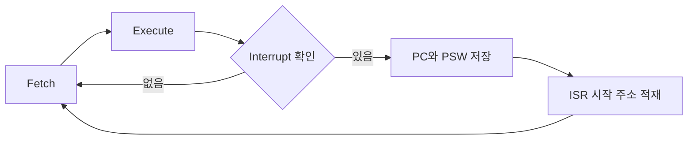
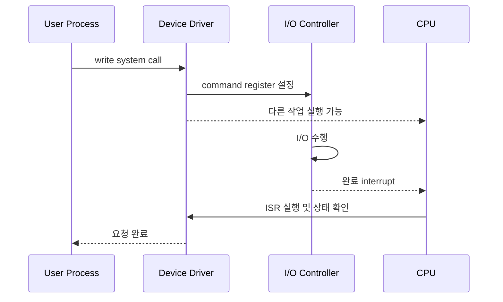
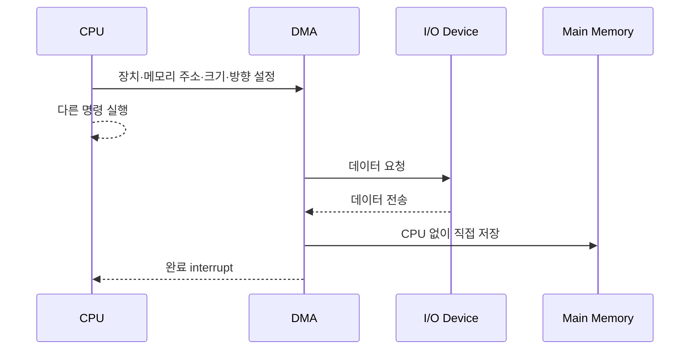

# Interrupt와 I/O

<strong>목차</strong>

- [interrupt란](#section-1)
- [interrupt의 종류와 발생원인](#section-2)
- [interrupt 처리를 위한 OS 서비스 루틴과 시작 주소 → 2번 질문](#section-3)
- [CPU의 interrupt 처리 방식과 OS의 역할 → 3번 질문](#section-4)
- [복습 질문](#section-5)
- [1번 질문 → 너무 자세함. 아래 다시 정리](#section-6)
- [질문 1-A](#section-7)
  - [질문1 답변](#section-8)
- [Interrupt Service Routine과 Context Switching](#section-9)
- [3번 질문](#section-10)
- [I/O 작업](#section-11)
- [2번 질문](#section-12)

Interrupt의 종류와 처리 과정, I/O 작업과 Process 상태 변화를 함께 정리합니다.

> 관련 노트: [Operating System 개요](operating-system-overview.md) · [Context Switching](context-switching.md)

## interrupt란

- interrupt가 발생한다 / HW 또는 Device Controller가 interrupt를 건다의 정의
    - Program Status Word (PSW) 레지스터의 Interrupt Enable/Disable bit를 1로 바꾼다.
    - 평상시에는 위 bit가 0으로 세팅
    - HW가 interrupt 상황을 감지하면 위의 bit를 1로 변경
- Fetch Stage → Execution Stage → Interrupt Stage
    - F → E는 그냥 실행되고, E Stage가 끝나면 Interrupt가 발생하였는지 CPU가 확인을 함
    - Interrupt는 언제라도 발생할 수 있음. 확인을 E Stage가 끝나고 할 뿐이지
    - Interrupt Stage 그 자체는 HW적으로 PC와 PSW를 Control Stack에 넣고 HW적으로 PC에 실행할 ISR의 시작 주소를 넣을 뿐이지, 실행 자체는 다시 F → E 과정에서 시작됨.
    - 따라서 Interrupt Stage에서 ISR 프로그램/명령을 실행한다? → 잘못됨

## interrupt의 종류와 발생원인

아래 4가지 종류 모두 HW Device가 발생시키기 때문에 Hardware Interrupt라고도 부름

- Program Interrupt
    - 프로그램(SW)가 원인이 되어 발생
        - SW의 이상행동을 HW가 발견, HW Device가 interrupt를 발생시킴
        - 프로그램은 interrupt를 발생시킬 수 없음.
    - Overflow 발생 시 작동
        - PSW의 컨디션 코드가 이를 감지
    - 0으로 나누기 연산을 한다면 발생
        - CPU 내 Exception Unit이 이를 감지
    - 잘못된 명령어를 실행할 때
        - Execution Stage의 명령 분석 HW가 command의 존재 유무를 확인
    - 다른 유저의 memory space에 access 하는 경우
        - 메모리 관리 유닛이 감지
        - 각 프로세스마다 할당받은 메모리 공간이 있는데, 할당받은 공간을 넘어 다른 곳을 침범하는 경우
        - 오류 발생으로 디스크에서 메모리로 오는 도중 자기 영역을 벗어난 액세스 진행
        - 고의적으로 Run Flow 탈취
- Timer Interrupt

    여러 프로그램이 동시에 실행되는 것이 아니라 번갈아가면서 실행되고 있는데, 이를 위해서 Processor는 Timer를 사용함. (굉장히 빠른 속도로 번갈아 가며 실행, 유저가 알기 어려울 정도로)

    프로그램이 실행을 시작하면 타이머를 켜놓고 딱 타임아웃이 되면 프로그램이 바뀌는 형식

    - 이 processor의 timer에서 interrupt가 발생하는 경우 → 프로그램에 할당된 시간이 전부 소모된 경우
        - 한 프로그램이 타임아웃을 받으면, timer interrupt에 의해 그대로 프로그램이 중단이 되어버린다.
        - Program Interrupt나 HW Failure 와는 다르게 다시 중단된 프로그램의 차례가 되면 다시 실행을 해야한다.
        - 어떻게 interrupt 발생 직전 흐름에서 다시 시작할 수 있는가? → Control Stack에 그 때 그 직전의 Register들을 저장한다.
            - 다만, PC와 PSW 만큼은 HW로 먼저 저장
- I/O Interrupt
    - I/O Controller가 발생시키며, 다른 3개의 interrupt와는 다름
        - 단순 I/O 작업을 위한 신호가 아닌, 종료 상황을 알리기 위한 interrupt임
            - 정상적 종료
            - 여러 Error 상황들
        - 예시로 printf()나 scanf()에서 interrupt가 발생하면, 함수를 ‘진행할 때’ I/O interrupt가 걸리는 건가하는데, ‘할’ 때가 아닌 함수가 ‘끝났을’ 때  interrupt에 걸린다고 얘기해야 함.
        - 왜 ‘종료 상황’에서 interrupt를 거는지에 대한 원인
            - I/O 디바이스와 CPU의 속도 차이 → I/O 디바이스가 CPU보다 압도적으로 느림
                - 데이터 변환
                    - 키보드 입력(문자) → %d 정수형으로 변환, %f 실수형으로 변환, %c 그래도 문자형으로 저장
                - 버퍼링 작업
                    - IO 라이브러리 함수를 호출하는 것인 printf()는 화면에 바로바로 출력되는 것이 아닌 buffer에 저장이 되었다가 특정 조건(\n 이나 프로그램 종료)에 이 buffer 바구니를 flush하여 출력함.
                        - printf() → buffer in IO lib. func → write() in IO lib. → 출력
                    - OS에 프로그램이 직접 요청하게 하는 system call 함수인 write()는 바로 출력을 시켜버림
                        - write() → 출력
                    - 그래서 printf(”1”); printf(”2”); write(stdout, “A”); 이렇게 코드 순서를 구성하면,
                    ”12A” 이렇게 출력되는 것이 아닌 “A12” 이렇게 출력됨.
            - 그래서 이 속도 차이랑 I/O interrupt랑 뭔 상관이 있냐?
                - User Program이 write() system call을 호출하면, CPU 제어권이 OS 내 Device Driver(교안 기준 I/O Program)로 넘어감
                - OS Device Driver가 넘겨받은 데이터 확인하고 I/O Controller의 Command Register에 출력 명령을 내리고 CPU는 다른 프로세스를 실행하러 떠남(CPU와 I/O 디바이스의 속도 차이로 인한 비동기, I/O Controller는 하드웨어)
                - 그럼 지시받은 I/O Controller는 I/O Device를 조작해 물리적 출력을 진행
                - 작업이 정상 종료되면 I/O Controller가 자신의 Status Register에 Error Bit를 0 으로 기록함
                - I/O Controller가 CPU에게 작업 종료를 알리는 I/O Interrupt 신호를 보냄(Interrupt 발생)
                - 다른 작업을 끝낸 CPU가 돌아와서 I/O Controller의 상태 레지스터를 읽고 Error bit가 0임을 확인, 정상적으로 write() 작업을 최종 마무리 (ISR, Interrupt 처리)
            - Short I/O Wait → CPU의 대기 시간 없이 효율적임
                - I/O 입출력이 꽤 빠르게 진행되거나 User Program이 다음 write()를 요청하기까지 계산할 것이 많아 오랜 텀이 걸릴 때
                - User Program이 첫 write()를 요청
                - CPU는 4번 작업을 시작, 여기서 4번 작업은 I/O Program 코드를 실행하는 시간으로, 정확히는 OS 내 I/O Device Driver 코드를 실행하는 것이다.  CPU가 I/O Controller에게 출력 명령을 command register에 세팅하기 위한 준비 및 명령 하달 작업
                - 위 4번 작업을 마치면 I/O Device는 I/O Controller에 의해 작업을 시작하고(I/O Command 부분), 동시에 CPU는 다시 User Program으로 돌아와 2a 작업을 수행함.
                - 즉, 2a 작업을 cpu가 처리하고 있는 동안 I/O Device 쪽에서도 동시에 출력이 진행되고 있는 중임.
                - User Program이 두 번째 write()를 요청하기 전에, I/O Controller가 일을 다 끝내고 I/O interrupt Signal을 보냄
                - 그럼 CPU는 하던 작업을 멈추고 5번 작업을 수행한 후 2b로 돌아옴.
                - 두 번째 write()가 호출되면 write() → 4번 → 3a → 5 → 3b 순으로 진행됨
            - Long I/O Wait → I/O가 오래 걸려서 CPU도 대기하게 됨
                - I/O 입출력이 느리거나 User Program이 write() 요청을 짧은 텀으로 요청할 때
                - User Program이 첫 write()를 요청
                - CPU는 4번 작업을 진행, I/O Command 진행
                - I/O Command가 진행됨과 동시에 CPU는 User Program으로 복귀, 2번 작업을 수행
                - 두 번째 write() 요청을 확인, 근데 I/O Command가 여전히 출력 중에 있음(I/O Device가 느린 등의 이유로)
                - 동일한 I/O Device에 명령을 겹쳐서 내릴 수는 없으므로, CPU도 어쩔 수 없이 대기상태로 진입(검은 블록이 이 경우)
                - 작업 중이던 I/O가 첫 번째 작업을 끝내고 interrupt를 보내면, CPU도 대기를 해제하고 두 번째 지시를 진행
            - 교안에서 No interrupt 부분은 단순히 비교를 위한 것일 뿐, 현대 컴퓨터와 OS는 해당 방식을 사용하지 않음.
            - 위 Short, Long I/O Wait 대신 현실 작업
                - 일단, 실제로는 A 프로그램에서 I/O 작업을 한다면 CPU가 그대로 2번 또는 2a번 작업을 진행하는 것이 아닌, 다른 대기하고 있는 B 프로그램을 가져와서 처리를 진행함
                - 교수님이 억울한 interrupt라고 표현한 이유는, 예를 들어 A 프로그램에 입출력 명령을 하달하고 C 프로그램을 처리하고 있는데, A측에서 i/o intrrupt를 보내면, C 프로그램이 종료되어버리는 거임.
                - 이 C 프로그램은 내가 발생시킨 interrupt도 아닌데 종료되어 버려서 억울하다는 얘기
                - 그래서 I/O interrupt가 발생하여 처리되던 프로그램이 중단이 되었을 때, 이 프로그램을 안 바꾸고 일단 interrupt만 처리하고 다시 처리되던 프로그램을 마저 처리함.
- Hardware Failure
    - 말그래도 HW에 문제가 발생한 것
    - Power 문제
    - Memory 문제
        - 데이터가 움직이면서 데이터에 오류가 발생하는 경우
        - 이 오류를 감지하기 위해 Parity Bit를 활용해 체크함
        - 체크하며 오류가 감지되면, HW Failure에 의한 interrupt 발생

## interrupt 처리를 위한 OS 서비스 루틴과 시작 주소 → 2번 질문

- 각 interrupt들을 처리하기 위한 각각의 Interrupt Service Routine(ISR) / Interrupt Handler가 존재함
    - 예를 들어 Timer Interrupt가 걸리면 이를 처리하기 위한 Timer ISR이 있음
    - CPU가 Interrupt Signal을 받으면 어떤 이유로 interrupt가 발생하였는지 확인함
    - 확인된 결과에 따라 적절한 ISR / handler를 불러옴

## CPU의 interrupt 처리 방식과 OS의 역할 → 3번 질문

- 기본적으로 CPU는 그냥 내비두면 User Program을 처음부터 끝까지 실행하려고 함
- 근데 OS가 끼어들어서 User Program → OS → User Program → OS 이렇게 작업이 반복이 됨

## 복습 질문

## 1번 질문 → 너무 자세함. 아래 다시 정리

Interrpt stage에서 정확히 어떻게 무슨 일을 하고 그래서 interrupt가 어떻게 진행되는지

- 일단 명령 사이클은 Fetch → Execution → Interrupt 3단계로 이루어짐
- 먼저 명령 사이 종료 대기
    - 현재 실행중인 명령어(덧셈, 메모리 읽기 등)의 Execution Stage가 완전히 끝날 때까지 대기
    - CPU는 Clock 단위로 동작하기 때문에 사이클 중간에 임의로 멈출 수가 없음
- Interrupt Pin 및 Program Status Word(PSW) 확인
    - CPU는 다음 명령어를 Fetch하러 가기 직전, CPU 칩 외부에 튀어나온 인터럽트 요청 핀(IRQ Pin)에 전기 신호가 들어왔는지, 그리고 자신의 PSW 레지스터 내 Interrupt Enable/Disable bit가 ‘1’ 인지를 확인함 (여기서 IRQ Pin에는 Interrupt Controller라는 친구가 신호를 보냄)
    - PSW의 int bit가 0이면 interrupt를 무시하고 다음 Fetch를 진행
- Interrupt Acknowledge(INTA) 신호 발송
    - interrupt를 감지하면, CPU는 Control Bus 또는 Interrupt Controller에 직접 Interrupt Acknowledge(INTA) 신호를 발송함.
    - 이 Control Bus를 타고 INTA 신호를 받은 Interrupt Controller는 아까 자신에게 Interrupt를 요청했던 장치 (예를 들면 Timer가 interrupt를 요청) 의 고유번호인 Interrupt Vector를 Data Bus로 올림
    - CPU는 Control Bus로 INTA 신호를 보낸 후 Data Bus를 읽어 들임
    - Data Bus에 2번(타이머) 이라는 숫자가 올라와 있으면, CPU는 이제 이것이 Timer가 요청한 Interrupt라는 것을 알게 됨
- Interrupt Vector Table로 점프
    - CPU는 이제 어떤 interrupt인지를 알았으니 메모리에 있는 IVT의 해당 고유번호 항목(지금 예로는 2번)을 찾음
    - 그리고 Timer의 ISR의 시작주소를 PC 레지스터에 덮어씌우며 Timer ISR 작업을 시작함.
- 현재(PCI 버스 형식의 메인보드)의 컴퓨터는 Level-Triggered 방식을 사용하며, 이는 ISR이 동작하는 단계에서 interrupt signal을 interrupt가 발생한 HW에서 해제하게 됨.
- ISR을 진행하며 interrupt가 발생한 곳에 대해 CPU가 해당 HW의 상태 레지스터를 읽는 순간, HW는 interrupt 상태를 cpu가 확인하고 조치를 시작했다는 것을 파악, interrupt 신호 전달을 중단함.

## 질문 1-A

Interrpt stage에서 정확히 어떻게 무슨 일을 하고 그래서 interrupt가 어떻게 진행되는지

### 질문1 답변

- 명령어 실행 사이클은 Fetch → Execution → Interrupt로 구성되어 있음
- 명령어 한 사이클까지 대기
    - 한 명령어의 Execution Stage가 끝날 때까는 그 사이에 Interrupt가 발생해도 그냥 실행함.
    - Execution Stage가 끝나면 PSW의 Interrupt Enable/Disable Bit를 확인함
        - 0이면 Interrupt 미발생이므로 다음 Fetch-Execution 진행
        - 1이면 Interrupt 발생이므로 Interrupt Stage를 진행
    - Interrupt Stage 진행
        - Interrupt Stage는 HW적으로 먼저 처리하는 Stage
        - 먼저 기존 실행 중이던 프로그램의 PC와 PSW를 Control Stack에 저장
        - 이후 Interrupt의 종류에 맞는 ISR의 시작주소를 PC에 저장
        - PC에 ISR 시작 주소를 저장하면, Fetch-Execution을 진행하며 ISR 실행
            - 이미 PC에 ISR 주소를 넣은 시점에서 interrupt stage는 완료

## Interrupt Service Routine과 Context Switching

OS 프로그램의 적절한 인터럽트 서비스 루틴은 어떻게 실행 시작하는지

지금 프로그램이 어떻게 시작하는지, 중단되었다 다시 어떻게 시작하는지, OS의 적절한 ISR은 어떻게 실행 시작하는지

- 모든 실행의 중심은 PC 레지스터와 상태 저장에 있음
- 실행 시작(ISR 포함)
    - CPU는 PC 레지스터 안에 들어 있는 주소의 코드를 무조건 실행함
    - 따라서 User Program이든 OS의 ISR이든 일단 PC 레지스터에 해당 시작주소를 넣기만 하면 즉시 실행을 시작함.
- 프로그램 중단
    - 프로그램의 실행을 멈출 경우에는 CPU 내부에 있는 모든 레지스터값(PC, PSW, General Register들 등)을 Control Stack에 전부 저장함.
    - 우리 포너블에서 Segmentation Fault나 여타 프로그램을 조졌고 강제 종료될 때, Core Dump를 보면 종료될 때의 모든 레지스터 값이 저장되어 볼 수 있는데, 그런 느낌?
- 프로그램 재시작
    - 나중에 다시 프로그램을 재시작할 때는, Control Stack에 있던 레지스터 값들을 CPU로 복원함.
    - 이때 예전 PC값도 같이 복원되기 때문에 멈췄던 지점에서 다시 정확히 실행이 가능함.
    - 이렇게 A 프로그램의 Register들을 저장하고 B 프로그램의 레지스터를 복원하여 실행의 주도권을 넘겨 주는 것을 “Context Switching”이라고도 한다.
- Control Stack이란? (내가 추가로 조사한 거)
    - 우리가 아는 User Stack과는 다른 곳임 (User Stack의 주소 : 0x7fff~)
    - Control Stack은 Kernel Stack 과 동일함. (Kernel/Control Stack 주소 : 0xffff~), 즉 Control Stack은 Kernel Space에 존재함.
        - 물론, OS가 존재하는 가정하에, OS적 관점에서는 User와 Kernel의 권한 분리를 의미하는 Kernel Stack임.
        - Flow Control 관점에서는 PC, PSW 등 레지스터의 Data를 안전하게 저장할 수 있는 Control Stack임.
        - OS가 없는 기기는 Kernel Stack이 없지만, 그곳에서도 PC, PSW, 범용 레지스터를 저장하는 Stack을 Control Stack이라고 부름.
    - 즉, 위쪽의 레지스터값들은 Kernel 영역에 저장하기 때문에,  교수님이 ‘안전한’ 영역에 안전하게 저장된다라고 표현하셨던 것임

## 3번 질문

4번 박스 작업이 하드웨어적으로 먼저 진행된 이유

- PC와 PSW의 내용을 HW적으로 먼저 진행되는 이유는, ISR을 시작하기 위해서는 무조건 Program Counter에 ISR 시작주소를 넣을 수 밖에 없고, ISR도 프로그램이기 때문에, 메모리 공간 확보등을 위한 덧셈/뺄셈이라도 하는 순간, PSW가 ISR을 위해 갱신되어버림.
    - 혹시 프로그램 시작 시의 메모리 스택, 어셈블리 코드를 본 사람은 알 수 있듯이, 프로그램 시작 후 가장 먼저하는 일은 메모리 Stack을 늘려 공간을 확보하는 작업이다. 그리고 이는 연산을 요구하는 작업이다.
- 위 작업을 OS가 시작한 이후 첫 작업으로 할당하여도, 이미 ISR을 실행하기 위해 PC에는 ISR 시작 주소가 들어가 있는 상태이기 때문에, 무조건 HW적으로 먼저 Control Stack에 밀어넣어야 한다.
- 그에 반해 General Register들은 단지 PC에 ISR 시작주소를 넣고 실행한다고 기계적으로 값이 바로 달라지지는 않는다. 따라서 ISR을 실행 직후 소프트웨어적으로 Control Stack에 값을 저장해도 늦지 않는다.

---

## I/O 작업

- Programmed I/O
    - I/O 작업을 시키고, I/O 작업이 종료될 때까지 CPU가 대기하는 것
    - I/O 전체 작업이 I/O Program에 의해 이루어짐
- Interrupt Driven I/O
    - 시작은 I/O Program이 하고, I/O작업을 하는 동안 CPU는 다른 작업을 하다가 Interrupt Signal이 오면 Interrupt Handler가 개입하는 방식
- Direct Memory Access(DMA)
    - CPU를 거치지 않고 I/O 모듈이 직접 Memory에 접근하는 것
    - read(), write()에서 file이 입출력을 하는 경우 (표준입출력이 아닌 Secondary Memory에서 꺼내는 경우)
    - 처음 시작은 명령을 읽어서 CPU가 판단
        - 예를 들어 파일에서 읽어들여 1000개를 출력해야 한다했을 때, 첫 시작과 끝은 CPU가 개입하지만, 그 중간에 천 여개를 옮기는 작업에는 관여하지 않음.
        - I/O 디바이스인 HDD나 SSD가 직접 메모리에 접근함
        - 이를 수행하기 위해서는 CPU가 판단 후 DMA 모듈에 나 대신 해달라고 요청을 함
    - DMA 모듈에 작업을 요청(넘기는 정보)
        - 어느 I/O Device의 어느 위치에서 읽고 쓰는지
        - 메모리에 있는 데이터 이동 시작 주소
        - 몇 바이트나 옮기는 지, Word의 수
        - read 인지 write인지
    - DMA 모듈에 정보를 보내고 CPU는 다른 자기 할 일을 하러 떠남
    - DMA 모듈 또한 해당 건이 끝나면 I/O interrupt를 발생시켜 CPU에 보고한다.
    - DMA 모듈은 I/O Module(I/O Controller)나 System Bus에 붙어있음 (CPU에 내장된 것이 아님)
        - DMA 모듈이 작업을 하면서 System Bus를 이용하게 되는데, 기본적으로는 CPU에게 우선권이 있어 CPU가 사용하지 않을 때 그 틈에 작업을 진행함
        - 다만 DMA 모듈이 작업을 하던 도중에 CPU가 필요로 하게 된다면, CPU는 DMA 작업 멈출 때까지 대기하게 됨.
        - 그래서 DMA 작업을 하는 동안에는, CPU 작업이 조금 느려질 수 있음

---

## 2번 질문

[Process State 도식](processes.md#section-4)에서 interrupt와 관련 있는 상태 전이는 두 가지다.

- Running → Ready (Time out 화살표)
    - Time out = timer interrupt 설명이 더 필요한가?
- Blocked → Ready (Event Occurs 화살표, 이벤트 발생/완료)
    - I/O 작업 등으로 Blocked가 되어 있던 Process가 I/O interrupt를 보낸 후, 이상없이 작업 마무리가 되었다면 OS가 해당 프로세스를 Ready 상태로 바꿔줌
