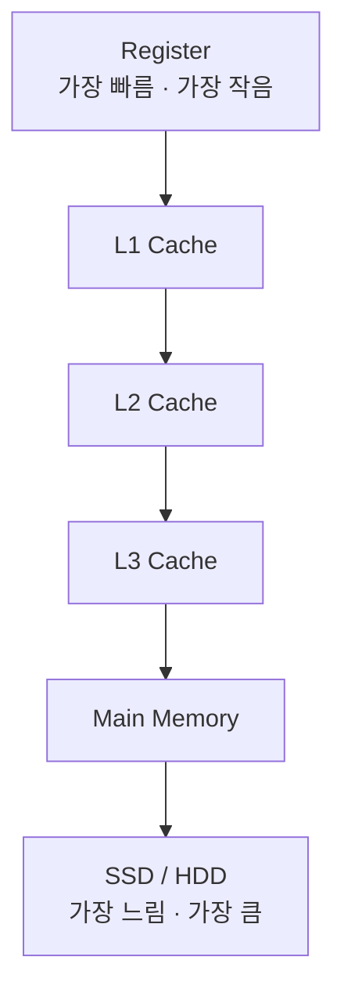
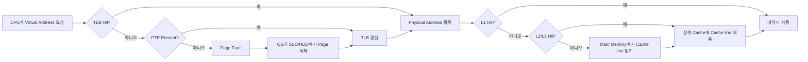

# Memory Hierarchy

<strong>목차</strong>

- [메모리](#section-1)
- [Memory Hierarchy에서의 데이터 이동](#section-2)
  - [각 계층별 한 번에 데이터를 이동시킬 수 있는 단위](#section-3)
  - [CPU 작업과 Cache Miss, Page Fault](#section-4)
  - [L1 Cache Miss 발생 후 L2, L3, Main Memory에서 Hit이 될 경우](#section-5)
  - [Hit 발생 시 실제 이동 시퀀스(On-Chip Interconnect, 2000s 이후)](#section-6)
- [1번 질문](#section-7)

Register, Cache, Main Memory와 저장장치 사이의 데이터 이동과 성능 특성을 정리합니다.

> 관련 노트: [Memory Management](memory-management.md) · [Virtual Memory](virtual-memory.md)

## 메모리

- Memory Hierarchy
    - Register
    - Cache
        - Processor와 Main Memory 간 속도 차이의 완충을 위해 존재하는 메모리
        - CPU가 레지스터에 있는 데이터를 읽고 계산하는 속도와 거의 같은 속도로 캐쉬에서 레지스터로 데이터를 이동시킬 수 있음. (거의 1~3 클럭 정도에 L1 Cache → Register로 데이터를 옮길 수 있음 )
        - Cache는 Main Memory의 한 부분을 가져와서 복사함
        - OS가 아니라 HW단에서 Cache의 관리를 진행함. → 1번 질문
        - Single Cache일수도 있고, Level - Cache 일수도 있음(요즘은 다 Level-Cache)
    - Main Memory
    - HDD/SSD (Secondary Memory)
- 하위 memory 일수록 차이
    - bit당 가격 감소
    - 용량 증가
    - access 시간 증가
    - Processor에서 메모리에 접근하는 빈도 감소
        - 하드디스크에 A 프로그램이 있다고 하면, 프로그램의 전체 중에 A가 실행해야 하는 코드가 들어 있는 한 페이지가 메모리로 올라감
        - 일단 메모리에 올려놓으면, 그 메모리 안에 있는 한 Page에 있는 코드들을 실행
            - 그리고 그 한 Page에는 적어도 1000 여 개의 코드가 존재함.
        - 즉, 그걸 실행하는 동안에는 다시 하드디스크로 갈 일이 없음.
        - 위 얘기는 곧 하드디스크에서 한 번 액세스하면 메모리에서는 천 번쯤 액세스할 수 있다는 뜻이 됨.
        - 그 다음에 이제 메모리에 있는 한 페이지의 데이터 중에서 A가 지금 실행하는 명령에 있는 한 블록만 Cache로 이동함.
        - 그러면 도 한 번 캐쉬에 한 블록이 갖다 놓으면(메모리에 한 번 액세스하면) 그걸 전부 실행할  때가지 그 메모리에 갈 일이 없음
        - 따라서 가장 많이 액세스하는 것은 Cache, 그 다음이 Memory, 그그 다음이 하드디스크가 되는 것이다.
        - 이렇게 하위 레벨의 메모리에 대해 액세스가 적어지는, 접근 빈도가 감소하는 이유가 바로 Reference의 Locality 때문이다.
- Locality of Reference
    - 프로그램을 작성할 때, 별 일이 없으면 순차적으로 실행되게끔 코드를 작성하고 실행 또한 순차적으로 됨
    - 그러면 한 명령이 실행되면 그 다음 명령은 그 다음줄에 있을 확률이 높음
    - 함수의 경우에는 a함수에서 b함수를 호출한다고 했을 때, b함수는 a함수 위에 있거나 아래에 배치되었을 것임.
        - 즉, 다음에 호출할 함수가 근처에 있다는 것
    - 데이터의 경우에도 대용량의 데이터를 사용할 때 보통 배열을 많이 씀.
        - 즉, 데이터들도 모여있다는 것
    - 이렇게 실행해야할 것들이 모여있는것, 이걸 Locality of Reference라고 부름.
    - 그래서 결국 한 Page를 가져온다면, 실행할 때 필요한 데이터나 함수들이 그 Page안에 전부 모여있기 때문에 다시 하드디스크를 액세스하고 다른 Page를 가져올 일이 적어진다는 것이다.

## Memory Hierarchy에서의 데이터 이동

이건! 작성자 본인이 Locality of Reference와 Cache에 원하는 명령이 없다면 다시 하드디스크로 이동해야한다는 것이, 고작 Page하나 없다고 다시 하드디스크(정확히는 Secondary Memory)로 가야한다는 것이 이해가 안가서 찾아본 부록적인 내용입니다.

컴퓨터 구조 내용을 포함하고 있으며, 건너뛰어도 되는 부분입니다.

### 각 계층별 한 번에 데이터를 이동시킬 수 있는 단위

- Secondary Memory → Main Memory : 4kb, 명령어 1,000여개 (1개 Page의 크기, Page 단위 이동)
- Main Memory → Cache : 64 byte, 보통 16개의 명령어 (Cache Line/Cache Block 단위 이동)
- Cache → Register : 4 byte(32bit CPU), 8 byte(64bit CPU), 1개 명령어 (Word 단위 이동)
    - 여기서 Level - Cache의 경우에는 L1에서 L1i (Instruction Cache)와 L1d (Data Cache)로 나뉘는데,
    - 저 Word 단위 이동은 Data에 해당하는 경우로, Instruction에는 해당하지 않음.
    - 그래서 L1d → Register로 이동할 때는 CPU의 bit에 따라 word 크기가 달라서 영향을 받지만,
    - 명령어의 경우에는 L1i → Instruction Queue → Decoder로 이동하며 최종적으로는 Execution Unit 내의 ALU Control Unit으로 이동하여 Control Signal을 보냄.
- 따라서 instruction이 Decoder에 가기 전의  한 Cache Line 에는 CPU bit 관계없이 16개의 instruction이 대기 중

### CPU 작업과 Cache Miss, Page Fault

- 일단 CPU에서 1번 instruction을 처리했다하면, 다음 명령(2번 명령이라 가정)을 L1i에서 확인한다.
- 여기서 L1i에 2번 명령이 존재한다면 해당 명령을 불러오고, 2번 명령을 진행하며 필요한 변수를 L1d에서 찾아보고 있다면 불러온다.
- 자, 위의 경우는 문제없이 명령어와 데이터들이 전부 L1에 존재하는 경우이며(L1 Hit), 아래부터가 Cache Miss 내용이다.
- L1i Cache Miss / L1d Cache Miss, Pipeline Stall
    - L1 Miss는 발생하자마자 Cache Controller는 CPU의 Control Unit에게 Memory Stall Signal을 보냄.
    - 신호를 받은 즉시 CPU는 Pipeline Stall 상태가 된다. (일종의 HW판 interrupt 느낌)
    - 그리고 이 필요한 정보를 가져오기 위해 모든 Bus의 대역폭을 최우선 할당받게 됨
    - L1i Cache Miss는 다음 명령어가 L1i 내에 없을 경우를 말한다
    - L1d Cache Miss는 명령을 수행하는데 필요한 변수(데이터) 내용이 L1d에 없는 경우를 말한다.
- L2 Cache Miss
    - L1 Cache Miss가 발생할 경우 L2를 확인한다.
    - L2에 원하는 내용이 있으면 그대로 L1으로 올려보내고(L2 Hit), 없다면 L2 Cache Miss가 발생, L3를 확인하게 된다.
- L3 Cache Miss / LLC Miss (Last Level Cache Miss)
    - L2 Cache Miss가 발생할 경우 L3를 확인한다.
    - L2와 동일하게 원하는 내용이 있으면 L2로 올려보내고(L3 Hit), 없다면 L3 Cache Miss가 발생, Cache Miss로써 마지막 확인처인 RAM(Main Memory)를 확인하게 된다.
- Page Fault
    - L3 Cache Miss까지 발생하여 RAM까지 확인하게 되었는데, 여기에서 조차도 원하는 instruction을 가진 Page가 없다면, Page Fault가 발생
    - Page Fault가 발생한다면 예외 interrupt(Trap / Page Fault Interrupt) 신호를 발생시켜 OS가 개입하게 되면서 다른 프로세스를 올리는 Context Switching이 일어나고,
    - 필요한 Page를 Secondary Memeory에서 스캔하고 찾아오는 동안에는 Process의 State가 Running에서 Blocked 상태가 된다.
- Cache Miss와 Page Fault
    - Cache Miss는 HW 자체 내에서 이루어지며, OS가 개입하지 않는다.
    - Cache Miss는 최소 10 사이클에서 최대 300 사이클 내에 처리가 되면서 Process가 Running 상태를 유지하면서, 단순히 CPU가 기다리는 상태(Pipeline Stall / Bubble)가 된다.
    - Page Fault는 Secondary Memory까지 접근해서 필요한 내용을 찾아와야 하기 때문에 수 ms에서 수십 ms의 시간이 걸린다.
    - 따라서 지금 실행중인 Process를 멈추고 다른 프로세스를 실행하게 된다.

### L1 Cache Miss 발생 후 L2, L3, Main Memory에서 Hit이 될 경우

- Critical Word First (요청 단어 우선 전송)
    - Miss가 발생했다는 것은, 현재 필요한 instruction / data가 없기 때문에 CPU가 Stall 상태에 있는 중, 즉 CPU가 놀고 있다는 것
    - 그래서 이 L2 / L3 Cache, Main Memory에서 원하는 내용이 발견된 경우, 내용을 옮기기 위해 L3 Hit → cache line(64 byte) 이동 → 해당 cache line을 L2에 저장 → 이동 → L1i/L1d 저장 → Decoder/Register로 보내버리기를 수행하기에는 시간이 너무 소요됨.
    - 그래서 당장 필요한 내용 4~8byte를 추출해 우선적으로 상위 memory로 forwarding 해버림
    - 그래서 바로 실행해야 하는 이 Word는 최대한 빠르게 Decoder(L1i Miss)/Register(L1d Miss)로 이동함.
- Early Restart (조기 재개)
    - CPU에 필요한 Instruction/Data가 들어오고 Decoder/Register에 준비가 된다면, L1 cache에 아직 이동을 위한 64byte가 준비되지 않았더라도
    - 필요한 Word가 Decoder/Register에 들어온 즉시 CPU는 실행을 재개함
    - CPU가 밀린 작업을 하는 그 찰나의 순간에, Memory Controller는 56Byte의 자잘한 주변 데이터들을 채워넣으면서 Cache Line 전송을 마무리함.

### Hit 발생 시 실제 이동 시퀀스(On-Chip Interconnect, 2000s 이후)

- System Bus로 하나의 공유된 길은 1990~2000년 초 펜티엄 CPU 시절까지는 물리적인 사실이었음
    - 그러나 현재는 Bus가 각기 나뉘어서 각 역할과 공간에 맞게 연결되어 있음
    - 논리적인 의미로 System Bus 를 바라보는 것이 맞음
- Memory Bus (RAM ↔ CPU 내 Memory Controller)
    - CPU 바깥에서 데이터를 퍼나르는 가장 넓지만 상대적으로 느린 도로
    - 일종의 국경선과 국외 검문소 느낌
- Ring Bus / Mesh Architecture (Memory Controller ↔ 공용 L3 Cache ↔ 각 코어의 정문 (Ring Stop)
    - CPU 내부에서 코어들과 L3 Cache를 둥글게(Ring) 혹은 바둑판(Mesh) 형태로 연결하는 내부 순환망 (AMD에서는 이를 Infinity Fabric 이라고 함)
    - CPU 내 각 코어들과 공용 L3 Cache를 연결하는 외곽순환도로 느낌
- Internal Data Bus, IDB (코어 정문(Ring Stop) ↔ 전용 L2 Cache ↔ L1 Fill Buffer ↔ ALU/Register
    - 코어 1개 안에만 존재하는 독립이고 폐쇄적인 도로
    - AMD에서는 IDB를 Core-Complex(CCX) Internal Routing이라고도 함.
    - L1d ↔ Register 사이에서 데이터를 나르는 Path를 특별히 Load/Store Datapath 라고 부름
    - L1i → Decoder 사이의 길은 Instruction Fetch Pathm IFP 라고 함.
    - Decoder → ALU Controller의 길은 Dispatch / Issue Bus 라고 함.
- Memory Hit 시의 이동 시퀀스
    - RAM에서 8 Byte가 Memory Bus를 이용해 CPU의 Memory Controller에 도달
    - Memory Controller가 이 Word를 Ring Bus에 태움, 목적지는 요청한 코어의 Ring Stop
    - Word가 요청 코어의 Ring Stop으로 이동하는 동안, L3 Cache Controller가 지나가는 이 Word의 복사본을 낚아채고 저장을 시작함.
    - Ring Stop에 도착하면 코어 내부 도로로 진입, 길이 3 갈래로 나있는데, 이 세 갈래 전부로 동시 전송
        - 한 갈래는 L2 Cache로 이동되어 저장
        - 한 갈래는 L1 Cache의 Fill Buffer로 이동되어 저장
        - 마지막은 L1 Fill Buffer를 스쳐지나가자마자 Decoder/Register로 직행, Pipeline을 다시 가동시킴
- 다른 L3, L2 Hit 위 과정을 기반으로 거리가 가까울 수록 앞의 과정들이 생략됨.
    - L3는 코어 외부 L3 Cache에서 시작하고, L2는 코어 내부 L2 Cache에서 시작
    - RAM → CPU는 대략 300 사이클 또는 클럭
    - L3 → CPU는 대략 30 사이클 또는 클럭
    - L2 → CPU는 대략 10 사이클 또는 클럭
    - 물리적인 거리에 따라 대기 시간의 차이가 있음
    - CPU의 연산속도가 4.0GHz라면 1클럭은 0.25ns(나노세컨드) 임

---

## 1번 질문

왜 Cache는 OS가 아닌 HW가 직접 관리를 하는가?

- OS는 SW이기 때문에 개입하면 그만큼 느려짐
- 그래서 OS의 개입을 줄이고 HW적으로 Cache 자체에서 빠르게 빠르게 처리하는 것
