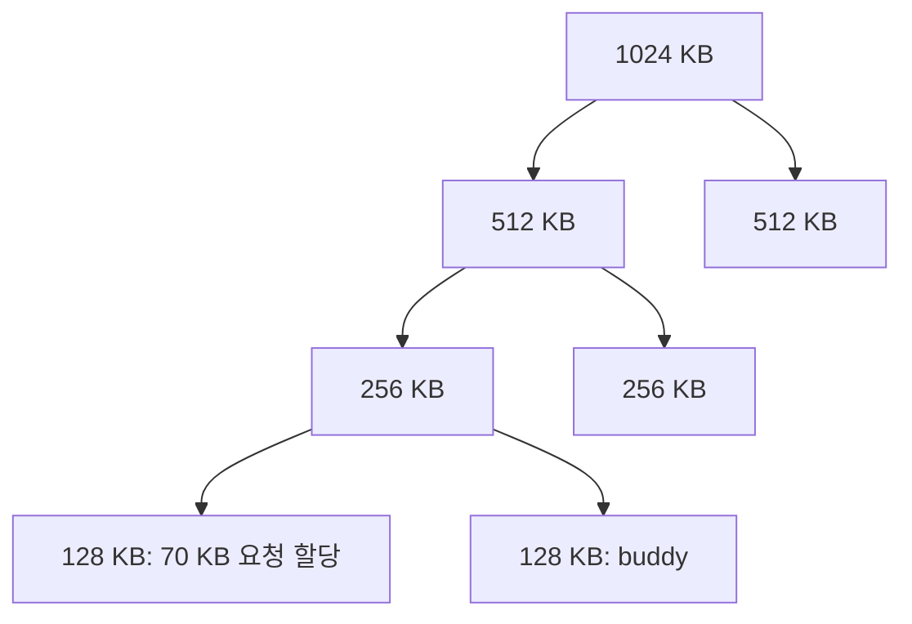
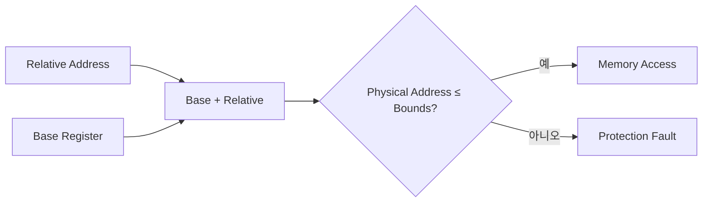
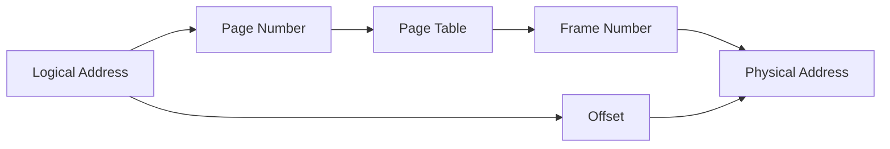
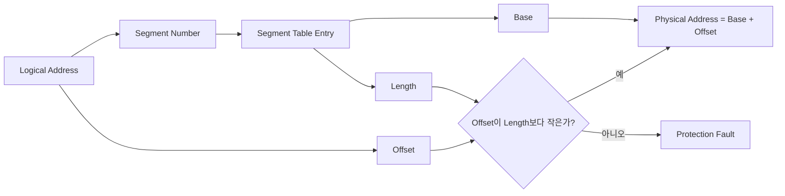

# Memory Management

<details>
<summary><strong>목차</strong></summary>

- [Memory Management](#section-1)
- [Memory Management Requirements](#section-2)
  - [Relocation](#section-3)
  - [Protection](#section-4)
  - [Sharing](#section-5)
- [Partitioning](#section-6)
  - [Fixed Partitioning](#section-7)
  - [Dynamic Partitioning](#section-8)
  - [Dynamic Partitioning Placement Alg.](#section-9)
- [Buddy System](#section-10)
- [Addresses](#section-11)
  - [Base Register와 Bounds Register를 이용한 Relocation/Protection](#section-12)
  - [Address의 개념](#section-13)
- [주소 비트 수와 프로그램의 최대 크기](#section-14)
- [Paging](#section-15)
  - [Page Tables](#section-16)
  - [Logical Addresses](#section-17)
  - [Paging 주소 변환](#section-18)
  - [Paging에서 Protection](#section-19)
  - [Paging의 장단점](#section-20)
- [Segmentation](#section-21)
  - [Segment Table](#section-22)
  - [Segmentation의 주소 변환과 Protection](#section-23)
- [Paging vs Segmentation](#section-24)
- [복습 질문](#section-25)
- [Base Register와 Bound Register는 몇 개가 필요할까?](#section-26)
- [Paging에서 Relative Address와 Logical Address는 왜 다시 컴파일할 필요가 없는가](#section-27)

</details>


Memory Partitioning, Paging, Segmentation과 주소 변환 및 보호 기법을 정리합니다.

> 관련 노트: [Memory Hierarchy](memory-hierarchy.md) · [Virtual Memory](virtual-memory.md)

오늘은~ 어린이날~

<a id="section-1"></a>
## Memory Management

- 기본 전제
    - Virtual Memory 이전에는 전체 프로그램이 전부 Main Memory에 올라와야 시작할 수 있었다.
    - 지금은 프로그램 전체를 메모리에 올리지 않고 일부만 올려도 실행할 수 있지만,
        - 7장에서 다루는 과거 방식은 전체 프로그램이 메모리에 있어야 실행된다는 전제로 진행한다.
- Memory Management란?
    - 여러 프로세스를 수용하기 위해 메모리를 나누고, 가능한 많은 프로세스를 메모리에 넣도록 효율적으로 할당하는 것

<a id="section-2"></a>
## Memory Management Requirements

메모리 관리를 잘한다는 말은 단순히 빈 공간에 프로그램을 넣는 것이 아니다.

실행 과정에서 Relocation, Protection, 경우에 따라 Sharing이 필요하다.

진짜 중요한 것은 Relocation과 Protection이다.

Sharing은 필요할 수 있지만, 핵심은 앞의 두 개이다.

<a id="section-3"></a>
### Relocation

- 프로그램은 컴파일될 때 실제 동작하게 되면 메모리 몇 번지에 올라갈지 알 수가 없다.
    - 프로그램 안의 instruction에는 연산 코드뿐 아니라 데이터 주고, jump주소, 함수 호출 주소 등이 계속 들어가는데, 컴파일 시점에는 실제 메모리 배치 위치를 알 수가 없다.
- 그래서 보통 0번지를 기준으로 컴파일한다.
- 예를 들어
    - instruction에 “100번지 데이터를 가져와라” 라고 되어 있다면,
    - 이 100번지는 실제 물리주소 100번지가 아니라 0번지 기준 상대주소다.
    - 만약 이 프로그램이 실제 메모리 5340번지부터 올라갔다면,
    - 상대 주소 100번지는 실제로 5440번지 근처를 의미하게 된다.
- 이런 식으로 실행 시점에 상대 주소를 실제 물리주소로 바꾸는 작업을 Relocation이라고 한다.

<a id="section-4"></a>
### Protection

- 프로세스가 자기에게 할당된 메모리 범위를 벗어나지 못하게 하는 것을 말한다.
- 예를 들어
    - 어떤 프로그램이 1000번지부터 2000번지까지 할당받았다면, 850번지나 2500번지를 접근해서는 안된다.
        - 왜냐? 다른 프로세스의 코드나 데이터일 수 있기 때문
- 자기 범주를 넘어가지 않게 관리하는 것이 Protection이다.

<a id="section-5"></a>
### Sharing

- 코드나 데이터 일부를 여러 프로세스가 공유할 수 있게 하는 것을 말한다.
- 예를 들어
    - 특정 데이터 영역을 여러 프로세스가 R/W할 수 있게 관리하는 식이다.
- 다만 진짜 중요한 것은 Relocation과 Protection이지, Sharing은 해도되고 안해도 그만이다.

<a id="section-6"></a>
## Partitioning

```text
낮은 주소
+------------------+
| Operating System |
+------------------+
| Process A        |
+------------------+
| Free space       |
+------------------+
| Process B        |
+------------------+
| Free space       |
+------------------+
높은 주소
```

<a id="section-7"></a>
### Fixed Partitioning

#### Equal-Size partitions

- 메모리를 같은 크기의 partition으로 나누눈 것이다.
    - 예를 들어 네 공간으로 나누면 최대 4개의 프로그램이 동시에 메모리에 올라갈 수 있다.
- 하지만 프로그램마다 같은 공간을 할당하게 되면, 공간의 낭비가 심할 수 있다.
    - 프로그램 크기가 partition의 크기와 딱 맞을 가능성이 낮기 때문이다.
    - 작은 프로그램이 큰 파티션에 들어가면 남는 공간이 생기지만,
    - 이 남는 공간에 다른 프로그램이 사용할 수 없기에 낭비다.

#### Unequal-Size partitions

- 위의 문제를 해결하고자 다양한 크기의 partiton을 미리 만들어 두는 것이다.
- 작은 프로그램용 공간, 큰 프로그램용 공간을 따로 두는 방식이다.
- 실제 프로그램의 크기과 공간의 크기가 맞지 않으면, 위의 Equal보다 더 낭비가 심할 수 있다.
    - 만약 아래 예시 기준으로 10mb가 넘는 프로그램만 계속 들어오면,
    - 작은 파티션들은 아무도 사용할 수 없어서 오히려 equal-size partition보다 낭비가 심할 수 있다.
- Unequal 파티션 구성 예시


#### Fixed Partitioning을 사용한 이유

- Relocation을 안 하기 위해서
    - Partition의 시작 주소가 미리 정해져 있으니까 처음부터 “이 프로그램은 3000번지 시작 파티션에 들어갈 것이다.” 라고 가정하고 컴파일 할 수 있다.
    - 그러면 실행 시점에 주소를 다시 바꾸는 relocation 부담이 줄어든다.
- 장점 : 시작 주소를 고정할 수 있어 relocation 부담이 작다.
- 단점 : 메모리 낭비가 심하다. 특히 partition 내부에 빈 공간이 생긴다.

<a id="section-8"></a>
### Dynamic Partitioning

- fixed Partitioning의 낭비를 줄이기 위해 나온 방식이다.
    - 프로그램이 20mb 필요하다하면은 20mb를,
    - 프로그램이 14mb가 필요하다고 하면은 14mb를 할당해주는 방식이다.
    - 처음 보면 딱 필요한 만큼주니까 낭비가 없어보인다.


#### External Fragmentation Problem

- 하지만 실행 중 프로세스가 종료되거나 swap-out되면 중간중간 빈 공간이 생긴다.
    - 예를 들어 14mb짜리 공간이 비었는데 8mb짜리 프로세스가 들어오면 6mb가 남는다.
    - 이런 작은 빈 공간들이 메모리 곳곳에 흩어져 샌긴다.
- 문제는 전체 빈 공간의 합은 충분해도, 각각이 너무 작고 흩어져 있으면 큰 프로그램을 넣을 수 없다는 것이다.
- 이를 External Fragmentation 이라고 한다.
    - 그리고 이는 Compaction으로 해결할 수 있다.


#### Compaction

- 위의 External Fragmentation 문제는 메모리 전체를 읽어서 빈공간을 인식해서 프로세스들을 깔끔하게 이어 붙히는 것이다.
- Compaction이 끝나면 할당된 공간이 한쪽으로 모이고, 흩어졌던 빈 공간은 하나의 큰 연속 영역이 된다.
- 다만 메모리 전체를 읽고 작업을 하는 것이기 때문에 시간이 오래걸린다.
    - 옛 시스템에서 프로그램 실행 중 갑자기 시스템이 오래 멈추는 일이 있는데, 그것이 Compaction 작업 때문이다.
- 즉 정리하면,
- Dynamic Partitioning은 필요한 만큼 할당하므로 좋아 보이지만 External Fragmentation이 생긴다.
- Compaction으로 해결할 수 있지만, Compaction은 매우 비싼 작업이라 시스템이 멈출 수 있다.

<a id="section-9"></a>
### Dynamic Partitioning Placement Alg.


- Best-Fit
    - 요청한 크기를 수용할 수 있는 free block 중에 가장 딱 맞는 공간에 프로그램을 넣는 방식이다.
        - 즉, 넣고 남는 공간이 가장 작은 block을 선택하는 방식이다.
    - 예시로 16mb 프로그램을 넣어야 하고 Free Block들이 8mb, 12mb, 22mb, 18mb, 36mb 가 있다고 하면,
        - 8mb와 12mb는 너무 작아서 안 되고, 22mb, 18mb, 36mb 중에서는 18mb가 가장 잘 맞는다.
        - 그래서 18mb block에 16mb를 넣고 2mb만 남기는 것이 Best-Fit 방식이다.
    - 장점은 남는 공간을 최소화하려 한다는 것
    - 단점은 전체 Free-List를 다 훑어봐야 한다는 것이다.
        - Free Block들은 Linked-List로 연결되어 있고, Best-Fit은 External Fragmentation이 최소화되는 공간을 찾기 위해 리스트를 끝까지 검사해야 한다.
        - 즉 최선 수를 찾기 위해 메모리 전체를 탐색해야 한다.
- Worst-Fit
    - Best-fit과는 반대로 요청을 수용할 수 있는 Free Block 중에서 가장 큰 공간을 선택하는 방식이다.
        - 가장 큰 공간에 넣으면 남는 조각도 비교적 커지므로, 나중에 다른 프로세스가 쓸 가능성이 있다고 보는 방식이다.
    - 하지만 Best-Fit과 Worst-Fit 모두 “가장” 이라는 말을 쓰기 때문에 문제가 생긴다.
        - 가장 잘 맞는 공간이든 가장 안 맞는 공간이든, 결국 전체 Free-List를 다 확인해야 한다는 뜻이다.
        - 프로세스 사이 조각이 99개 있으면 99개를 검사해야 하므로 그 자체가 시간이 걸린다.
- First-Fit
    - First-Fit은 Free-List를 앞에서부터 보다가, 요청한 프로그램이 들어갈 수 있는 첫 번째 공간을 선택하는 방식이다.
        - 가장 좋은 공간인지 따지지 않고, 들어갈 수 있으면 그냥 넣는다.
    - 장점은 빠르다는 것이다.
        - Best-Fit처럼 모든 Free Block을 확인할 필요가 없다.
    - 단점은 앞쪽에 작은 조각들이 많이 생길 수 있고,
        - 장기적으로 Fragmentation이 나빠질 수 있다.
- Next-Fit
    - Next-Fit은 First-Fit 과 비슷하지만, 매번 리스트의 처음부터 찾는 것이 아니라 지난번에 할당한 위치 이후부터 다음으로 들어갈 수 있는 공간을 찾는 방식이다.
    - 목표는 First-Fit처럼 빠르게 찾되, 검색이 항상 앞쪽에서만 시작되어 앞쪽 공간만 계속 쪼개지는 현상을 줄이는 것이다.
    - First/Next-Fit은 Best/Worst-Fit 처럼 전체 리스트를 비교하지 않고, 들어갈 수 있는 첫 번째 또는 다음 공간을 택해서 시간을 줄이는 방식이다.

<a id="section-10"></a>
## Buddy System



- 2의 n제곱의 공간을 나눠주는 방식
- 단순이 2의 n제곱이 아닌, 전체에서 반, 그 중 한 공간을 반으로 자르며 요구한 크기보다 큰, 가장 가까운 크기의 공간을 할당해준다.
- 나중에 블록이 비면 아무 블록이나 합치는 게 아니라 서로 buddy인 블록끼리만 합친다.


- Buddy 시스템은 Dynamic 파티셔닝과 비슷하게 필요한 공간에 맞춰 할당하지만, Compaction 없이도 Buddy끼리 합쳐 큰 공간을 다시 만들 수 있다는 장점이 있다.
- 다만 필요한 것보다 조금 더 큰 공간을 주는 경우가 있으니 내부 공간 낭비는 생길 수 있다.
    - 예를 들면 70kb가 필요하면 128kb 블록을 줄 수 밖에 없는 형식

<a id="section-11"></a>
## Addresses

<a id="section-12"></a>
### Base Register와 Bounds Register를 이용한 Relocation/Protection



- Fixed/Dynamic Partitioning, Buddy System처럼 프로그램이 메모리의 연속된 공간에 올라가는 방식에서는
    - Base Reg와 Bounds Reg로 Relocation/Protection을 할 수 있다.
- Base Register에는
    - 프로그램의 시작 Physical Address가 들어간다.
    - 절대!!!! <u>**프로세스**</u>의 시작주소가 아니다!!!!
        - 프로세스의 시작주소에는 PCB가 들어있다.
- Bounds Register에는
    - 프로그램이 접근할 수 있는 마지막 Physical Addr, 즉 데이터/프로그램 영역의 끝 주소가 들어간다.
    - 이 역시 절대로 프로세스가 아니다!!!! 시발!!!! 난 틀렸다.
- Relocation은 다음과 같이 진행된다.
    - Physical Addr = Base Reg + Relative Addr
    - 예를 들어 프로그램이 5000번지부터 시작하고, instruction이 relative address 350번지를 접근하려고 하면 실제 physical address는 5350번지가 된다.
- Protection은 그 결과 Physical Addr가 Bound Reg보다 작은지 확인하는 것이다.
    - Base Reg + Relative Addr ≤ Bounds Reg
    - 위의 식이 성립되면 정상 접근이고,
    - bounds보다 크면 자기 영역을 넘어간 것이므로 interrupt가 발생, 프로그램이 중단된다.
        - 이때 “주소를 잘못 사용했습니다” 식으로 프로그램이 종료된다.
        - invaild address가 뜨기도 한다.

<a id="section-13"></a>
### Address의 개념

- Physical Address / Absolute Address
    - 실제 메모리 주소
    - 메모리 1259번지 같은 진짜 주소
- Relative Address
    - 프로그램이 컴파일될 때 특정 기준점, 보통 0번지를 기준으로 만들어진 주소
    - 프로그램 코드와 데이터가 연속된 공간에 있다고 보고 만들어진 주소
- Logical Address
    - 논리적으로 말이 되는 주소 형식
    - 시스템이 정한 방식으로 Physical Address로 변환할 수 있으면 된다.
        - 논리 주소는 MMU/OS의 변환과정을 거쳐 Physical Address가 된다.
    - Paging에서는 Logical Address를 page number + offset으로 사용하고
    - Segmentation에서는 Segment Number + offset으로 사용한다.

<a id="section-14"></a>
## 주소 비트 수와 프로그램의 최대 크기

- 시스템이 16비트 주소를 사용한다면, 표현 가능한 주소 개수는 2^16개이다.
- 주소 범위는 0 ~ (2^16 - 1) 번지
- 따라서 Byte-Addressable Memory라면 프로그램이 표현할 수 있는 최대 주소 공간은 2^16 Bytes라고 볼 수 있다.
- 이걸 왜 얘기하냐?
    - 프로그램 코드 안에는 주소가 들어있다는 점이다.
    - 주소 필드가 16비트라면, 16비트로 표현할 수 없는 주소는 instruction 안에 넣을 수가 없다.
    - 따라서 주소 비트 수는 프로그램이 접근 가능한 주소 범위와 직접 연결된다.

<a id="section-15"></a>
## Paging

- 앞의 base/bound 방식은 프로그램 전체가 메모리의 연속된 공간에 올라간다고 가정할 때 가능하다.
    - 프로그램 시작 주소에 relative address를 더하여 physical address가 나오기 때문에
- 메모리를 동일한 크기의 정크들로 잘라서 각 프로세스의 크기에 맞게 할당해준다.
- 프로세스의 chunk들을 page라고 부르고
- 메모리의 chunk들은 page frame이라고 부른다.
- 각 Page는 메모리의 서로 떨어진 frame에 들어갈 수 있다.
    - 즉, 프로그램 전체가 연속된 공간에 있지 않아도 된다.
    - 페이징 시스템은 한 페이지 한 페이지가 연속되지 않은 공간에 할당되기 때문에 Base Register를 사용할 수 없다.
- 그래서 OS는 각 process마다 page table을 사용한다.
    - Page Table은 각 Page가 실제 메모리의 몇 번 page frame에 들어있는지를 기록한다.


- (f) 순서를 보면은, Paging 시스템에서는 페이지가 연속되지 않아도 프로그램 D가 메모리에 올라와 실행될 수 있다.

<a id="section-16"></a>
### Page Tables


<a id="section-17"></a>
### Logical Addresses


- Paging의 Logical Address
    - Logical Address = Page Number + Offset
        - Page Number는 프로그램 안의 몇 번째 Page인지 나타내고,
        - Offset은 그  Page 안에서 몇 번째 Byte인지를 나타낸다.
- 위의 예시에서
    - 상대주소 1502번지, Page Size 1kb이고 1kb = 1024byte
    - 0번 Page: 0~1023, 1번 Page : 1024 ~ 2047
    - 따라서 1502번지는 1번 Page 안에 있고, offset은 1502 - 1024 = 478이다.
    - 즉, 상대주소에서 논리주소로 전환할 수 있다.
        - 따로 다시 컴파일할 필요가 없다는 얘기다.

<a id="section-18"></a>
### Paging 주소 변환



- Paging의 주소 변환
    - Logical Address에서 Page Number를 확인한다.
    - Page Table에서 해당 Page Number의 Entry 지점을 찾는다.
    - 그 Entry에 적힌 Frame Number를 가져온다.
    - Physical Address는 Frame Number + Offset으로 만든다.
- 수식
    - Logical Addr = Page Number + Offset
    - Physical Addr = Frame Number + Offset
    - Physical Addr = Frame Num x Page Size + Offset
- 예시 설명
    - Page의 크기는 1024 byte, 2^10이다.
    - 논리 주소에 6 bit Page이므로 2^6 = 64개이다.
    - 즉 Page의 개수는 64개, 각 페이지당 index가 2^10(0~1023이다)
    - Page Index에 맞춰 프로세스의 Page Table의 Page Table Entry를 확인, Frame Number를 확인한다.
        - 예를 들어 PN이 1이고 해당 PTE의 FN이 `000110`이라면 Frame Number는 6이다.
        - 오프셋에 있는 주소는 그대로 가져오면서 Physical Addr로 전환하면 된다.
        - 결론적으로 000110|0111011110 으로 16비트 주소가 만들어진다.

<a id="section-19"></a>
### Paging에서 Protection

- 프로세스의 Page Table이 0번, 1번, 2번 Page에 대한 Entry만 가지고 있는데,
    - instruction이 Page Number 5를 접근하려고 하면 그건 잘못된 주소이다.
    - 왜냐하면 해당 프로세스가 가진 논리주소 공간을 벗어난 것이기 때문
- Page Size가 정해져 있고 Offset bit 수가 정해져 있기 때문에
    - offset을 따로 검사할 필요가 없다.
    - offset은 애초에 page 안의 범위로만 표현할 수 있기 때문이다.
- P따라서 Protection의 핵심은 Page Number가 Page Table 범위 안에 있는지 확인하는 것이다.

<a id="section-20"></a>
### Paging의 장단점

- 장점
    - 프로그램 전체가 연속된 공간에 올라갈 필요가 없다.
    - Partitioning 기법들에 의한 External Fragmentation 문제가 사라진다.
    - 각 page는 아무 grame에나 들어갈 수 있고, 주소 변환은 page table로 한다.
- 약점
    - 프로그램을 기계적으로 같은 크기의 page로 자르기 때문에, 논리적으로 관련있는 코드가 page 경계에 의해 나뉠 수 있다.
    - 반복문이 두 page에 걸쳐 있는데 메모리에 한 page만 둘 수 있다면, 두 page를 계속 왔다갔다 하면서 중단될 수 있다.
        - 이는 Segmentation의 도입과 연결된다.
    - 7장 관점에서는 paging은 같은 크기로 잘라 외부 단편화를 없애지만, 프로그램의 논리적 구조를 반영하지 못한다. 정도이다.

<a id="section-21"></a>
## Segmentation

- Paging은 프로그램을 일정한 크기의 page로 기계적으로 자르는 방식이다.
- 반면 Segmentation은 관련 있는 코드나 데이터를 하나의 Segment로 묶는 방식이다.
    - 함수 하나 또는 관련 함수 2~3개를 같은 Segment 안에 넣는 식이다.
- 따라서 segment는 page와 달리 크기가 제각각이다.
    - 함수마다 크기가 다르고 데이터 구조마다 크기가 다르기 때문
    - segment들은 같은 길이일 필요가 없고, maximum segment length가 있으며, 주소는 segment number와 offset으로 구성된다.
    - Logical Address = Segment Number + Offset
- Segmentation과 Dynamic Partitioning
    - Segmentation은 Dyanamic Partitioning을 사용한다.
        - 이유는 Segment들이 같은 크기가 아니기 때문
    - Page는 모두 같은 크기라서 frame에 딱딱 넣으면 되지만,
        - Segment는 크기가 제각각이다.
        - 그러면 각 segment를 메모리에 넣을 때 필요한 크기의 빈 공간을 찾아야 하므로 dynamic partitoning과 유사한 문제가 생긴다.
        - 그래서 External Fragmentation이 완전히 없어지는 것은 아니다.
    - 다만 전체 프로그램을 하나의 큰 덩어리로 넣는 dynamic partitioning보다는 부담이 줄어들 수 있다.
        - 프로그램 전체가 아니라 segment 단위로 나누어 넣기 때문

<a id="section-22"></a>
### Segment Table

- Segmentation에서는 Page Table이 아닌 Segment Table을 사용한다.
- Page Table Entry는 기본적으로 Frame Number를 알려주면 되었었다.
    - 하지만 Segment는 크기가 제각각이므로, Segment Table Entry에는 적어도 두 정보가 필요하다
        - Base
        - Length
    - Base 값은 실제 Segment가 시작되는 Physical Address와 같은 길이여야 하고
    - Length를 나타내는 bit 수는 Offset을 나타내는 bit 수와 연결된다.
    - 이를 이용해 Segment Table Entry의 크기를 계산할 수도 있어야 한다.

<a id="section-23"></a>
### Segmentation의 주소 변환과 Protection




- Segmentation에서의 주소 변환
    - Physical Address = Segment Base + Offset
    - Logical Address에 있는 segment number로 segment table을 index하고, 해당 entry에서 base를 가져온다.
    - 그 base에 offset을 더하면 physical address가 된다.
- Protection은 length로 한다.
    - Offset ≤ Segment Length
    - Offset이 Segment Length보다 크면, 해당 Segment의 범위를 벗어난 접근이므로 interrupt가 발생하게 된다.
- 즉 Segmentation에서는
    - Base로 Relocation을 하고
    - Length로 Protection을 한다.

<a id="section-24"></a>
## Paging vs Segmentation

| 구분 | Paging | Segmentation |
| --- | --- | --- |
| 나누는 기준 | 고정 크기 page | 논리적 단위 segment |
| 크기 | 모두 같음 | 제각각 |
| 주소 형식 | page number + offset | segment number + offset |
| 변환 테이블 | page table | segment table |
| entry 핵심 정보 | frame number | base + length |
| relocation | page number를 frame number로 교체 | base + offset |
| protection | page number가 page table 범위 안인지 검사 | offset이 length 이하인지 검사 |
| 장점 | external fragmentation 제거 | 프로그램의 논리 구조 반영 |
| 단점 | 관련 코드가 page 경계로 나뉠 수 있음 | dynamic partitioning 비슷한 관리 문제 |

<a id="section-25"></a>
## 복습 질문

<a id="section-26"></a>
## Base Register와 Bound Register는 몇 개가 필요할까?

메인 메모리에 100개의 프로세스가 올라와 있으면 Base Reg와 Bound Reg는 몇 개씩 필요한다?

- 100개라고 답한다면, 축하한다. 당신은 틀렸다.
- CPU 안에 한 쌍이면 된다.
    - 왜냐하면 Relocation/Protection은 프로그램이 실행될 때 주소 변환을 하는 작업이기 때문이다.
    - CPU가 하나라면 한 순간에 실행 중인 프로세스는 하나뿐이고, 나머지 99개는 메모리에 있어도 실행 중이 아니므로 지금 당장 Relocation/Protection이 필요 없다.
    - 따라서 현재 실행 중인 프로세스의 Base/Bound만 CPU 레지스터에 있으면 된다.

<a id="section-27"></a>
## Paging에서 Relative Address와 Logical Address는 왜 다시 컴파일할 필요가 없는가

상대 주소 1502를 논리주소로 바꾸면 page number 1, offset 478이다.

그리고 이것을 이진수로 보면 상대주소 1502의 상위비트가 page number가 되고, 하위 10비트가 offset이 된다.

즉, 실제 비트 패턴은 같은 주소를 다른 방식으로 해석하는 것에 가깝다.

교수님이 말하신 relative address로 사용하던 주소를 logical address로 사용한다고 해서 다시 컴파일할 필요가 없다고 설명한 것이 그 얘기다.
