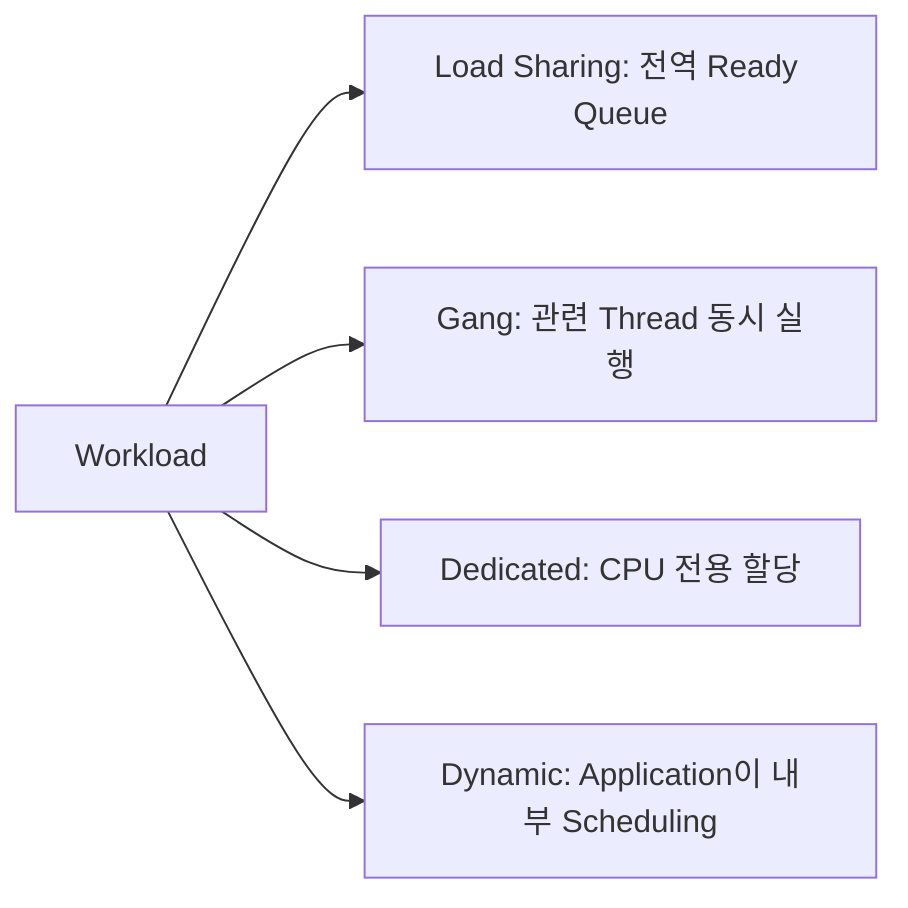

# Multiprocessor Scheduling

<details>
<summary><strong>목차</strong></summary>

- [Multiprocessor Scheduling](#section-1)
- [Multiprocessor system 구분](#section-2)
  - [Tightly coupled multiprocessor가 수업의 대상](#section-3)
- [Multiprocessor Scheduling은 왜 Application 종류에 따라 달라지는가](#section-4)
- [Multiprocessor Scheduling의 세 가지 design issue](#section-5)
  - [Process를 Processor들에게 어떻게 배분할 것인가](#section-6)
  - [Multiprogramming을 사용할 것인가](#section-7)
  - [어떤 Scheduling Algorithm을 사용할 것인가](#section-8)
- [Multiprocessor Thread Scheduling 4가지](#section-9)
  - [Load Sharing](#section-10)
  - [Gang Scheduling](#section-11)
  - [Dedicated Processor Assignment](#section-12)
  - [Dynamic Scheduling](#section-13)
- [네 가지 Multiprocessor Scheduling 선택 기준 정리](#section-14)
- [네 가지 Multiprocessor Scheduling 선택 기준 정리](#section-15)

</details>


Load Sharing, Gang Scheduling, Dedicated Assignment와 Dynamic Scheduling을 정리합니다.

> 관련 노트: [CPU Scheduling](cpu-scheduling.md) · [Real-Time 및 운영체제별 Scheduling](real-time-and-system-scheduling.md)

- 아래는 13주차 목요일 내용을 내용적 연관을 위해 끌고 왔다.

<a id="section-1"></a>
## Multiprocessor Scheduling

<a id="section-2"></a>
## Multiprocessor system 구분

- Loosely coupled / Distributed / Cluster는 여기서 말하는 multiprocessor가 아니다.
    - 여러 독립적인 system을 network로 연결해 하나처럼 사용하는 방식
    - 각 system이 자기 CPU, 자기 memory, 자기 I/O channel을 갖고 있고, 각각 자기 OS를 갖는다.
    - 이런 것은 loosely coupled system, distributed multiprocessor cluster라고 부를 수 있지만,
        - 이 10장에서 말하는 tightly coupled multiprocessor는 아니다.
- Functionally specialized processor도 여기서 말하는 multiprocessor가 아니다.
    - 일반 컴퓨터 안에도 CPU, GPU, I/O processor 등 여러 processor가 있을 수 있다.
    - 하지만 이들은 기능이 다르다.
    - CPU와 GPU처럼 역할이 다르면 여기서 말하는 동일한 의미의 multiprocessor scheduling 대상은 아니다.

<a id="section-3"></a>
### Tightly coupled multiprocessor가 수업의 대상

- 10장에서 말하는 multiprocessor system은
    - 하나의 system 안에 여러 CPU가 있고,
    - 하나의 memory와 하나의 I/O channel을 공유하는 구조다.
        - 이것이 tightly couped multiprocessor system이다.
- 중요한 차이는 memory에서 발생한다.
    - Loosely coupled
        - 각 system이 자기 memory를 가지고 있다.
            - 각자 OS를 가진다.
            - 통합 Layer가 따로 있을 수 있다.
    - Tightly coupled
        - memory가 하나
            - OS가 하나
            - 여러 CPU가 하나의 OS를 동시에 실행할 수 있다.
            - scheduler도 하나

<a id="section-4"></a>
## Multiprocessor Scheduling은 왜 Application 종류에 따라 달라지는가

- Multiprocessor scheduling은 process/application의 종류와 밀접하게 관련된다.
    - 만약 모든 program이 하나의 process, 하나의 thread로만 구성되어 있다면,
        - 사실 10장을 따로 배울 이유가 사라진다.
        - 그냥 9장의 scheduling 기법을 그대로 쓰거나 더 간단한 기법을 써도 된다.
    - 문제가 되는 것은
        - 하나의 application이 여러 child process나 여러 thread로 구성되어 있고,
        - 이들이 서로 데이터를 주고받거나 동기화해야 하는 경우다.
- application을 synchronization 빈도에 따라 5단계로 나눌 수 있다.
    - Independent
        - app이 사실상 하나의 process/thread로 구성되거나
        - app 간 상호작용이 거의 없다.
    - Very coarse-grained
        - 여러 process/thread가 있지만 동기화가 매우 드물다.
        - 수천~1만 개 명령마다 한 번
    - Coarse-grained
        - 대략 200~2000개 명령마다 한 번 정도 동기화
    - Medium-grained
        - 대략 20~200개 명령마다 동기화
        - 이 정도면 꽤 빈번하다고 할 수 있다.
    - Fine-grained
        - 20개 명령 이내마다 동기화
        - 명령 실행보다 데이터 주고받는 시간이 더 커질 수 있다.
- 10장에서 배울 multiprocessor scheduling 기법들은
    - 누가 더 좋다/나쁘다로 비교하는 것이 아니다.
- 9장에서는 response time 기준으로 FCFS/RR/SPN/SRT/HRRN을 비교했지만
    - 10장에서는 application 내부 process/thread 들이 얼마나 자주 synchronization하는지와 CPU 개수에 따라 적합한 기법이 달라진다.

<a id="section-5"></a>
## Multiprocessor Scheduling의 세 가지 design issue

<a id="section-6"></a>
### Process를 Processor들에게 어떻게 배분할 것인가

- CPU가 하나일 때는 ready Q 하나만 생각하면 된다.
- 하지만 CPU가 여러 개면 선택지가 생긴다.
    - CPU마다 local ready queue를 둘 것인가
    - 전체 system에 global ready queue 하나를 둘 것인가

- 처음에는 각 CPU가 자기 ready Q를 갖는 방식이 좋아보였다.
    - 각 CPU는 자기 Q에서 process를 뽑으면 되니까 overhead가 작고,
    - 기존 uniprocessor scheduling을 거의 그대로 쓸 수 있었다.
- 하지만 문제가 있다.
    - 처음 process가 들어왔을 때 실행시간이 길지 짧을지 모르므로,
        - 우연히 어떤 CPU Q에는 긴 process가 몰리고
        - 다른 CPU Q에는 짧은 process가 몰릴 수 있다.
        - 그러면 어떤 CPU는 계속 바쁘고, 다른 CPU는 놀게 된다.
    - 이것을 idle while busy 문제라고 한다.
        - 즉 한 CPU는 idle인데 다른 CPU는 busy 상태가 되는 것이다.
        - 비싼 CPU를 여러 개 사놓고 제대로 활용하지 못하는 문제가 생긴다.

- 그래서 결국 많은 system은 global queue를 사용한다.
    - 모든 CPU가 하나의 ready queue에서 다음 process를 가져간다.
    - 그러면 workload가 더 균등하게 분배된다.
- 하지만 global queue는 critical section이어야 한다.
    - 두 CPU가 동시에 scheduler를 실행해서 같은 process를 동시에 선택하면 안 되기 때문이다.
    - 따라서 Mutual Exclusion이 필요하고, 여러 CPU가 global queue에 접근하려고 줄을 서면 bottleneck이 된다.
- 따라서 multiprocessor OS에는 이런 CS이 많기 때문에
    - CPU가 n개라고 해서 성능이 n배가 되지는 않는다.

- 정리하면
    - Local Queue
        - 장점 : Overhead 적음
        - 단점 : idle while busy 발생 가능
    - Global Queue
        - 장점 : workload 균형
        - 단점 : queue 접근이 critical section이 되어 bottleneck 발생

<a id="section-7"></a>
### Multiprogramming을 사용할 것인가

- CPU가 여러 개든 하나든 당연히 multiprogramming을 해야할 것 같지만,
    - multiprocessor에서는 꼭 그렇지 않을 수 있다.
- CPU 하나짜리 system에서는 process가 block되면 다른 process로 context switch해야 한다.
- 그런데 multiprocessor system에서 block의 이유가 I/O가 아니라 synchronization이라면 이야기가 달라진다.
    - 예를 들어 fine-grained나 medium-grained process들은 I/O 때문에 block되는 것이 아니라
    - 다른 thread와 데이터를 주고받거나 CS에 들어가기 위해 잠깐 기다리는 경우가 많다.
    - 이때 다른 CPU에서 상대 thread가 실행 중이라면, 아주 조금만 기다리면 데이터가 오거나 CS이 풀릴 수 있다.
    - 그런데 그 순간 context switch를 해버리면, context switch가 끝나기도 전에 기다리던 event가 해결될 수 있다.
        - 그러면 오히려 손해가 된다.
- 그래서 multiprocessor에서는 어떤 경우 context switching을 덜 하거나 아예 안하는 방식이 좋을 수 있다.
    - 즉 multiprogramming을 항상 하는 것이 아니라,
    - synchronization 빈도가 높은 application에서는 기다리는 것이 더 나을 수 있다.

<a id="section-8"></a>
### 어떤 Scheduling Algorithm을 사용할 것인가


- 이 세 번째 이슈는 9장에서 배운 FCFS/RR/SPN/SRT/HRRN 같은 방식 중 multiprocessor에서는 무엇이 적합한가 하는 문제다.
- 왜냐하면 CPU가 여러 개이면 특정 scheduling discipline의 중요성이 상대적으로 줄어들기 때문이다.
    - Uniprocessor에서는 실행 시간이 짧은 process를 먼저 실행하면 response time이 확 줄어든다.
    - 그런데 multiprocessor에서는 CPU가 여러 개라 여러 process가 동시에 실행된다.
    - 그러면 누구를 먼저 실행하느냐의 차이가 CPU 하나일 때보다 작아질 수 있다.
    - 그래서 10장에서는 9장처럼 이 Alg이 response time이 몇이고 저 Alg가 몇이다로 단순 비교하지 않는다.
- 10장에서는 Application의 동기화 빈도와 CPU 개수에 따라 적절한 scheduling 방식을 고르는 것이 중요하다.

<a id="section-9"></a>
## Multiprocessor Thread Scheduling 4가지



| 방식 | Scheduling 단위 | CPU 보유 방식 | 적합한 상황 |
| --- | --- | --- | --- |
| Load Sharing | 개별 Thread | Idle CPU가 전역 Queue에서 선택 | CPU가 적고 일반적인 workload |
| Gang Scheduling | Application의 Thread 묶음 | time slice 동안 동시에 실행 | Thread 간 동기화가 빈번한 병렬 작업 |
| Dedicated Assignment | Application | 실행 동안 CPU를 전용으로 보유 | CPU가 충분하고 동기화가 매우 빈번한 작업 |
| Dynamic Scheduling | Application이 생성한 Thread | OS는 CPU 수만 할당 | Thread 수가 실행 중 자주 변하는 작업 |

- Multiprocessor Thread Scheduling
    - Load Sharing
    - Gang Scheduling
    - Dedicated Processor Assignment
    - Dynamic Scheduling
- 위 네 가지를 CPU 개수와 동기화 빈도를 기준으로 선택해야 한다.

<a id="section-10"></a>
### Load Sharing

- 가장 단순하고 많이 쓰이는 방식이다.

#### 기본 동작

- 모든 thread가 global ready queue에 줄을 선다.
- CPU가 idle이 되면 global queue 앞에서 thread 하나를 꺼내 실행한다.
- 예시
    - App P1의 thread a, b, c가 ready Q에 있다.
    - CPU가 a만 선택해 실행할 수 있다.
    - b, c는 여전히 ready Q에 남아 있을 수 있다.
- 즉 Load Sharing은 한 application 안의 thread들을 동시에 실행시킨다는 보장이 없다.

#### 장점

- 간단하고,
- CPU가 놀지 않게 하며,
- Global Queue 덕분에 Load Distribution이 비교적 균등하다는 점이다.
    - 요약 : even load distribution, no idle-while-busy
- 실제로 많은 system에서 load sharing을 사용한다.
    - 이유는 현실적인 CPU 개수 때문이다.
    - Multiprocessor라고 해도 CPU가 2개, 4개, 8개 정도라면 여러 application의 여러 thread를 모두 동시에 실행할 만큰 충분하지 않다.
    - 이런 경우 gang scheduling이나 dedicated assignment를 하기는 어렵고, load sharing이 현실적인 최선에 가깝다.

#### 단점

- 동기화가 빈번한 application에서 context switch가 많아질 수 있다는 것이다.
- 예를 들면
    - P1의 a thread만 실행 중이고 b, c는 queue에 남아 있다면,
    - a가  b나 c와 동기화해야 하는 순간 a는 block 된다.
    - b/c는 실행 중이 아니므로 a가 기다려야 하고, 결국 switching이 발생한다.
    - 즉, 동기화가 빈번한 system이라면
        - 끊임없이 block되고 끊임없이 switching하는 상황이 생길 수 있다.
- 추가 단점으로는,
    - Central Queue에는 Mutual Exclusion이 필요해 Bottleneck이 될 수 있고,
    - Preempted thread가 같은 processor에서 다시 실행된다는 보장이 없어 cache reuse가 나빠질 수 있다.
    - 또한 모든 thread가 global queue에 있으면 한 program의 모든 thread가 동시에 processor를 얻지 못할 수 있다.

#### Load Sharing에 적합한 경우

- CPU 개수
    - 2개 이상이면 사용 가능
    - CPU가 많이 않은 현실적 system에 적합
- 동기화 빈도
    - independent 또는 ver coarse/coarse-grained
    - 동기화가 거의 없거나 드문 application에 적합
- 장점
    - 간단함, load balancing 좋음
- 단점
    - 관련 thread 동시 실행 보장 없음
    - 빈번한 동기화 application에서는 switching이 많아짐

<a id="section-11"></a>
### Gang Scheduling

- Gang Scheduling은 Load Sharing과 반대로, 관련 thread들을 동시에 실행시키는 방식이다.

```text
시간       0-----------q-----------2q
CPU 1      App A / T1   App B / T1
CPU 2      App A / T2   App B / T2
CPU 3      App A / T3   idle

같은 Application의 Thread가 같은 time slice에 함께 실행된다.
```

#### 기본 동작

- Load Sharing에서는 ready queue에 thread별로 줄을 선다.
- Gang Scheduling에서는 Application 단위로 줄을 선다고 보면 된다.
- 예를 들어
    - A application에 thread가 10개 있다면,
    - A가 실행될 차례에 A 안의 thread 10개를 동시에 여러 CPU에서 실행시킨다.
    - 그 다음 B application 차례가 되면 B 안의 thread들을 동시에 실행한다.

#### 장점

- 장점은 동기화 비용이 줄어든다는 것이다.
- Thread들이 자주 message를 주고받거나 Critical Section 때문에 기다리는 경우,
    - 관련 thread가 동시에 실행 중이면 기다림이 짧다.
- 예시
    - a thread가 b thread의 data를 기다림
        - b도 동시에 실행 중
        - 곧 data를 보냄
        - a가 오래 block되지 않음
    - a thread가 CS을 기다림
        - CS에 들어간 thread도 동시에 실행 중
        - 곧 빠져나옴
- Gang Scheduling과 Dedicated Processor Assignment는 한 Application의 thread들을 동시에 실행시키기 때문에 빈번한 동기화 사황에서 switching을 줄일 수 있다.

#### Gang Scheduling과 Time Sharing

- Gang Scheduling에서 Application 간에는 Time Sharing을 한다.
- 예를 들어
    - A app thread들을 동시에 실행하다가 timeout되면,
    - 다음에는 B app thread들을 동시에 실행한다.
    - 즉 application 단위로 CPU 집합을 번갈아 주는 방식이다.
- 후에 나오는 Dedicated Processor Assignment와 비교한다면
    - Gang Scheduling은 App 간에 time sharing을 하는 반면
    - Dedicated Processor Assignment는 그것조차 하지 않는다.

#### CPU 개수 조건

- Gang Scheduling은 CPU가 충분히 많아야 한다.
- 적어도 한 app의 thread들을 동시에 실행시킬 수 있어야 한다.
    - Gang Scheduling과 Dedicated Processor Assignment는 CPU 개수가 thread 수보다 훨씬 많을 때 적합하다.

#### Processor Allocation과 Waste


- Gang Scheduling에서는 Processor Allocation을 고려해야 한다.
    - N processor가 있고 M application이 있을 때,
    - 각 app에 시간을 균등하게 줄 수도 있고, thread 수에 따라 가중치를 줄 수도 있다.
- 예시에서는 균등 분할의 낭비가 37.5%, thread 수에 따른 가중 분할의 낭비가 15%였다.
- 위 설명의 의미는,
    - app마다 thread 수가 다르면 단순히 시간을 똑같이 나누는 것이 비효율적일 수 있다는 것이다.
    - thread가 적은 application에게 너무 큰 processor set 시간을 주면 CPU가 idle이 될 수 있기 때문이다.

#### Gang Scheduling에 적합한 경우

- CPU 개수
    - 충분히 많아야 한다.
    - application thread들을 동시에 실행할 수 있어야 한다.
- 동기화 빈도
    - medium-grained ~ fine-grained
    - 동기화가 빈번한 parallel application에 적합하다.
- 장점
    - 관련 thread 동시 실행
    - synchronization 대기와 context switch 감소
- 단점
    - CPU가 부족하면 어렵고
    - Processor Allocation을 잘못하면 Waste가 발생한다.

<a id="section-12"></a>
### Dedicated Processor Assignment

- dedicated processor assignment는 gang scheduling보다 더 강한 방식이다.

#### 기본 동작

- application이 schedule되면, 그 app의 thread들이 특정 processor에 배정된다.
- 그리고 그 thread들은 그 processor를 계속 차지한다.

#### Block되어도 CPU를 잡고 기다린다.

- block된 이유가 I/O든 Synchronization이든 상관없이 무조건 CPU를 차지한 채 기다린다.
- 처음에는 낭비처럼 보일 수 있다.
    - 하지만 fine-grained처럼 동기화가 매우 빈번한 경우에는 유리할 수 있다.
    - 어차피 곧 data가 오거나 lock이 풀릴 것이라면,
    - context switch하는 것보다 잠깐 CPU를 잡고 기다리는 편이 낫기 때문이다.

#### 장점

- Context Switch를 거의 피할 수 있다.
- Thread가 계속 같은 processor에 있으므로 cache locality도 유지될 가능성이 높다.
- 동기화가 매우 빈번한 app에서는 context switch 비용을 줄이는 것이 중요하다.

#### 단점

- Processor idle이 발생할 수 있다.
- Thread가 I/O나 Synchronization으로 block되면 그 processor는 다른 일을 하지 않고 놀 수 있다.
- 이를 Processor Fragmentation Problem이라고 표현한다.

#### 적합한 경우

- CPU 개수
    - 매우 많아야 한다.
    - 적어도 Application Thread 수보다 충분히 많아야 한다.
- 동기화 빈도
    - fine-grained, 매우 빈번한 synchronization
- 장점
    - context switch 최소화
- 단점
    - processor idle / processor fragmentation 가능
- 동기화 빈도만 보면
    - dedicated processor assignment가 가장 빈번한 동기화에 적합하고
    - 그 다음 gang scheduling
    - 그 다음 load sharing이다.

<a id="section-13"></a>
### Dynamic Scheduling

- 쉽게 얘기해서,
    - 되면 하고, 안되면 말고인 스케쥴링
- OS는 CPU를 할당하는 역할을 하며
    - 스케쥴링 자체는 어플리케이션 내에서 조절을 하는 방식이다.

#### 왜 필요한가

- 현실에서는 CPU가 gang scheduling이나 dedicated processor assignment를 할 만큼 아주 많지는 않을 수 있다.
- 그렇다고 load sharing을 쓰기에는 CPU가 어느 정도 있고, application thread들이 완전히 independent하지 않고 어느 정도 동기화도 한다.
- 이 상황을 load sharing과 gang/dedicated의 중간 정도라고 한다.
    - CPU도 적당히 많고, 동기화 빈도도 적당히 있는 상황
    - 이때 쓸 수 있는 것이 Dynamic Scheduling이다.

#### 핵심 : OS는 Processor Allocation만 한다.

- Dynamic scheduling의 핵심은 OS이 역할이다.
- OS는 App에게 processor를 몇 개 줄지 결정한다.
    - 예를 들어
    - app이 CPU 5개를 요청했는데 남는 CPU가 5개 있으면 5개를 준다.
    - 남은 CPU가 3개면 3개만 준다.
- 중요한 건, 실제 thread scheduling은 application이 한다는 점이다.
    - Application이 thread 5개를 가지고 있는데 CPU 3개만 받았다면
    - 그 5개 thread 중 어떤 3개를 먼저 실행할지는 application이 결정한다.
- 실제 스케줄링은 application에서 하고 OS는 CPU를 할당하는 역할만 한다.

#### CPU 할당 규칙

- 할당 플로우
    - Application이 하나 이상의 Processor를 요청한다.
    - 요청한 만큼 남아 있으면 요청한 만큼 준다.
    - 요청한 만큼 없으면 줄 수 있는 만큼 준다.
    - 여러 app이 동시에 요청하면, 최대한 하나씩은 나눠준다.
    - 하나씩도 못 줄 만큼 app이 많으면, 나머지는 기다린다.
    - 어떤 app이 종료해서 CPU를 반납하면,
        - 대기 중인 app에게 먼저 하나씩 나눠주고
        - 남으면 오래 기다린 app에게 더 준다.
- 즉 달라고 하는 만큼 줄 수 있으면 주고, 안되면 최소한 하나씩이라도 주고, 그것도 안되면 나머지는 기다리게 하는 것이다.

<a id="section-14"></a>
## 네 가지 Multiprocessor Scheduling 선택 기준 정리

- Load Sharing
    - CPU가 많지 않다.
    - 동기화가 거의 없거나 드물다.
    - thread 단위 global queue
- Gang Scheduling
    - CPU가 충분히 많다.
    - 동기화가 꽤 빈번하다.
    - Application 단위 Time Sharing
    - 관련 thread 동시 실행
- Dedicated Processor Assignment
    - CPU가 매우 많다.
    - 동기화가 매우 빈번하다.
    - block되어도 processor를 놓지 않음
    - context switch 최소화
- Dynamic Scheduling
    - CPU가 적당히 많다.
    - 동기화도 적당히 있다.
    - OS는 Processor 개수만 할당
    - thread 선택은 application이 함

---

<a id="section-15"></a>
## 네 가지 Multiprocessor Scheduling 선택 기준 정리

- Load Sharing
    - CPU가 많지 않다.
    - 동기화가 거의 없거나 드물다.
    - thread 단위 global queue
- Gang Scheduling
    - CPU가 충분히 많다.
    - 동기화가 꽤 빈번하다.
    - Application 단위 Time Sharing
    - 관련 thread 동시 실행
- Dedicated Processor Assignment
    - CPU가 매우 많다.
    - 동기화가 매우 빈번하다.
    - block되어도 processor를 놓지 않음
    - context switch 최소화
- Dynamic Scheduling
    - CPU가 적당히 많다.
    - 동기화도 적당히 있다.
    - OS는 Processor 개수만 할당
    - thread 선택은 application이 함
