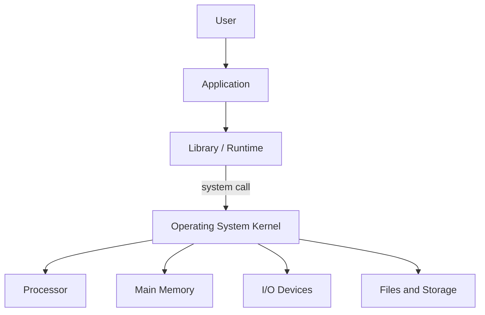

# Operating System 개요

<strong>목차</strong>

- [멀티 프로세서(Symmetric Multi-Processors, SMP)](#section-1)
- [OS](#section-2)
- [Resource Manager](#section-3)
- [OS의 발전](#section-4)
- [OS 발전에 따른 성취](#section-5)
- [Modern OS](#section-6)
- [OS별 Architecture 차이](#section-7)
- [추가 질문](#section-8)

운영체제의 역할, 자원 관리, 발전 과정과 주요 Architecture를 정리합니다.

> 관련 노트: [Interrupt와 I/O](interrupts-and-io.md) · [Process와 Process State](processes.md)

## 멀티 프로세서(Symmetric Multi-Processors, SMP)

- OS 관점으로, 코어가 10개라고 하면, 1~10번 코어 전부 동등한 권한을 가지고 OS를 실행시킬 수 있다는 의미의 이름
- CPU 갯수에 의미를 둔 Multi-Core나 Many-Core는 HW적 관점이다.
- 최적의 프로그램을 고를려고 함
- 근데 cpu 여러개가 모두 그 최적의 프로그램을 건들게 하면 안됨.
- 그래서 OS 작업을 할 때는 동시에 선택아닌, 순차적으로 선택하게 만듦
- 따라서 10개의 코어가 있다고 해서 10배의 속도가 나지는 않음

## OS

- 정의 및 역할
    - User가 실행하는 Application Program의 실행을 조절해주는 Program
    - Application과 Hardware 사이의 인터페이스 역할
        - Application Program → Library / Utility Function → OS → Hardware
        - 중요한 것은, User 측에서 직접적으로 HW에 접근하지 않는다는 것
        - 사용자로부터 HW를 숨겨주기도 하고, 사용자 입장에서 HW를 몰라도 프로그램을 다룰 수 있게됨
- Program Development
    - VS 같은 거, Compile, Linking 작업 등…
- Program Execution
    - 프로그램 실행! 말해뭐함
- Access I/O Device
    - I/O 작업, I/O Program… 앞에서 했죠?
- Controlled access to files
    - File은 하드디스크에 있고, 하드디스크는 I/O Device이므로 OS가 담당함.
- System Access
    - Program이 CPU를 사용할 수 있게하는 순서 조절
- Error Detection and Response(중요)
    - ISR 또한 OS에 속해있는 것이니
- Accounting
    - User 또한 Application Program을 통해 조작을 진행하는 것임. 이를 관리

## Resource Manager

- OS
    - 컴퓨터 자원을 관리하는 관리자
        - OS는 ‘공정’하게 프로그램을 조율하는데에는 관심이 없음
        - 효율적으로 리소스를 할당하는 것이 중요하며, 우선순위에 따라 순서를 할당하게 됨
            - OS가 이건 중요하다, 예뻐한다 하면? → 우선석으로 리소스를 할당받아 빠르게 쾌적하게 실행됨
            - OS가 이 프로그램은 이상하다,수상하다, 싫어한다 하면? → 리소스를 잘 할당받지 못해 느리게 실행되는 느낌을 받게 됨.
    - I/O
    - Main Memory
    - Secondary Memory
    - Processor Execution Time
- Kernel
    - main memory에 존재하는 OS의 일부분 (0xffff~ 부분에 따로 존재함)
    - 과거에는 OS = Kernel이었으나, OS의 크기가 커지면서 OS 전체를 Memory에 올리지 못하게 됨.
    - 따라서 Kernel은 OS에서 가장 자주, 많이 사용되는 함수들을 포함함
    - 그리고 항상 Main Memory에 존재함

## OS의 발전

- Serial Processing
    - 시스템에 프로그램을 한 번에 하나씩만 넣을 수 있음
    - 프로그램을 한 번에 하나 씩만 실행함.
    - 그래서 A 끝나면 B를, B가 끝나면 C를 실행시켜주어야 함
    - 이걸 사람이 수동으로 진행함
- Simple Batch Systems
    - A 끝나면 B를, B가 끝나면 C를 실행을 자동으로 함.
- Multiprogrammed Batch Systems
    - 여러 프로그램들을 Memory에 집어넣고 프로그램을 번갈아 가며 실행시킬 수 있게 됨.
    - Processor Use를 최대화하려고 함
- Time Sharing Systems
    - 위의 Multiprogrammed Batch에 Time 제한까지 추가 시켜버리는 것
        - Multiprogrammed 기법 + Time Slicing 기법 = Time Sharing
        - 다만 Timeout이 될 때마다 OS가 개입하여 프로그램을 바꿔야하므로 위의 MultiProgrammed Batch보다는 Processor 사용률이 떨어짐.
    - Response Time을 최소화하려고 함

## OS 발전에 따른 성취

- Process 관리
- Memory 관리
- 정보보호 및 보안
- 스케쥴링과 자원관리

## Modern OS

- MicroKernel Architecture
    - OS의 용량이 점점 커지면서 더이상 OS의 모든 것을 메모리에 올릴 수 없게됨
    - 따라서 방법이 2가지로 나뉘었는데
        - 하나는 다른 프로그램들처럼 필요할 때 Main Memory에 올리는 것이고
        - 하나는 OS를 새롭게 설계하는 것이다. 그리고 이것이 MicroKernel Archtecture이다.
    - 대표적으로는 Windows 시스템
        - 가장 중요하고 항상 사용되는 함수들만 따로 모아서 Kernel로 만들고
        - I/O Program 등 다른 OS 작업 프로그램은 다른 프로세스로 만들어서 필요할 때 실행하게 함.
        - 별도의 모듈을 만들어서 필요할 때 해당 서비스를 불러옴
        - 그래서 개별 프로세스에 대해 개별적으로 업데이트를 할 수 있음
        - MicroKernel을 제외한 다른 OS 프로그램은 User Mode에서 실행됨.
    - 대비되는 시스템으로는 Unix 시스템
        - OS 프로그램들이 전부 한 덩어리로 컴파일되어 있음
        - 그래서 개별 OS 프로그램들을 업데이트하려면, OS 전체를 다시 컴파일 해야함
        - OS 프로그램은 모두 Kernel Mode로 실행됨
    - 단점
        - 예를 들어 I/O Program을 계속 호출한다고 하면, 계속 해당 Process를 호출하면서 Context Switching을 진행해야함 → 성능이 하락함
        - Unix는 Kernel Mode만 들어가면 그냥 함수를 실행하면 됨.
        - 그래서 이 성능저하를 극복하고자 Windows가 Multi-Threading 기술을 도입함
- Multi-Threading
    - process를 동시에 실행하기 위한 기술
        - 한 Application에 a, b, c 함수가 있다고 하고, 이 함수들을 순차적으로 실행할 필요가 없을 때,
        - a, b, c 각각의 함수를 별개의 Thread로 만들어서 동시에 실행시키는 기술이다.
        - 즉 Application의 여러 부분들을 동시에 실행시키는 것
    - 예시로 웹사이트에 주소를 치고 접근한다고 할 때,
        - 네트워크가 원활하고 빠를 때 바로 웹사이트 주소를 치자마자 들어가지고 웹사이트 구성이 한 번에 딱 뜨는데,
        - 네트워크가 느릴 때는 웹사이트의 일부분씩 조금조금 생기는 것을 볼 수 있다.
        - 화면에 보이는 부분부분이 별개의 Thread로 만들어져있어 각자가 서버에게 요청해서 데이터를 가져오는 것이다.
- Symmetric Multiprocessing(SMP)
    - 코어가 여러 개인데 OS가 한 개인 경우. 위에 SMP 관련 설명이 있음.
    - 보통의 현대 컴퓨터 CPU 생각하면됨.
- Distributed Operating Systems
    - SMP는 당시에 여러 개의 코어/CPU가 있는 컴퓨터를 구하기엔 비쌌음
    - 그래서 컴퓨터가 여러 대 있을 때, 그 컴퓨터들의 OS 위에 한 번 더 Distributed OS를 덮는 방식이다.
    - 네트워크 연결에 의해 성능이 저하되긴 하겠지만, 다른 컴퓨터가 놀고는 있는 것보단 낫다.
    - (당시 기준) 싼 값에 여러 개의 CPU를 갖는 패러렐 컴퓨터처럼 작동하도록 하게 한다.
    - 사용자 입장에서는 하나의 컴퓨터지만, 실제로는 네트워크로 연결되어 뒤에는 여러 대의 컴퓨터가 처리를 진행한다.
    - 요즘에는 데이터를 분산해서 저장한다든지 그다음에 데이터를 감추는 목적으로 많이 사용 중임
        - 클라우드 컴퓨팅이나 클러스터 등이 이 예
- Object-Oriented Design
    - OOD는 사람이 코드를 더 알아보기 쉽고 관리하기 편하게 만들기 위해 나온 방식임
    - MicroKernel Architecture처럼 확장성과 이식성이 좋게 설계가 되어 있음
    - 과거 Unix 운영체제는 하나의 덩어리로 뭉쳐있기 때문에, 어딘가를 고칠려면 포인터를 따라가면서 뜯어고쳤어야 했음
    - 하지만 위의 사항을 극복하고 더 나은 업그레이드를 위해 MicroKernel Arch.와 OOD를 결합해서 OS를 만든 것이 현대의 OS임.
    - Microkernel Arch.와 마찬가지로, 실행 속도가 빨라지지는 않음. 모듈화로 인한 Context Switching이 더 자주 일어나기 때문에, 성능은 저하됨.
    - 쾌적함 ≠ 실행속도 향상

## OS별 Architecture 차이

- Windows
    - Kernel Mode의 I/O manager나 다른 개별 OS 프로그램들에 대해 각각 업데이트가 가능하다.
    - 동적 라이브러리
- Unix
    - 여긴 정적 라이브러리

---

## 추가 질문
