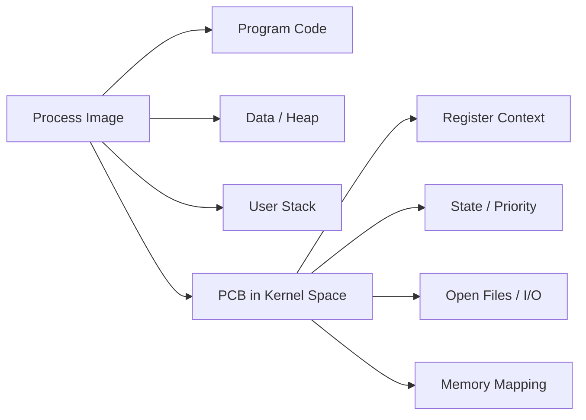
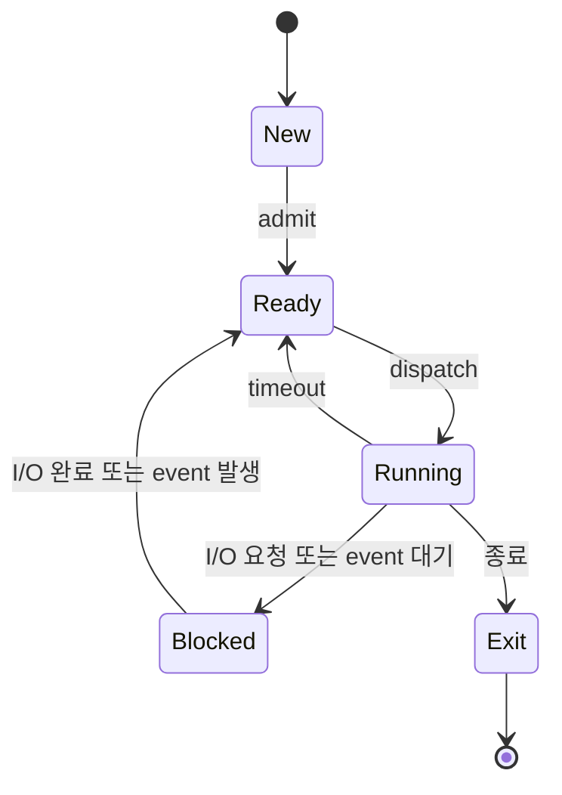
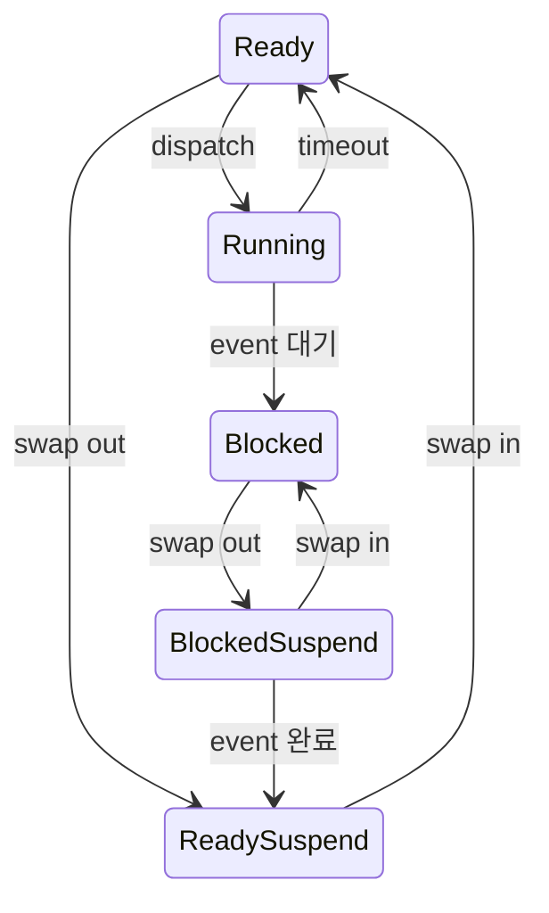

# Process와 Process State

<strong>목차</strong>

- [Process](#section-1)
  - [Process Image 구성](#section-2)
- [Dispatcher와 Scheduler](#section-3)
- [Five-State Model](#section-4)
- [Swapping 작업](#section-5)
- [상태 변화 화살표 설명](#section-6)
- [Suspension이 발생하는 이유](#section-7)
- [Memory Tables](#section-8)
- [I/O Tables](#section-9)
- [File Tables](#section-10)
- [Primary Process Table](#section-11)
- [Process Image](#section-12)
  - [Process Control Block(PCB)](#section-13)
- [OS Kernel의 일반적 기능들](#section-14)
- [Process Creation](#section-15)
- [Processor Execution Mode](#section-16)
  - [User Mode](#section-17)
  - [Kernel Mode = System Mode = Control Mode](#section-18)
- [Change of Process State](#section-19)
- [Execution of Operating System](#section-20)
  - [Non-Process Kernel](#section-21)
  - [Execution Within User Processes](#section-22)
  - [Process-Based Operating System](#section-23)
- [복습 질문](#section-24)
- [(재작성) jmp 명령어에 대한 Execution Stage](#section-25)
- [jmp 명령어를 주고 Execution stage에 대한 단계를 설명할 수 있어야 함.](#section-26)
- [Processor Execution Mode 주의점](#section-27)
- [PCB에 정보가 저장된다는 뜻은](#section-28)
- [여러 프로세스가 있는데 Processor의 주소 변환 레지스터는 몇 세트?](#section-29)
- [시험 및 Quiz 정리](#section-30)
- [Unix SVR4 Process Management](#section-31)

Process의 생성과 상태 변화, PCB와 Process Image, OS의 실행 구조를 정리합니다.

> 관련 노트: [Context Switching](context-switching.md) · [Thread와 Multithreading](threads.md)

## Process

- 정의
    - Process = 실행 중인 Program
        - 헷갈리지 말자. Process Program 잘못 쓰면 점수 나가리
        - Program = 코드를 작성하고 컴파일하고 링킹해서 실행 파일의 형태로 하드디스크에 저장되어 있는 코딩 뭉치
    - Process = 위의 프로그램 파일을 실행시켜 Main Memory로 올라와 있는, OS가 관리를 하고 있는 상태
        - 프로세스는 실행, 상태, 자원, 이런 것들에 대한 정보 모두를 포함하는 하나의 유닛임.

### Process Image 구성

- 실행 (Execution)
    - 프로세스는 단순히 멈춰있는 것이 아니라 한 줄 한 줄 명령을 읽어나가는 동적인 흐름임
        - 코드 (Code) : 뭘 실행할지에 대한 CPU의 명령어들
        - 스택 (Stack) : 메인 함수에서 A 함수를 부르고 A 함수에서 B 함수를 부르는 등의 ‘실행의 궤적’ 과 ‘지역 변수’를 저장하는 실행 공간 , 또한 돌아갈 함수의 주소를 저장
        - PC (Program Counter) : 다음에 실행할 명령어의 메모리 주소를 기억함
- 상태 (State)
    - 시스템 안에는 프로세스만 있는 것이 아님. interrupt에 의해 수시로 끊기고 쫓겨나게 됨
        - 프로세스가 중단될 때, 나중에 다시 돌아와서 자기가 중단되었다는 사실조차 모르게 Restore해 주려면, 해당 그 찰나의 ‘상태’를 전부 저장해야함
        - CPU 내부의 레지스터 값들, 현재 상태(Running/Ready/Block 등), 우선순위 같은 정보들이 전부 포함됨
- 자원 (Resources)
    - OS는 프로세스에게 Memory(집)과 I/O 장치(도구) 등을 할당해줌
        - 메모리 자원 : 메모리의 100번지부터 200번지만 쓸 수 있다. 하고 할당받은 구역(Code, Data 영역등)
        - I/O 및 파일 지원 : 이 프로세스가 현재 열어놓은 파일, 사용 중인 키보드나 모니터 권한 등 OS로부터 부여받은 권리와 재산
- PCB (Process Control Block)
    - 위의 것들을 전부 하나로 묶는 일종의 파일
    - OS가 프로세스를 관리하기 위해서 필요한 모든 정보들을 다 기록해 둔 곳
    - 위의 3개 정보들은 User Mode에서 접근과 쓰기가 가능하지만, PCB만큼은 따로 Kernel Space에 존재하여 Kernel Mode에서만 접근이 가능함. 즉, OS만 볼 수 있음.

## Dispatcher와 Scheduler

## Five-State Model

- New : 신입 받아라.
    - 처음에 PCB를 만들어 놓은 순간 그 시점부터 New 상태가 됨
- Running : 실행 중인 상태의 프로세스
- Not Running
    - Ready : 준비는 되었으나 실행 대기 중인 상태
    - Blocking/Waiting : I/O 작업 등 준비가 되지 못한 상태
- Exit : 프로그램 종료

- Single Blocked Queue
- Multiple Blocked Queue
    - 각 분야별로 나누어진 Queue에 해당 분야 작업만을 할당

## Swapping 작업

한 Process에는 최소 한 개의 Page를 제공해야함.

여기서 Page는 작업하는데 있어 최소 단위임.

근데 Main Memory에 들어올 수 있는 Process는 한계가 있음.

그래서 메모리의 Blocked 상태의 Process들을 하드디스크의 Swap 공간으로 Swap-Out 시켜버림

물론, Main Memory의 용량이 무한하다면 필요없는 작업이다.

- Two New States
    - Blocked/suspend : 프로세스가 I/O 작업 등으로 실행 준비가 되지 않았고, Swap 공간에 있는 상태
    - Ready/suspend  : 프로세스가 준비되었으나 Swap 공간에 있는 상태

## 상태 변화 화살표 설명

- New → Ready/Suspend 화살표
    - 아무리봐도 지금 Main Memory에 넣을 수 없는 경우
    - Memory가 꽉 찼을 때
- Blocked/Suspend → Blocked
    - blocked 상태가 빨리 끝날 것 같다던지
    - 우선순위가 높은 process라던지의 경우
    - 일반적인 경우로는 Blocked/Suspend → Ready/Suspend → Ready 순서가 맞음

## Suspension이 발생하는 이유

- Swapping
- Other OS Reason
    - 메모리 부족시 Background나 Utility 프로그램 등의 우선순위가 떨어지는 프로그램을 우선적으로 Swap 공간으로 보내버림 (Ready → Ready/Suspend)
    - 이상 행동, 다른 유저의 메모리에 액세스를 하는 등 위험한 짓을 할 때 일단 Swap 공간으로 보내버림 (Running → Ready/Suspend)
- Interactive User Request (Running → Ready/Suspend)
    - pause()나 sleep() system call을 유저가 직접 호출해서 suspend를 원할 때
- Timing
    -
- Parent Process Request
    - fork()를 통해 만들어진 child process에 대해 작업을 조정하면서 suspend를 요청할 수 있음.

Queue에는 Pointer만 있다.

모든 Queue는 전부 Main Memory OS영역에서 관리함.

---

3장 이어서

Table이란? → 여러가지 정보들이 저장되어 있는 구조체 배열

Mem, I/O, File Table은 중간고사 이후 자세하게

## Memory Tables

- 메인 메모리에 process 공간 할당
- Swapping area(Secondary Memory)에 process 공간 할당
- shared memory region
    - 원래는 Process는 본인에게 할당된 공간 이외에 다른 공간에 Access를 할 수 없음
    - 그러나 Process들 간 통신을 하기 위해서 약간의 공유 공간이 필요한 경우가 있음
    - 따라서 Shared 메모리 공간을 마련하고 권한에 따라 어떤 프로세스는 읽기만 하고, 어떤 프로세스는 쓰기만 하는 등의 권한 설정을 함.
- virtual memory
    - 프로세스가 메인 메모리에도 있다가 Swapping Area로도 쫓겨나고 다시 Swapping에 있다가 다시 Main Memory로 오는 등 한 곳에 위치가 고정되어 있는 것이 아니라 물리적 위치가 유동적임
    - 따라서 이것을 한 번에 관리하기 위해 하나의 거대한 메모리를 쓰는 느낌으로 관리하는 것
    - Distributed OS라고 생각하면 편함

## I/O Tables

- I/O Device가 사용가능한지, 이미 할당되었는지
- I/O 작업 상태
- ?

## File Tables

- File
- File의 정보(Attributes)

## Primary Process Table

- Process 관리/실행에 필수적인 요소들을 포함하고 있는 Table
    - Process ID (PID)
    - Process Image로의 Pointer
    - 메모리 주소

## Process Image

2주차 Process 파트 참조

### Process Control Block(PCB)

- Process Identification
    - Process Identifier
        - PID, 프로세스 식별번호, Primary Process Table의 index 번호
    - Parant Process Indentifier
        - PPID, 자신을 만든 부모 프로세스의 번호
    - User Identifier
        - 이 프로세스의 owner가 누구인지(누가 실행했는지)
- Processor State Information (CPU 상태 정보, **프로세스 아님**)
    - User-Visible Registers
    - Control & Status Register (HW적으로 저장되므로 고정된 주소를 가짐)
        - Program Counter (PC)
        - Program Status Word (PSW)
    - Stack Pointers
- Process Control Information (프로세스 관리 정보)
    - Scheduling and State Information
        - 이 프로세스가 I/O 작업을 몇 번했는지 아니면 CPU를 지금까지 몇 시간이나 썼는지, 어떠한 종류의 프로세스인지 등 많은 정보를 포함, 이러한 스케줄링 정보를 관리함
        - 프로세스가 Ready인지 Blocked 상태인지 등
    - Memory Management
        - 이 프로세스가 메모리의 몇 번지부터 몇 번지까지 들어있다를 알려주는 정보
        - Virtual Memory Management를 위한 정보
        - OS가 Process를 관리하는데 필요한 정보들을 가지고 있음
    - Resource Ownership and Utilization
        - 리소스 관련해서 누가 만들었는지와 누가 활용할 수 있는지, 얼만큼 자원을 사용했는지 등에 대한 정보
    - Inter-Process Communication
        - 서로 통신하려는 프로세스 중 한 쪽에서 Message Queue를 만듦
        - A ↔ OS, OS ↔ B 이런 느낌으로 통신한다. A ↔ B 이렇게 다이렉트로 하지 않는다.
    - Process Privileges
        - OS의 프로세스 권한 관리
        - 많은 프로세스들이 HW적/SW적 자원들을 만들어서 사용중인데, 파일을 포함해서 이러한 자원들에 대해 어떤 프로세스가 어떤 자원을 사용할 수 있다, 사용할 수 없다. 부분적 사용이 가능하다 들의 관리를 위한 정보를 가진다.
    - Data Structuring
        - Pointer-Point Pointer를 관리하는 것을 말함 (포인터를 가리키는 Pointer)
            - 모든 프로세스는 Primary Process Table에 존재.
            - 포인터로 연결된 구조들
            - Primary Process Table, Process Tree, Queue들의 관리 전부 OS가 하고 있다는 뜻

## OS Kernel의 일반적 기능들

- Process Management
    - Process creation and termination
    - Process scheduling and dispatching → 9장 10장
    - Process Switching
    - Process Synchronization and Support for Interprocess Communication
    - Management of Process Control Blocks
- Memory Managent → 7장 8장
    - Allocation of Address Space to Processes
    - Swapping
    - Page and Segment Management
        - 페이지 단위로 자르면 중간에 실행중인게 잘릴 수 있음
        - Segment 단위로 자르면 함수 단위로 잘려서 논리적으론 좋을 수 있음
            - 근데 크기가 제각각이라 관리가 힘듦
        - 최근에는 Page + Segment 단위로 조절하고 있음
- I/O management → 11장
    - Buffer Management
    - Allocation of I/O Channels and Devices to Processes
- Support Functions
    - Interrupt Handling
    - Accounting
    - Monitoring

## Process Creation

- 순서
    - 새로운 프로세스에 PID 부여
    - 메모리 공간할당
    - PCB 초기화
    - Link 준비
    - 다른 data structure 생성 또는 확장

---

## Processor Execution Mode

### User Mode

- 하위 권한 모드
- User Program은 일반적으로 이 모드로 실행됨

### Kernel Mode = System Mode = Control Mode

- 상위 권한 모드
- OS의 커널

---

## Change of Process State

- Save the context of the processor
- Running 상태로 적혀있는 PCB를 업데이트 (Ready든 Block이든)
- 알맞는 Queue로 PCB 이동
- 실행을 위한 다른 Process 선정
- 선정된 Process의 PCB를 업데이트
- Memory Management Data Structure들을 업데이트
    - 실행되는 process의 정보로 업데이트
- 선택된 Process의 저장된 Register들을 Restore

## Execution of Operating System

### Non-Process Kernel

- Kernel 바깥에서 실행되는 모든 Process
- OS code는 분리된 entity에서 따로 실행함
- 과거 방식, 지금은 못함

### Execution Within User Processes

- 각각의 User Process 안에서 OS코드가 실행되는 방식
    - ??
- 위 경우의 Process Image

- 단점
    - 좀 복잡하다. 복잡한 구조
- 장점
    - Context/Process Switching을 안해도 됨

### Process-Based Operating System

- Microkernel Arch. 같은 방식
- 주요 kernel 함수들을 별개의 Process로 분리함
- Multi-Processor나 멀티 컴퓨터 환경에서 유리함
    - 각 함수들이 별개의 Process이므로 충돌없이 서로 필요한 함수들을 동시에 실행할 수 있음
- 단점
    - OS의 함수가 각 Process이기 때문에, Process Switching이 자주일어남

## 복습 질문

명령 중에  jmp 명령이 있다. 조건문이거나 반복문일 때 프로그램이 순차적으로 실행하는 것이 아니라 요구하는 위치로 이동하게 됨.

## (재작성) jmp 명령어에 대한 Execution Stage

- 명령어 해독 (Decode)
    - 제어장치가 IR에 들어온 명령어를 분석하여 이것이 jmp 명령어임을 인식한다.
- 조건 확인
    - 만약 조건부 점프라면, 이전 연산 결과가 담긴 상태 레지스터, PSW의 컨디션 코드를 확인한다.
- 목적지 주소 추출
    - IR 뒷부분에 있는 Operand, 즉 점프해야할 목적지 논리 주소를 추출한다(예 : 900번지)
- PC 값 덮어쓰기 (PC ← 900)
    - Fetch Stage에서 미리 1 증가시켜두었던 기존의 PC 값(101)을 지우고, 방금 추출한 목적지 주소(900)을 PC에 덮어씌운다.
- 이로써 Execution Stage가 종료되며, 바로 다음 Fetch Stage가 시작될 때 CPU는 자연스럽게 변경된 PC값인 900번지로 가서 명령어를 읽어오게 된다.
- Fetch Stage부분은 아래 Fetch 설명부를 확인할 것

## jmp 명령어를 주고 Execution stage에 대한 단계를 설명할 수 있어야 함.

- OS가 참조하는 Control Table 중 하나로, Primary Process Table이 여기에 관여함
    - Primary Process Table은 다음과 같은 정보를 가짐
        - 프로세스의 PID
        - Process Image가 있는 주소를 가리키는 Pointer
        - Memory의 위치(이 친구가 여기서 메인)
- 프로그램이 Dispatch 되기 직전, OS가 먼저 밑작업을 진행함
    - Scheduler가 이 프로세스를 실행하기로 결정하면, OS는 Primary Process Table을 확인하여 이 프로세스가 물리 메모리의 몇 번지에 올라가 있는지를 확인함(예시 : 3000번지)
    - OS는 Dispatcher를 통해 CPU 내부에 있는 Base Register에 이 3000(지금은 예시로)이라는 값을 세팅해둠
        - 이 뜻은, 지금부터 들어오는 모든 주소 명령어는 3000번지부터 시작한다는 뜻
        - 왜냐하면, Complier가 작성된 코드를 Complie하여 프로그램으로 만들 때, 기준을 0번지로 잡기 때문에 실제 메모리에 올라갈 때는 보정을 해줘야함.
            - 만약 900번지로 컴파일이 되었는데, 3000번지를 Base Address로 올라간 상태에서 이를 보정안하지 않는다면 실제로는 3900번지에 접근해야하지만  900번지에 접근하게 되면서 잘못된 메모리 접근이 발생함.
- Fetch Stage (jmp 명령을 가져오는 과정, 이거는 일반적임)
    - 컴구 기준 Instruction Fetch(IF) Stage이다.
    - MAR ← PC (예시 100)
        - 현재 PC가 가리키고 있는 주소(jmp 명령어가 들어있는 논리적 주소, 100번지)를 MAR로 저장하려고 함
        - 중간에 MMU(Memory Management Unit)이 개입하여 Base Register에 저장되어 있는 3000을 더함
        - 결과적으로 MAR에 3100이 들어감
    - Mem Read, PC++
        - 제어장치가 메모리에 Read 신호를 보냄
        - 동시에 자연스러운 PC++이 진행
    - MBR ← Memory[MAR]
        - 메모리에서 찾아낸 실제 데이터(예시 :  jmp 900)가 데이터 통로인 MBR로 들어옴
    - IR ← MBR
        - MBR에 있는 실제 데이터(jmp 900)가 명령어를 분석하는 IR로 이동하며 Fetch Stage 종료
- Execution Stage (OS상 2단계, 컴퓨터 구조상 ID, EX, MEM, WB 스테이지를 포함)
    - Instruction Decode(ID) Stage
        - 명령어 해독 : Control Unit이 IR을 확인하고 jmp 명령어임을 인식
        - 목적지(Operand) 추출
            - IR의 뒷부분에서 논리적 목적지 주소인 900을 뽑아냄
        - 조건부 분기 확인
            - 만약 JZ(Jump if Zero) 같은 조건부 점프라면, 이전 연산 결과가 담긴 상태 레지스터(PSW)의 플래그를 확인
            - 조건이 거짓이라면 jmp를 취소하고 파이프라인을 그대로 흘려보냄
    - Execution (EX) Stage
        - 목적지 주소 계산
            - 절대 주소 점프라면 : 목적지 = 900
            - 상대 주소 점프라면 : 현재 PC(101) + 오프셋 계산
        - Pipeline Flush (Control Hazard 해결) : jmp가 확정이 되면, pipeline 특성상 IF, ID stage에 이미 PC = 101, 102의 명령어들이 들어와 있으므로 이 친구들을 싹 다 비워버림
        - PC 덮어쓰기(PC ← 900) : 아까 IF 단계에서 증가했던 PC값을 지우고 새로운 논리 주소 900을 넣음
    - Memory (MEM) & Write Back (WB) Stage
        - 일반적인 jmp 명령어는 메모리에 데이터를 Write하거나 범용 레지스터에 계산 결과를 저장할 필요가 없음
        - 따라서 이 두 스테이지는 일하지 않고 넘어감
- 다시 Fetch Stage
    - 앞선 EX Stage에서 PC가 900으로 조작된 직후, 새로운 사이클의 IF 스테이지가 시작
        - CPU는 바뀐 PC값인 900을 던짐
        - MMU 개입, MAR에 3900이 들어감
        - 이후 일반적인 프로세스 진행

## Processor Execution Mode 주의점

여기에서 User Mode는 현재 CPU가 보통의 User Program을 실행하고 있는 모드

Kernel Mode는 현재 CPU가 OS의 Kernel 명령을 실행하고 있는 모드

단순히 하위/상위 권한 모드라고 표현하면 0점이라고 교수님이 경고하심

## PCB에 정보가 저장된다는 뜻은

정보 데이터 자체가 저장된다는 것이 아닌, 해당 정보가 저장되어 있는 곳을 가리키는 Pointer를 저장한다는 것

## 여러 프로세스가 있는데 Processor의 주소 변환 레지스터는 몇 세트?

메모리에 프로세스가 10개가 올라와 있다 했을 때, 주소 변환을 위한 레지스터는 몇 세트가 필요하냐?

→ 몇 개가 되는 실행자체는 한 개의 프로세스만 실행되므로 1세트만 있으면 된다.

8번 → interrupt가 (발생이 확인되면 → 발생하면), interrupt 발생 직전 CPU가 처리하던 프로그램의 정상 실행이 중단된다.

- 발생 “하면”으로 바꿔버리면 틀린 문장이 된다. Fetch stage에서 발생하였을 때 바로 프로그램을 중단하지 않으므로
- interrupt는 언제 어느시간대든 발생할 수 있다. 확인을 execution stage가 끝나고 확인할 뿐

---

## 시험 및 Quiz 정리

- 중간고사 답안은 문장형으로 나열하지 말고, 아래처럼 딱딱 서술할 것
- 불필요한 내용이나 틀린 용어 사용 시 감점 또는 0점 처리될 수 있음
    - 특히 특정 동작을 수행하는 주체를 서술할 것

I/O interrupt의 발생 원인

- I/O 디바이스와 CPU의 속도 차이가 크다
- 그래서 I/O 작업을 하는 동안 CPU는 다른 작업을 진행한다
- 요청한 I/O 작업이 완료되면, CPU는 해당 인터럽트를 본다
- “OS”가 요청한 입출력작업이 정상적으로 종료되었는지 오류가 발생하였는지 확인한다.

## Unix SVR4 Process Management

대부분의 OS 코드들은 User Process 환경에서 실행됨

→ OS의 어떤 작업들은 시스템 프로세스에서 처리되고, 어떤 작업들은 유저 프로세스 내에서 처리됨.

- Process의 두 종류
    - System Process
        - 0 : Swapper
            - PID 0번은 Swap 작업을 하는 프로세스
        - 1 : init
            - 이제 PID 1번부터 프로세스의 시작점
        - Process Tree
            - 이제 Parent Process가 fork()를 수행하며 child process를 만들어내며 Process Tree를 구성함
    - User Process
- Process 설명(앞서 설명한 Process image의 구성요소와의 매핑)
    - User Level Context
        - Process Text
            - 프로그램 코드에 해당
        - Process Data
        - User Stack
        - Shared Memory
    - Register Context → Processer State Information에 해당
        - Program Counter(PC)
        - Process Status Register
        - Stack Pointer
        - General-Purpose Registers
    - System Level Context → Process Control Information + Process Identification
        - Process Table Entry
            - Process Identification 정보와 Process Control Information 중 Scheduling과 Execution State 등 실행 관련 정보를 가짐
        - U(user) Area
            - 자원 관련 정보 (Ownership of Resource 라던가 자원 사용에 관한 정보들)
                - 예를 들면, 파일을 오픈했다 했을 때, 프로세스가 어떤 파일을 오픈해서 어떻게 사용하고 있는지
                - 프로세스와 프로세스 간 시그널을 보낸다고 할 때, 내가 어떤 시그널을 누구에게 어떻게 보내고 있는지에 대한 정보
                - 시스템콜을 호출한다고 하면, 시스템 콜을 호출할 때는 펑션 콜하는 것과 동일하므로, 어떤 인자를 주고 리턴 값을 받는지에 대한 정보들 등 이런 정보들을 전부 포함한다.
        - Per Process Region Table
            - 메모리 관련 정보
                - 이 프로세스가 할당 받은 메모리가 몇 번지에서 몇 번지까지 인지 등에 대한 정보
        - Kernel Stack
            - 유저 프로세스 안에서 커널 코드가 실행되는 방식이기 때문에, User Stack이 있고 Kernel Stack도 있는, 2개의 스택을 가지고 있다.
            - User Stack은 위에 User-Level Context로 관리되고,
            - Kernel Stack에는 System-Level Context로 관리된다.

- State (동그라미 원)
    - Created  : New 상태
    - Ready to Run in Memory : Ready 상태
    - Ready to Run Swapped : Ready/Suspend 상태
    - Asleep in Memory : Blocked 상태
    - Sleep, Swapped : Blocked/Suspend 상태
    - Zombie : Exit 상태
    - User Running / Kernel Running : Running 상태
    - PreEmpted → 중간고사 질문 (Ready / Timer Interrupt에 의한 Ready 상태)
        - PreEmpted 상태는 Ready to Run in Memory 상태와 동일한 Ready 상태임
- 화살표(상태 변화)
    - 앞선 상태 변화에서는 Blocked/Suspend → Blocked가 이런저런 이유로 가능했음
        - 하지만 여기 Unix에서는 한 번 Swapping Area로 쫓겨나면, 문제가 해결될 때까지 다시는 메모리로 올라올 수 없음
    - 이 상태도는 Process 입장에서 그려진 것임을 기억해야함.
    - Unix는 Process 내부에서 OS 코드가 실행되므로 Running이 2개로 나뉨.
        - User Process가 알아서 시작할 수 없으므로 OS코드가 먼저 준비하고 User 코드가 실행됨.
        - Ready to Run in Memory → Kernel Running → User Running
    - User Running에서 system call 이나 interrupt이 발생하면, 이를 처리하기 위해 프로세스 내 OS코드가 실행됨
        - User Running → Kernel Running
        - 처리가 끝나면 User Running으로 복귀하거나  Asleep in Memory로 이동함.
    - Preempted → User Running과 Ready to Run in Memory → Kernel Running 관련은 아래 질문 1번을 참조할 것
