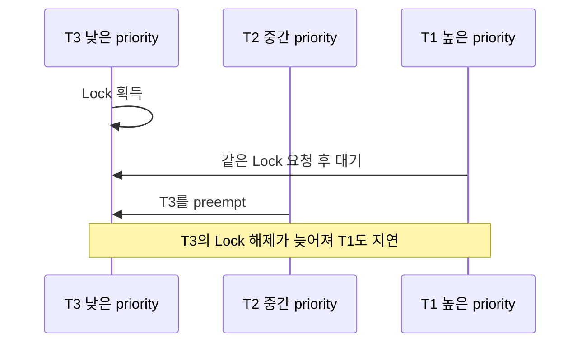
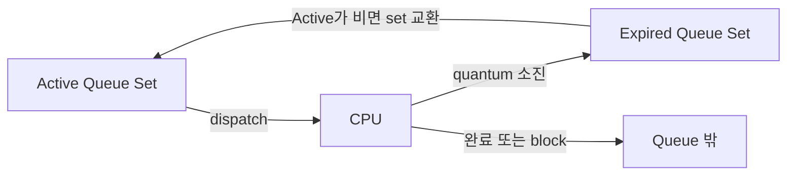

# Real-Time 및 운영체제별 Scheduling

<details>
<summary><strong>목차</strong></summary>

- [Real-Time Scheduling](#section-1)
  - [Real-Time Task의 종류](#section-2)
  - [Real-Time Scheduling의 목표](#section-3)
  - [첫 번째 : Earliest Deadline Scheduling](#section-4)
  - [두 번째 : Rate Monotonic Scheduling](#section-5)
  - [Earliest Deadline vs Rate Monotonic](#section-6)
- [Priority Inversion](#section-7)
  - [Priority Inversion 발생 구조](#section-8)
  - [Priority Inheritance](#section-9)
- [Windows Scheduling](#section-10)
  - [Windows Scheduling의 특징](#section-11)
  - [Process Base Priority](#section-12)
  - [Thread’s Base Priority](#section-13)
  - [Thread’s Dynamic Priority](#section-14)
  - [Multiprocessor Windows Scheduling](#section-15)
  - [Soft Affinity](#section-16)
- [UNIX SVR4 Scheduling](#section-17)
  - [Priority-driven Preemptive Scheduling](#section-18)
  - [Real-time Class](#section-19)
  - [Time-sharing Class](#section-20)
- [Linux Scheduling](#section-21)
  - [Linux Real-Time Scheduling](#section-22)
  - [Real-time task에 FIFO를 쓰는 이유](#section-23)
  - [FIFO라고 해서 CPU를 빼앗기지 않는 건가?](#section-24)
  - [RR class는 Windows/Unix SVR4와 비슷하다.](#section-25)
  - [Linux Real-time Task Scheduling 정리](#section-26)
  - [Linux의 독특한 부분 : Active Queue와 Expired Queue](#section-27)
  - [Active queue가 비면 active와 expired를 교환한다.](#section-28)
- [Linux Scheduling에서 Windows/Unix SVR4와 비교](#section-29)
- [Earliest Deadline Scheduling 정리](#section-30)
- [Active/Expired 구조가 왜 starvation을 줄이는가](#section-31)
- [6-1. 기말 답안용 예시](#section-32)

</details>


Real-Time Scheduling, Priority Inversion과 Windows, UNIX, Linux Scheduling을 정리합니다.

> 관련 노트: [CPU Scheduling](cpu-scheduling.md) · [Multiprocessor Scheduling](multiprocessor-scheduling.md)

<a id="section-1"></a>
## Real-Time Scheduling

- Real-Time Task는 Deadline이 중요하다.
    - 일반 program은 입력에 대해 정확한 결과만 나오면 된다.
        - 시간이 조금 걸려도 결과가 맞으면 된다.
    - 하지만 Real-Time Task는 정확한 결과뿐 아니라 deadline도 맞춰야 한다.
        - 만약 deadline을 못맞춘다면, 그 작업은 안한 것과 똑같다.

<a id="section-2"></a>
### Real-Time Task의 종류

- Hard real-time task
    - hard real-time task는 deadline을 반드시 맞춰야 한다.
    - deadline을 못 맞출 경우 시스템이 치명적인 손상을 받거나 오류가 나며 터져버릴 수 있다.
    - 즉, hard real-time에서는 deadline miss가 단순 성능 저하가 아니라 실패다.
- Soft real-time task
    - 여기서는 deadline을 못 맞춘다고 시스템이 터지거나 하지는 않는다.
    - 다만 deadline을 못 맞춘다면 해당 작업을 안 한 것처럼 처리될 수 있다.
    - soft real-time에서는 가능한 많이 deadline을 맞추도록 scheduling하는 것이 좋다.
    - 수업헤서는 이후 설명을 soft real-time task를 기준으로 한다.
- Periodic task
    - Periodic task는 일정 주기로 도착한다.
    - 예를 들어
        - 20분마다 한 번 도착하고, 도착하면 10분 작업해야 하며, 다음 도착 전까지 끝내야 하는 식이다.
    - real-time task는 대부분 system 작업이고, 주기적으로 어떤 작업을 수행하므로 대부분 period task다.
- Aperiodic task
    - Aperiodic task는 갑자기 도착한다.
    - 도착 주기가 없고, 도착했을 때 얼마나 실행해야 하며 deadline이 언제인지가 주어진다.
- 수업에서는 periodic soft real-time task를 가정하고 scheduling 기법을 설명한다.

<a id="section-3"></a>
### Real-Time Scheduling의 목표

- Soft real-time + Periodic task를 가정하면 목표는 다음과 같다.
    - 가능한 한 많은 task가 deadline을 맞추도록 scheduling한다.
    - deadline을 못 맞출 것 같은 task에는 CPU를 쓰지 않는 것이 나을 수 있다.
- throughtput 관점으로
    - Throughput은 단위 시간 동안 몇 개의 작업을 끝냈는가인데,
    - real-time에서는 deadline을 못 맞춘 작업은 끝낸 것으로 보지 않는다.
- 그러므로 deadline을 못 맞출 작업에 CPU를 쓰느니
    - deadline을 맞출 수 있는 작업을 먼저 하는 것이 좋다.

<a id="section-4"></a>
### 첫 번째 : Earliest Deadline Scheduling


#### 기본 원칙

- 우선순위 기반의 preemptive scheduling 방식이다.
    - 작업을 하던 중 우선순위가 높은 작업이 도착을 하면,
    - 하던 작업을 멈추가 상위 우선권의 작업에게 CPU를 할당한다.
- 즉, deadline이 가장 빠른 task를 먼저 실행한다.
    - deadline = priority
    - preemptive scheduling

#### 예제 조건

- Task A
    - 20분마다 도착
    - 도착하면 10분 작업
    - deadline은 다음 A가 도착하기 전
- Task B
    - 50분마다 도착
    - 도착하면 25분 작업
    - deadline은 다음 B가 도착하기 전

#### 예제 실행 흐름

- 0분에 A1과 B1이 동시에 도착한다.
    - A1 deadline은 20, B1 deadline은 50이다.
    - 더 빠른 deadline은 A1이므로 A1을 먼저 실행한다.
- A1이 10분 실행되어 끝나면 B1을 실행한다.
- 20분이 되면 A2가 도착한다.
    - 이때 B1이 실행 중이다.
    - A2의 deadline은 40이고 B1의 deadline은 50이다.
    - A2가 더 급하므로 B1은 preempt되고 A2가 실행된다.
- A2가 끝난 뒤 다시 B1을 실행한다.
- 40분이 되면 A3가 도착한다.
    - 이때 B1과 A3를 비교한다.
    - B1 deadline은 50, A3 deadline은 60이다.
    - 이번에는 B1이 더 급하므로 B1을 계속 실행한다.
        - 이때 B1의 남은 작업시간은 5분이다.
- B1이 끝난 뒤 A3를 실행한다. (45분 시점)
- 50분에 B2가 도착하더라도 A3 deadline은 60, B2 deadline은 100이므로 A3가 계속 실행된다.

```text
시간  0      10     20     30     40   45     55
EDF  | A1   | B1   | A2   | B1   | B1 | A3   |
      deadline이 더 가까운 작업이 도착하면 현재 작업을 선점한다.
```

- 60분에 A4가 도착하고 B2가 실행 중이라면,
    - A4 deadline은 80, B2 deadline은 100이므로 A4가 B2를 preempt한다.
    - 현재 A3는 55분에 작업이 끝났고, B2는 55분에 CPU를 받았다.
- 80분에 A5가 도착했을 때 B2와 A5의 deadline이 둘 다 100이기 때문에 deadline이 같다.
    - 따라서 먼저 도착한 B2를 계속 실행한다.
    - deadline이 같으면 먼저 도착한 task를 먼저한다.
        - A4는 70분에 작업이 종료되었고, B2는 70분부터 작업하여 총 15분을 작업한 상태다.
- 90분에 B2 작업이 종료되고 100분까지 A5가 작업하여 deadline을 맞춘다.

#### Earliest Deadline Scheduling 정리

- 새 task가 도착할 때마다 현재 task와 deadline을 비교한다.
- 새 task deadline이 더 빠르면 preempt한다.
- 현재 task deadline이 더 빠르면 계속 실행한다.
- deadline이 같으면 먼저 도착한 task를 우선한다.
- Earliest Deadline은 priority가 고정되지 않고 시간에 따라 바뀔 수 있다.

<a id="section-5"></a>
### 두 번째 : Rate Monotonic Scheduling


#### 기본 원칙

- Rate Monotonic Scheduling은 deadline이 아니라 period, 즉 주기를 기준으로 priority를 정한다.
    - period가 짧을수록 priority가 높다.
    - priority는 고정된다.
    - preemptive scheduling이다.
- Earliest Deadline과 Rate Monotonic이 비슷해 보이지만 기준이 완전히 다른다.
    - Earliest Deadline은 그때그때 남아 있는 deadline에 따라 priority가 바뀐다.
    - Rate Monotonic은 주기가 짧은 task가 항상 우선이다.

#### 예제 조건

- 구성
    - T1(4,1) : 4시간마다 1번씩 도착, 처리시간 1시간
    - T2(5,2) : 5시간마다 1번씩 도착, 처리시간 2시간
    - T3(7,2) : 7시간마다 1번씩 도착, 처리시간 2시간
    - 모두 Deadline은 다음 주기가 오기 전까지
- 우선순위 판단
    - T1의 주기가 제일 짧으므로 T1이 가장 큰 우선순위를 가진다.
    - T1 > T2 > T3
    - 위 priority는 고정된다.

#### 예제 실행 흐름과 deadline miss

- 0시에 T1, T2, T3가 동시에 도착하면
    - priority 순서대로 T1을 1시간 실행하고,
    - T2를 2시간 실행한다.
    - 그 다음 T3를 실행한다.
- 그러나 T3는 2시간짜리인데, 1시간 정도 실행한 시점에 T1이 다시 도착한다.
    - T1은 항상 T3보다 priority가 높으므로 T3는 CPU를 빼앗긴다.
- T1이 끝난 뒤 T2가 다시 도착하면 T2도 T3보다 priority가 높으므로 T2가 먼저 실행된다.
    - 그러다 보면 T3는 원래 2시간 실행해야 deadline을 맞추는데 1시간 밖에 실행하지 못한 채 deadline이 지나갈 수 있다.
- 이 경우 남은 1시간은 나중에 시간이 남아도 처리하지 않는다.
    - 어차피 deadline을 놓친 작업은 안 한 것과 같기 때문이다.

<a id="section-6"></a>
### Earliest Deadline vs Rate Monotonic

| 구분 | Earliest Deadline First | Rate Monotonic |
| --- | --- | --- |
| Priority 기준 | 현재 absolute deadline | 고정된 period |
| Priority 변화 | 동적 | 정적 |
| 높은 Priority | deadline이 가장 가까운 Task | period가 가장 짧은 Task |
| 장점 | 가용 CPU를 효율적으로 활용 | 구현과 분석이 단순함 |
| 주의점 | 도착 때마다 priority 재평가 | CPU 사용률이 높으면 deadline miss 가능 |

- Earliest Deadline
    - 기준 = absolute deadline
    - priority = 동적으로 변한다.
    - 새 task 도착 때마다 deadline을 비교한다.
- Rate Monotonic
    - 기준 = period
    - priority = 고정
    - period가 짧은 task가 항상 우선이다.
- 주의점
    - 예제만 보면 Earliest Deadline이 더 좋아 보일 수 있지만, 실제로 더 많이 사용되는 것은 Rate Monotonic이다.
    - 즉 예제 하나로 Earliest Deadline이 무조건 더 좋다고 판단해서는 안된다.

<a id="section-7"></a>
## Priority Inversion


- Real-time scheduling에서 중요한 문제로,
    - 더 높은 권한의 task가 더 낮은 권한의 task를 위해 기다리고 있는 상황을 말한다.
    - 이를 Priority Inversion이라고 한다.
- File Update에서의 Locking을 예시로,
    - 어떤 task가 file에서 data를 읽고, 계산하고, 다시 file에 write한다고 하자.
    - 이 과정 중 다른 task가 같은 data를 건드리면 안 되므로 lock을 건다.
    - lock을 가진 task가 작업을 끝내고 lock을 출어야 다른 task가 해당 data를 사용할 수 있다.

<a id="section-8"></a>
### Priority Inversion 발생 구조



- Task가 3개가 있다고 하자
    - T1 : pr 가장 높음
    - T2 : 중간 pr
    - T3 : pr 가장 낮음
- T3가 먼저 실행되어 shared resource에 lock을 걸었다.
    - 그 후 T1이 도착했고, T1도 그 resource가 필요하다.
    - T1은 pr가 가장 높지만 T3가 lock을 잡고 있으므로 기다려야 한다.
- 여기까지는 어쩔 수 없는 resource waiting이다.
    - 문제는 T2가 등장할 때다.
- T3가 lock을 풀려면 CPU를 받아 계속 실행해야 한다.
    - 그런데 T2는 T3보다 pr가 높다.
    - T2가 ready가 되면 T3를 preempt하고 실행된다.
    - 그러면 T3가 lock을 풀 기회가 늦어지고, T1도 계속 기다린다.
- 결국 가장 높은 pr인 T1이, 중간 pr T2 때문에 간접적으로 더 오래 기다린다.
    - T1은 T3의 lock 때문에 기다림.
    - T3는 lock을 풀려면 실행되어야 함.
    - T2가 T3보다 pr가 높아 T3 실행을 방해함.
    - 결과적으로 T1이 T2 때문에 더 오래 기다림.
- 이를 priority inversion이라고 한다.
- 주의할 점
    - T1과 T2 사이가 priority inversion이고, T1과 T3 사이는 아니다.
    - T1이 T3를 기다리는 것은 reasource lock 때문에 직접 기다리는 상황이다.
    - 진짜 inversion의 핵심은 중간 pr인 T2가 끼어들어 T3의 lock 해제를 지연시키고,
        - 그 결과 T1이 T2 때문에 간접적으로 밀리는 것이다.

<a id="section-9"></a>
### Priority Inheritance


- Priority Inversion의 해결책이 Priority Inheritance다.
    - 낮은 pr task가 자신과 resource를 공유하며 기다리는 높은 pr task의 pr를 상속받는 것이다.
- 예시에 적용하면
    - T3가 T1이 필요한 lock을 잡고 있다.
    - 그러면 T3는 일시적으로 T1의 pr를 상속받는다.
    - 그러면 T2가 도착해도 T3보다 pr가 높지 않으므로 T2가 끼어들 수 없다.
    - T3가 빨리 실행되어 lock을 풀고, T1이 실행될 수 있다.
- T3가 T1의 pr를 받아 T2보다 먼저 작업하게 된다는 것을 정확히 이해하여야 한다.

<a id="section-10"></a>
## Windows Scheduling

- Windows는 기본적으로 Multiprocess Scheduling을 고려하여 설계되어 있다.
- 32단계의 Multi-Level Priority Queue
    - Real-time Priority Queues (16 Levels)
    - Variable Priority Queues (16 Levels)
- Jobs in 실시간 우선순위 큐(16~31 Queue)
    - Fixed Priority
    - 한 큐 내에서는 Round-Robin으로 진행
- Jobs in 가변형 우선순위 큐(0~15 Queue)
    - 일반 task를 위한 variable priority queue
    - 여기서는 thread의 dynamic priority가 변할 수 있다.
    - Feedback Queue


<a id="section-11"></a>
### Windows Scheduling의 특징

- 우선순위에 따른 Preemptive Scheduling
    - 더 높은 우선순위의 작업이 들어오면,
    - 기존 낮은 우선순위의 작업은 CPU를 빼앗기고
    - 더 높은 우선순위의 작업에게 CPU를 할당한다.
- 실시간 우선순위 큐에 있는 작업들
    - 같은 Priority의 작업들은 RR로 진행된다.
- 가변형 우선순위 큐에 있는 작업들에 대한 Priority Feedback
    - CPU를 할당받고 작업을 하다가 block 당하면 다음에는 더 높은 우선순위 큐로 들어간다.
    - CPU를 time-out까지 끝까지 가지고 있었으면, 후에 더 낮은 우선순위 큐로 들어가게 된다.
    - 이는 끝까지 내려가고 끝까지 올라가는 것이 아닌, 일정 범위 내에서 움직인다.


<a id="section-12"></a>
### Process Base Priority

- OS가 기본적으로 할당해주는 우선순위
- Windows는 microkernel architecture를 사용하므로,
    - 일반 user process 뿐 아니라 많은 system process도 user mode에서 실행된다.
    - 따라서 process가 system process인지 user process인지,
    - system process라면 어떤 일을 하는 process인지에 따라
    - OS가 기본 priority를 부여한다.

<a id="section-13"></a>
### Thread’s Base Priority

- 어플리케이션을 만든 User가 지정하는 우선순위
    - 즉 같은 process 안에서도 어떤 thread는 더 중요하고 어떤 thread는 덜 중요할 수 있다.
- Process Base Priority의 +-2 범위에서 설정가능하다.

<a id="section-14"></a>
### Thread’s Dynamic Priority

- 실제 실행하면서 Scheduler가 우선순위를 높여주고 낮춰준다.
- base pr -2까지만 우선순위를 낮출 수 있다.
- 이 값은 process base pr와 thread base pr를 바탕으로 하되, 실행 history나 I/O 이후 등 여러 상황에 따라 조정될 수 있다.

<a id="section-15"></a>
### Multiprocessor Windows Scheduling

- 여기서 Dispatcher는
    - ready thread를 다음 available processor에 배정하고
    - higher-priority thread가 ready인데 processor가 idle이거나 lower-priority thread를 실행하는 일이 없도록 한다.
- 또한 Kernel은
    - N개의 processor를 ready 상태의 N개 highest-priority thread에게 주려고 한다.
- 즉 CPU가 여러 개 있으면 Windows는 priority가 높은 thread들을 가능한 한 동시에 실행하게 하려 한다.

<a id="section-16"></a>
### Soft Affinity

- Windows는 soft affinity도 고려한다.
    - dispatcher는 ready thread를 가능하면 마지막으로 실행되었던 같은 processor에 다시 배정하려고 한다.
        - 이유는 cache reuse 때문이다.
        - 같은 processor에서 다시 실행되면 그 thread가 사용하던 data/instruction이 cache에 남아 있을 가능성이 높다.
- 다음번에 작업할 때 가능한 한 같은 CPU에게 작업하게 scheduling 한다는 것은
    - caching을 효과적으로 사용하기 위해 soft affinity가 반영된다는 것이다.

<a id="section-17"></a>
## UNIX SVR4 Scheduling

- 앞의 9장에서 배운 Traditional UNIX와는 다르다.
    - UNIX SVR4를 최신 버전의 UNIX하고 생각하면 된다.
    - 앞선 Traditional UNIX는 단일 CPU를 고려한 system이고,
    - scheduling 수식이 response time 성능보다는 fairness만 강하게 고려했다.
        - 즉 오래 CPU를 못 쓴 process가 먼저 실행되는 구조였다.
- UNIX SVR4는
    - multiptocessor와 real-time을 고려하고
    - microkernel architecture부터 Windows를 많이 흉내 냈다.


- 160단계의 우선순위 큐를 사용한다.
    - real-time process를 위한 최고 단계 큐 (159-100)
    - kernel-mode process를 위한 그 다음 높은 단계 큐 (99-60)
    - 다른 user-mode process를 위한 가장 낮은 단계의 큐 (59-0)


- Queue가 160개면, 어느 queue가 비어 있지 않은 가장 높은 priority Q인지 찾는데 시간이 걸릴 수 있다.
    - 그래서 빠른 확인을 하기 위해 Bit Map을 사용한다.
- 160개의 queue를 32개씩 5개 묶음으로 보고
    - 먼저 5개 bitmap 중 어느 묶음이 비어있지 않은지 찾고
    - 그 안에서 다시 bit를 확인하면 빠르게 highest nonempty queue를 찾을 수 있다.

<a id="section-18"></a>
### Priority-driven Preemptive Scheduling

- UNIX SVR4도 Windows와 유사하게 priority  기반 preemptive scheduling을 사용한다.
- 항상 가장 높은 priority Q의 task부터 실행한다.
- 낮은 priority Q의 task가 CPU를 차지하려면 자기보다 높은 priority Q들이 전부 비어 있어야 한다.
- 그런데 겨우 CPU를 잡아도, 더 높은 priority task가 도착하면 바로 CPU를 빼앗긴다.

<a id="section-19"></a>
### Real-time Class

- Real-time Class에 대해서는
    - 같은 priority job들에 대해 Round-Robin을 사용하고
    - Fixed Priority와 Fixed Time Quantum을 사용한다.
- Real-time task는 priority가 높은 것부터 scheduling하고,
    - 같은 pr real-time task는 RR으로 작업한다.
- Fixed time quantum이라는 말은
    - queue 번호에 따라 timeout이 달라지는 것이 아니라
    - real-time queue들에서 동일한 time quantum을 사용한다는 뜻이다.

<a id="section-20"></a>
### Time-sharing Class

- UNIX SVR4의 time-sharing class는 feedback queue 방식이다.
    - processor-bound thread는 priority를 낮추고
    - I/O-bound thread는 priority를 올리며
    - time quantum은 priority에 따하 100ms부터 10ms까지 달라진다.

<a id="section-21"></a>
## Linux Scheduling

- 140개의 Multilevel Queue
    - 0~99번 Queue : real-time task용 queue, 총 100개
    - 100~139번 Queue : non-real-time task용 queue, 총 40개
    - 숫자가 작을수록 높은 pr을 가진다.
- real-time task class는 FIFO와 RR Policy를 가지고 있고,
    - FIFO thread는 특정 시점에서 중단이 되고
    - RR thread는 time slice가 추가된다.

<a id="section-22"></a>
### Linux Real-Time Scheduling

- Linux가 Windows/UNIX SVR4와 크게 다른 첫 번째 지점은
    - real-time task scheduling class를 두 가지 방식 중 선택할 수 있다는 것이다.
- Linux real-time task를 scheduling할 때 둘 중 하나를 선택할 수 있다.
    - FIFO class
    - Round-Robin class

<a id="section-23"></a>
### Real-time task에 FIFO를 쓰는 이유

- Real-time task는 보통 실행 시간이 매우 짧고, 주기적으로 도착해서 짧게 작업하고 끝나는 경우가 많다.
- 그런데 같은 priority의 real-time task끼지 굳이 RR을 하면 계속 context switching을 하면,
    - 그 switching 시간에 차라리 하나를 끝낼 수도 있다.
- 그래서 real-time task의 실행 시간이 매우 짧다면,
    - 닽은 pr끼리는 RR으로 나누기보다 FIFO처럼 순서대로 하나씩 끝까지 처리하는 것이 더 낫다고 본 것이다.
- 반대로 real-time task의 실행 시간이 좀 길다면,
    - 같은 pr끼리 한 task가 너무 오래 CPU를 잡을 수 있으므로 RR이 더 적합할 수 있다.
- 그래서 Linux는 real-time task에 대해 FIFO와 RR 둘 다 제공한다.

<a id="section-24"></a>
### FIFO라고 해서 CPU를 빼앗기지 않는 건가?

- FIFO class는 같은 pr의 task들 사이에서는 RR을 하지 않고 순서대로 끝까지 처리한다.
- 하지만 무조건 CPU를 절대 안 빼앗기는 것은 아니다.
- FIFO real-time task가 줄단되는 경우는 세 가지다.
    - 더 높은 priority의 task가 ready 상태가 된다.
    - 실행 중인 task가 스스로 block된다.
        - I/O block, Synchronization block 등
    - system call 이후 자발적으로 processor를 포기한다.
- 즉 Linux FIFO class도  priority-driven preemptive scheduling이다.
    - 더 높은 priority task가 오면 당연히 현재 task는 중단된다.
    - 다만 같은 pr task 끼리는 time quantum으로 쪼개지 않고, 먼저 기다린 task가 실행되면 끝까지 가는 방식이다.

<a id="section-25"></a>
### RR class는 Windows/Unix SVR4와 비슷하다.

- Linux의 real-time RR class는 Windows나 Unix SVR4에서 설명한 방식과 거의 같다.
    - 즉 pr가 높은 Q부터 실행하고
    - 같은 pr의 task가여러 개 있으면 RR으로 time slice를 나누어 실행한다.
        - thread마다 time-slice가 추가된다는 점이 다르다.

<a id="section-26"></a>
### Linux Real-time Task Scheduling 정리

- Linux real-time FIFO
    - 같은 priority끼리는 순차적으로 끝까지 실행한다.
    - 단, 더 높은 priority task가 오거나 block되면 중단한다.
- Linux real-time RR
    - 같은 priority끼리 time slice 기반 RR로 실행한다.
    - Windows/Unix SVR4 real-time scheduling과 유사하다.

<a id="section-27"></a>
### Linux의 독특한 부분 : Active Queue와 Expired Queue



- 여기서 설명하는 Active Queue / Expire Queue는 최신은 아니고 좀 예전 버전의 Linux, Linux Scheduler다. 참고할 것
- Linux에는 Queue Set이 하나가 아니라 두 세트 있다.
    - Active Queue Set : 140개 Queue
    - Expired Queue Set : 140개 Queue
    - 각각 0~139 priority queue를 가진다.

#### Active Queue에 들어가는 과정

- 어떤 process가 system에 들어오면, 자기 priority에 따라 active queue에 들어간다.
- 예를 들어
    - priority가 120이면 active queue의 120번 queue에 들어간다.
    - Sechduler는 active queue에서 가장 높은 priority의 non-empty queue를 찾아 task를 실행한다.
- 여기서 140개 queue 중 어느 queue에 task가 있는지를 빠르게 찾기 위해 bitmap을 사용한다.
    - Unix SVR4에서도 bitmap으로 비어있지 않은 가장 높은 priority queue를 빠르게 찾는다고 했는데, Linux도 비슷하게 bitmap을 사용한다.

#### Time quantum을 다 쓰면 어디로 가는가? → Expired Queue로

- Windows나 Unix SVR4의 feedback queue 방식에서는 process가 CPU를 오래 쓰면 priority를 낮춰서 아래쪽 queue로 내려보내는 식이다.
- 그러나 Linux에서는 active queue 안에서 한 단계 아래로 보내는 것이 아니라 Expired Queue로 보낸다.
- 흐름은 다음과 같다.
    - process가 active queue에서 나와 CPU를 잡는다.
    - Time Quantum을 끝까지 다 쓴다.
    - 그러면 다시 active queue로 돌아가는 것이 아니라 expired queue로 이동한다.
    - expired queue로 갈 때 같은 priority로 갈 수도있고, priority가 몇 단계 낮아진 상태로 갈 수도 있다.
- 즉 CPU를 다 썼으니까 한 단계 아해 active queue로 내려가는 것이 아니라,
    - 아예 active set에서 사라져 expired set으로 이동한다.

<a id="section-28"></a>
### Active queue가 비면 active와 expired를 교환한다.

- Process들이 active queue에서 실행되고, time quantum을 다 쓴 process들이 expired queue로 이동하다 보면
    - 어느 순간 active queue가 완전히 비게 된다.
- 그러면 Linux는
    - active queue set ↔ expired queue set
    - 을 교환한다.
- 즉 방금까지 expired였던 queue set이 새로운 active queue가 되고,
    - 거기에 있던 process들이 다시 실행 기회를 얻게 된다.

<a id="section-29"></a>
## Linux Scheduling에서 Windows/Unix SVR4와 비교

- 공통점
    - 셋 다 multilevel priority queue를 사용한다.
    - 셋 다 real-time task를 일반 task보다 높은 priority로 처리한다.
    - 셋 다 priority-driven preemptive scheduling 구조를 가진다.
    - 같은 priority 내에서는 RR 계열 처리가 가능하다.
- 차이점
    - Windows
        - 32개의 Queue
        - 0~15 일반, 16~31 real-time
        - process base priority, thread base priority, thread dynamic priority로 우선순위를 구성한다.
        - soft affinity 고려
    - Unix SVR4
        - 160개 Queue
        - bitmap으로 highest nonempty queue를 빠르게 찾는다.
        - real-time class는 fixed priority + fixed time quantum + RR 조합으로 처리한다.
        - time-sharing class는 priority feedback 구조를 가진다.
        - processor-bound thread의 우선순위는 down, I/O-bound thread는 우선순위를 up 하는 feedback 구조를 가진다.
    - Linux
        - 140개 Queue
        - 0~99 real-time, 100~159 non-real-time
        - real-time class에서 FIFO 또는 RR 선택 가능
        - normal task scheduling에서 active/expired set 사용
        - starvation 가능성을 줄이기 위해 active가 비면 expired와 swap한다.

---

<a id="section-30"></a>
## Earliest Deadline Scheduling 정리

- 새 task가 도착할 때마다 현재 task와 deadline을 비교한다.
- 새 task deadline이 더 빠르면 preempt한다.
- 현재 task deadline이 더 빠르면 계속 실행한다.
- deadline이 같으면 먼저 도착한 task를 우선한다.
- Earliest Deadline은 priority가 고정되지 않고 시간에 따라 바뀔 수 있다.

<a id="section-31"></a>
## Active/Expired 구조가 왜 starvation을 줄이는가

핵심은 Active/Expired 구조가 starvation 가능성을 줄이는 과정을 queue 상태 변화로 설명하는 것이다.

왜 active/expired 구조가 starvation을 줄이냐면, active queue에 있는 task들이 한 번씩 CPU를 쓰고 time quantum을 다 쓰면 expired로 빠져나간다. 그러면 active queue 안에 계속 남아 있는 task가 줄어들고, 결국 active queue가 비게 된다. 그 순간 expired queue가 active가 되므로, expired에 밀려 있던 task들도 결국 실행 기회를 얻는다.

즉 일반 priority queue처럼 높은 priority task가 계속 새로 들어와 낮은 priority task를 영원히 밀어내는 구조와 달리, Linux active queue에서는 CPU를 이미 쓴 task들이 expired로 빠져 active set에서 빠져나가기 때문에, active set 안의 다른 task들이 실행될 가능성이 높아진다.

---

<a id="section-32"></a>
## 6-1. 기말 답안용 예시

교수님이 “말로 쓰지 말고 예제를 그리라”고 했으니, 답안은 이런 식으로 준비하면 좋아.

```
Active queues:
Q100: A
Q101: B
Q120: C

Expired queues:
empty
```

처음에는 active queue의 가장 높은 priority인 A가 실행된다. A가 time quantum을 다 쓰면 active Q100으로 돌아가는 게 아니라 expired Q100 또는 조정된 priority의 expired queue로 간다.

```
After A runs:

Active:
Q101: B
Q120: C

Expired:
Q100: A
```

이제 active Q100이 비었으므로 B가 실행된다. B도 time quantum을 다 쓰면 expired로 간다.

```
After B runs:

Active:
Q120: C

Expired:
Q100: A
Q101: B
```

이제 C도 실행될 수 있다. 만약 active/expired가 없고 단순 priority queue였다면 A나 B 같은 높은 priority task가 계속 active queue로 돌아오면서 C가 계속 밀릴 수 있다. 하지만 Linux 방식에서는 time quantum을 다 쓴 A와 B가 expired로 빠져나가기 때문에 C가 active queue에 남아 있으면 결국 실행된다.

C까지 실행되고 active가 비면:

```
Active:
empty

Expired:
Q100: A
Q101: B
Q120: C
```

이때 active와 expired를 swap한다.

```
New Active:
Q100: A
Q101: B
Q120: C

New Expired:
empty
```

이런 식으로 각 task가 한 round 안에서 실행 기회를 얻을 수 있으므로 starvation 가능성이 줄어든다고 설명하면 된다.

정리하면 **active에서 실행한 task는 expired로 이동하고, active가 비면 두 set을 교환하므로 낮은 priority task도 실행 기회를 얻는다.**
