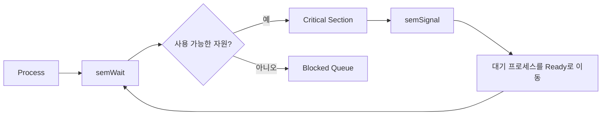
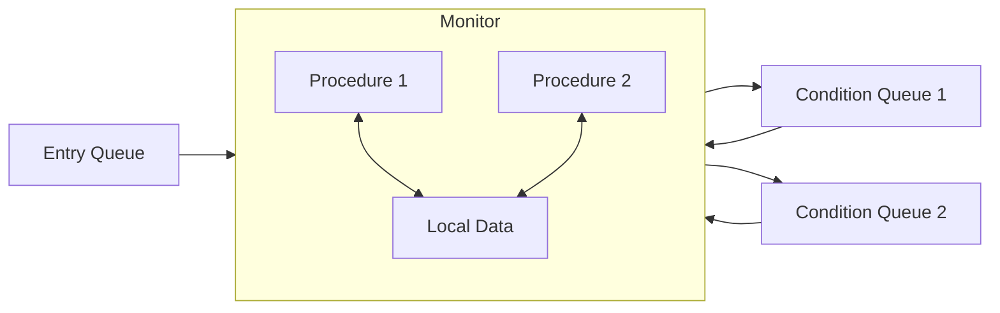
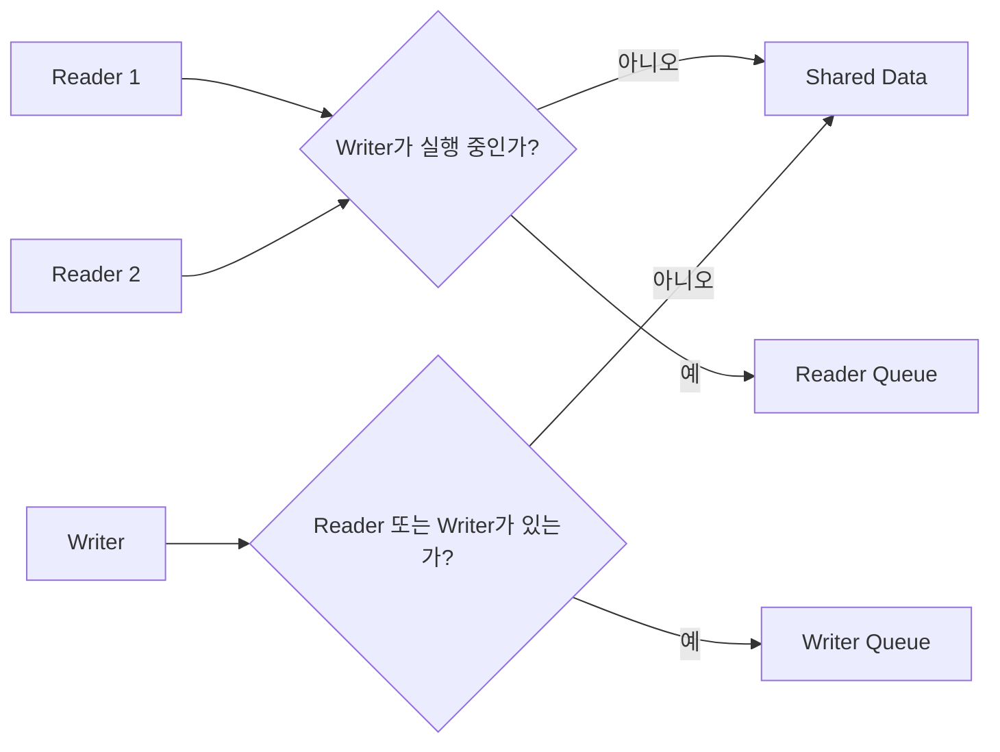

# Semaphore, Monitor와 동기화 문제

<details>
<summary><strong>목차</strong></summary>

- [Semaphore](#section-1)
  - [Strong / Weak Semaphore](#section-2)
  - [Binary Semaphore](#section-3)
  - [Semphore를 이용한 Mutex 구현](#section-4)
- [Producer/Comsumer Problem](#section-5)
  - [Bounded Buffer](#section-6)
  - [Semaphore가 없는 유한 Buffer 통제](#section-7)
  - [Bounded Buffer using Semaphores](#section-8)
- [복습 질문](#section-9)
- [질문1](#section-10)
- [질문2 (+중간고사 팁)](#section-11)
  - [질문2 대답](#section-12)
- [Producer/Consumer의 Semaphore 순서와 Deadlock](#section-13)
- [Monitor](#section-14)
  - [Charateristics](#section-15)
  - [Synchronization](#section-16)
- [Structure of a Monitor](#section-17)
- [Readers/Writers Problem](#section-18)
  - [Semaphore를 이용한 해결](#section-19)
- [복습 질문](#section-20)
- [질문1](#section-21)
  - [질문1 답변](#section-22)
- [질문2](#section-23)
  - [질문2 답변](#section-24)
- [질문3](#section-25)
  - [질문3 답변](#section-26)

</details>


Semaphore와 Monitor의 동작 원리 및 Producer/Consumer, Readers/Writers 문제를 정리합니다.

> 관련 노트: [Concurrency와 Mutual Exclusion](concurrency-and-mutual-exclusion.md) · [Deadlock](deadlocks.md)

<a id="section-1"></a>
## Semaphore

- 세마포어란?
    - OS가 관리하는 구조체 변수
    - 이 변수는 정수 값(Integer Value)과 큐(Queue)를 가지고 있음.
        - 정수 값을 가지는 변수 int count와
        - 프로세스들을 대기시킬 수 있는 줄 Queue로 구성
    - OS에서 관리하는 것이기 때문에 일개 User Process가 관여할 수 없음.
        - Semaphore s 라는 변수가 있다고 하면, s++, s + 5 등의 이런 작업을 할 수 없다는 것
        - Semaphore를 사용하려면 System Call을 호출해야 함.
- 위 HW Instruction의 Busy-Waiting과 Starvation을 해결하기 위한 방법
    - Busy Waiting을 없애는 방법
        - CS에 진입하려고 하는데 이미 CS 내에 다른 프로세스가 진입해있을 때
        - CPU를 계속 차지하는 것이 아닌 이 Process를 Block 시키는 것
    - Starvation을 없애는 방법
        - 위에서 CS 진입 대기를 할 때 Block 시킨 Process들을 Queue에 집어넣어서 대기시키는 것
        - 이제 안에서 CS를 돌리던 누군가가 CS를 나오면, 바로 다시 CS에 진입하는 것이 아닌
        - 대기중인 Queue의 Process가 진입하는 것
- 위 기능들은 Process의 실행상태를 조절하는 것이므로, OS가 제공하는 기능임
    - Process 자체 내 메모리 주소에서 처리하는 것이 아닌
    - OS가 제공하는 변수라는 것
    - 프로그래머가 Shared Memory Segment에 공유 데이터를 올리고, 해당 공유 데이터의 Semaphore를 붙히면, 다른 Process가 접근할 때 Sem를 거쳐가는 것임.
    - 공유 데이터는 Sem를 가질 수 있고, Sem마다 각 Blocked Queue를 가짐.




- Semaphore가 수행하는 작업 3가지
(Semaphore를 다룰 수 있는 System Call 3가지)
    - Initialize()
        - Semaphore의 변수값을 초기화하는 System Call
        - 0보다 크기가 같은, 음수가 아닌 수로 초기화해야 한다.
        - 양수로 초기화하는 것은 충분히 처리할 수 있는 Process의 크기를 말하지만,
        - Sem을 0으로 초기화한다는 뜻은, 아직 작업을 시작할 조건이 되지 않았으므로, 해당 데이터로부터의 프로세스의 접근을 차단하는 의미를 가진다.
            - 위 활용사례는 아래 나올 Producer/Consumer 문제에 나온다.
        - 음수값은 Sem에서 이미 Q에 Process 몇 개있다는 뜻으로 활용되기 때문에
            - 이후 Producer/Consumer 부분에서 왜 오류로 작용하는지가 나온다.
            - 물론 Mutex(Mutual Exclusion) 용도라면 저 음수 초기화가 된 Sem에 의해 Blocked된 프로세스는 영원히 깨어나지 못하는 Deadlock에 걸리게 됨.
    - semWait(semaphore s)
        - Semaphore의 값을 하나 빼는 연산
        - 값을 하나 뺀 결과가 0 또는 그 이상의 양수라면, Blocked되지 않고 그대로 넘어가 실행된다.
        - 값을 하나 뺀 결과가 음수라면, 접근하려했던 프로세스는 Blocked되어 해당 Sem가 관리하는 Q로 들어가게 된다.
    - semSignal(semaphore s)
        - Semaphore의 값을 하나 올리는 연산
        - 값을 하나 더한 결과가 음수 또는 0이라면,
            - 이 Sem가 관리하는 Q에 대기하는 프로세스가 존재하는 뜻이다.
            - 따라서 해당 Q의 맨 앞에 있는 프로세스를 Blocked 상태에서 깨워Ready Q로 보냄.
            - 이후 실행 시점은 OS의 Scheduler가 결정
- 아래 순서는 세마포어 값과 대기 큐의 변화를 설명하기 위한 예시다.
    - Critical Section을 구현하는 실제 흐름과는 다르다.
    - 논리 순서를 보면 일반적인 사용 방식과 차이가 있음을 알 수 있다.
    - 프로세스 A B C는 semWait()만 하는 친구고 프로세스 D는 semSignal()만 하는 친구다.


- 프로세스 A B C D는 전부 공유데이터에 접근해있거나 접근하려는 프로세스
    - 프로세스 A B C는 semWait()만
    - 프로세스 D는 semSignal()만 수행
- s = 1이란 뜻은 현재 하나의 프로세스가 공유데이터에 접근할 수 있다는 뜻
    - A가 semWait()를 이용해 해당 데이터에 접근을 하고, 접근해있던 중 timeout 발생
    - 결과적으로 semWait()에 의해 s = 0, A는 CS에 있던 중 time-out 발생
- s = 0인 상태에서 B가 semWait()을 발생, semWait() 결과로 s = -1이 되므로 B는 해당 Sem의 Blocked Queue로 이동하여 대기
- s = -1인 상태에서 D가 CPU를 할당받고, 공유데이터에 대한 일처리가 끝나면서 semSignal()을 발생, semSignal()이 발생하고 OS가 처리하면서 Blocked Q에 있던 프로세스 B가 Ready Q로 이동
- 이후 D는 time-out으로 다시 Ready Q로 이동, s는 아까 semSignal() 호출했으므로 s = 0
- 다음 순서로 C에 CPU가 할당, C는 공유데이터에 접근하기 위해 semWait() 발생, Blocked Q로 이동  (s = -1)
- Ready Q에 있는 A, B가 순서대로 실행되면서 semWait()을 각각 수행, s = -3
- 다시 D 차례가 돌아오면서 semSignal()을 발생, C가 Ready Q로 넘어가고 s = -2
- 다시 한 번 말하지만, 이 순서는 세마포어 값과 큐 변화를 설명하기 위한 예시일 뿐 일반적인 실제 사용 흐름은 아니다.

<a id="section-2"></a>
### Strong / Weak Semaphore

거의 모든, 대다수의 OS는 Semaphore와 HW Instruction 모두 지원을 한다.

다만, 모든 OS의 Semaphore가 같은 방법으로 구현되어 있지는 않다.

- Strong Semaphore
    - Sem의 Blocked Q에서 대기하는 프로세스들을 FIFO 방식으로 관리하면 Strong Semaphore라고 한다.
        - FIFO : First-in First-out, 먼저 들어온 놈이 먼저 나감
    - 일단 지금 Semaphore 문제들을 해결할 때의 기본적인 포맷이다.
- Weak Semaphore
    - FIFO 방식이 아닌 다른 규칙으로 프로세스를 Blocked Q에서 꺼내는데, 그게 먼저 들어온 프로세스가 먼저 나가는 방식은 아니다.

<a id="section-3"></a>
### Binary Semaphore


- 위에 Strong과 Weak Sem는 일단은 int count 변수로 숫자를 관리한다.
    - 이를 통해 자신의 Q를 보지 않고도 count 변수를 통해
        - 음수라면 자신의 Blocked Q에 몇 개의 프로세스가 대기 중인지,
        - 0 또는 양수라면 자신이 몇 개의 프로세스를 더 보내도 되는지 알 수 있다.
- 하지만  Binary Semaphore는 세마포어의 값이 0 아니면 1 둘 중 한 가지 값만 가진다.
    - semWaitB()를 호출하면
        - sem의 값이 1이라면 값을 0으로 바꾸고 프로세스가 무사히 진입한다.
        - sem의 값이 0이라면 값은 0으로 둔 채, 접근한 프로세스만을 즉시 Blocked Q로 집어넣어 대기시킨다.
    - semSignalB()를 호출하면
        - 여기서 위의 semSignal() 과의 차이점이 들어난다.
        - semSignal()에서는 일단 +1을 하고 음수 또는 0이라면 Blocked Q에 대기중인 프로세스가 있음을 알고 Q에서 프로세스를 꺼내 Ready로 보낼 수 있다.
        - 하지만 semSignalB()에서는 일단 +1을 할 수가 없다.
            - 값을 건드리기 전에 Blocked Q를 먼저 확인하여야 한다.
                - s.queue is empty()가 true라면, Q가 비어있다면 다음 프로세스를 위해 s.value를 1로 바꾸어 Sem을 열어둔다.
                - Q가 비어있지 않다면, s.value를 0으로 내비둬 sem를 잠궈두고, Blocked Q에 있던 프로세스 하나를 꺼내어 Ready Q로 보낸다.
- 주의점
    - 위에 제공되는 semWait이나 semSiganl 같은 코드들은 OS나 Kernel에서 제공하는 system call이기에 ‘이용 가능한 것’ 이지 코드를 수정하거나 할 수 있는 것이 아니다.
    - 자세한 것은 아래 질문2 중간고사 팁 참조

<a id="section-4"></a>
### Semphore를 이용한 Mutex 구현


- Mutex를 구현하기 위해
    - sem의 값을 1로 초기화하고
    - CS 진입 전과 후에 각각 semWait(), semSignal()을 두면 끝이다.
    - 간단함!


- 실행 흐름
    - 프로세스 A, B, C가 CS에 접근하려고 한다면
    - Mutex 구현을 위해 s = 1이고 프로세스의 갯수는 3개(n = 3)인 상황
    - 먼저 도착한 A가 semWait()을 호출, s = 0이 되고 CS에 집근해서 실행
    - 후에 도착한 B가 semWait()을 호출, s = -1이 되고 음수이므로(A가 실행 중에 있음)
        - B는 Sem의 Blocked Q에서 대기
    - 아직도 A는 실행 중, C가 semWait()을 호출하고 s = -2가 되며 B 다음 순번으로 C가 Blocked Q에서 대기
    - A가 CS 내의 코드를 다 실행하고 나오고 semSignal()을 호출
        - s = -1이 되면서 대기중이던 B가 Ready Q로 이동, Scheduler에 의해 Running 상태가 되면 CS에 진입 후 실행
    - A는 이후 자신의 코드 실행(non-CS) B는 CS 내 코드 실행 중, C는 Blocked Q.에서 대기 중
    - B가 semSignal()을 호출하고 s = 0이 되면서 C는 Ready Q로 이동, 이후 똑같이 CS를 수행
    - C가 CS 내 코드를 전부 수행하고 semSignal()을 호출하면서 s = 1로 돌아옴.
        - s가 양수이므로 Blocked Q에 접근하기 않고 그냥 있음.
- 이 Semaphore 솔루션의 장점
    - HW Instr.에 있던 Busy-Waiting과 Starvation이 발생하지 않음
    - Busy-Waiting
        - SemWait()를 호출하는 순간, Sem에서 -1 한 뒤의 값이 0 또는 양수이면 그냥 blocked 없이 지나가고
        - 음수라면 아예 바로 Blocked가 되므로 CPU를 차지할 기회조차 나지 않음
    - Starvation
        - Blocked Q에서 가만히 대기하고 있으면 순차적으로 꺼내줌.
        - 그냥 기다리다 보면 내 차례가 되어있는 것
        - 저 프로세스 A B C 작업 중에 갑자기 프로세스 D가 끼어들어도 semWait()를 하는 순간 Q로 들어가버림.
- 여기까지가 Mutex 동기화의 가장 대표적인 문제인 Critical Section에 대한 검증이다.
- 다음은 동기화의 두 번째 대표 문제인 Producer/Consumer 문제다.

<a id="section-5"></a>
## Producer/Comsumer Problem

- General Situation
    - 어떠한 작업을 하는데, 시스템 내에 Producer들이 여럿있고
        - Producer들이 data를 만들고 buffer에 그 데이터들을 저장함
    - Comsumer들은 그 buffer에 있는 것들을 가져감
    - 오직 한 producer나 comsumer만이 해당 buffer에 접근해야만 함.
- The Problem
    - 상호배제 (Mutual Exclusion)
        - 위에서 말했듯이 한 번에 한 명만 buffer에 접근해야 함.
        - 생산자와 소비자가 동시에 Buffer를 조작하면 데이터의 일관성이 훼손된다.
    - 버퍼 초과 (Overflow)
        - 우리가 사용하는 어떠한 시스템도 무한대의 Buffer는 존재하지 않음.
        - 버퍼가 꽉 차 있을 때 Producer가 데이터를 더 넣으려 하면 논리적 오류가 발생한다.
    - 버퍼 고갈 (Underflow)
        - 버퍼가 비어 있을 때 Consumer가 데이터를 꺼내려 하면 읽을 대상이 없어 오류가 발생한다.
- 위 문제들을 다루는 것
    - Mutex를 다루는 것은 Critial Section 문제다.
    - 버퍼를 꽉차면 Producer가 기다리고 버퍼가 비면 Consumer가 기다라는 문제는
        - Synchronization 문제다. (동기화 문제)
        - 순서를 맞추는 문제다.
    - 이 P/C Problem은 시스템에 있어 굉장히 중요한 문제이다.

<a id="section-6"></a>
### Bounded Buffer


- in과 out이라는 두 개의 인덱스를 사용 중
    - in은 다음번에 데이터를 쓸 위치(해당 위치부터 비어있음)
        - Producer가 Data를 넣을 위치
    - out은 다음번에 데이터를 가져갈 위치(데이터가 들어 있음)
        - Consumer가 Data를 챙겨갈 위치
- a의 상황
    - 2번, 3번, 4번 공간에 데이터가 남아 있는 상황
    - 2번 위치에서 데이터를 가져갈 차례
    - 5번 위치에 데이터를 쓸 차례
- b의 상황
    - 3번 위치에 데이터를 쓸 차례
        - 이미 버퍼의 끝까지 가고 다시 1번 2번 위치에 데이터를 쓰고 3번에 위치한 상황
    - 1, 2, 3, 4 데이터를 다 읽었고, 다음은 5번 위치의 데이터를 읽을 차례

<a id="section-7"></a>
### Semaphore가 없는 유한 Buffer 통제


- in이 가리키는 위치에는 v를 저장함. (Producer)
- out이 가리키는 위치에 있는 데이터를 w에 저장함 (Consumer)
- Buffer가 가득차는 경우는
    - 위의 b 상황에서 3번에 데이터를 쓰고 4번까지 쓰면은 in이 움직이다가 out이 같아지는 포인트가 오게 됨.
- 근데 Buffer가 비는 경우도
    - 위의 a 상황에서  2번, 3번, 4번 데이터를 비우면서 out이 움직이면 in과 같아지는 포인트가 오게 된다.
- 즉, 둘 다 in == out 인 상황이 나와버리는 것이다.
- 그래서 이 코드에서는 produer 부분에서 한 칸을 아예 비워버리기로 함.
    - b 상황에서 3번에 데이터를 쓰고 in이 4번을 가리키게 되면, 그것을 Full 상태로 간주함.
    - 해당 상황에서 4번 공간은 비어두는 판단을 하는 것
- 이제 이거를 Semaphore로 구현할 것임.

<a id="section-8"></a>
### Bounded Buffer using Semaphores

```text
semaphore mutex = 1
semaphore empty = BUFFER_SIZE
semaphore full = 0

producer(item):
    wait(empty)
    wait(mutex)
    append(item)
    signal(mutex)
    signal(full)

consumer():
    wait(full)
    wait(mutex)
    item = take()
    signal(mutex)
    signal(empty)
    return item
```

- 아래 main을 보면은 producer와 consumer를 동시에 실행시킴.
    - 여기서는 producer 하나와 consumer 하나를 실행시키지만,
    - 실제로는 여러 Producer와 여러 Consumer가 같이 작업을 진행함.
    - 물론 1 : m, n : 1, n : m 모든 상황이 나올 수 있음.
- 가장 위에 이 버퍼의 크기를 정함.
- 이 코드의 semaphore는 3개를 사용함.
    - semaphore s : Critical Section을 구현하는 세마포어, 초기값이 1
    - semaphore n : Consumer가 데이터를 읽으러 갈 때, Buffer의 상황을 확인하기 위해 사용하는 세마포어, 초기값은 0
    - semaphore e : Producer를 위한 세마포어, 초기값은 버퍼의 크기
- void producer() 함수
    - 실제로 데이터를 만드는 것
    - 어떤 데이터를 만드는 지는 관심이 없음.
        - 중요한 것이 아니니까 버퍼의 데이터를 쓸 때 동시에 쓰지않게만, 꽉 찬 곳에 쓰지 않게만 조절하면 됨.
    - produce() → 데이터를 만드는 작업(느림)
        - Semaphore를 통과하고(구체적으로는 sem s) 느린 작업을 해버리면은,
        - 해당 작업동안에는 다른 프로세스들은 버퍼에 접근조차 못하고 대기해야 함.
    - semWait(e) → 동기화, Buffer에 빈 공간이 있는지 확인
        - e의 값이 0이라면, 접근한 Producer를 Blocked 시킴(Q에 적재)
        - 이 경우에는 버퍼가 꽉차서 데이터를 쓸 공간이 없음.
    - semWait(s) → Mutex, Buffer 자물쇠 잠금
    - append() → Buffer에 데이터를 저장하는 작업(빠름)
        - 위의 Producer의 두 코드를 뜻함.


    - semSignal(s) → Mutex, Buffer 자물쇠 풀기
    - semSignal(n) → 동기화, Buffer에 데이터가 하나 더 늘었음을 알림
        - 또한 n 세마포어의 Q에서 대기 중이던 Consumer 하나를 Ready Q로 보냄
        - 물론 대기 중이던 Consumer가 있다면.
- void consumer() 함수
    - 데이터를 꺼내는 함수
    - semWait(n) → 동기화, 읽을 데이터가 있는지 확인
        - n 값이 0이라면, 접근한 프로세스를 Blocked 시킴(Q에 적재)
    - semWait(s) → Mutex, Buffer 자물쇠 잠금
    - take() → Buffer에서 데이터를 확보함 (빠른 작업)
        - 위의 Consumer의 두 코드를 뜻함.


    - semSignal(s) → Mutex, Buffer 자물쇠 풀기
    - semSignal(e) → 동기화, Buffer에 빈 공간이 하나 났음을 알림
        - 또한 e 세마포어의 Q에서 대기 중이던 Producer 하나를 Ready Q로 보냄
        - 물론 대기 중이던 Producer가 있다면.
    - consume() → 데이터를 소비하는 작업(느림)
        - 위의 produce()와 같이 sem 내에서 해버리면 Buffer에 다른 프로세스가 그동안 접근을 하지 못하고 대기해야함.

<a id="section-9"></a>
## 복습 질문

목요일 10분대 중간고사 문제

<a id="section-10"></a>
## 질문1

왜 Semaphore에서 count 값의 초기값이 음수이면 안되는가?

- semaphore의 count값은 현재 상태를 나타내는 지표로, 음수일 때는 그 절댓값이 현재 큐에서 대기 중인 프로세스의 수를 의미하기 때문이다.
- 만약 초기값이 음수인 상태에서 semWait()이나 semSignal()을 호출할 경우 문제가 생길 수 있다.
    - semWait() 호출시에는 시스템이 시작하자마자 처음 진입을 시도하는 정상적인 프로세스마저 ‘자원이 부족하다’ 판단하여 Blocked 상태에 빠지게 된다. 그리고 이 Blocked된 프로세스는 다시는 일어날 수 없게될 가능성이 있다.
    - semSignal() 호출시에는  count가 음수인 것을 보고 큐에 대기 중인 프로세스가 있다고 착각하게 된다. 결국 아무도 없는 텅 빈 큐에서 프로세스를 깨우려 시도하고, 이는 시스템에 치명적인 오류를 유발하게 된다.

<a id="section-11"></a>
## 질문2 (+중간고사 팁)

Binary Semaphore 시스템에서는 s.value에 의미를 두는 작업을 할 수 없다.

Counting Sem.는  count 그 자체에 상태 정보가 있지만, Binary Sem.에는 0과 1 밖에 없으니 n개의 프로세스를 다루기 위해서는 어떠한 추가 코드가 필요하다.

- 주의점
    - semWaitB()나 semSignalB() 등의 syscall이던 HW instruction의 C&S Instr.과 Exchange Instr.이던 뭔가 코드를 구성하라고 할 때, 해당 syscall이나 instr. 자체의 코드를 건드는 경우가 있음
    - syscall은 OS에서 제공하는 BlackBox이고, HW instr. 또한 특정 목적에 맞게 컴파일된 명령어이기에 건들 수가 없음.
    - 기본적으로 우리가 이용할 수 있는 거지, 수정할 수 있다는 것이 아님.

<a id="section-12"></a>
### 질문2 대답

Binary Sem만 가지고 n개의 프로세스를 다루기 위해서는 다음과 같은 것들이 필요하다.

- 상태를 기억할 공유 변수
    - 대기 중인 프로세스 수나 남은 자원 수를 카운트할 일반 정수형 변수를 별도로 선언해야 한다.
- 공유 변수를 보호할 Mutex용 Binary Semaphore
    - 위에서 만든 공유 변수에 여러 명이 접근하기 못하게 CS를 설정해주어야 한다.
- if문 판단 로직
    - s.value는 0,1만을 가지기 때문에, 프로세스들은 추가된 공유 변수의 값을 if문으로 직접 확인하여 스스로 Blocked될지 말지를 결정하여야 한다.
- 관련 코드

    ```c
    /* ==========================================================
       [OS 제공 영역 - Black Box]
       절대 내부를 뜯어고치거나 로직을 수정할 수 없는 시스템 콜
    ========================================================== */
    // void semWaitB(binary_semaphore s);
    // void semSignalB(binary_semaphore s);

    /* ==========================================================
       [사용자 정의 영역 - Wrapper 구현]
       블랙박스를 활용하여 n개의 프로세스를 관리하는 Counting Sem. 설계
    ========================================================== */

    // 1. n개의 프로세스를 제어하기 위한 새로운 구조체
    struct counting_semaphore {
        int count;                  // [상태 변수] n개의 자원 여유분 또는 대기자 수를 기록
        binary_semaphore mutex;     // count 변수 접근을 보호할 이진 자물쇠
        binary_semaphore delay;     // 자원이 없을 때 프로세스를 가두는(Block) 이진 대기실
    };

    // 2. 초기화 함수 (초기 가용 자원을 n개로 설정)
    void init_semC(struct counting_semaphore *s, int n) {
        s->count = n;               // n명의 프로세스가 대기 없이 통과할 수 있도록 설정

        // (OS가 제공하는 초기화 함수가 있다고 가정)
        // s->mutex = 1; (자물쇠 열림 상태로 시작)
        // s->delay = 0; (대기실 잠김 상태로 시작)
    }

    // 3. 자원 요청 (semWaitC)
    void semWaitC(struct counting_semaphore *s) {
        semWaitB(s->mutex);         // [블랙박스 호출] count 변수를 만지기 전 상호배제 락 획득

        s->count--;                 // 자원 1개 요청 (n이 깎임)

        if (s->count < 0) {         // n개를 다 써서 자원이 부족하다면 (0 미만)
            semSignalB(s->mutex);   // [블랙박스 호출] ★중요: 남들이 반납할 수 있게 락을 먼저 풀어줌
            semWaitB(s->delay);     // [블랙박스 호출] 자신은 delay 세마포어에 들어가 스스로 Block 됨
        } else {
            semSignalB(s->mutex);   // [블랙박스 호출] 자원이 넉넉했다면 락만 풀고 무사히 CS 진입
        }
    }

    // 4. 자원 반납 (semSignalC)
    void semSignalC(struct counting_semaphore *s) {
        semWaitB(s->mutex);         // [블랙박스 호출] count 변수를 만지기 전 상호배제 락 획득

        s->count++;                 // 다 쓴 자원 1개 반납

        if (s->count <= 0) {        // 나 외에 누군가 delay 대기실에 갇혀있다면
            semSignalB(s->delay);   // [블랙박스 호출] 대기 중인 프로세스 1명을 Wakeup 시킴
        }

        semSignalB(s->mutex);       // [블랙박스 호출] 작업 끝, 락 해제
    }
    ```

<a id="section-13"></a>
## Producer/Consumer의 Semaphore 순서와 Deadlock

Semaphore를 활용한 생산자/소비자 코드에서 wait 순서를 변경할 시 Deadlock이 발생하는 조건


- producer와 consumer 모두 semWait(e) 또는 (n)을 진행하고 semWait(s)를 하는 것을 볼 수 있다.
- 근데 이걸 semWait(s) → (e) / (n) 순서로 접근할 경우, 두 가지 상황에서 Deadlock이 발생한다.
    - 버퍼가 가득 찬 상황(Buffer is Full)
        - 초기 상태 : e = 0, n = sizeofbuffer, s = 1
        - Producer의 Lock 획득(Sem s에 접근)
            - Producer가 semWait(s)를 호출, s를 0으로 만들고 Lock을 획득, 진입
        - Producer의 대기
            - 이어서 Producer가 데이터를 쓰기 위해 semWait(e)를 호출
            - 버퍼에 빈 공간이 없으므로(e = 0), Producer는 Lock을 쥔 채로(s = 0) Sem e의 Blocked Q로 이동, 대기
        - Consumer의 도착 및 대기
            - 데이터를 소비하여 빈 공간을 만들기 위해 Consumer가 실행
            - Consumer는 진입을 위해 semWait(s)를 호출하지만, 생산자가 Lock을 쥔 채(s = 0인 상황) 잠들어 있으므로 Consumer 역시 Sem s의 Blocked Q로 이동, 대기
        - 결과적으로 Producer는 소비자가 데이터를 읽어가 빈 공간을 만들어주기를 기다리고 있고, Consumer는 생산자가 Lock을 풀어주기를 무한히 기다리게 된다.
    - 버퍼가 텅 빈 상황(Buffer is Empty)
        - 초기 상태 : e = sizeofbuffer, n = 0, s = 1
        - Consumer의 Lock 획득(Sem s에 접근)
            - Consumer가 semWait(s)를 호출, s를 0으로 만들고 Lock을 획득, 진입
        - Consumer의 대기
            - 이어서 Consumer가 semWait(n)을 호출
            - 버퍼에 읽을 데이터가 없어(n = 0), Consumer는 Lock을 쥔 채로(s = 0) Sem n의 Blocked Q로 이동, 대기
        - Producer의 도착 및 대기
            - 데이터를 추가하여 버퍼의 공간을 채우기 위해 Producer가 실행
            - Producer는 진입을 위해 semWait(s)를 호출하지만, 소비자가 Lock을 쥔 채(s = 0인 상황) 잠들어 있으므로 Producer 역시 Sem s의 Blocked Q로 이동, 대기
        - 결과적으로 Consumer는 생산자가 데이터를 써서 버퍼를 채워주길 기다리고 있고, Producer는 소비자가 Lock을 풀어주기를 무한히 기다리게 된다.

---

- 6주차 Semaphore 내용(이건 6주차를 볼 것)

<a id="section-14"></a>
## Monitor

- Semaphore의 Deadlock 문제와 안정적이고 더 쉬운 control을 위해 제공되는 programming-language 차원의 구조이다.
    - Semaphore를 잘못 구성하면 문제가 생기기 때문에, Monitor 구조로 더 쉽게 해결하는 느낌
    - 프로그래밍 언어 차원의 구조란, 개발자가 특정 클래스나 함수를 ‘모니터’로 선언하기만 하면, 컴파일러가 알아서 해당 함수 앞뒤로 Mutex를 위한 Lock 획득/반납 코드를 삽입해준다.
    - Semaphore를 직접 다루다가 semWait()이나 semSignal()을 잘못 배치하여 DeadLock 등이 발생하게 될 오류를 원천적으로 차단한다.
        - Monitor 내부에 진입하는 것 자체가 이미 안전한 Mutex 구역에 들어온 것을 보장한다.
- 1개 이상의 Procedure로 구성되어 있고, Initialization Sequence와 Local Data로 구성되어 있다.

<a id="section-15"></a>
### Charateristics

- Local Data 변수들에는 오직 monitor에 의해 접근가능함.
- Process는 이 Procedure들 중 하나를 불러서만 monitor에 들어올 수 있음.
- 한 번에 오직 한 Process만 monitor에서 실행할 수 있음.

<a id="section-16"></a>
### Synchronization

- monitor 내의 condition 변수들을 사용해서 Synchronization을 실현함.
    - 값이 없이 Queue 로만 이루어진 구조체
- Monitor Functions
    - cwait(c)
        - condition c 에서 calling process의 실행을 멈춤
    - csignal(c)
        - 같은 condition에서의 cwait() 이후에 막힌 process의 실행을 재개함.

<a id="section-17"></a>
## Structure of a Monitor



- 흰색 Monitor라고 되어 있는 부분만 Monitor 공간이다.
- Monitor 내부의 Local Data에는 Monitor 내부에서만 접근할 수 있다.
- Monitor 내에는 오직 한 명만 들어갈 수 있다.
- 어떤 프로세스가 모니터 내로 들어가고 싶으면, 모니터 안에 있는 함수를 호출해야 한다.
    - 모니터에 들어가고 싶은 프로세스는 모니터 내의 Function(1번~k번) 중 하나를 호출하면 된다.
    - 1 ~ k번이라고 한 것을 보면 알겠지만, Function == Procedure이다.
        - 전통적인 프로그래밍 언어 구조에서 특정 상태를 변경하거나 작업을 수행하는 코드 블록을 프로시저(Procedure)라고 표현한다.
- Local Data는 공유데이터 일 수도 있고, 버퍼 일 수도 있다. 여기에 접근하는 것은 Procedure에 개발자가 어떻게 정의해놨냐는 거다.
    - A Data에 접근해서 뭔갈 하는 것이 Procedure 1번에 적혀져있다면, 이 작업을 원하는 Process는 1번 Procedure를 호출할 것이다.
    - B Buffer에 접근해서 Producer의 행위를 하는 것이 Procedure 2번이라면, 이 작업을 원하는 Process는 2번 Procedure를 호출할 것이다.
        - 여기서 A가 Monitor 내부의 Procedure 1번을 실행중이라면, 만약 2번 Procedure를 호출한 Process는 우측 상단의 Q of Entering processes에서 대기할 것이다.
    - B Buffer에 접근해서 Consumer의 행위를 하는 것이 Procedure 3번이라면, 이 작업을 원하는 Process는 3번 Procedure를 호출할 것이다.
        - 여기서 B Buffer가 비어있다면, 이 Process는 Condition 2번의 대기 Q에서 대기할 것이다. (Producer는 1번 Condition 변수, Consumer는 2번 Condition 변수로 간다고 가정)
        - 2번 Procedure를 수행한 Process가 지나가고 csignal(c2)를 하게 되면, c2에서 대기중이던 Consumer Process가 작업을 Procedure 3번을 이어서 진행하게 될 것이다.
        - 여기서 Producer Process는 동시성 조정을 위해 Urgent Q로 넘어갈 것이다.
            - 물론 지금은 Consumer/Producer 문제라 Producer가 작업을 끝내고 csignal()을 하지만, 실제로는 코드 중간 어디에서든 csignal()을 할 수 있고, csignal()을 한 즉시 제어권은 호출된 condition Q에 있던 Process로 넘어간다.
- 이 아래가 Monitor를 이용한 Producer/Consumer 문제 해결 방법이다.


- monitor로 boundedbuffer를 선언
- buffer[N]과 nextin, nextout, count는 지역 변수
- notfull과 notempty는 condition var이며, Queue를 가지는 구조체
- append()와 take()는 Monitor의 Procedure


- 위와 이어지는 코드가 아니며, 각각 producer, consumer 프로세스다.
- producer는 append()로 monitor에 접근하는 것을 볼 수 있고
- consumer는 take()로 monitor에 접근하는 것을 볼 수 있다.

<a id="section-18"></a>
## Readers/Writers Problem



- 많은 procees들 사이에서 data area가 공유됨
    - Producer/Consumer 문제는 프로세스들이 Write라는 대등한 작업을 진행하지만, Readers/Writers 문제는 데이터에 접근하는 목적이 다르다.
- 안전한 환경조성
    - reader는 데이터를 일기만 하므로 데이터가 변형되지 않는다.
        - 여러 reader들이 동시에 접근해도 괜찮다.
    - writer는 데이터를 변형하므로 한 번에 한 writer만 가능하다.
        - 즉, Mutex가 철저히 지켜져야 한다.
    - 만약 writing 중이라면, reader의 접근은 불가하다.
        - Writer와 Reader는 동시에 접근할 수 없다.

| 현재 사용자 | 새 Reader | 새 Writer |
| --- | --- | --- |
| 없음 | 진입 가능 | 진입 가능 |
| Reader 1명 이상 | 함께 진입 가능 | 대기 |
| Writer 1명 | 대기 | 대기 |

<a id="section-19"></a>
### Semaphore를 이용한 해결


- int readcount
    - 현재 데이터를 읽고 있거나 읽으려고 시도하는 독자의 수, 초기값 0
- semaphore wsem = 1
    - CS(데이터 영역) 자체를 보호하는 세마포어
    - 작성자는 항상 이 wsem Sem을 통해 진입하며, 첫 번째 독자 일 경우에만 이 세마포어를 확인한다.
    - Writer와 Reader 둘 다 사용한다.
- semaphore x = 1
    - readcount 변수를 여러 독자가 동시에 조작하지 못하게 보호하는 CS 역할
    - 대기 중인 독자들을 줄 세우는 Queue 역할
    - Reader만 사용한다.
- Writer 의 진입 매커니즘
    - semWait(wsem)을 호출하여 Lock을 획득한다.
    - wsem이 1이면 0으로 만들고 진입하여 데이터를 수정한다.
        - semWait()은 count—;를 진행하므로
    - 이미 다른 Writer나 Reader가 wsem을 0이하로 만들었다면, 해당 Writer는 wsem의 Q에서 대기한다.
- Reader의 진입 매커니즘
    - 가장 중요한 상황은, Writer가 이미 데이터를 쓰고 있을 때, 여러 명의 독자가 연달아 도착하는 경우이다.
    - 첫 번째 독자(R1)의 도착 및 Block
        - R1이 semWait(x)를 통과(x는 0이 된다.)
        - readcount를 1 증가시켜 1이 된다.
        - if(readcount == 1) 조건이 참이므로 semWait(wsem)을 호출한다.
        - 현재 작성자가 작업 중이므로 wsem은 0이하다. 따라서 R1은 여기서 Blocked되어 wsem의 Q로 들어가서 대기한다.
    - 두 번째(R2), 세 번째(R3) 독자의 도착 및 Block
        - R2가 도착하여 코드를 시작하고 semWait(x)를 호출한다.
        - R1이 아직 x를 출어주지 않았으므로(x=0), R2는 readcount를 증가시키지도 못하고 즉시 블록되어 x의 Q로 들어간다.(x는 -1이 된다.)
        - R3가 도착해도 마찬가지로 x의 Q에 들어가며, x는 -2가 된다.
    - 작업 완료 후 연쇄적 진입
        - 작성자가 퇴장하며 semSignal(wsem)을 호출한다.
        - wsem 큐에서 대기하던 R1이 깨어난다.
        - R1은 CS에 진입하면서 아까 멈춰있던 코드인 semSignal(x)를 실행한다.
        - 이 신호에 의해 x 큐에서 대기하던 R2가 깨어난다.
        - R2는 readcount를 2로 만들고, if(readcount == 1)이 거짓이므로 wsem 확인을 건너뛴 뒤 semSignal(x)를 실행한다.
        - 이 신호에 의해 R3가 깨어나고 위에서 R2가 한 전철을 그대로 밟는다.

<a id="section-20"></a>
## 복습 질문

<a id="section-21"></a>
## 질문1

Semaphore를 활용한 생산자/소비자 코드에서 wait 순서를 변경할 시 Deadlock이 발생하는 조건

<a id="section-22"></a>
### 질문1 답변

6주차 질문 파트로.

<a id="section-23"></a>
## 질문2

Monitor를 활용한 구현에서 교착 상태(Deadlock)가 발생하지 않는 이유


<a id="section-24"></a>
### 질문2 답변

- cwait() 호출과 Monitor 탈출
    - 프로세스가 Monitor 내부에 진입하여 Local Data를 확인했을 때 작업을 진행할 수 없다면, cwait()을 호출한다.
    - 이 때 Semaphore처럼 그 자리에서 멈춰서 Blocked되는 것이 아닌, 해당하는 Condition Q로 Process가 들어간다.
- Lock의 자동 해제
    - 프로세스가 cwait()을 호출하여 Cond Q로 이동하면, 방금 전까지 점유하고 있던 monitor가 비게 된다.
    - 즉, 자신이 쥐고 있던 Monitor의 Mutex용 Key를 자동으로 풀고 비워주는 것이다.
- 다른 프로세스의 진입 허용
    - Monitor가 비워졌기 때문에, 모니터 밖 Entry Q에서 기다리고 있던 다른 프로세스가 Monitor 안으로 들어와 Procedure를 실행할 수 있게 된다.
- 결론
    - 이 질문2는 앞선 질문1의 문제를 해결하는 방안으로써 존재한다. 질문1에서는 Semaphore가 잘못 작성될 경우 Sem s에서 관리하는 Lock을 그대로 쥐고 Blocked 되지만, Monitor는 자동으로 Mutex용 Lock을 반납함으로써 Deadlock 문제가 발생하지 않는다.

<a id="section-25"></a>
## 질문3

Readers/Writers Problem에서 reader가 우선순위를 가지는 구체적 상황

<a id="section-26"></a>
### 질문3 답변

- 그럼 사실상 reader가 이미 진입해있으면 reader가 우선순위를 갖는 거네?
reader1 이 진입해있고, writer가 왔는데 사용중이니 대기하고,
그 뒤에 writer가 동작하기 전에 reader2가 또 오면 해당 reader2 는 wsem을 안거치고 바로 들어가니까

정확한 분석입니다. 방금 요약하신 내용이 이 알고리즘이 **'독자 우선(Readers-Priority)'**이라고 불리는 핵심 이유입니다.

동작 논리를 단계별로 정리하면 다음과 같습니다.

1. **초기 상태:** 최소 한 명의 독자가 크리티컬 섹션에서 데이터를 읽고 있습니다 (`readcount >= 1`).
2. **작성자 대기:** 작성자가 도착하여 `semWait(wsem)`을 호출하지만, 첫 번째 독자가 이미 락을 걸어두었으므로 큐에서 대기(Block)합니다.
3. **후속 독자 프리패스:** 이 상황에서 새로운 독자가 도착하면, `semWait(x)`를 거쳐 `readcount`를 증가시킵니다. 이때 `readcount`는 2 이상이 되므로, `if (readcount == 1)` 조건을 건너뛰게 됩니다.
4. **작성자 무시:** 즉, 후속 독자는 대기 중인 작성자가 있음에도 불구하고 `wsem`을 확인조차 하지 않고 곧바로 크리티컬 섹션으로 진입하여 기존 독자들과 함께 데이터를 읽습니다.

결과적으로 독자들이 끊임없이 연속해서 도착한다면, 대기 중인 작성자는 영원히 크리티컬 섹션에 진입하지 못하는 **기아(Starvation)** 상태에 빠질 수 있습니다.

시스템의 스케줄링 관점에서 **먼저 도착해서 대기열에 있는 작성자보다 나중에 도착한 독자에게 진입 권한을 지속적으로 먼저 부여**하기 때문에 완벽한 '독자 우선' 구조가 되는 것입니다.
