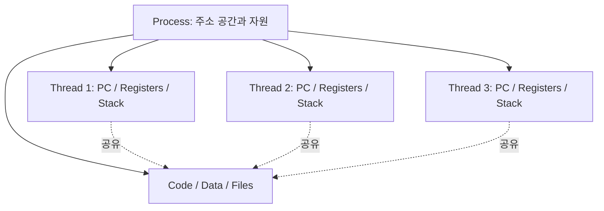
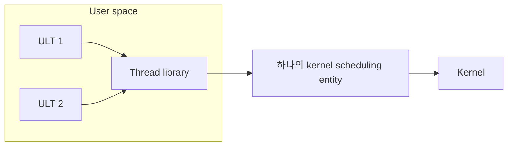
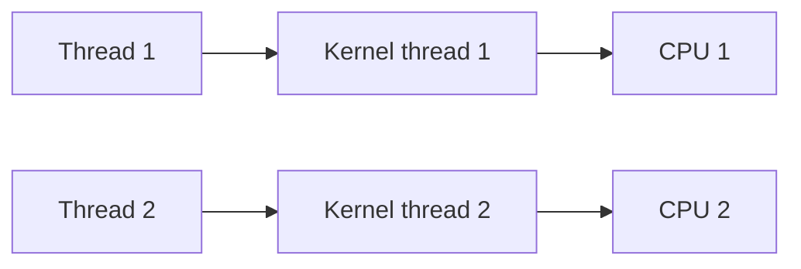
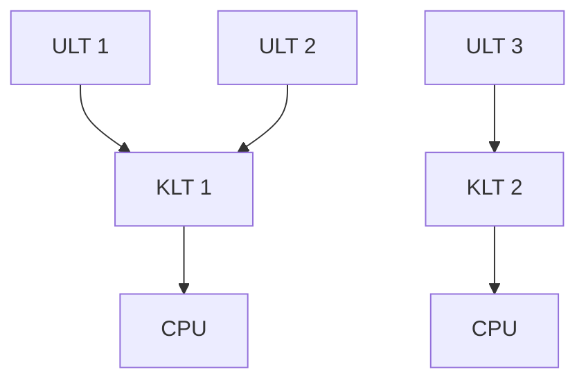
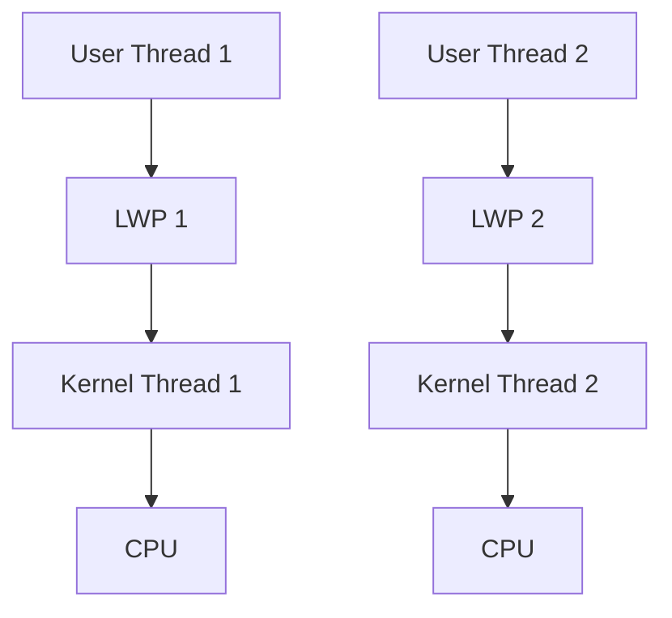

# Thread와 Multithreading

<strong>목차</strong>

- [Process와 Thread](#section-1)
  - [Process 와 Thread](#section-2)
  - [Multi-Threading](#section-3)
- [Thread 사용 예시](#section-4)
- [Thread의 장점](#section-5)
- [Thread States](#section-6)
- [Thread State vs Process State](#section-7)
- [User-Level Threads](#section-8)
- [Kernel-Level Threads](#section-9)
- [User-Level Threads vs Kernel-Level Threads](#section-10)
- [Combined Approaches for Threads](#section-11)
- [Relationship Between Threads and Processes](#section-12)
- [Windows Process and Thread](#section-13)
  - [Windosws의 특징](#section-14)
  - [Windows Process Object Attributes](#section-15)
  - [Windows Thread Object Attributes](#section-16)
  - [Windows에서의 Thread 상태도](#section-17)
- [Solaris Processes and Threads](#section-18)
  - [Solaris의 Process와 Thread 구조](#section-19)
  - [Solaris의 Thread 상태도](#section-20)
- [Linux Tasks](#section-21)
- [Linux의 Thread](#section-22)
- [Linux의 Process/Thread 상태도 (Task 상태도)](#section-23)
- [복습 질문](#section-24)
- [질문 1번](#section-25)
- [핵심 정리](#section-26)
- [추가 질문](#section-27)

Process와 Thread의 차이, Thread 구현 방식과 운영체제별 Thread 모델을 정리합니다.

> 관련 노트: [Process와 Process State](processes.md) · [Concurrency와 Mutual Exclusion](concurrency-and-mutual-exclusion.md)

## Process와 Thread

### Process 와 Thread

- Process
    - 실행/스케쥴링의 단위
    - 자원 소유권 단위
- OS에 의해 위 두 특성이 분리됨
    - Dispatchinig 단위가 Thread(or Lightweight Process)
    - 리소스 할당 단위가 Process (or Task)

### Multi-Threading

- OS는 한 프로세스에서 여러 thread를 실행하는 것을 지원함

- 결론적으로는 Multi-Threading에서의 Process와 Thread를 구분해야함
- Processes
    - 멀티쓰레드 환경에서의 한 Process
        - 자원 할당의 단위이고 Protection의 단위로 관리되는 것으로 정의됨
            - Protection 단위 뜻 : 예를 들어 1번 프로세스가 1천 ~ 2천 번지로 할당을 받으면, 다른 프로세스가 해당 영역으로 접근하지 못하게 하는 것
        - Process Image가 Virutal Address Space를 가짐
            - VAS는 프로그램의 코드, 데이터 영역 가지고 있음.
            - 즉, 전역변수가 Process 단위로 관리됨.
        - Process Control Information에서 자원 관련된 부분(Processor, 다른 Process, 파일, I/O 자원 등)은 여전히 Process 단위로 관리됨.
- Threads
    - 실행 상태를 가짐(running, ready, block 등 swap-out 상태 제외 다른 상태)
    - running 상태가 아닐 때 thread context 정보를 저장함
    - execution stack을 가짐
        - 쓰레드마다 고유의 Stack을 가지면서 아래 지역변수나 Thread Context가 저장됨
    - 지역 변수에 대한 고정된 저장공간(Static Storage)을 각 thread마다 가짐
    - thread가 속한 process의 메모리와 자원에 접근할 수 있음
        - 한 프로세스의 모든 thread들은 위 자원들을 공유함.

- 멀티스레드 환경에서는 PCB와 TCB의 역할을 구분해야 한다.
    - PCB는 프로세스가 소유한 주소 공간과 자원을 관리한다.
    - TCB는 각 스레드의 실행 상태와 문맥을 관리한다.
- Process Identification
    - 이거는 PCB에서, Process 단위로 관리된다.
- Processor State Information
    - 이거는 TCB에서 Thread 단위로 관리된다.
- Process Control Infromation
    - TCB에는 쓰레드의 실행과 상태정보들이 들어있음.
    - PCB에는 자원 할당에 관련된 정보가 들어있음.
    - 이처럼 Process Control Information은 둘로 나뉘어 저장되게 됨.

## Thread 사용 예시

## Thread의 장점

- 사실 child를 2개 만들어서 2개의 Process로 작업을 진행할 수도 있음.
- 왜 Process 대신 Thread를 사용하냐?
    - Process는 너무 무겁다
    - Thread는 stack만 추가로 만들면 된다.
    - Switching할 때도 시간이 적게 걸린다.
        - 같은 프로세스 내에서 1번 Thread에서 2번 Thread로 Switching이 된다면 Process 1번에서 2번으로 Switching하는 것보다 더 빠르다.
    - child process를 만들어서 작업을 하면, child가 작업을 하고 parent에게 전달을 해야함. (중요)
        - 그래서 OS가 중간에 껴서 데이터 전달 작업을 진행해야 함.
        - 근데 Thread를 쓰면 그냥 프로세스 내에서 전역변수로 정보를 던져주면, 다른 thread에서도 이를 확인할 수 있음

## Thread States

- Spawn : Spawn another Thread
- Ready
- Running
- Blocked
- Finish : Deallocate Register Context and Stacks

## Thread State vs Process State

- 몇몇 state들은 Process-Level 개념임
    - process를 suspend한다는 것은, 해당 process의 모든 thread를 suspend 한다는 뜻이다.
    - 왜냐하면 같은 주소공간을 공유하기 때문에
- Process를 종료한다는 것 = 해당 process 내 모든 Thread를 finish해버린다는 것

## User-Level Threads

- User-Level Thread Library의 역할
    - 유저레벨에서 Thread를 관리
        - Thread를 만들고 종료시키고
        - Thread 간에 메세지와 데이터를 전달해주고
        - Thread 실행의 Scheduling을 하는 등의 일을 함.
    - kernel 입장에서는 thread들의 존재를 알 수 없음
        - 그냥 한 process를 실행한다고 생각함
- User-Level Thread의 경우 상태변화 (상태 불일치, State Mismatch 설명)

- 위 ULT에서의 상태변화를 봤을 때,
    - (a) 상태에서는 Process B에서 Running이고 Thread 1이 Ready, Thread 2가 Running 중이다.
    - (b) 상태에서 Process B가 Blocked 상태가 되면서, Thread 1과 Thread 2 모두 ‘마지막 상태 그대로 존재한다.’
        - 왜냐? User-Level에서 Thread가 관리되기 때문에, OS는 Thread의 존재를 알지 못한다. 즉, 그냥 Process만, Thread Library만 중단시켜버렸기 때문에 Thread의 정보를 갱신할 시간이 없었고, 해당 상태가 계속 유지가 되는 것이다.
        - 즉, 상태 불일치, State Mismatch가 발생하게 된다.

## Kernel-Level Threads

- 모든 Thread 작업 관리를 Kernel에서 관리를 함.
- Multi-Processor 환경에서는 동시에 여러 Thread들을 동시에 실행시킬 수 있음
- 한 thread에서 blocked되거나 Time out되어도, kernel은 다른 thread를 할당해줄 수 있음
    - 즉, Thread의 스케쥴링을 ULT와는 다르게 Kernel에서 진행함

## User-Level Threads vs Kernel-Level Threads

- User-Level Threads
    - thread switching이 커널모드 권한을 필요로 하지 않는다.
        - 따라서 Switching 시간이 커널이 작업하는 것보다 짧다.
    - Scheduling이 application에 최적화되어 있다.
    - 어떤 OS에서든 ULTs는 동작할 수 있다.
- Kernel-Level Threads
    - 멀티 프로세서에서 여러 쓰레드들을 동시에 할당할 수 있다.
    - 한 Thread가 Block되어도, 다른 thread를 schedule할 수 있다.
    - Kernel 자체가 multithreaded될 수 있다.

## Combined Approaches for Threads

- KLTs에 Thread Lib.를 이용해 ULTs를 매핑하는 방식으로 혼합 사용하는 방식이다.
- 불필요한 Thread를 만들지 않기 위해, User-Level Thread Lib.에서 정리하여 KLTs로 만든다라고 생각하면 됨.

## Relationship Between Threads and Processes

Threads:Processes / 설명 / 예시

- 1 : 1
    - 한 프로세스 안에 쓰레드 하나, 즉 프로세스 기반 시스템이라는 것
    - Traditional한 Unix 시스템
- M : 1
    - 한 프로세스 안에 여러 쓰레드, 즉 멀티쓰레딩 시스템이라는 것
        - Windows나 Solaris, Linux 시스템 등
- 1 : M
    - 쓰레드가 한 개인데, 여러 프로세스가 있는 것
    - 일반적으로 한 시스템 내에서 이럴 필요는 없음.
    - 이 경우 여러 개의 컴퓨터/시스템이 네트워크로 연결된 경우임
- M : N
    - 위 1:M과 비슷한 경우지만, 여러 쓰레드인 경우

## Windows Process and Thread

### Windosws의 특징

- process와 thread들 모두 Object, 객체로 구현되어 있음.
    - 2장에서 최신 OS 경향으로 Object-Oriented Design을 사용한다고 얘기했었음
- process는 새로운 프로세스가 만들어지기도 하고, 다른 프로세스를 카피해서 만들기도 함
    - 위에 UNIX에서는 프로세스가 무조건 다른 프로세스를 카피해서 만듬
        - 이를 Parent-Child 관계 라고 함
            - Parent 프로세스의 코드를 복제해서 그대로 사용할 수도 있고,
            - 일단 카피해서 만들고 사용할 child 코드를 변경해서 사용할 수 있다.
            - 중요한 것은, 시작점이 ‘복제/카피’를 해서 만든다는 것
    - Windows는 아예 새로 만들기, UNIX 방식 둘 다 사용할 수 있다~
- 실행할 수 있는 Process는 적어도 한 개 이상의 Thread를 가지고 있다.
    - 사실 이건 당연한 건데, 프로세스가 실행을 하려면, 실행 가능한 Stack이 하나는 있어야 함.
    - 그래서 적어도 Thread를 하나를 가지고 시작한다~
    - 그렇게 Thread를 하나 가지고 시작하고, 이 Thread가 여러 개의 Thread를 만들어 내면서 Multi-Threading이 커널레벨에서 지원하게 되는 것
- Thread가 실행의 단위이다.
    - = 위에서 말한 Thread가 커널레벨에서 지원된다.
    - 커널레벨에서 지원되므로, Ready Queue에 Thread가 줄을 선다~
    - 그래서 실행의 단위이고 Dispatch의 단위이다.
- Process와 Thread 모두 여러가지, 레벨별로 동기화 툴을 가지고 있음
    - 프로세스 레벨 동기화
        - a 프로세스의 작업이 끝나고 b 프로세스가 작업을 시작해야 한다 같은 순서를 정하기 위한 툴
    - 쓰레드 레벨 동기화
        - 그 a 프로세스 안에서도 1, 2, 3번 쓰레드가 있을 때, 1번이 끝난 뒤에 2, 3번을 실행하는 등의 순서를 정하는 것이다.

### Windows Process Object Attributes

- Process ID
- Security Descriptor
    - 이 프로세스를 누가 만들었는지(Owner), 누가 실행시키고 있는지, 이 프로세스를 실행시킬 수 있는 사람은 누구누구고 실행시킬 수 없는 사람은 누구누구인지
    - 위와 같이 권한에 대한 정보들을 가지고 있음.
- Base Priority
    - 우선순위는 Scheduling과 연관이 있는 것
        - 스케쥴링은 Thread들이 Ready Queue에 있으면서 OS가 다음에 실행할 Thread를 선택함.
        - 그리고 이 선택은 그냥하는 것이 아닌, 우선순위에 따라서 우선순위가 제일 높은 것을 먼저 실행시킴
        - 그래서 우선순위라고 하는 것은, 실행을 하는 Thread가 가지고 있는 정보처럼 생각 됨.
    - 하지만 여기서는 Process가 Base Priority를 가지고 있는 상황임.
        - 왜 Process가 가지고 있냐?
        - 프로세스는 어떤 일을 하는 프로세스인가에 따라서 기본적으로 가지고 있는 우선순위가 있음.
            - 예를 들어 한 프로세스의 Priority가 5 라고 한다면, 이 프로세스에 속한 Thread들은 5 보다 약간 위아래 정도에서부터 우선순위를 갖고 시작할 수 있다.
            - 즉, 처음부터 굉장히 높은 우선순위를 가질 수는 없다는 것
    - 그래서 Base Priority는 이 Process에 속해 있는 Thread들이 가져야 되는 기본 우선순위를 얘기함.
        - 왜 이렇게 기본 우선순위를 정해두었냐?
            - Windows는 Process 기반의 OS 실행 방식을 가지고 있기 때무에 수많은 OS의 Service Routine들이 전부 별도의 프로세스로 만들어져 있음.
            - Process는 User Process 뿐만 아니라 OS Process도 포함되기 때문에 OS가 어떤 작업을 하느냐에 따라서 또 우선순위가 달라짐.
            - 그래서 System 작업을 하는 Process와 Application Process의 우선순위를 구분해 줘야 되고
            - System 작업을 하는 Process의 경우에도 어떤 시스템 작업을 하냐에 따 우선순위를 다 다르게 줘야 한다.
            - 그래서 Base Priority가 중요하다.
- Default Processor Affinity
    - Windows 시스템은 여러 개의 CPU를 갖는 멀티-프로세서 환경을 고려한 OS이다.
    - 그래서 Processor Affinity란 여러 개의 CPU가 있다고 가정했을 때, ***CPU 선호도***를 말한다.
        - 1~10번 CPU가 있을 때, 나는 3번, 5번, 7번에서 실행을 하면 좋겠다, 이런 느낌으로,
        - ‘실행했으면 좋겠다하는 CPU의 집합’이다.
        - 당연히 진짜로 실행을 하는 게 Process는 아님.
            - 이 Process 입장에서 자기에 속한 Thread들이 몇 번 몇 번 CPU에 가서 일을 했으면 좋겠다라고 Process가 생각하는 디폴트 값인 것
        - 왜 굳이 선호 CPU를 정해야 하는가?
            - Caching(캐싱) 때문이다.
                - 만약 1번 Thread가 3번 cpu에서 작업을 하다가 Time-out으로 인해 Ready Queue로 이동하게 됨.
                - 그리고 다시 Scheduling이 되었는데 5번 cpu로 가라고 함.
                - 문제는 1번 Thread는 3번 cpu에서 작업을 했기에 3번 cpu에 관련 코드들이 캐싱되어있는 상태이며, 5번 cpu로 가서 작업을 한다면 다시 하드디스크까지 갔다오면서 다시 캐싱을 진행해야함.
                - 즉, 캐쉬의 효율성이 확 떨어지고, 사실상 캐쉬를 사용하는 이유가 없어짐.
                - 그래서 차라리 조금 더 기다리더라도 다시 3번 cpu로 가는 것
- Quota Limits
    - 이 프로세스가 사용중인 자원의 최대치를 걸어두는 것
        - CPU는 얼마큼 쓸 수 있고, 메모리는 얼마큼 쓸 수 있으며 그런 것

이 아래의 정보들은 프로세스에 속한 쓰레드들이 실제로 실행을 하면서 사용하는 자원에 대한 정보들이다.

- Exeucution Time
- I/O Counters
- VM Operation Counters
- Exception/Debugging Ports
- Exit Status

### Windows Thread Object Attributes

- Thread ID
- Thread Context (가장 중요한 것)
    - Thread가 실행을 하다가 중단이 되었을 때 CPU 안에 있는 Register 값들을 저장해 놓은 게 Thread Context이다.
    - Thread가 멈추는 그 찰나의 순간에, CPU 내부에 있던 Register 값들과 상태 데이터들이 있는 스냅샷이다.
    - 실질적으로 Thread가 실행을 한다는 것을 알 수 있다.
- Dynamic Priority
    - 아래 Base Priority는 처음 부여받은 우선순위이고, Dynamic Priority는 실제로 실행을 하면서 이 Thread가 어떻게 실행을 하냐에 따라 우선순위를 높이기도 하고 낮추기도 한다.
    - OS 스케줄러가 스레드의 CPU 사용 패턴을 보고 실시간으로 올리거나 내리는 현재의 우선순위이다.
- Base Priority
    - 위의 Process의 Base Priority에서 +-2 정도의 값을 Thread의 Base Priority로 지정한다.
    - Thread가 처음 만들어졌을 때 부여받은 우선순위다.
- Thread Processor Affinity
    - 위에 Process에서는 Thread들이 작업하게 할 CPU의 집합이라고 하면,
    - 여기 Thread에서는 자신(Thread)이 실행한 적 있는 CPU를 선호하는 것이다.
    - 다만, 예를 들어 Process Processor Affinity가 3, 5, 7번 CPU라고 했을 때, Thread가 2번 cpu에서 실행된 적이 있어도 2번 cpu를 선호한다고 적어둘 수 없다.
        - 위의 3, 5, 7번 중에서만 입력이 가능하다.

이 아래 내용들은 이 Thread가 실행을 하면서 필요한 자원이나 상황들을 표시하기 위한 정보들이다.

- Thread Execution Time
- Alert Status
- Suspension Count
- Impersonation Token
- Termination Port
- Thread Exit Status

### Windows에서의 Thread 상태도

- Windows는 Thread의 상태 5개보다 더 많고, New(Spawn) 상태가 없는 것과 마찬가지이기 때문에 Thread의 5 상태에서 새로 추가된 것이 몇가지 있다.

#### Thread 상태 및 상태변화

- Runnable → 실행을 할 수 있거나 실행을 하고 있는 상태
    - Ready
        - Thread가 새로 만들어져 실행을 할 준비가 되어 있는 상태이다.
        - 또한 언제든지 CPU를 주면 실행을 할 수 있는 상태이다.
    - Standby
        - Ready → Running으로 변화할 때, 일반적인 것과는 달리, 한 번에 가는 것이 아닌 Ready → Standby → Running으로 Pick to Run, Switch가 진행된다.
        - Standby 상태는 Ready 상태에 있는 여러 Thread들 중 다음에 실행할 Thread를 선택(Pick to Run) 했을 때 진입하는 상태이다.
        - 왜 이 상태가 존재하냐?
            - Windows는 Multi-Processor 환경을 가진 시스템을 가정하고 만들어졌기 때문이다.
        - 왜 멀티 프로세서 환경에서는 Standby 상태가 존재해야 하는가?
            - 스케줄러가 Thread를 실행하려고 선택한 후, 선택된 Thread가 이전에 멈췄던 지점에의 CPU 레지스터 값(Thread Context)을 복원하는 데는 약간의 시간이 걸리게 된다.
            - 만약 1번 CPU가 Thread A를 선택해서 복원 작업을 하는 틈에, 2번 CPU도 Thread A를 선택해버리면 두 CPU가 동시에 하나의 Thread를 실행하려는 충돌이 발생하게 된다.
        - 그래서 Standby 상태는
            - 1번 CPU가 “내가 지금 이 스레드를 점 찍어놨으니, 다른 CPU는 건드리지 마라.” 라고 표시해 두는 것과 같다.
            - 다른 CPU의 스케줄러는 Standby 상태인 Thread를 제외하고, 순수하게 Ready 상태인 Thread 중에서만 다음 대상을 고르게 된다.
    - Running
        - Standby 상태에서 Thread의 레지스터 값을 CPU에 복원하는 Switch 작업이 모두 완료되면 진입한다.
        - 실제로 CPU를 점유하고 자신의 코드를 실행하는 상태이다.
        - 여기서 Time-out이 된다면 다시 Ready로 돌아가게 된다.
        - Running → Ready를 Preempted라고 하고, 이 PreEmpted는 CPU를 뺏겼음을 의미한다.
            - 이 PreEmpted가 발생하는 경우는 Time-out도 있지만, 다른 경우도 있음
            - 바로 Ready Queue에 더 높은 우선순위의 Thread가 들어올 경우, 기존 실행중이던 Thread는 CPU를 빼앗기게 된다.
                - 왜냐하면 Windows 시스템의 스케쥴러는 항상 우선순위가 가장 높은 스레드를 먼저 실행한다.
                - 시간이 남아도 빼앗기냐? → Yes
- Not Runnable → 실행을 할 수 없는 상태
    - Terminated
        - Exit 상태와 같다.
    - Waiting
        - Blocked 상태와 같다.
        - Running → Waiting으로 변화하면서 Blocked/Suspend 라고 되어있다.
        - 근데 중요한 것은, Thread는 Suspend(Swap Out)가 될 수 없다는 것이다.
            - Process 단위로 Swap Out이 진행된다.
        - 그럼 저 Thread의 Suspend는 뭐냐?
            - System Call이나 동기화 목적으로 Thread가 자기 스스로 또는 Parent가 Suspend를 시킨 상황을 말한다.
            - 즉 이제는 Suspend ≠ Swap out 인 것이다.
        - 어쨌든 Thread 입장에서 보면, Thread 본인이 I/O 작업 때문이든 system call을 사용했던 동기화 때문이던 실행을 못하는 건 다 똑같다.
        - 그래서 위에를 다 묶어서 Waiting 상태로 표현하는 것이다.
    - Transition
        - Waiting → Ready : Unblock/Resume Resource Available
            - Block이 해제되고 Thread가 실행할 수 있는 상태일 때의 변화
            - Thread의 Process가 Memory에 있어 바로 실행가능한 경우
        - Waiting → Transition : Unblock Resource Not Available
            - Block은 해제되지만 Thread가 실행할 수 없는 상태일 때의 변화
            - Thread의 Process가 Swapping Area에 있어 Swap in이 될 때까지 기다려야 하는 경우 (즉, Ready/Suspend 상태)
        - Transition → Ready : Resource Available
        - 위처럼 두 상태(Ready, Transition)가 표현되는 이유
            - Thread 상태 안에 Process의 상태가 살짝 끼어들어가 있는 것
            - 이 Thread 상태도는 ‘Thread 입장’에서 서술되는 것이다.
                - Thread 상태도에는 Process처럼 Swapping Area로 쫓겨나는 suspend 상태가 따로 존재하지 않는다.
                - 그리고 Thread의 상태와 Process의 상태를 별개로 보기 때문에, Thread가 Waiting 상태일 동안, 메모리 부족으로 Process 전체가 Swapping Area로 Swap-out 되더라도 Thread의 상태는 별도로 갱신되지 않고, Waiting으로 유지된다.
                - 이제 block되었던 원인(I/O 작업 같은)이 완료되어 Thread가 깨어날 때(Unblock), 자신의 코드를 실행할 메모리 공간이 없음을 확인하게 된다. (Process가 Swap-Out된 상황)
                - 결과적으로 당장 실행할 수 없으므로, Ready로 직행하지 못하고 Transition 상태로 이동하여 Process가 Memory로 다시 Swap-in 될 때까지 대기한다.
                    - 이것이 독립적인 Thread 상태도에 Process의 자원 상태가 개입하는 지점이다.
                - 자 근데 생각해보면, 위에서 Thread의 상태가 Waiting → Transition 상태로 바뀔 때는, Process가 Blocked/Suspend 상태일 것이기에 Thread 또한 실행하지 못하는 상태이다.
                - 여기서 상태 정보를 바꾸는 것은 Thread가 아닌 OS가 바꿔주는 것이다.
                    - I/O 인터럽트가 발생하면 OS 커널이 개입하고 ISR을 실행한다.
                    - OS는 방금 끝난 I/O 작업이 어떤 Thread가 요청했던 것인지 확인한다. (메인 메모리의 TCB를 뒤져서 해당 스레드를 찾는다)
                    - OS가 해당 Thread를 Waiting에서 깨워주려고(Ready로 보내려고) 부모 Process의 PCB를 확인
                    - 그런데  PCB에 해당 Process의 유저코드가 Swap-out되어 있음을 확인
                    - OS가 당장 CPU를 줘도 실행을 못한다고 판단, OS가 직접 해당 Thread의 TCB 상태 값을 Transition으로 덮어쓴다.

## Solaris Processes and Threads

- Solaris는 Windows와는 달리 Combined Approach를 사용한다.
    - Windows는 Multi-Threading System의 표준을 그래도 따른 정도다.
        - 여기서 이 표준은 Kernel이 Thread의 생성과 Scheduling을 직접 주관하는 Kernel-Level Thread, KLT 모델을 의미한다.
    - 그래서 Windows와 달리 Solaris Thread 모델은 다르다고 얘기하는 것이다.
    - 쨌든 Solaris는 Kernel-Level에서의 Thread 지원도 하고, User-Level Thread 지원도 한다.
        - ULT는 ULT Library에서 관리가 되고, 실제로 커널에는 ULT가 보이지 않는다.
        - 당연히 커널에는 KLT가 존재한다.

### Solaris의 Process와 Thread 구조

- 위의 경우는 2개의 ULTs와 2개의 KLTs가 매핑되어 있는 경우이고,
- Solaris에서는 user thread와 kernel thread 사이의 실행 단위를 LWP라고 표현한다.
- 결론적으론, 이 Process는 2개의 ULT를 가지고 있고, 2개의 User Thread가 2개의 LWP로 매핑되어 커널 레벨에서 관리가 되고 있는 것이다.
    - 그래서 커널에서 이 Process는 몇 개의 LWP가 있냐고라고 하면, 2개라고 대답하는 것이다.
    - 그리고 커널에서 이 Process가 몇 개의 User Thread를 가지고 있냐고 묻는다면, “모른다”라고 말하는 것이다.
- 자 그럼 저 LWP 아래에 망할 Kernel Thread는 뭐냐? 저게 KLT 아니냐? 인데
    - 쉽게 생각해 LWP + Kernel Thread가 결합해서 완벽한 하나의 Kernel-Level Thread를 만든다라고 생각하면 된다.
    - 조금 더 쉽게는, Multi-Threading 환경에서 Process Image를 보면, 프로그램 코드와 데이터 영역이 있고, Thread 쪽에 Stack이 존재한다.
    - Multi-Threading에서의 정보 구성

    - 완전체 Thread 하나 당 Stack 하나랑 TCB 정보를 가지고 있는데,
    - LWP 안에 User Stack이, Kernel Thread 안에 Kernel Stack과 TCB 정보가 들어있다고 생각하면 된다.
        - 모든 Kernel-Level Thread는 Stack과 TCB가 필요하며, Solaris는 이 역할을 LWP와 Kernel Thread 구조로 구분한다. 실제 구현은 더 복잡하다.
- 굳이 LWP와 Kernel Thread를 구분한 이유는?
    - Solaris에서는 시스템 안에서 시스템 작업을 하는 시스템 프로세스들을 LWP와 결합하지 않고 Kernel Thread로만 실행을 시키기 때문
        - 즉 User 측에서 사용할 때는 LWP + Kernel Thread지만, 시스템 안에서만 작업을 하는 프로세스는 LWP를 붙히지 않음.
        - LWP가 없는 채로 그냥 커널 작업만 하는 Thread라고 생각하면 됨.
- 왜 Light Weight Process, Process라고 이름을 붙힌 이유
    - Solaris에서는 Swap-out을 할 때, LWP 단위로 Swap-out을 할 수 있음
    - 앞서 배울 때는 Swap-out은 Process 단위로 실행되지만, Solaris에서는 한 Process에 3개의 LWP가 있다고 했을 때, 그 중 하나의 LWP만을 Swap-out 시킬 수 있다는 것이다.
        - 한 Process에 1번, 2번, 3번 LWP가 있고, 1번과 2번 LWP는 정상 실행 중이고 3번 LWP가 좀 이상한 실행을 하고 있다면,
        - 다른 시스템의 경우에는 전체 프로세스를 Swap-out 시키지만,
        - Solaris 시스템의 경우에는 1, 2번은 냅두고 3번 LWP만 따로 하드디스크로 Swap-out 시켜버린다는 것이다.
    - 가끔씩은 공간이 모자랄 때고 어느 한 Thread만, 어느 한 LWP만 Swap-out하는 경우도 있다.
- Solaris가 이런 시스템을 가진 이유
    - Solaris가 Unix에서부터 발전이 된 시스템이기 때문
    - Unix 기반이면서 Object-Oriented Design으로 변형하다보니 신기한 형태들이 많이 나옴

### Solaris의 Thread 상태도

- State
    - Idle
        - New 상태
        - Thread가 새로 만들어짐
    - Run (착각 주의!)
        - Ready 상태
        - 새로 Thread가 만들어졌으면, 대기하게 됨.  (Idle → Run)
    - OnProc (On Processor)
        - Running 상태
        - Run → OnProc으로 switch () 진행
        - OnProc → Run으로 preempt () 진행
            - Time-out 또는 더 높은 우선순위의 Thread 등장
    - Sleep
        - Blocked 상태
        - OnProc → Sleep으로 syscall () 진행
            - I/O 작업이나 그런 걸로 block됨
        - Sleep → Run으로 wakeup () 진행
            - I/O 작업이 끝나는 등 block 사유가 없어짐
    - Stop
        - Suspend 상태
        - Thread의 상태이므로, 그 Suspend가 Swap-out을 말하는 것이 아님
        - 외부의 요인이나 관리자의 요청으로 인해 Thread 자신과는 무관하게 강제로 멈춰져 있는 것
    - Zombie
        - Exit 상태
        - Unix에서 나온 시스템들은 exit이 아닌 zombie란 말을 씀
    - Free (특이한 놈 1)
        - Free 상태 전 Zombie 상태에서, 프로세스와 스레드 모두 종료해서 할당된 자원을 전부 반납하고 그다음 완전히 종료하여 테이블 엔트리까지 전부 지운 상태가 된다.
            - 그러면 이 Thread 가 시스템에서 사라져야 하는데,
            - 사라지지 않고 Kernel Thread를 삭제하지 않고 남겨둔 상태 (이게 Free 상태)
        - Free 상태는, LWP에 결합되어 있지도, 시스템 작업을 하지도, 그냥 아무하도고 결합되어 있지도 않는 비어 있는 Thread 상태
            - Solaris에서는 이 비어있는 Thread를 삭제하지 않고 그냥 Free 상태로 둠
            - 그리고 Threal Pool이 하나 있어서, 저런 Thread들이 쭉 정렬되어 있음.
        - 왜 이런 상태를 사용하는가?
            - Thread를 생성하고 삭제하는데 시간이 걸림 (정확히는 생성이 오래걸림)
            - 그래서 모양만 남은 Thread들을 가지고 있다가,
            - 새로운 프로그램이 Thread를 만들면, 그때 하나씩 매핑을 시켜주는 개념이다.
            - LWP와 Kernel Thread를 매핑하는 방식이 이런 이유로 사용되는 것 일 수도 있음.
    - Pinned (특이한 놈 2)
        - Running(OnProc)을 하고 있다가, Interrrupt가 걸리면 Pinned 상태가 됨.
        - CPU에 핀을 꽂아두고, 인터럽트 처리를 하고 간다는 느낌
            - 즉, Context Switching이 일어난 것은 아님
            - 대표적으로 I/O interrupt
        - Unix 기반의 Kernel Running 상태와 비슷함.
            - 하지만 Unix SVR4는 Process의 상태를 표현하지만, 여기는 Thread의 상태를 표현함.
            - 실제 커널 코드는 다른 Kernel Thread가 진행을 하고, 현재 실행 중이던 Thread는 Kernel Thread가 실행을 하고 있는 동안 그냥 가만히 있게 됨.
            - Unix SVR4에서 Kernel Running 상태가 유저 프로그램 입장에서는 그냥 자신은 가만히 있는 것으로 인식되듯이, 지금도 그런 경우라는 것

## Linux Tasks

내용적 일관성을 위해 여기에 적음

- Task_struct Data Structure로 대표되는 Linux이며, Process 또는 Task라고 표현됨.
    - State
    - Scheduling Information
    - Identifiers
    - Interprocess Communication (IPC)
    - And others

## Linux의 Thread

- Linux는 thread와 process를 구분하지 않음.
    - Task라고 부르는 이유는, Process이자 Thread 일 수 있기 때문이다.
- User-Level의 Thread가 Kernel-Level의 Process와 매핑됨.
    - 유저 레벨에서는 쓰레드를 만들 수 있고
    - 커널 레벨에서는 프로세스로만 관리됨.
- 새로운 프로세스는 기존의 프로세스를 복사해서 만들어진다.
    - fork () 명령이 있고, clone () 명령이 있다.
        - A Task가 존재한다고 할 때,
        - fork () 명령은 A를 복사해 B Task를 만들어내면서, 완전히 독립적인 Task를 만들어 낸다.
        - clone () 명령은 A를 복사해 C Task를 만들어내면서, Task A의 PCB와 User Address Space, Program Code와 Data 영역, Process Control Information 중 자원 관리 영역들을 Task C가 공유한다.
        - 그리고 이때 Task C는 실행을 위한 별도의 TCB 자료들과 Stack을 가진다.
            - 결과적으로는, Task A, B, C로 Task는 총 3개가 있음.
            - 하지만 Task A와 C를 같이 보면, 2개의 스레드를 갖고 있는 멀티스레드를 지원하는 Process Image와 동일함.

## Linux의 Process/Thread 상태도 (Task 상태도)

- State
    - Ready
        - Task가 실행 가능한 상태
        - 이젠 모르면 안되긴 함.
    - Executing
        - Running 상태
        - Scheduling을 통해 Ready → Executing으로 전환
        - Time-out 또는 더 높은 우선순위의 다른 Task로 인해 CPU를 빼앗길 수 있음.
            - 즉 Pre-Empted로 인해 Executing → Ready
    - Stopped
        - Thread 기반 Suspend 상태
            - 외부의 요인이나 관리자의 요청으로 인해 강제로 멈춰져 있는 상태
    - Zombie
        - Exit 상태
    - Uninterruptible
        - Blocked 상태 1
        - 프로그램이 기다리는 Event가 발생해야지만 Block이 해제됨.
        - 어떨 때 이 상태로 진입하는 가?
            - 조금 복잡한 시스템 콜을 수행하고 있을 때
            - ctrl + C 같은 걸로 함부로 깨우면 안되는 경우일 때
            - 예를 들면, 하드디스크를 직접 읽고 쓰는 Disk I/O 작업같은 거
                - 만약 중간에 강제로 종료되면 파일이 깨질수도 있음
            - 즉, 무결성을 보장해야하는 작업을 수행할 때 uninterruptible에 할당
    - Interruptible
        - Blocked 상태 2
        - 프로그램이 기다리는 Event가 발생하거나 interrupt signal 등으로 깨우면서 Block을 해제할 수 있음.
        - 어떨 때 이 상태로 진입하는 가?
            - 단순 scanf 입력 대기라던가 다른 한 없이 대기해야하는 상황에 유연하게 대처하기 위해 ctrl + C 같은 interrupt signal 같은 거에 반응하도록 상태를 설정한다.

## 복습 질문

## 질문 1번

- Preempted에서 출발하는 화살표는 왜 Kernel Running을 거치지 않고 바로 User Running으로 직행하는가?

PreEmpted 상태와 Ready to Run in Memory 상태는 논리적으로는 동일한 Ready 상태다. (점선 연결)

하지만 이 상태도는 Process의 입장에서 작성됨을 기억해야한다.

- Ready to Run in Memory의 경우
    - 여기서 Ready가 되는 경우는 2가지이다.
        - 하나는 Created(New) 상태의 프로세스이고,
        - 하나는 Asleep in Memory(Blocked)나 Swapped(Suspend) 상태라는 것이다.
    - 그래서 Ready가 되었다한들, 다시 Running을 시작하려면 초기 환경 구축이나 I/O 결과 수령 및 세팅을 하는 등의 OS 권한 작업이 필요하다.
- PreEmpted의 경우
    - PreEmpted 상태는 User Program이 Timer Interrupt에 걸리는 Timer Event의 경우 이동하게 된다.
    - 프로세스 입장에서는, 그냥 잘 작동하다가 Timer에 의해 멈추는 것이다.
    - 그래서 다시 Running을 하게되면, 프로세스입장에서는 기존 실행흐름을 그대로 가져오는 것이기 때문에 Kernel Running 없이 바로 User Running으로 건너뛰는 것이다.
- 그럼 Scheduler나 Dispatcher 작업은 죽쒔냐? 이건 OS가 하는 작업인데, Kernel Running이 아니냐?
    - 위에서 강조한대로 ‘Process’ 기준으로 작성된 것이 이 상태도표다.
    - 따라서 OS 입장에서는 다시 스케쥴링하고 프로세스를 할당하는 작업이겠지만, 프로세스입장에서는 그냥 잠깐 멈췄다가 바로 다시 시작하는 것이다.
    - 그래서 PreEmpted → User Running이 해당하게 된다.

## 핵심 정리

- ULT  라이브러리의 역할
- Windows Standby 상태의 이유
- Windows transition 분기
- Windows PreEmpted의 선점 원리
- Solaris의 특이상태

## 추가 질문

Windows에서 프로세스가 시작될 때, 최소 한 개의 Thread를 가진다고 하고, 그 Thread에서 다른 Thread를 Spawn한다고 했는데, 그럼 시작하는 그 순간에는 무조건 1개의 Thread만 만들어지는 것인지 궁금
