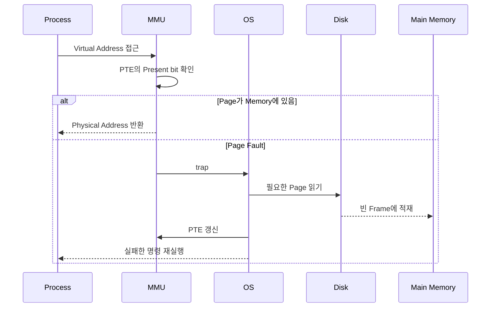
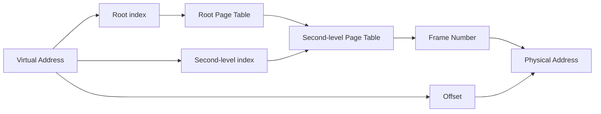
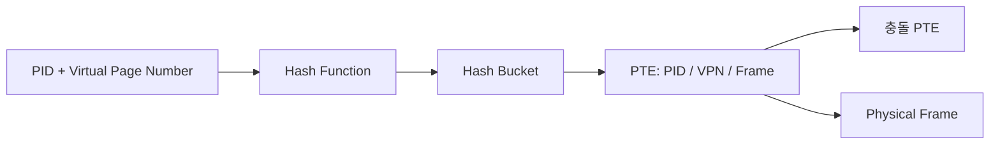
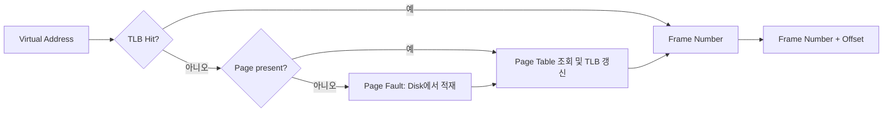
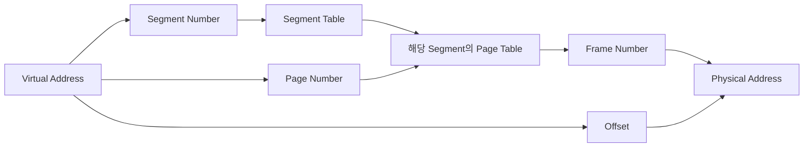
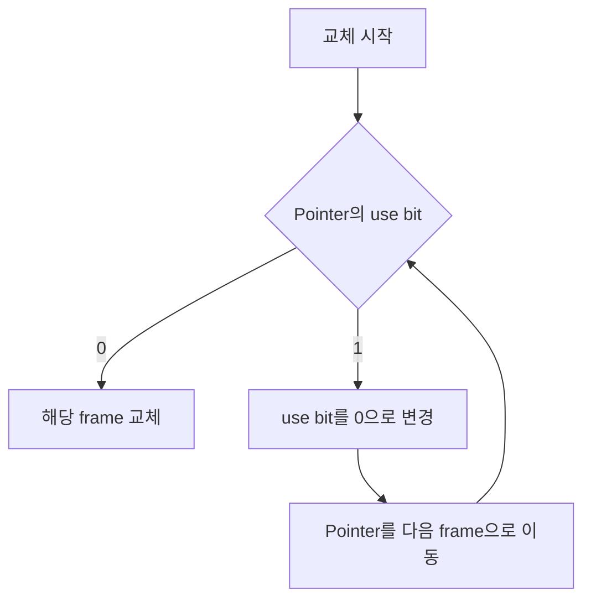

# Virtual Memory

<details>
<summary><strong>목차</strong></summary>

- [Virtual Memory](#section-1)
  - [메모리 타입](#section-2)
  - [Execution of a Program](#section-3)
  - [Thrashing & Locality](#section-4)
- [Virtual Memory 구현 방식 3가지](#section-5)
- [Paging / Page Table Entry(PTE)](#section-6)
- [Page Table Pointer와 단순 Page Relocation](#section-7)
- [Page Table이 너무 커지는 문제](#section-8)
  - [Page Table을 관리하기 위한 Page Table](#section-9)
  - [Two-Lv Page Table에서 Virutal Address가 10/12/12로 나뉘는 이유](#section-10)
- [Inverted Page Table](#section-11)
  - [도입 배경](#section-12)
  - [설명](#section-13)
  - [Inverted Page Table의 장단점과 Hash Function](#section-14)
- [TLB : Translation Lookaside Buffer](#section-15)
  - [TLB가 추가된 주소 변환](#section-16)
- [Page Size 문제](#section-17)
- [Segmentation](#section-18)
- [Segment Table Entries](#section-19)
  - [Segment Tables](#section-20)
  - [Segmentation을 이용한 주소변환](#section-21)
- [Combined Paging and Segmentation](#section-22)
  - [Paging + Segment에서의 주소 변환](#section-23)
- [복습 질문](#section-24)
- [기말 관련 문제](#section-25)
- [Fetch Policy](#section-26)
- [Replacement Policy](#section-27)
  - [Page Fault와 Replacement의 목표](#section-28)
- [Basic Replacement Algorithms](#section-29)
  - [1. Optimal Policy](#section-30)
  - [2. LRU(Least Recently Used)](#section-31)
  - [3. FIFO(First-in, First-out)](#section-32)
  - [4. Clock Policy](#section-33)
- [Resident Set Size](#section-34)
  - [Fixed Allocation/Local Scope](#section-35)
  - [Working Set : Process가 실제로 필요로 하는 Page 수는 계속 변한다.](#section-36)
  - [Variable Allocation](#section-37)
- [UNIX Memory Management](#section-38)
- [UNIX Two-Handed Clock](#section-39)
  - [Page-out List와 Disk I/O를 한꺼번에 처리하는 이유](#section-40)
  - [Two-Handed Clock에서 두 바늘의 속도 조절](#section-41)
- [Windows Memory Management](#section-42)
- [복습 질문](#section-43)
- [Page Fault를 세는 기준으로는](#section-44)
- [강조한 Clock에서의 실수 포인트](#section-45)
- [Replacement policy 비교](#section-46)

</details>


Page Table, TLB, Page Replacement와 운영체제별 Virtual Memory 정책을 정리합니다.

> 관련 노트: [Memory Management](memory-management.md) · [CPU Scheduling](cpu-scheduling.md)

<a id="section-1"></a>
## Virtual Memory

<a id="section-2"></a>
### 메모리 타입

- Real Memory → Main Memory에 있는 거
    - 7장 Real Memory System에서는 프로그램 전체가 메모리에 올라와야 실행할 수 있었다.
    - 프로그램 전체가 연속 공간이든 불연속 공간이든, 어쩄든 코드 전체가 main memory 안에 있어야 했다.
- Virtual Memory
    - Main Memory + Memory in Disk(Swapped Memory)
    - 효율적인 멀티 프로그래밍을 가능하게 함.
    - 프로그램 일부만 메모리에 있어도 실행이 가능하다.
    - 나머지는 disk에 있다가 필요할 때 가져온다.
        - 필요하다면, 한 page로도 프로그램을 구동시킬 수도 있다.

<a id="section-3"></a>
### Execution of a Program



- Virtual Memory에서 프로그램은 처음부터 전체가 올라오지 않는다.
- OS가 필요한 일부 page만 main memory에 올리고 실행한다.
    - 이때 현재 Main Memory에 올라와 있는 process의 일부를 Resident Set이라고 한다.
- 실행 중 필요한  Page가 Main Memory가 없으면 Page Fault가 발생한다.
    - Page Fault는 Process 입장에서 굉장히 큰 사건이다.
    - 필요한 Page가 없으면 Process는 계속 실행할 수 없고 Block된다.
    - OS는 disk에서 해당 Page를 읽어오고, 그동안 다른 Process가 CPU가 사용할 수 있다.
    - disk I/O가 끝나면 interrupt가 발생하고, 해당 Process는 다시 ready state로 돌아간다.
- 정리
    - Process가 Virtual Memory를 참조
    - 해당 Page가 Main Memory에 없음
    - Page Fault Interrupt 발생
    - OS가 Process를 Blocked State로 보냄
    - Disk I/O로 필요한 Page를 읽어옴
    - I/O 작업 동안 다른 Process가 CPU를 차지함
    - I/O 완료 interrupt 발생
    - 기존 Process는 Ready State로 돌아간다.
- Page Fault가 많아진다면
    - 그만큼 Process가 중간중간 block되어 실행이 끊긴다.
    - 그래서 Page Replacement의 목표도 결국 Page Fault 수를 줄이는 것으로 이어진다.

<a id="section-4"></a>
### Thrashing & Locality

- Thrashing
    - Page가 올라왔다 내려가는 작업 때문에 프로그램의 실행보다 해당 작업이 더 오래걸리는 것이다.
        - 예를 들어 thrashing은
        - 필요한 조각이 필요해지기 직전에 swap out 시켜버리고
        - Processor가 user instruction 실행보다 swapping에 대부분 시간을 쓰는 상황이다.
- Principle of Locality (지역성의 원칙)
    - Virtual Memory가 현실적으로 동작하는 이유다.
    - 프로그램이 보통 한 Page에서 한 문장 실행하고 전혀 다른 page로 가는 식으로 작성되지 않는다.
    - 함수와 관련 코드가 근처에 있고, 데이터도 배열이나 구조체처럼 근처에 모이는 경우가 많다.
    - 그래서 page 하나를 가져오면 그 안에서 한동안 실행이 가능하다.
- 교수님의 추가 설명
    - 4kb Page라면 그 안에 꽤 많은 instruction이 들어가고, 그 Page에 대한 Frame 정보를 TLB에 저장해두면 한동안 계속 쓸 수 있다.

<a id="section-5"></a>
## Virtual Memory 구현 방식 3가지

- Paging
- Segmentation
- Segmentation + Paging Combined Approach

실제로 Segmentation만 사용하는 Virtual Memory System은 거의 없다.
이유는 Segmentation이 Dynamic Partitioning과 비슷해져서 비효율적이기 때문
실제로는 Paging System이나 Combined System을 사용한다.

<a id="section-6"></a>
## Paging / Page Table Entry(PTE)

- Paging에서는 Main Memory를 동일한 크기의 Page Frame으로 나누고, 프로그램도 Frame 크기에 맞춰 Page로 나눈다.
    - Page Frame 하나에 들어가기 때문에 External Fragmentation이나 Internal Fragmentation 문제는 거의 없다.
    - 그래서 Paging은 메모리를 효율적으로 관리할 수 있는 방식이다.
- 하지만 Paging에서 Relocation과 Protection을 하려면 Page Table이 필요하다.
- 7장 Real Memory System에서도 Page Table을 사용했지만,
    - 8장 Virtual Memory System에서는 Page가 Memory에 있을 수도 있고 없을 수도 있으므로 Page Table Entry의 정보가 더 많아진다.


- 각 Process는 본인만의 Page Table을 가진다.
    - Virtual Memory에서도 Address는 Virtual Address를 사용하고,
    - 구조는 Logical Address처럼 Page Number + Offset이다.
    - 각 Page Table Entry는 메인 메모리 내의 연관성있는 page의 frame 번호를 적어둔다.
    - 내부 구성요소
        - Presence Bit / P bit
            - 해당 page가 main memory에 있는지 없는지 알려주는 bit
        - Modify Bit / M bit
            - 해당 Page의 변경사항이 있나없나를 알려주는 bit
            - 즉 main memory에 올라온 뒤 수정이 되었는지
            - data가 들어있는 page라면, modify bit가 1일 때 하드디스크 내의 page 또한 바꾸어줘야 한다.
        - Control Bits
            - Page Replacement에 필요한 정보들
        - Frame Number
            - Page가 Main Memory에 있다면 어느 Frame에 있는지

```text
+----------+---------+--------------+--------------+
| Present  | Modify  | Control Bits | Frame Number |
+----------+---------+--------------+--------------+
```

<a id="section-7"></a>
## Page Table Pointer와 단순 Page Relocation


단순히 Page Table Pointer와 Page Number를 더하는 방식은 Page Table이 연속된 한 영역에 있다고 가정한다.
그러나 실제 Page Table은 훨씬 크고 여러 단계로 나뉠 수 있다.

- Page Relocation 순서
    - Virtual Address에서 Page Number를 꺼낸다.
    - 그 Page Number를 이용해 Page Table에서 해당 Entry를 찾는다.
    - 그 Entry에서 Frame Number를 얻는다.
    - Frame Number와 Offset을 붙이면 Physical Address가 된다.
- 식으로 표현하면
    - Virtual Addr = Page Number + Offset
    - Physical Addr - Frame Number + Offset
- 이때 Page Table이 어디 있는지를 알아야 한다.
    - 그래서 Page Table Pointer Register가 필요하다.
    - 이 Register는 현재 Process의 Page Table 시작 주소를 가지고 있다.
    - Process가 실행을 시작할 때 OS가 해당 Process의 Page Table을 Memory로 가져오고,
    - 그 시작주소를 Page Table Pointer에 저장한다.
    - 그러면 Page Table Pointer + Page Number를 통해 원하는 PTE를 찾을 수 있다.
- 하지만 이 방식이 그대로 가능하려면 Page Table이 한 Page에 들어 있어야 한다.
    - 왜냐하면 Page Table Pointer는 Page Table의 시작 주소 하나만 가지고 있는데,
    - Page Table이 여러 Page에 흩어져 있으면 단순히 “시작 주소 + Page Number”로 원하는 PTE를 찾는 것이 의미가 없어질 수 있기 때문이다.
- 실제로는 Page Table이 훨씬 더 크기 때문에, 이 단순 방식만으로는 부족하다.

<a id="section-8"></a>
## Page Table이 너무 커지는 문제

- 전체 Page Table은 메인 메모리의 많은 부분을 잡아먹음
- Page Table 또한 virtual memory에 속해있음
- 프로세스가 실행 중일 때, page table의 일부가 main memory에 존재하게 됨.

<a id="section-9"></a>
### Page Table을 관리하기 위한 Page Table


- Root Page Table은 단 한 개만 존재한다.
- 전체 페이지 테이블의 크기에 따라 2단계 이상으로 구성될 수 있다.
- 구성
    - 프로그램의 최대 크기
        - 4Gb = 2^2 * 2^30 = 2^32
        - 프로그램의 최대 크기가 4GB라는 뜻은 Virtual Address가 32bit라는 뜻이다.
            - 반대로 Virtual Address가 32bit라면 User Addr Space는 4GB이다.
    - 페이지의 크기
        - 4kb = 2^12 bytes
    - 한 프로그램이 포함하는 페이지의 최대 개수
        - 2^32 / 2^12 = 2^20 (개)
    - 페이지 테이블의 한 entry의 크기
        - 4 bytes
    - 전체 페이지 테이블의 최대 크기
        - 4 x 2^20 = 2^22 bytes = 4Mb
        - 최대 페이지 갯수 * PTE의 크기 = 전체 Page Table의 최대 크기
        - 2단계 구조라면 → 루트, 1단, 2단 PT 전부 포함해서 위의 크기라는 것
    - 전체 페이지 테이블(2단계 PT)이 포함하는 페이지의 최대 개수
        - 2^22 / 2^12 = 2^10
    - Root Page Table의 크기
        - 페이지 테이블의 각 페이지가 어디에 있는지 알려주는 페이지 테이블
        - 4 x 2^10 = 2^12
        - 페이지 테이블의 한 Entry 크기 x 하위 페이지의 개수
- Page Size, PTE 크기, Page 개수를 바꿔가며 다단계 Page Table을 구성하는 바업ㅂ을 고민할 것.

<a id="section-10"></a>
### Two-Lv Page Table에서 Virutal Address가 10/12/12로 나뉘는 이유



- 위에서는 32bit Virtual Address와 4kb Page Size를 기준으로 설명이 되어있다.
    - Page Size가 2^12 byte이므로 offset은 12bit 다.
    - 전체 Virtual Address가 32bit이므로, Page Number 부분은
        - 32 - 12 = 20bit이다.
    - 그런데 two-level page table에서는 이 20bit page number를 통째로 쓰지 않고 10bit + 10bit로 나눈다.
        - Virtual Addr = 10 bits + 10 bits + 12 bits
        - 앞 10 bits : root page table에서 entry를 찾기 위한 index
        - 중간 10 bits : 2단계 page table에서 entry를 찾기 위한 index
        - 마지막 12 bits : offset
- 이게 항상 10/10으로 나뉘는 것은 아니다.
    - 3단계면 page number 부분이 세 부분으로 나뉘어야 하고,
    - 4단계면 네 부분으로 나뉘어야 한다.
    - 단계 수 와 page table 페이지 하나에 들어가는 entry 수에 따라 나누는 방식이 달라진다.
- 주소 변환 과정은 다음과 같다.
    - CPU 안의 root page table pointer가 root page table의 시작 주소를 가진다.
    - Virtual Addr의 첫 10bit를 더해 root page table entry를 찾는다.
    - Root PTE에는 Fram Number가 아니라 2단계 Page Table의 시작주소가 들어 있다.
    - 그 시작 주소에 두 번째 10bit를 더해 2단계 PTE를 찾는다.
    - 이 entry에서 실제 page frame number를 얻는다.
    - frame number와 offset 12bit를 붙여 physical address를 만든다.

<a id="section-11"></a>
## Inverted Page Table

<a id="section-12"></a>
### 도입 배경

- Hierarchical Page Table은 큰 Page Table을 다루기 위한 방식이지만,
- 그래도 Process가 많아지면 Page Table이 차지하는 공간이 많아진다.
- 그래서 공간 문제를 해결하기 위해 생각을 바꾼 방식이다.

<a id="section-13"></a>
### 설명




- 일반적인 방식
    - Page Table은 Process마다 있고,
    - Page Number를 index로 해서 frame number를 찾는다.
        - 일반 Page Table :  프로세스의 Page Number → Frame Number
- Inverted Page Table 방식
    - 실제 Physical Memory Frame을 기준으로 테이블을 만든다.
    - Inverted Page Table
        - Frame Number를 index로 사용
        - 각 Entry에는 그 frame에 들어 있는 process/page 정보 저장
- 예시
    - 0번째 entry는 0번 frame에 저장된 process/page 정보
    - k번째 entry는 k번 frame에 저장된 process/page 정보
- 그래서 inverted page table에는 frame number를 저장하지 않는다.
    - 왜냐하면 table index 자체가 frame number이기 때문이다.
- 각 entry에는 다음이 들어간다.
    - Page Number
    - Process ID
    - Control bits
    - Chain Pointer
- Process ID가 필요한 이유는
    - 서로 다른 process가 같은 page number를 가질 수 있기 때문이다.
    - 예를 들어
        - Process A의 page 3과 Process B의 page 3은 page number는 같지만 서로 다른 page다.
        - 그래서 page number만으로는 구분이 안 되고 PID가 같이 필요하다.

<a id="section-14"></a>
### Inverted Page Table의 장단점과 Hash Function

- Inverted Page Table의 장점
    - 공간이 작다는 것이다.
        - 일반 page table은 virtual address space 크기와 process 수에 영향을 받지만,
        - inverted page table은 physical memory frame 수 만큼만 entry가 있다.
        - 즉 memory frame 수에 비례하는 고정된 크기의 table이 된다.
- 단점
    - 검색이 단점이다.
        - 원하는 page가 어떤 frame에 있는지 찾으려면,
        - 나이브하게는 inverted page table의 0번 entry부터 마지막 entry까지 전부 확인해야 한다.
        - 최악의 경우 O(n) = 2^n - 1 이라 너무 비효율적이다.
- 그래서 사용하는 것이 Hash Function이다.
    - page number를 10으로 나눈 나머지 같은 간단한 해쉬 함수가 예시이다.
        - 3, 13, 23, 33,… → 10으로 나누면 전부 나머지는 3이다.
        - 나머지값이 3이라면, 대응될 수 있는 값은 3, 13, 23, 33, … 이다.
    - 같은 hash 값을 갖는 entry들을 linked-list로 연결하고, 이 연결을 따라가기 위해 chain pointer가 필요하다.
    - 여기서 hash function의 return값은 단순히 “나머지 값”이 아니라,
        - 같은 hash 값을 가진 entry들이 연결된 연결리스트의 시작 index라는 점이다.
        - 예를 들어
            - 53번 page를 찾을 때 53 % 10 = 3 이라면,
            - 3을 그대로 frame number로 보는 것이 아니라,
            - hash value 3에 해당하는 chain의 시작 entry로 가서 page number와 PID를 비교하며 따라간다,
            - 찾은 entry의 index가 곧 frame number가 된다.


<a id="section-15"></a>
## TLB : Translation Lookaside Buffer

- 도입 배경
    - Virtual Memory에서는 data나 instruction을 가져오기 전에 page table을 거쳐야 한다.
    - 단순한 1단계 page table이라도 page table을 한 번 익고, 그 다음 실제 data를 읽어야 하므로 memory access가 최소 2배가 된다.
    - Hierarchical Page Table이면 2번, 3번, 4번 더 읽을 수 있고,
    - Inverted Page Table은 몇 번 읽어야 할지 모를 수도 있다.
    - 이런 식이면 프로그램 실행 속도가 2배에서 수십 배까지 느려질 수 있고,
    - 그러면 Virtual Memory System을 실제로 사용하기 어려웠을 것이다.
- 이 문제를 해결하는 것이 TLB, Translation Lookaside Buffer이다.
    - TLB는 최근 사용한 Page Number → Frame Number 정보를 저장하는 Cache다.
        - Page Size가 4kb라면 그 안에 수많은 instruction이 들어 있고,
        - 한 Page에서 한동안 실행할 수 있으므로, “몇 번 Page가 몇 번 frame에 있다”는 정보를 TLB에 한 줄 저장해두면 한참동안 사용할 수 있다.
    - 따라서 page table을 매 instruction마다 찾아가는 것이 아니라,
    - TLB hit가 나면 바로 frame number를 얻을 수 있다.

<a id="section-16"></a>
### TLB가 추가된 주소 변환




- 주소 변환 흐름은 다음과 같다.
    - Virtual Address에서 Page Number를 꺼낸다.
    - 먼저 TLB에서 그 Page Number를 찾는다.
    - TLB Hit
        - Page number → Frame number 정보가 TLB에 있다.
        - Frame number + Offset으로 Physical Addr를 만든다.
    - TLB Miss
        - TLB에 정보가 없는 상황이다.
        - Page Table로 가서 Frame Number를 찾는다.
        - 찾은 정보를 TLB에 저장한다.
        - Frame Number + Offset으로 Physical Addr를 만든다.
    - Page Fault
        - Page Table을 봤는데 Page 자체가 Memory에 없다.
        - Disk에서 Page를 읽어와 Memory에 올린 뒤 다시 작업을 한다.
- TLB는 Associative Memory와 비슷하다.
    - Virtual Memory Reference 하나가 Page Table 접근과 Data 접근으로 두 번의 Physical Memory Access를 유발할 수 있고,
    - 이를 줄이기 위해 최근 사용한 PTE를 저장하는 High-Speed Cache인 TLB를 둔다.

<a id="section-17"></a>
## Page Size 문제

- Paging System에서 또 다른 쟁점이 Page Size다.
    - Page Size는 쉽게 결론이 나지 않는 문제다.
- Page Size가 작으면 Page가 많아지고 Page Table이 커진다.
- Page Size가 크면 한 번에 가져오는 양이 많아져서
    - Locality에 맞으면 좋을 수 있지만,
    - 필요하지 않은 Data까지 같이 올라올 수 있다.
- 그래서 실제 시스템마다 Page Size가 다르며,
    - 4kb ~ 64kb까지 다양하다.
- 시험에서도 Page Size가 바뀌면
    - offset bit 수가 바뀌며
    - page 개수가 바뀌고
    - page table entry 개수가 달라지고
    - page table 크기가 바뀐다.
    - hierarchical page table 단계 수가 바뀔 수 있다.

<a id="section-18"></a>
## Segmentation

- 같은 크기가 아닌, 동적으로 크기를 할당하는 것이다.

<a id="section-19"></a>
## Segment Table Entries


<a id="section-20"></a>
### Segment Tables

<a id="section-21"></a>
### Segmentation을 이용한 주소변환


<a id="section-22"></a>
## Combined Paging and Segmentation



- Paging이 External Fragmentation을 없애주게 된다.


- Combined Approach에서는
    - Virtual Address = Segment Number + Page Number + Offset 로 구성된다.
- 구성
    - 먼저 Segment Table Pointer를 이용해 Segment Table에 접근한다.
    - Segment Number로 해당 Segment Table Entry를 찾는다.
    - 주의할 점은
        - Combined System에서는 Segment가 Memory에 있다/없다라는 말 자체가 의미가 없다.
        - 왜냐하면 Segment 안에 여러 Page가 있고,
        - 각각의 Page가 memory에 있을 수도 있고 없을 수도 있기 때문이다.
    - 그래서 Segment Table Entry에는 Paging System의 P bit, M bit 같은 것이 붙는 방식이 아니라
        - 해당 Segment에 속한 Page 들의 Page Table을 찾아기 위한 정보가 필요하다.
- Segment Base의 의미
    - Segmentation Only에서는
        - Segment Base가 실제 Segment 시작 Physical Address 였다.
    - 하지만 Combined System에서는
        - Segment가 Page들로 나뉘어 있으므로
        - Segment에 속한 Page들의 Page Table 시작 주소에 해당한다.
    - 즉 Segment Table에서 Segment Number로 Entry를 찾고,
        - 그 Entry의 Segment Base를 이용해 해당 Segment의 Page Table로 간다.
        - 그 다음 Page Number로 PTE를 찾고,
        - 거기서 Frame Number를 얻어 Offset을 붙인다.

<a id="section-23"></a>
### Paging + Segment에서의 주소 변환


- 주소 변환 흐름
    - Segment Table Pointer + Segment Number
        - Segment Table Entry 찾기
    - Segment Table Entry의 Segment Base
        - 해당 Segment의 Page Table 시작 주소
    - Segment Base + Page Number
        - Page Table Entry 찾기
    - PTE의 Frame Number + Offset
        - Physical Address 조합
- Segmentation Only에서의 Base/Length와 헷갈리기 쉬우니 주의

<a id="section-24"></a>
## 복습 질문

<a id="section-25"></a>
## 기말 관련 문제

- Page Size, PTE 크기, Page 개수를 바꿔가며 다단계 Page Table을 구성하는 방법을 고민할 것.
- 시험에서 Page Size가 바뀌면
    - offset bit 수가 바뀌며
    - page 개수가 바뀌고
    - page table entry 개수가 달라지고
    - page table 크기가 바뀐다.
    - hierarchical page table 단계 수가 바뀔 수 있다.

---

내용적 일관성을 위해 Fetch Policy부터 가져옴,(11주차 목요일 후반)

<a id="section-26"></a>
## Fetch Policy

- Fetching은 Disk에서 어떤 Page를 Memory로 가져올 것인가의 문제다.
- Demand Paging은 필요한 Page 하나만 가져오는 방식이다.
    - 필요한 Page가 생김 → 그 Page만 Disk에서 읽어옴
- Pre-paging은 필요한 Page를 가져올 때 다음 Page까지 같이 가져오는 방식이다.
    - 필요한 Page가 생김 → 그 page + 다음 page를 같이 읽어옴
- 보이기에는 Pre-Paging이 좋아 보일 수 있다.
    - 프로그램은 보통 Sequential하게 실행되므로, 현재 Page 다음 Page도 곧 필요할 가능성이 있어 보이기 때문이다.
    - 또한 Disk에서 Page를 찾는데 시간이 많이 걸리고,
    - 일단 찾은 뒤 바로 옆 page를 추가로 읽는 것은 시간이 거의 비슷할 수 있다.
    - 그래서 어차피 disk에 간 김에 다음 page까지 같이 읽자는 발상이 나온 것이다.
- 하지만 결론은 Demand Paging이 더 좋다.
    - 왜냐하면 Pre-Paging은 필요없는 page를 미리 가져올 위험이 크다.
    - 다음 page가 바로 쓰일 수도 있지만, 현재 page 안에 loop를 오래 돌 수도 있고,
    - 다음 page가 영영 쓰이지 않을 수도 있다.
    - 심지어 현재 page를 쓰다가 멀리 떨어진 다른 함수로 jump할 수도 있다.
    - 그러면 Pre-Paging으로 가져온 page는 memory만 차지한다.
    - 불필요한 page까지 가져오면 실제 memory 크기가 줄어든 것과 같아진다.
- 그래서 Prepaging은 생각보다 효율적이지 않고, 결국 demand paging을 사용하는 것이 좋다.

<a id="section-27"></a>
## Replacement Policy

- Replacement는 memory에 새 page을 올려야 하는데, 이미 할당된 frame이 꽉 차 있을 때 기존 page 중 무엇을 버릴 것인가의 문제다.
- Fetching과는 다르게 쉽게 결론이 나지 않는 문제다.
    - 그래서 실제 시스템마다 서로 다른 replacement policy를 사용할 수 있다.
- Replacement의 핵심은
    - 앞으로 오랫동안 사용하지 않을 page를 버리는 것이다.
- 그런데 미래를 정확히 알 수는 없다.
    - 그래서 어떤 정보를 저장하고, 어떤 기준으로 page를 버릴지 고민해야 한다.
    - 단, replacement를 잘하려고 정보를 너무 많이 저장하면, Overhead가 커진다.
        - 정보가 하나도 없이 할 수는 없지만, 최소한의 정보로 해결해야 한다.

<a id="section-28"></a>
### Page Fault와 Replacement의 목표

- Replacement를 잘하느냐 못하느냐의 결과는 결국 Page Fault 횟수로 나타난다.
    - 잘못 버리면 곧바로 다시 필요해져서 Page Fault가 발생한다.
    - Page Fault가 발생하면 Process가 Block된다.
    - Page Fault가 세 번 발생했다는 것은 곧 Process가 세 번 Block되었다는 뜻이다.
    - Block되면 그동안 Program은 실행되지 못하고,
        - 따라서 Page Fault가 많을 수록 Program 실행이 중간중간 끊기고 느려진다.
- 그래서 Page Replacement의 성능 평가는 Page Fault 수를 기준으로 한다.

<a id="section-29"></a>
## Basic Replacement Algorithms

기본적으로 총 4개의 Replacement 알고리즘을 다룬다.

- Optimal Policy
- LRU(Least Recently Used)
- FIFO(First-in First-out)
- Clock Policy

<a id="section-30"></a>
### 1. Optimal Policy

- Optimal Replacement는
    - 미래를 모두 알고 있다고 가정하고,
    - 앞으로 가장 오랫동안 사용되지 않을 Page를 버리는 방식이다.
- “미래를 모두 알고 있다 가정”이라는 점에서
    - 실제로는 구현이 불가능하다.
    - 왜냐하면 OS는 프로그램이 앞으로 어떤 page를 어떤 순서로 access할지 알 수 없기 때문이다.
- 그럼에도 optimal을 배우는 이유는 ‘기준점’이 되기 때문이다.
    - 어떤 알고리즘에서 page fault가 5번 발생했다고 했을 때, 그것이 좋은 것인지 나쁜 것인지 바로 알 수 없다.
    - 그런데 optimal이 3번이라면 5번은 optimal보다 2번 더 많은 것이고,
    - optimal보다 작을 수는 없으므로 비교기준이 된다.


<a id="section-31"></a>
### 2. LRU(Least Recently Used)

#### LRU의 기본 아이디어

- Least Recently Used, 말 그대로 가장 오랫동안 사용되지 않은 Page를 버리는 방식이다.
- Optimal은 미래를 보고 앞으로 가장 오래 안 쓸 page를 버리지만, 미래를 볼 수는 없으니 LRU는 과거를 본다.
- 최근에 사용된 Page는 앞으로도 사용될 가능성이 높다라는 가정은 Reference Locality에 근거한다.
    - 프로그램은 지금 사용 중인 Page 안에 필요한 코드나 데이터가 몰려 있을 가능성이 높기 때문에,
    - 방금 쓴 Page는 가까운 미래에도 다시 쓸 가능성이 크다.
    - 반대로 오랫동안 사용되지 않은 Page는 앞으로도 당분간 사용되지 않을 가능성이 높다.
- 그래서 LRU는 다음 원칙을 따른다.
    - 최근 사용된 Page → 유지
    - 가장 오래 사용되지 않은 Page → 교체 대상


#### 예제에서의 LRU 동작

- 처음 2, 3, 2, 1 page를 사용하는 동안 frame이 채워지는 과정이므로 큰 문제없이 진행한다.
- 이후 5번 page가 필요해졌을 때, 현재 memory 안의 page들 중에서 최근 사용 기록을 본다.
    - 그 시점에서 가장 최근에 사용된 것은 1번 page,
    - 그 직전에 사용된 것은 2번 page이고,
    - 3번 page가 가장 오해 사용되지 않은 page다.
- 그래서 LRU는 3번 page를 버리고 5번 page를 가져온다.
    - 이때 page fault가 1회 발생한다.
- 이런 식으로 계산하여 LRU의 Page Fault 수는 4회가 된다.

#### LRU의 장점

- LRU의 장점은 Page Fault 수가 적다는 것이다.
    - Page Fault 수만 놓고 보면 LRU가 Optimal에 가장 가까운 구현 가능 방법이다.

#### LRU의 단점 : 시간적/공간적 Overhead

- 문제는 Overhead다.
- LRU를 정확히 구현하려면 각 Page가 언제 마지막으로 사용되었는지 저장해야 한다.
    - 즉 Page마다 Timestamp나 Counter 같은 정보가 필요하다.
    - Page가 많으면 이 정보를 저장하는 공간 자체가 커진다.
    - 이것이 공간적 Overhead다.
- 또 Page Replacement가 필요할 때, 모든 Page의 마지막 사용 시점을 비교해서 가장 오해 사용되지 않은 Page를 찾아야 한다.
    - 이것이 시간적 Overhead다.
- 그래서 LRU는 Page Fault 수는 좋지만, 시공간적 Overhead가 굉장히 크다.
    - 그래서 실제 시스템에서 LRU를 그대로 쓰는 것을 부담스러워진다.
    - 따라서 LRU에 가까운 효과를 내면서 Overhead를 줄이는 방식이 필요해진다.

<a id="section-32"></a>
### 3. FIFO(First-in, First-out)

#### FIFO의 기본 아이디어

- 앞선 LRU의 Overhead가 너무 크기 때문에, 반대로 시간적/공간적 Overhead를 최소화하는 방식이다.
- FIFO는 Page Frame들을 Circular Buffer처럼 본다.
    - 예를 들어 frame이 3개라면, page 교체 시 아래 순서로 교체한다.
    - 0번 frame → 1번 frame → 2번 frame → 다시 0번 frame → 1번 frame → …
- 즉 어떤 page가 최근에 사용되었는지, 앞으로 필요할 지 전혀 보지 않는다.
- 그냥 포인터가 가리키는 frame을 순서대로 교체한다.


#### FIFO 예시 순서

- 0번 Frame에 2번, 1번 Frame에 3번, 2번 Frame에 1번 페이지가 들어 갔다.
- 5번 Page가 없으므로 Page Fault, 가장 먼저 들어온 2번 페이지 자리에 5번 페이지가 들어온다.
- 다시 2번 페이지가 필요하지만, 방금 버렸다. 그래서 3번 페이지 자리에 2번 페이지를 넣는다.
- 4번 페이지는 없으므로 가장 최근 들어온 1번 페이지를 버리고 그 자리에 4번 페이지를 넣는다.

#### FIFO 장점

- Overhead가 매우 작다는 것이다.
    - 저장해야 하는 정보 : 거의 없음
    - 필요한 정보 : 다음에 교체할 frame을 가리키는 pointer 하나
    - 검색 : 필요 없음
- LRU처럼 page마다 마지막 사용 시간을 저장하지 않아도 되고, replacement 시 전체 page를 비교하지 않아도 된다.
    - FIFO는 시간적/공간적 overhead를 최소화하는 방법이다.

#### FIFO 단점

- 성능이 나쁘다는 점이다.
    - 위의 예제를 보면 FIFO의 Page Fault 수는 6회였다.
    - 그리고 그 이유를 보면 버리자마자 해당 Page가 다시 필요한 경우가 많았다.
- FIFO Anomaly라는 모순이 존재한다.

#### FIFO Anomaly

- FIFO의 또 다른 문제점이다.
- 일반적으로 page frame을 더 많이 주면 page fault 수가 줄어야 할 것 같지만,
    - FIFO의 경우, 어떤 reference string에서는 frame을 더 많이 줬는데도 page fault가 더 늘어날 수 있다.
    - 이것이 FIFO Anomaly다.
- 즉 FIFO는 단순하고 Overhead는 작지만, Page 사용 패턴을 고려하지 않기 때문에 성능이 불안정하다.

<a id="section-33"></a>
### 4. Clock Policy

#### Clock이 나온 배경

- Clock은 LRU와 FIFO의 중간쯤에 있는 방법이다.
    - LRU는 Page Fault 수가 적지만 overhead가 너무 크다
    - FIFO는 overhead가 작지만 Page Fault 수가 많다.
- Clock은 Use Bit 하나와 Pointer 하나를 사용해서 LRU를 어느 정도 흉내내는 방식이다.
- Clock의 Page Fault 수는 FIFO보다 적고 LRU보다 많지만,
    - 성능상으로는 FIFO보다 LRU 쪽에 가깝다.


#### Clock의 자료구조

- Clock에서는 각 Frame/Page마다 use bit를 둔다.
    - use bit = 1  →  최근에 사용된 page
    - use bit = 0  →  최근에 사용되지 않은 page
- 그리고 circular buffer처럼 frame들을 원형으로 보고, 하나의 pointer, 즉 시계 바늘이 현재 검사할 frame을 가리킨다.

#### Clock의 동작 방식




- Clock Replacement는 다음과 같이 동작한다.
    - Page Replacement가 필요해진다.
    - Clock Pointer가 가리키는 Frame의 use bit를 본다.
    - use bit = 0 이면
        - 최근 사용되지 않은 page로 보고 그 page를 교체한다.
    - use bit = 1 이면
        - 최근 사용된 page이므로 바로 버리지 않는다.
        - use bit를 0으로 바꾸고 pointer를 다음 frame으로 이동시킨다.
    - use bit = 0 인 frame을 찾을 때까지 반복한다.
- 즉 use bit가 1인 page에게는 “한 번 더 기회”를 주는 방식이다.
- 그래서 Clock을 Second Chance 알고리즘처럼 이해해도 된다.

#### 강조한 Clock에서의 실수 포인트

- Clock에서 바늘(Pointer)은 언제 움직이는가가 계산 실수의 단골 포인트다.
- Clock Pointer는 Page Replacement를 할 때만 움직인다.
    - 만약 이미 Memory에 있는 Page를 읽었다면, 그것은 Page Hit이다.
    - 이때는 그 Page의 use bit만 1로 바꾸면 된다.
    - pointer는 움직이면 안된다.
- 예제의 경우, 2번 page를 읽은 순서상 3번째 상황에서,
    - 이때는 page 교체가 아니라 이미 memory에 들어 있는 page를 읽는 것이므로
    - use bit만 1로 만들고 바늘은 움직이지 않는다.
    - 여기서 바늘을 움직이면, 뒤의 계산이 전부 틀리게 된다.

<a id="section-34"></a>
## Resident Set Size

- Replacement Alg만 중요한 것이 아니라, 각 Process에게 몇 개의 Page Frame을 줄 것인가도 중요하다.
    - 이것을 Resident Set Size 문제라고 한다.
- Resident Set은 현재 Process의 Page 중 Main Memory에 올라와 있는 Page들의 집합이다.
    - 어떤 Process에게 Frame을 3개 주면 Resident Set Size는 3이고,
    - Frame을 5개 주면 Resident Set Size는 5가 된다.
- 이는 Multi-Programming Level과 연결된다.
    - 전체 Page Frame 수 / Process당 할당 Frame 수
    = 동시에 Memory에 올릴 수 있는 Process 수
    = Multi-Programming Level
- 즉 Process 하나에게 Frame을 너무 많이 주면 Page Fault는 줄 수 있지만, 동시에 실행 가능한 Process 수가 줄어든다.
- 반대로 너무 적게 주면 MultiProgramming Level은 올라가지만 각 Process의 PF가 늘어난다.

<a id="section-35"></a>
### Fixed Allocation/Local Scope

- Fixed Allocation/Local Scope
    - 프로세스마다 고정된 크기의 Page Frame을 할당해 준다.
    - 프로세스의 크기가 작다면 공간이 낭비될 것이고,
    - 프로세스의 크기가 크다면 Page Fault가 자주 발생할 수 있다.

<a id="section-36"></a>
### Working Set : Process가 실제로 필요로 하는 Page 수는 계속 변한다.

- Working Set을 통해 Fixed Allocation이 왜 적절치 않은지를 설명할 수 있다.
- 어떤 Process가 실행된다고 하면,
    - 처음에는  main 함수와 A, B, C 함수 쪽 Page 들이 필요할 수 있다.
    - 그래서 그 Page들이 Memory에 올라오고, 한동안은 그 page들만 가지고 실행된다.
    - 그러다가 A/B/C 함수 실행이 끝나고 D/F/G 함수 쪽으로 넘어가면, 갑자기 D/F/G 관련 Page들이 필요해진다.
        - 이 순간에는 필요한  page 수가 늘어난 것처럼 보인다.
        - 왜냐하면 기존에 쓰던 main + ABC page도 있고, 새로 필요한 DFG page도 들어오기 때문이다.
    - 그러나 시간이 조금 지나면 ABC page는 더 이상 쓰지 않는다는 걸 알게 되고, 필요한 page 집합에서 이탈하게 된다.
    - 그러면 다시 필요한 page 수가 줄어든다.
- 이것을 process가 실행을 계속하면서 필요한 page들이 계속 변한다. 늘어났다 줄어든다고 한다.
- 그래서 이런 구분을 할 수 있다.
    - Resident Set
        - 실제로 지금 main memory에 들어와 있는 page들의 집합
    - Working Set
        - page fault 없이 실행하려면 main memory에 있어야 하는,
        - 지금 현재 실제로 사용하는 page들의 집합
- 이상적인 상태는 resident set이 working set을 따라가는 것이다.
- 그래서 결론은
    - Working Set은 실행 중 계속 변한다.
    - 따라서 Resident Set도 그에 맞춰 변하는 것이 자연스럽다.
    - 그러므로 Fixed Allocation보다는 Variable Allocation이 더 적절하다.

<a id="section-37"></a>
### Variable Allocation

- Variable Allocation
    - Process에게 할당된 page frame 수가 실행 중 늘어날 수도 있고 줄어들 수도 있는 방식이다.
    - Variable Allocation은 두 가지 방식으로 구현할 수 있다.
        - Global Scope
        - Local Scope
    - 여기서 Scope는 Page Replacement를 할 때 어느 범위에서 Victim Page를 고를 것이가를 말한다.

#### Variable Allocation/Global Scope

- Global Scope는 Page Fault가 발생했을 때
    - 반드시 자기 process의 page만 버리는 것이 아닌,
    - System 전체 page 중에서 적절한 page를 골라 버리는 방식이다.
- Clock 방식을 예로 들면은,
    - 어떤 process B가 새 page 727번을 가져오려고 하는데 free frame이 없다고 가정한다.
    - Clock이 System 전체를 돌면서 오래 사용되지 않은 page를 찾았고,
        - 그게 process A의 page 556번 이었다고 하자.
    - 그러면 A의 556번 page를 버리고 B의 727번 page를 가져온다.
- 여기서 중요한 변화는 다음과 같다.
    - A Process의 Resident Set 크기 : 1 감소
    - B Process의 Resident Set 크기 : 1 증가
- 즉, 다른 Process의 page를 버리고 내 page를 가져오면, 다른 process의 resident set은 줄이고 내 resident set은 늘어난다.
    - 이것이 working set 변화와 자연스럽게 맞물린다.
    - 왜냐하면 clock이 버린 page는 오랫동안 사용되지 않은 page다.
    - 그러면 그 page를 가진 process는 지금 그 page를 별로 쓰지 않는 중이고, working set이 줄어드는 중이라고 볼 수 있다.
    - 반대로 새 page를 가져오려는 process는 지금 새로운 page가 계속 필요한 시점이므로 working set이 늘어나는 중이다.
- 그래서 Global Scope에서는 자연스럽게 다음 일이 벌어진다.
    - Working Set이 늘어나는 Process
        - PF 발생 → 새 page를 가져옴 → Resident Set 증가
    - Working Set이 줄어드는 Process
        - 오래 안 쓴 page가 victim이 됨 → Resident Set 감소
- 따라서 Variable Allocation을 Global Scope로 구현하는 것이 “굉장히 자연스러운 방법”이고
    - 실제로 많은 OS에서 사용하는 방식이다.
        - OS는 free frame을 어느 정도 보유하고 있다가, 새 page가 필요하면 free frame을 주고,
        - free frame이 없어지면 기존 process들이 가진 page 중 오래 사용하지 않은 page를 버린다.

#### Variable Allocation/Local Scope

- Local Scope는 PF가 발생했을 때
    - System 전체가 아니라
    - 그 process에게 할당된 frame 안에서만 victim page를 고르는 방식이다.
- Fixed Allocation과 같아보일 수 있지만, Fixed에서는 안하는 작업을 한다.
- Variable Allocation/Local Scope는 주기적으로 Page Fault 수를 측정한다.
    - 일정 시간동안 PF가 너무 많이 발생하면,
        - 그 process의 resident set이 working set보다 너무 작다는 뜻이므로 frame 수를 늘려준다.
    - 반대로 page fault가 거의 발생하지 않으면
        - resident set이 working set보다 너무 클 수도 있으므로 frame 수를 줄인다.
- 그래서 정리하면
    - Page Replacement 자체 : 자기 process의 frame 안에서만 수행
    - Frame 수 조절 : 주기적으로 PF 수를 보고 늘리거나 줄임
    - PF가 너무 많다.
        - Resident Set < Working Set → Frame 수를 늘림
    - PF가 너무 적다
        - Resident Set > Working Set일 가능성 → Frame 수를 줄임

<a id="section-38"></a>
## UNIX Memory Management

- Unix는 두 종류의 Memory Management Mechanism을 사용한다.
- 첫째, 일반 user process를 위해서는
    - page-based virtual memory system을 사용한다.
    - page table을 사용하고, TLB도 사용한다.
    - 8장의 paging 기반 virtual memory를 그대로 사용한다고 보면 된다.
- 둘째, kernel memory allocator는 조금 다르다.
    - kernel을 위해서는 변형된 형태의 buddy system을 사용한다.
    - 7장에 있던 buddy system이 UNIX kernel memory management에 사용되는 방식이다.

<a id="section-39"></a>
## UNIX Two-Handed Clock

- Unix의 page replacement는 그냥 clock이 아니라 two-handed clock이다.
    - clock pointer가 하나가 아니라 두 개다.
- clock 기법의 장점은 LRU보다 overhead가 작다는 점이지만,
    - 일반 clock도 경우에 따라 바늘이 한 바퀴를 다 돌아야 할 수도 있다.
    - 그렇게 되면 교체할 page를 찾는데 드는 시간이 LRU와 비슷해질 수도 있다.
    - 그래서 Unix는 이 search time을 거의 없애기 위해 two-handed clock을 쓴다.


- 동작 설명
    - 첫 번째 바늘은 page frame들을 지나가면서 reference bit를 전부 0으로 만든다.
    - 두 번째 바늘은 그 뒤를 따라가면서 reference bit사 여전히 0인 page를 page-out list에 넣는다.
- 동작의 의미
    - 첫 번째 바늘이 지나간 뒤 두 번째 바늘이 올 때까지도 reference bit가 0이라는 것은
    - 그 시간 동안 그 page가 사용되지 않았다는 뜻이다.
        - 예를 들어 두 바늘 사이 시간 차이가 30분이라면, 두 번째 바늘이 볼 때 여전히 0인 page는 최근 30분 동안 사용되지 않은 page라는 뜻이다.
    - 그래서 이 방식은 LRU와 같은 원칙
        - 즉 최근 사용되지 않은 page를 버린다는 원칙을 사용한다.

<a id="section-40"></a>
### Page-out List와 Disk I/O를 한꺼번에 처리하는 이유

- Two-handed clock은 reference bit가 0인 page들을 page-out list에 넣고, page-out list에 있는 page들을 한꺼번에 disk에 쓴다.
- 여기서 disk I/O의 특성을 알아야 하는데,
    - Disk에 가서 page 하나를 쓰든, 두 page를 쓰든, 10개의 page를 쓰든, 한 번 가서 처리하면 걸리는 시간이 비슷할 수 있다는 것이다.
    - 반면 disk에 10번 따로따로 가면 시간이 10배가 될 수 있다.
- 그래서 UNIX는 page-out list에 버릴 page들을 모아두었다가 한 번에 disk에 반영해서 I/O 비용을 줄인다.
- 그리고 page-out list의 page들이 disk에 반영되면 그 frame들은 free frame이 된다.
- 그러면 나중에 어떤 process가 새 page를 필요로 할 때,
    - victim을 찾으러 clock을 돌릴 필요 없이 이미 준비된 free frame 중 하나를 주면 된다.
- 그래서 two-handed clock은 page replacement 시점의 search time을 거의 0으로 만드는 방식이라고 할 수 있다.
- 즉 Two-Handed Clock의 핵심은 다음과 같다.
    - Reference Bit 기준으로 오래 안 쓴 page를 미리 골라둔다.
        - 고르는 타이밍은 두 번째 바늘이 도착했을 때 Ref Bit가 여전히 0인 경우다.
    - Page-out List에 모아둔다.
    - Disk에 한꺼번에 쓴다.
    - Disk 작업이 완료된 Frame들은 Free Frame으로 미리 만들어둔다.
    - 새 page가 필요하면 search 없이 free frame 을 준다.

<a id="section-41"></a>
### Two-Handed Clock에서 두 바늘의 속도 조절

- Two-Handed Clock에서 특히 강조되는 것은 두 번째 바늘의 속도다.
    - 첫 번째 바늘이 Ref Bit를 0으로 만들고 지나간다.
    - 두 번째 바늘이 너무 빨리 따라가면, page들이 아직 다시 사용될 기회가 거의 없는데 전부 0으로 보일 수 있다.
        - 그러면 너무 많은 page가 page-out list로 들어간다.
    - 반대로 두 번째 바늘이 너무 늦게 따라가면, 대부분 page가 그 사이 다시 사용되어 reference bit가 1이 되어 있을 수 있다.
        - 그러면 page-out list가 너무 적어진다.
- 정리하면
    - 두 번째 바늘이 볼 때 전부 0이다.
    → 너무 빨리 따라가고 있다.
    → 속도를 늦춰야 한다.
    - 두 번쨰 바늘이 볼 때 전부 1이다.
    → 너무 천천히 따라가고 있다.
    → 속도를 빠르게 해야 한다.
- 목표는
    - page-out list가 너무 많지도, 너무 적지도 않은 적절한 길이를 유지하는 것이다.
- 그래야 free frame을 안정적으로 준비하면서도, 아직 쓸 page를 너무 빨리 버리지 않는다.

<a id="section-42"></a>
## Windows Memory Management

- Windows도 동일하게 Page-based Virual Memory System을 사용한다.
- 그러나 Windows는 Variable Allocation/Local Scope를 사용하는 대표적인 시스템이다.
- Windows의 Allocation 방식
    - Windows는 Process를 처음 실행할 때 일정 개수의 page frame을 할당한다.
    - 그다음 주기적으로 page fault 수를 계산한다.
        - PF가 너무 많다. → frame 수를 늘린다.
        - PF가 너무 적다. → frame 수를 줄인다.
    - 이 방식은 working set이 resident set이 되도록 맞추려는 방식이다.
    - Windows가 이것을 Working-Set based Memory Management라고 부른다.
- 정리하면 Windows는
    - Page-based Virtual Memory System을 사용하고
    - Variable Allocation/Local Scope와 Working-set based Memory Management를 사용한다.
- Windows의 실제 Page Replacement는 LRU를 사용한다.
    - 원래 LRU는 시스템 전체에서 가장 오래 사용되지 않은 page를 찾으려면 시간/공간적 오버헤드가 너무 크다.
    - 그런데 Windows는 Local Scope를 사용하므로, System 전체가 아니라 해당 Process에게 할당된 Frame들 안에서만 LRU를 찾으면 된다.
- 더 설명하자면,
    - 자기한테 할당된 page frame은 많아봤자 6-7개 정도이므로
    - 그 중에서 가장 오해 사용되지 않은 page를 찾는 것은 부담이 작다.
    - 또한 정확한 타임스탬프를 전부 저장안하고 사용된 순서 정도만 관리해도 된다.
    - 그래서 Windows는 Local Scope를 이용해 LRU의 Overhead를 줄이면서 LRU의 좋은 성능을 가져가는 방식을 사용한다.

---

<a id="section-43"></a>
## 복습 질문

<a id="section-44"></a>
## Page Fault를 세는 기준으로는

처음 Frame이 비어 있어서 Page를 채우는 부분은 Page Fault 수로 세지 않는 방식이다.

처음 프로그램 실행을 시작했으면 할당된 Page Frame 3개가 찰 때까지는 계속 새로운 Page를 가져와야 하므로 여기까지는 Page Fault라고 세지 않는다고 교수님이 설명했다.

<a id="section-45"></a>
## 강조한 Clock에서의 실수 포인트

- Clock에서 바늘(Pointer)은 언제 움직이는가가 계산 실수의 단골 포인트다.
- Clock Pointer는 Page Replacement를 할 때만 움직인다.
    - 만약 이미 Memory에 있는 Page를 읽었다면, 그것은 Page Hit이다.
    - 이때는 그 Page의 use bit만 1로 바꾸면 된다.
    - pointer는 움직이면 안된다.
- 예제의 경우, 2번 page를 읽은 상황에서,
    - 이때는 page 교체가 아니라 이미 memory에 들어 있는 page를 읽는 것이므로
    - use bit만 1로 만들고 바늘은 움직이지 않는다.
    - 여기서 바늘을 움직이면, 뒤의 계산이 전부 틀리게 된다.

<a id="section-46"></a>
## Replacement policy 비교

교수님 설명 기준으로 네 가지를 비교하면 이렇게 된다.

| Policy | 기준 | 교수님 예제 page fault | 장점 | 단점 |
| --- | --- | --- | --- | --- |
| Optimal | 앞으로 가장 오래 안 쓸 page 제거 | 3 | 이론상 최적 | 미래를 알아야 해서 구현 불가능 |
| LRU | 과거에 가장 오래 안 쓴 page 제거 | 4 | 구현 가능 정책 중 성능 좋음 | 시간/공간 overhead 큼 |
| Clock | use bit와 pointer로 LRU 근사 | 5 | 성능은 LRU에 가깝고 overhead 작음 | LRU보다는 fault 수 많음 |
| FIFO | frame 순서대로 제거 | 6 | overhead 최소 | 성능 나쁨, FIFO anomaly |

교수님 결론은 이거야.

```
Page fault 수만 보면:
Optimal < LRU < Clock < FIFO

현실적 구현까지 고려하면:
LRU 또는 Clock 계열이 많이 쓰인다.
```
